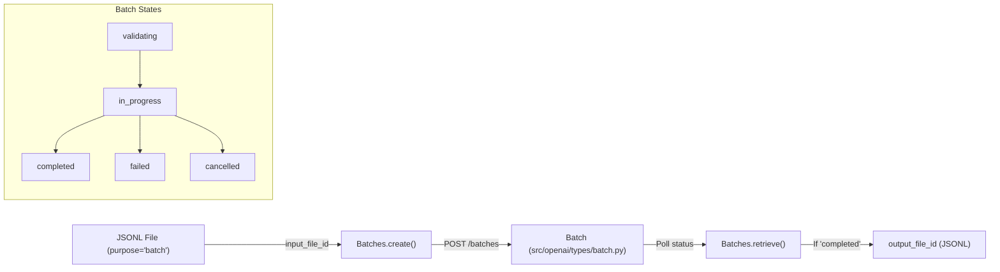

<!-- source: DeepWiki mcp.deepwiki.com · repo openai/openai-python · page 4.8 Additional API Resources · fetched 2026-10-26 -->

# Additional API Resources

<details>
<summary>Relevant source files</summary>

The following files were used as context for generating this wiki page:

- [src/openai/resources/admin/organization/__init__.py](src/openai/resources/admin/organization/__init__.py)
- [src/openai/resources/admin/organization/invites.py](src/openai/resources/admin/organization/invites.py)
- [src/openai/resources/admin/organization/organization.py](src/openai/resources/admin/organization/organization.py)
- [src/openai/resources/admin/organization/projects/__init__.py](src/openai/resources/admin/organization/projects/__init__.py)
- [src/openai/resources/admin/organization/projects/projects.py](src/openai/resources/admin/organization/projects/projects.py)
- [src/openai/resources/admin/organization/projects/spend_alerts.py](src/openai/resources/admin/organization/projects/spend_alerts.py)
- [src/openai/resources/admin/organization/projects/spend_limit.py](src/openai/resources/admin/organization/projects/spend_limit.py)
- [src/openai/resources/admin/organization/spend_alerts.py](src/openai/resources/admin/organization/spend_alerts.py)
- [src/openai/resources/admin/organization/spend_limit.py](src/openai/resources/admin/organization/spend_limit.py)
- [src/openai/resources/batches.py](src/openai/resources/batches.py)
- [src/openai/resources/containers/containers.py](src/openai/resources/containers/containers.py)
- [src/openai/resources/containers/files/files.py](src/openai/resources/containers/files/files.py)
- [src/openai/resources/skills/skills.py](src/openai/resources/skills/skills.py)
- [src/openai/resources/skills/versions/versions.py](src/openai/resources/skills/versions/versions.py)
- [src/openai/resources/uploads/parts.py](src/openai/resources/uploads/parts.py)
- [src/openai/resources/videos.py](src/openai/resources/videos.py)
- [src/openai/types/admin/organization/__init__.py](src/openai/types/admin/organization/__init__.py)
- [src/openai/types/admin/organization/invite_create_params.py](src/openai/types/admin/organization/invite_create_params.py)
- [src/openai/types/admin/organization/organization_spend_limit.py](src/openai/types/admin/organization/organization_spend_limit.py)
- [src/openai/types/admin/organization/organization_spend_limit_deleted.py](src/openai/types/admin/organization/organization_spend_limit_deleted.py)
- [src/openai/types/admin/organization/projects/__init__.py](src/openai/types/admin/organization/projects/__init__.py)
- [src/openai/types/admin/organization/usage_audio_speeches_response.py](src/openai/types/admin/organization/usage_audio_speeches_response.py)
- [src/openai/types/admin/organization/usage_audio_transcriptions_response.py](src/openai/types/admin/organization/usage_audio_transcriptions_response.py)
- [src/openai/types/admin/organization/usage_code_interpreter_sessions_response.py](src/openai/types/admin/organization/usage_code_interpreter_sessions_response.py)
- [src/openai/types/admin/organization/usage_completions_response.py](src/openai/types/admin/organization/usage_completions_response.py)
- [src/openai/types/admin/organization/usage_costs_response.py](src/openai/types/admin/organization/usage_costs_response.py)
- [src/openai/types/admin/organization/usage_embeddings_response.py](src/openai/types/admin/organization/usage_embeddings_response.py)
- [src/openai/types/admin/organization/usage_images_response.py](src/openai/types/admin/organization/usage_images_response.py)
- [src/openai/types/admin/organization/usage_moderations_response.py](src/openai/types/admin/organization/usage_moderations_response.py)
- [src/openai/types/admin/organization/usage_vector_stores_response.py](src/openai/types/admin/organization/usage_vector_stores_response.py)
- [src/openai/types/batch.py](src/openai/types/batch.py)
- [src/openai/types/batch_create_params.py](src/openai/types/batch_create_params.py)
- [src/openai/types/batch_list_params.py](src/openai/types/batch_list_params.py)
- [src/openai/types/container_create_params.py](src/openai/types/container_create_params.py)
- [src/openai/types/container_create_response.py](src/openai/types/container_create_response.py)
- [src/openai/types/container_list_params.py](src/openai/types/container_list_params.py)
- [src/openai/types/container_list_response.py](src/openai/types/container_list_response.py)
- [src/openai/types/container_retrieve_response.py](src/openai/types/container_retrieve_response.py)
- [src/openai/types/eval_create_params.py](src/openai/types/eval_create_params.py)
- [src/openai/types/evals/create_eval_completions_run_data_source.py](src/openai/types/evals/create_eval_completions_run_data_source.py)
- [src/openai/types/evals/create_eval_completions_run_data_source_param.py](src/openai/types/evals/create_eval_completions_run_data_source_param.py)
- [src/openai/types/evals/run_cancel_response.py](src/openai/types/evals/run_cancel_response.py)
- [src/openai/types/evals/run_create_params.py](src/openai/types/evals/run_create_params.py)
- [src/openai/types/evals/run_create_response.py](src/openai/types/evals/run_create_response.py)
- [src/openai/types/evals/run_list_response.py](src/openai/types/evals/run_list_response.py)
- [src/openai/types/evals/run_retrieve_response.py](src/openai/types/evals/run_retrieve_response.py)
- [src/openai/types/graders/score_model_grader.py](src/openai/types/graders/score_model_grader.py)
- [src/openai/types/graders/score_model_grader_param.py](src/openai/types/graders/score_model_grader_param.py)
- [src/openai/types/moderation.py](src/openai/types/moderation.py)
- [src/openai/types/moderation_create_params.py](src/openai/types/moderation_create_params.py)
- [src/openai/types/moderation_image_url_input_param.py](src/openai/types/moderation_image_url_input_param.py)
- [src/openai/types/moderation_model.py](src/openai/types/moderation_model.py)
- [src/openai/types/moderation_multi_modal_input_param.py](src/openai/types/moderation_multi_modal_input_param.py)
- [src/openai/types/moderation_text_input_param.py](src/openai/types/moderation_text_input_param.py)
- [src/openai/types/responses/response_function_shell_tool_call_output.py](src/openai/types/responses/response_function_shell_tool_call_output.py)
- [src/openai/types/video_create_params.py](src/openai/types/video_create_params.py)
- [tests/api_resources/admin/organization/projects/test_spend_alerts.py](tests/api_resources/admin/organization/projects/test_spend_alerts.py)
- [tests/api_resources/admin/organization/test_spend_alerts.py](tests/api_resources/admin/organization/test_spend_alerts.py)
- [tests/api_resources/test_batches.py](tests/api_resources/test_batches.py)
- [tests/api_resources/test_containers.py](tests/api_resources/test_containers.py)
- [tests/api_resources/test_videos.py](tests/api_resources/test_videos.py)

</details>


This page documents API resources that provide supporting functionality for the OpenAI SDK. These include model introspection, content moderation, batch processing, video generation, evaluation tools, skills management, and administrative organization management.

For conversational AI, see [Chat Completions API](#4.1) and [Responses API](#4.2). For specialized features, see [Assistants API (Beta)](#4.3), [Fine-Tuning API](#4.4), [Embeddings and Vector Stores](#4.5), [File Management and Uploads](#4.6), and [Audio, Images, and Video APIs](#4.7).

## Resource Overview

The SDK exposes these additional API resources through the main client:

| Resource | Purpose | Client Access |
|----------|---------|---------------|
| **Models** | Retrieve model metadata, list available models, delete fine-tuned models | `client.models` |
| **Moderations** | Classify text and images for policy violations | `client.moderations` |
| **Batches** | Process large volumes of requests asynchronously | `client.batches` |
| **Videos** | Create and manage high-fidelity video generation jobs | `client.videos` |
| **Evals** | Create and run evaluations to benchmark model performance | `client.beta.evals` |
| **Skills** | Manage reusable model capabilities and tool definitions | `client.beta.skills` |
| **Containers** | Manage containerized environments and associated files | `client.beta.containers` |
| **Admin** | Manage organization-level usage, costs, and project resources | `client.admin` |

**Sources:** [src/openai/resources/batches.py:25-26](), [src/openai/resources/videos.py:49-50](), [src/openai/resources/skills/skills.py:1-15](), [src/openai/resources/containers/containers.py:1-15]()

## Models API

The Models API provides introspection capabilities for available models and management of fine-tuned models.

### Resource Structure

```mermaid
graph TB
    ["OpenAI Client"] -- "client.models" --> ModelsResource["Models (src/openai/resources/models.py)"]
    ModelsResource -- "retrieve(model)" --> Model["Model (src/openai/types/model.py)"]
    ModelsResource -- "list()" --> Model
    ModelsResource -- "delete(model)" --> ModelDeleted["ModelDeleted (src/openai/types/model_deleted.py)"]
    
    Model --> ID["id: str"]
    Model --> Created["created: int"]
    Model --> OwnedBy["owned_by: str"]
    
    ModelDeleted --> DeletedID["id: str"]
    ModelDeleted --> Deleted["deleted: bool"]
```

**Sources:** [src/openai/resources/models.py:49-110](), [src/openai/types/model.py:7-15]()

### Methods
- **Retrieve Model Information**: Retrieves metadata for a specific model using `client.models.retrieve(model_id)`. [src/openai/resources/models.py:84-100]()
- **List Available Models**: Retrieves all models available to the API key. Returns a `SyncPage[Model]` with standard pagination support. [src/openai/resources/models.py:102-110]()
- **Delete Fine-Tuned Models**: Deletes a fine-tuned model owned by your organization using `client.models.delete(model_id)`. [src/openai/resources/models.py:61-82]()

---

## Moderations API

The Moderations API classifies content for policy violations across multiple categories. It supports text, image, and multi-modal inputs. [src/openai/types/moderation.py:1-181]()

### Content Categories
The API evaluates content across categories such as `harassment`, `hate`, `self-harm`, `sexual`, and `violence`. Scores and flagged statuses are provided per category. [src/openai/types/moderation.py:13-91]()

### Request and Response
The `Moderations.create()` method accepts `input` which can be a string or a list of multi-modal objects. [src/openai/types/moderation_create_params.py:13-30]()

The response `Moderation` object contains:
- `flagged`: Boolean indicating if content violates policies. [src/openai/types/moderation.py:193-193]()
- `categories`: `Categories` model mapping category names to booleans. [src/openai/types/moderation.py:182-183]()
- `category_scores`: `CategoryScores` model mapping category names to confidence scores. [src/openai/types/moderation.py:190-191]()
- `category_applied_input_types`: Specifies if the score applies to `text` or `image`. [src/openai/types/moderation.py:185-188]()

**Sources:** [src/openai/types/moderation.py:13-193](), [src/openai/types/moderation_create_params.py:13-30]()

---

## Batches API

The Batches API processes large volumes of requests asynchronously. This is cost-effective for non-time-sensitive workloads (24-hour turnaround). [src/openai/resources/batches.py:25-26]()

### Batch Data Flow



**Sources:** [src/openai/types/batch.py:7-110](), [src/openai/resources/batches.py:47-133]()

### Usage
- **Create**: `client.batches.create()` requires `completion_window` (currently only `24h`), an `endpoint` (e.g., `/v1/chat/completions`), and an `input_file_id`. [src/openai/resources/batches.py:47-133]()
- **Supported Endpoints**: Includes `/v1/responses`, `/v1/chat/completions`, `/v1/embeddings`, `/v1/completions`, `/v1/moderations`, `/v1/images/generations`, `/v1/images/edits`, and `/v1/videos`. [src/openai/types/batch_create_params.py:20-31]()
- **Monitor**: `client.batches.retrieve(batch_id)` returns the current status and `request_counts`. [src/openai/resources/batches.py:135-170]()
- **Cancel**: `client.batches.cancel(batch_id)` stops an in-progress batch. [src/openai/resources/batches.py:204-226]()

---

## Videos API

The Videos API handles high-fidelity video generation jobs, supporting models like `sora-2` and `sora-2-pro`. [src/openai/resources/videos.py:49-50](), [src/openai/resources/videos.py:92-93]()

### Key Methods
- **`create()`**: Initiates a video generation job from a `prompt`. Supports optional `input_reference` for assets, `seconds` (4, 8, 12), and `size` (resolution). [src/openai/resources/videos.py:69-135]()
- **`create_and_poll()`**: Convenience method that initiates the job and blocks until completion. [src/openai/resources/videos.py:137-170]()
- **`poll()`**: Wait for a specific `video_id` to reach a terminal state, using `X-Stainless-Poll-Helper` headers. [src/openai/resources/videos.py:171-205]()

**Sources:** [src/openai/resources/videos.py:69-205](), [src/openai/types/video_create_params.py:13-30]()

---

## Evals API (Beta)

The Evals API facilitates benchmarking model performance by creating evaluation groups and running them against specific data sources. [src/openai/types/eval_create_params.py:38-43]()

### Evaluation Components
- **Data Source**: Configured via `DataSourceConfig`. Supports `custom` (JSON schema), `logs` (metadata filters), and `stored_completions`. [src/openai/types/eval_create_params.py:67-111]()
- **Testing Criteria**: A list of graders. Supported graders include `LabelModel`, `TextSimilarity`, `Python`, and `ScoreModel`. [src/openai/types/eval_create_params.py:45-51](), [src/openai/types/eval_create_params.py:189-203]()
- **Runs**: Execution of evaluations via `client.beta.evals.runs.create()`. Supports `ReasoningEffort` for `o-series` models. [src/openai/types/evals/run_create_params.py:42-59](), [src/openai/types/evals/run_create_params.py:118-127]()

**Sources:** [src/openai/types/eval_create_params.py:38-111](), [src/openai/types/evals/run_create_params.py:42-146]()

---

## Admin and Organization API

The Admin API provides organization-level management for auditing, usage tracking, and project resource constraints.

### Audit Logs
The `client.admin.organization.audit_logs.list()` method retrieves a history of actions performed within the organization. [src/openai/resources/admin/organization/audit_logs.py:1-20]()
- **Actors**: Tracks if an action was performed by a `session` (user) or an `api_key`. [src/openai/types/admin/organization/audit_log_list_response.py:147-158]()
- **Events**: Logs events like `api_key.created`, `project.updated`, `user.added`, and `invite.sent`. [src/openai/types/admin/organization/audit_log_list_response.py:18-90]()

### Usage and Costs
Detailed usage metrics and cost tracking are available via specialized response models:
- **Completions**: `UsageCompletionsResponse` [src/openai/types/admin/organization/usage_completions_response.py:1-10]()
- **Costs**: `UsageCostsResponse` [src/openai/types/admin/organization/usage_costs_response.py:1-10]()
- **Other Metrics**: Includes `embeddings`, `images`, `moderations`, `vector_stores`, and `audio` (speech/transcription). [src/openai/types/admin/organization/usage_embeddings_response.py:1-10](), [src/openai/types/admin/organization/usage_audio_transcriptions_response.py:1-10]()

### Organization Management
- **Projects**: Manage isolated environments within an organization via `client.admin.organization.projects`. [src/openai/resources/admin/organization/projects/projects.py:1-20]()
- **Invites**: Manage user invitations via `client.admin.organization.invites`. [src/openai/resources/admin/organization/invites.py:1-10]()
- **Spend Alerts/Limits**: Configure alerts and limits for budget management. [src/openai/resources/admin/organization/spend_alerts.py:1-10](), [src/openai/resources/admin/organization/spend_limit.py:1-10]()

**Sources:** [src/openai/resources/admin/organization/audit_logs.py:1-20](), [src/openai/types/admin/organization/__init__.py:1-82](), [src/openai/resources/admin/organization/projects/projects.py:1-20]()

---

