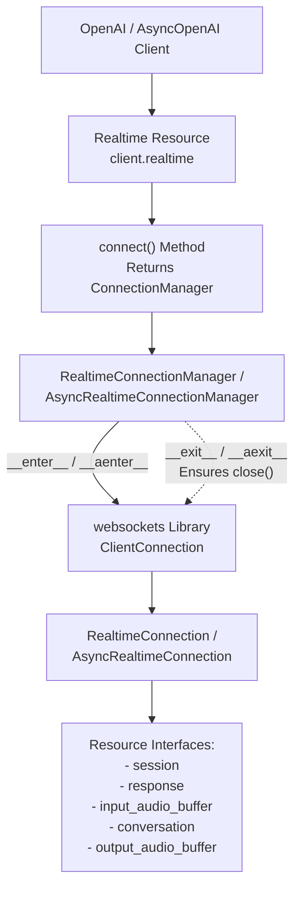
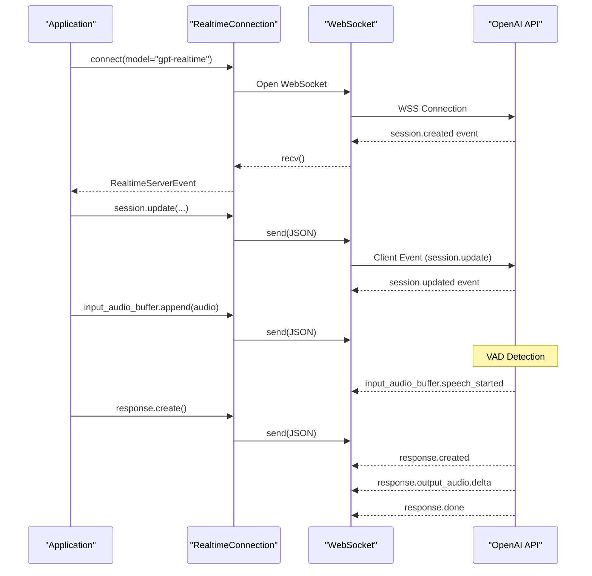
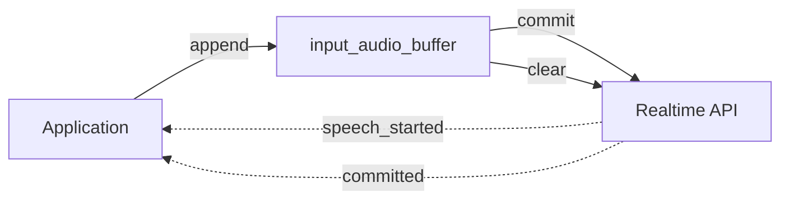
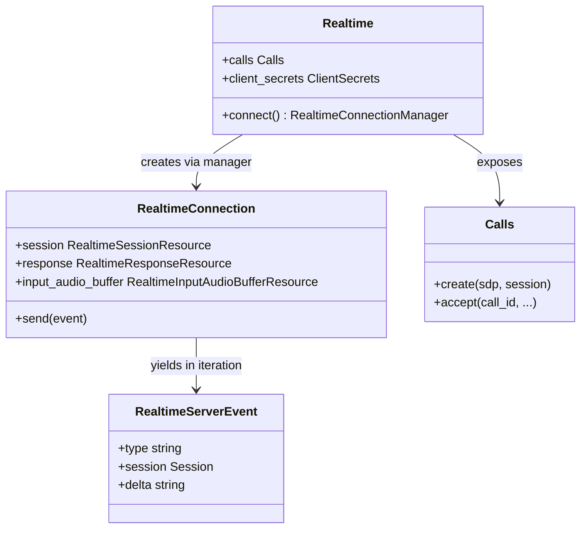

<!-- source: DeepWiki mcp.deepwiki.com · repo openai/openai-python · page 4.9 Realtime API (Beta) · fetched 2026-10-26 -->

# Realtime API (Beta)

<details>
<summary>Relevant source files</summary>

The following files were used as context for generating this wiki page:

- [README.md](README.md)
- [src/openai/__init__.py](src/openai/__init__.py)
- [src/openai/_base_client.py](src/openai/_base_client.py)
- [src/openai/_client.py](src/openai/_client.py)
- [src/openai/lib/_realtime.py](src/openai/lib/_realtime.py)
- [src/openai/lib/azure.py](src/openai/lib/azure.py)
- [src/openai/resources/beta/realtime/realtime.py](src/openai/resources/beta/realtime/realtime.py)
- [src/openai/resources/beta/realtime/sessions.py](src/openai/resources/beta/realtime/sessions.py)
- [src/openai/resources/realtime/__init__.py](src/openai/resources/realtime/__init__.py)
- [src/openai/resources/realtime/calls.py](src/openai/resources/realtime/calls.py)
- [src/openai/resources/realtime/realtime.py](src/openai/resources/realtime/realtime.py)
- [src/openai/types/beta/realtime/session.py](src/openai/types/beta/realtime/session.py)
- [src/openai/types/beta/realtime/session_create_params.py](src/openai/types/beta/realtime/session_create_params.py)
- [src/openai/types/beta/realtime/session_create_response.py](src/openai/types/beta/realtime/session_create_response.py)
- [src/openai/types/beta/realtime/session_update_event.py](src/openai/types/beta/realtime/session_update_event.py)
- [src/openai/types/beta/realtime/session_update_event_param.py](src/openai/types/beta/realtime/session_update_event_param.py)
- [src/openai/types/realtime/__init__.py](src/openai/types/realtime/__init__.py)
- [src/openai/types/realtime/call_accept_params.py](src/openai/types/realtime/call_accept_params.py)
- [src/openai/types/realtime/call_create_params.py](src/openai/types/realtime/call_create_params.py)
- [src/openai/types/realtime/call_refer_params.py](src/openai/types/realtime/call_refer_params.py)
- [src/openai/types/realtime/call_reject_params.py](src/openai/types/realtime/call_reject_params.py)
- [src/openai/types/realtime/realtime_response_create_mcp_tool.py](src/openai/types/realtime/realtime_response_create_mcp_tool.py)
- [src/openai/types/realtime/realtime_response_create_mcp_tool_param.py](src/openai/types/realtime/realtime_response_create_mcp_tool_param.py)
- [src/openai/types/realtime/realtime_session_create_request.py](src/openai/types/realtime/realtime_session_create_request.py)
- [src/openai/types/realtime/realtime_session_create_request_param.py](src/openai/types/realtime/realtime_session_create_request_param.py)
- [src/openai/types/realtime/realtime_session_create_response.py](src/openai/types/realtime/realtime_session_create_response.py)
- [src/openai/types/realtime/realtime_tools_config_param.py](src/openai/types/realtime/realtime_tools_config_param.py)
- [src/openai/types/realtime/realtime_tools_config_union.py](src/openai/types/realtime/realtime_tools_config_union.py)
- [src/openai/types/realtime/realtime_tools_config_union_param.py](src/openai/types/realtime/realtime_tools_config_union_param.py)
- [src/openai/types/responses/response_includable.py](src/openai/types/responses/response_includable.py)
- [src/openai/types/video_edit_params.py](src/openai/types/video_edit_params.py)
- [tests/lib/test_azure.py](tests/lib/test_azure.py)
- [tests/test_client.py](tests/test_client.py)
- [tests/test_utils/test_logging.py](tests/test_utils/test_logging.py)

</details>


The Realtime API enables low-latency, multi-modal conversational experiences through WebSocket and WebRTC connections. It supports text and audio as both input and output, as well as function calling. This page documents the WebSocket-based API implementation and the WebRTC (SDP) integration in the `openai-python` library.

For standard REST-based chat interactions, see [Chat Completions API](#4.1). For stateful assistant conversations using threads and runs, see [Assistants API (Beta)](#4.3).

## Connection Architecture

The Realtime API uses WebSocket connections managed through connection managers. The library provides both synchronous and asynchronous implementations with identical interfaces.

### Connection Lifecycle



**Sources:** [src/openai/resources/realtime/realtime.py:69-136](), [src/openai/resources/realtime/realtime.py:139-206](), [src/openai/resources/realtime/realtime.py:531-635](), [src/openai/resources/realtime/realtime.py:348-452]()

The connection flow follows this pattern:

1.  **Resource Access**: The client exposes `client.realtime` [src/openai/_client.py:83]().
2.  **Connection Initiation**: Call `connect(model="gpt-realtime")` to get a connection manager [src/openai/resources/realtime/realtime.py:99-136]().
3.  **Context Manager**: Use as a context manager to automatically handle connection lifecycle [src/openai/resources/realtime/realtime.py:348-353]().
4.  **Connection Object**: Inside the context, receive a `RealtimeConnection` or `AsyncRealtimeConnection`.
5.  **Resource Interfaces**: The connection object exposes typed resource interfaces for sending events.
6.  **Automatic Cleanup**: The context manager ensures the WebSocket is closed on exit.

### WebSocket URL Construction

The library constructs WebSocket URLs differently for standard OpenAI and Azure deployments. The `OpenAI` client uses `websocket_base_url` or defaults to the standard base URL with a scheme replacement.

| Client Type | URL Pattern | Query Parameters |
| :--- | :--- | :--- |
| `OpenAI` / `AsyncOpenAI` | `wss://{base_url}/v1/realtime` | `model={model}` |
| `AzureOpenAI` / `AsyncAzureOpenAI` | `wss://{azure_endpoint}/openai/realtime` | `api-version={version}`, `deployment={deployment}` |

**Sources:** [src/openai/_client.py:118-124](), [src/openai/resources/realtime/realtime.py:438-445](), [src/openai/resources/realtime/realtime.py:621-628]()

## Event-Based Communication Model

The Realtime API uses bidirectional event streaming. Client events are sent to the server, and server events are received and parsed.

### Event Types and Flow



**Sources:** [src/openai/resources/realtime/realtime.py:306-345](), [src/openai/resources/realtime/realtime.py:489-528]()

### Client Events

Client events are sent through typed resource interfaces on the connection object. The library provides methods that construct properly formatted event dictionaries:

*   **Session Events**: `connection.session.update(session={...})` [src/openai/resources/realtime/realtime.py:642-662]()
*   **Response Events**: `connection.response.create()`, `connection.response.cancel()` [src/openai/resources/realtime/realtime.py:664-708]()
*   **Audio Buffer Events**: `connection.input_audio_buffer.append()`, `connection.input_audio_buffer.commit()`, `connection.input_audio_buffer.clear()` [src/openai/resources/realtime/realtime.py:710-758]()

### Server Events

Server events are received by iterating over the connection object. Events are automatically parsed into `RealtimeServerEvent` objects [src/openai/resources/realtime/realtime.py:293-304]().

```python
async for event in connection:
    if event.type == "response.output_audio.delta":
        process_audio(event.delta)
    elif event.type == "session.created":
        print(f"Session ID: {event.session.id}")
```

**Sources:** [src/openai/resources/realtime/realtime.py:476-487]()

## Session Configuration

Sessions are configured using `session.update()`. This defines the model behavior, modalities, and audio processing parameters.

### Session Parameters

Key configuration options in `RealtimeSessionCreateResponse`:

*   **`model`**: The Realtime model to use (e.g., `gpt-4o-realtime-preview`) [src/openai/types/realtime/realtime_session_create_request.py:57-82]().
*   **`output_modalities`**: Set of modalities (`text`, `audio`) the model can respond with [src/openai/types/realtime/realtime_session_create_request.py:84-90]().
*   **`turn_detection`**: Controls Voice Activity Detection (VAD).
    *   `server_vad`: Server detects speech start/end automatically [src/openai/types/realtime/realtime_session_create_response.py:58-64]().
    *   `semantic_vad`: Advanced turn detection using a model to estimate turn completion [src/openai/types/realtime/realtime_session_create_response.py:128-134]().
*   **`instructions`**: System instructions prepended to model calls [src/openai/types/realtime/realtime_session_create_request.py:34-48]().

**Sources:** [src/openai/types/realtime/realtime_session_create_response.py:165-250](), [src/openai/types/realtime/realtime_session_create_request.py:18-147]()

## WebRTC and Phone Integration (Calls)

The `calls` resource provides methods for integrating with WebRTC and SIP/phone systems.

### WebRTC SDP Handshake

To establish a peer-to-peer audio connection, the client sends an SDP offer and receives an SDP answer from the API via `client.realtime.calls.create`.

```python
# Create a WebRTC call
answer_sdp = client.realtime.calls.create(
    sdp=offer_sdp,
    session={"model": "gpt-4o-realtime-preview"}
)
```

**Sources:** [src/openai/resources/realtime/realtime.py:75-78](), [src/openai/resources/realtime/calls.py:61-108]()

### Call Management Methods

| Method | Purpose | Key Parameters |
| :--- | :--- | :--- |
| `create` | Create WebRTC call via SDP offer | `sdp`, `session` |
| `accept` | Accept an incoming SIP call | `call_id`, `model`, `instructions` |
| `reject` | Reject an incoming call | `call_id` |
| `refer` | Transfer a call to another destination | `call_id`, `to` |

**Sources:** [src/openai/resources/realtime/calls.py:41-248]()

## Audio Streaming Details

Audio data is handled as base64-encoded strings of raw PCM bytes.

### Audio Formats

The API supports several audio formats for input and output:
*   **PCM16**: 16-bit PCM at 24kHz, mono, little-endian.
*   **G.711 u-law**: Standard telephony format.
*   **G.711 a-law**: Standard telephony format.

**Sources:** [src/openai/types/realtime/realtime_audio_formats.py:1-15]() (implied by type), [src/openai/types/realtime/realtime_session_create_response.py:166-167]()

### Audio Buffer Management



**Sources:** [src/openai/resources/realtime/realtime.py:710-758]()

## Reconnection and State Management

The SDK handles WebSocket reconnection logic through the `RealtimeConnectionManager`.

### Reconnection Logic

*   **Recoverable Closes**: The client attempts to reconnect if the closure is deemed recoverable [src/openai/types/websocket_reconnection.py:49]().
*   **Backoff**: Uses exponential backoff with `initial_delay`, `max_delay`, and `max_retries` [src/openai/resources/realtime/realtime.py:108-110]().
*   **Queueing**: A `SendQueue` manages messages that need to be sent once the connection is re-established [src/openai/resources/realtime/realtime.py:37]().

**Sources:** [src/openai/resources/realtime/realtime.py:406-432](), [src/openai/resources/realtime/realtime.py:589-615]()

### Error Handling

Errors are returned as `RealtimeErrorEvent` server events rather than raising Python exceptions during the stream.

```python
if event.type == "error":
    print(f"Error {event.error.code}: {event.error.message}")
```

**Sources:** [src/openai/types/realtime/realtime_error_event.py:1-20]()

## Implementation Mapping



**Sources:** [src/openai/resources/realtime/realtime.py:69-78](), [src/openai/resources/realtime/realtime.py:214-250](), [src/openai/resources/realtime/calls.py:41-60]()

---

