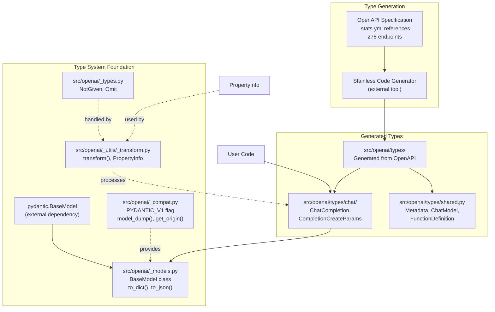
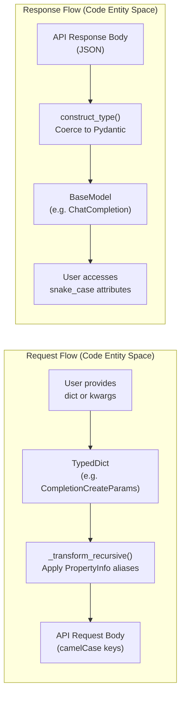

<!-- source: DeepWiki mcp.deepwiki.com · repo openai/openai-python · page 5 Data Types and Type System · fetched 2026-10-26 -->

# Data Types and Type System

Relevant source files

The following files were used as context for generating this wiki page:

- [.stats.yml](.stats.yml)
- [api.md](api.md)
- [src/openai/_types.py](src/openai/_types.py)
- [src/openai/_utils/__init__.py](src/openai/_utils/__init__.py)
- [src/openai/_utils/_reflection.py](src/openai/_utils/_reflection.py)
- [src/openai/_utils/_sync.py](src/openai/_utils/_sync.py)
- [src/openai/_utils/_transform.py](src/openai/_utils/_transform.py)
- [src/openai/_utils/_typing.py](src/openai/_utils/_typing.py)
- [src/openai/_utils/_utils.py](src/openai/_utils/_utils.py)
- [src/openai/types/__init__.py](src/openai/types/__init__.py)
- [src/openai/types/shared/__init__.py](src/openai/types/shared/__init__.py)
- [src/openai/types/shared_params/__init__.py](src/openai/types/shared_params/__init__.py)
- [tests/test_transform.py](tests/test_transform.py)
- [tests/test_utils/test_typing.py](tests/test_utils/test_typing.py)
- [tests/utils.py](tests/utils.py)

This document provides an overview of the OpenAI Python SDK's comprehensive type system. Types are automatically generated from the OpenAPI specification (referenced in [.stats.yml:2]()) and built on Pydantic with compatibility layers supporting both Pydantic v1 and v2. The type system encompasses request parameter types, response models, type coercion mechanisms, and special sentinel values.

For details on data transformation and validation processes that operate on these types, see [Data Transformation and Validation](#6). For information about how types are used in specific API resources, see [API Resources and Endpoints](#4).

## Overview

The SDK's type system is **generated from an OpenAPI specification** (278 configured endpoints as of [.stats.yml:1]()) and provides compile-time type safety through static type checkers like `mypy` and `pyright`. The library implements a dual type system that distinguishes between input parameters and output responses:

- **Type Generation**: Types are automatically generated from the OpenAPI spec stored at the URL in [.stats.yml:2]().
- **Request Parameters**: Defined using `TypedDict` with `total=False`, allowing flexible optional parameters [src/openai/_utils/_transform.py:99-105]().
- **Response Models**: Defined using custom Pydantic `BaseModel` subclasses with additional methods and compatibility shims [src/openai/_models.py:101-119]().
- **Compatibility Layer**: Abstracts differences between Pydantic v1 and v2 APIs through the `PYDANTIC_V1` flag [src/openai/_utils/__init__.py:36-42]().
- **Type Transformation**: The `transform` function handles mapping Python-style keys to API-style aliases (e.g., `foo_bar` to `fooBar`) using `PropertyInfo` metadata [src/openai/_utils/_transform.py:44-76]().
- **Special Sentinels**: `NotGiven` and `Omit` distinguish between absent parameters, explicit nulls, and values to remove [src/openai/_types.py:133-188]().

**Type System Architecture**

Sources: [.stats.yml:1-4](), [src/openai/_models.py:101-210](), [src/openai/_types.py:133-188](), [src/openai/_utils/_transform.py:44-76](), [src/openai/types/__init__.py:1-121]()

## Type System Components

### Core Type Definitions

The type system is organized across several modules:

| Module | Purpose | Example Types |
|--------|---------|---------------|
| `src/openai/_models.py` | Base model classes and construction logic | `BaseModel`, `GenericModel` |
| `src/openai/_compat.py` | Pydantic v1/v2 compatibility layer | `PYDANTIC_V1`, `model_dump` |
| `src/openai/types/shared/` | Shared types across multiple resources | `ErrorObject`, `FunctionDefinition` |
| `src/openai/types/__init__.py` | Exported types for end-users | `ChatModel`, `FileObject`, `Completion` |
| `src/openai/_types.py` | Internal utility types and sentinels | `NotGiven`, `Omit`, `FileTypes` |

The `BaseModel` class at [src/openai/_models.py:101-210]() extends `pydantic.BaseModel` with:

- **Enhanced serialization**: `to_dict()` and `to_json()` methods with `use_api_names` parameter to control key casing [src/openai/_models.py:139-210]().
- **Request ID tracking**: `_request_id` property for debugging (top-level responses only) [src/openai/_models.py:123-137]().

Sources: [src/openai/_models.py:101-210](), [src/openai/types/__init__.py:10-29](), [src/openai/_types.py:1-250]()

### Request vs Response Type Pattern

**Request Parameters** use `TypedDict` to provide type hints while allowing standard Python dictionaries. The `transform` utility at [src/openai/_utils/_transform.py:92-113]() maps snake_case keys to API-required aliases defined in `PropertyInfo` [src/openai/_utils/_transform.py:44-76]().

**Response Types** use Pydantic models that inherit from `BaseModel`. These models ensure that data returned from the API is validated and provides attribute-style access (e.g., `completion.choices[0].message`) [api.md:36, 94]().

Sources: [src/openai/_utils/_transform.py:44-113](), [src/openai/_models.py:101-137](), [api.md:36, 94]()

### Type Transformation and Metadata

The SDK uses `Annotated` types combined with `PropertyInfo` to manage how data is converted for the API.

- **PropertyInfo**: Metadata class storing `alias` (e.g., `fooBar`), `format` (e.g., `iso8601`), and `discriminator` [src/openai/_utils/_transform.py:44-76]().
- **_transform_recursive**: The engine that walks through nested dictionaries, lists, and unions to apply these transformations [src/openai/_utils/_transform.py:154-209]().

Sources: [src/openai/_utils/_transform.py:44-209](), [tests/test_transform.py:40-61]()

### Special Types and Sentinels

The library uses sentinel types to handle the ambiguity between "null" and "undefined" in API requests [src/openai/_types.py:133-188]().

- `NotGiven`: Used for parameters where the user didn't provide a value. This allows the SDK to omit the key from the JSON request instead of sending `null` [src/openai/_types.py:133-164]().
- `Omit`: Used to explicitly remove a key that might otherwise be included by default (e.g., headers) [src/openai/_types.py:166-188]().
- `FileTypes`: A complex union type for file uploads, supporting `bytes`, `pathlib.Path`, and tuples containing filenames and MIME types [src/openai/_types.py:72-81]().

Sources: [src/openai/_types.py:72-188](), [src/openai/_utils/_utils.py:160-161]()

## Child Pages

For more technical detail on specific components of the type system, see the following pages:

- [Type System Overview](#5.1) — Architecture and code generation from OpenAPI.
- [Request Parameter Types](#5.2) — Documentation on `TypedDict` parameters and key transformation.
- [Response Types and Models](#5.3) — Details on Pydantic response structures and validation.
- [Pydantic Models and BaseModel](#5.4) — Custom features of the `BaseModel` class and v1/v2 compatibility.
- [Special Types and Sentinels](#5.5) — Usage of `NotGiven`, `Omit`, and `FileTypes` for binary data.

Sources: [src/openai/_models.py:101-210](), [src/openai/types/__init__.py:1-121](), [src/openai/_types.py:1-250]()

---

