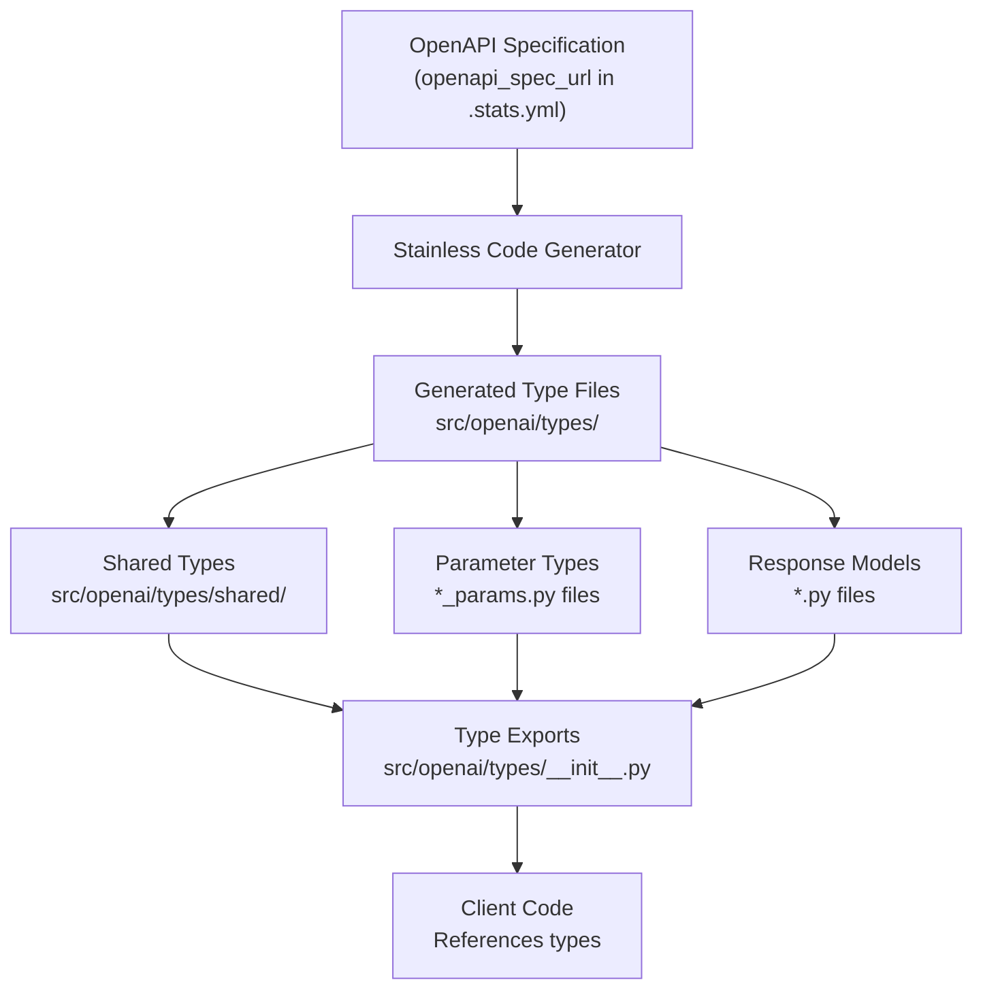
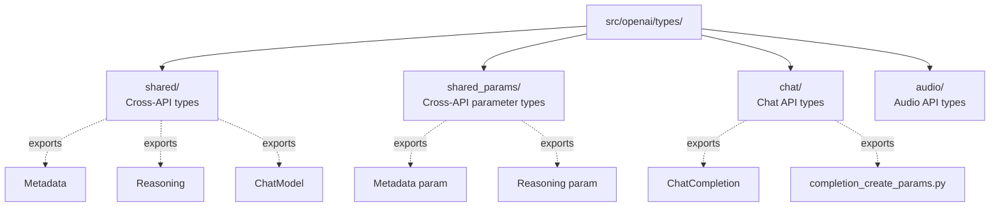
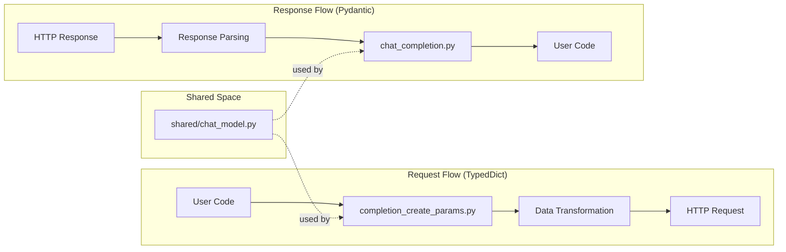

<!-- source: DeepWiki mcp.deepwiki.com · repo openai/openai-python · page 5.1 Type System Overview · fetched 2026-10-26 -->

# Type System Overview

Relevant source files

The following files were used as context for generating this wiki page:

- [.stats.yml](.stats.yml)
- [api.md](api.md)
- [src/openai/types/__init__.py](src/openai/types/__init__.py)
- [src/openai/types/shared/__init__.py](src/openai/types/shared/__init__.py)
- [src/openai/types/shared/all_models.py](src/openai/types/shared/all_models.py)
- [src/openai/types/shared/responses_model.py](src/openai/types/shared/responses_model.py)
- [src/openai/types/shared_params/__init__.py](src/openai/types/shared_params/__init__.py)
- [src/openai/types/shared_params/responses_model.py](src/openai/types/shared_params/responses_model.py)

## Purpose and Scope

This document explains the architecture of the OpenAI Python SDK's type system, including how types are generated from OpenAPI specifications, how they are organized into categories, and how they provide compile-time and runtime type safety. For details on specific type categories, see [Request Parameter Types](#5.2), [Response Types and Models](#5.3), and [Pydantic Models and BaseModel](#5.4). For sentinel values and special types, see [Special Types and Sentinels](#5.5).

The type system serves three primary goals:
1. **Compile-time type safety** via `mypy` and `pyright` type checkers.
2. **Runtime validation** via Pydantic models for API responses.
3. **Developer experience** through accurate IDE autocomplete and inline documentation.

## Type Generation Architecture

The SDK's types are automatically generated from OpenAI's OpenAPI specification using Stainless's code generation tooling. This ensures types stay synchronized with the API as it evolves.

Title: Type Generation Data Flow

**Sources:** [.stats.yml:1-5](), [src/openai/types/__init__.py:1-125]()

### OpenAPI Specification Source

The type system is generated from a specific OpenAPI specification version, tracked in the codebase:

| Configuration Key | Purpose | Value |
|-------------------|---------|-------|
| `openapi_spec_url` | Points to Stainless storage with versioned OpenAPI YAML | `https://storage.googleapis.com/stainless-sdk-openapi-specs/openai/openai-0650ebae454b4200491980d7663cb7ceabcff90dcb3ed9f67c3bca3e861a2bf6.yml` |
| `openapi_spec_hash` | MD5 hash ensuring spec integrity | `e9576bced964246b7e685a5ad30afffa` |
| `configured_endpoints` | Count of API endpoints | `278` |

The specification hash ensures reproducible builds and allows detecting when the API shape changes.

**Sources:** [.stats.yml:1-5]()

## Type Organization Structure

Types are organized into a hierarchical directory structure that mirrors the API's resource organization.

Title: Directory and Entity Mapping

**Sources:** [src/openai/types/__init__.py:1-125](), [src/openai/types/shared/__init__.py:1-21](), [src/openai/types/shared_params/__init__.py:1-17]()

### Directory Structure

| Directory | Purpose | Example Types |
|-----------|---------|---------------|
| `types/` | Root-level types and top-level resource types | `FileObject`, `Model`, `Completion`, `Batch` |
| `types/shared/` | Types shared across multiple API response contexts | `Metadata`, `ChatModel`, `Reasoning`, `ErrorObject` |
| `types/shared_params/` | Parameter types shared across multiple request contexts | `Metadata`, `ComparisonFilter`, `FunctionDefinition` |
| `types/chat/` | Chat Completions API types | `ChatCompletion`, `ChatCompletionMessage` |
| `types/audio/` | Audio API types | `AudioModel`, `AudioResponseFormat` |

**Sources:** [src/openai/types/__init__.py:1-125](), [api.md:1-167]()

## Type Categories

The type system divides types into three primary categories, each serving a distinct role in the request/response lifecycle.

Title: Request/Response Type Lifecycle

**Sources:** [src/openai/types/__init__.py:1-125](), [src/openai/types/shared/__init__.py:1-21]()

### 1. Shared Types

Shared types represent data structures used across multiple API endpoints. They are often defined twice: once in `types/shared/` for responses (Pydantic-compatible) and once in `types/shared_params/` for requests (TypedDict-compatible).

| Type Name | Purpose | Implementation File |
|-----------|---------|---------|
| `ChatModel` | Union of valid chat model identifiers | `src/openai/types/shared/chat_model.py` |
| `Metadata` | Optional metadata key-value pairs | `src/openai/types/shared/metadata.py` |
| `ReasoningEffort` | Configuration for model reasoning depth | `src/openai/types/shared/reasoning_effort.py` |
| `FunctionDefinition` | Tool function definition schema | `src/openai/types/shared/function_definition.py` |
| `AllModels` | Broad union of all supported model strings | `src/openai/types/shared/all_models.py` |
| `ResponsesModel` | Models specifically for the Responses API | `src/openai/types/shared/responses_model.py` |

**Sources:** [src/openai/types/shared/chat_model.py:1-91](), [src/openai/types/shared/all_models.py:1-30](), [src/openai/types/shared/responses_model.py:1-30](), [src/openai/types/shared_params/responses_model.py:1-32]()

### 2. Parameter Types (Request)

Parameter types define the shape of data sent to the API. They are implemented as `TypedDict` classes to allow users to pass plain Python dictionaries while maintaining type safety.

| Parameter Type | Endpoint | Source File |
|----------------|----------|------|
| `CompletionCreateParams` | `POST /chat/completions` | `src/openai/types/chat/completion_create_params.py` |
| `FileCreateParams` | `POST /files` | `src/openai/types/file_create_params.py` |
| `EmbeddingCreateParams` | `POST /embeddings` | `src/openai/types/embedding_create_params.py` |
| `ImageGenerateParams` | `POST /images/generations` | `src/openai/types/image_generate_params.py` |

**Sources:** [src/openai/types/__init__.py:66-125](), [api.md:94-116]()

### 3. Response Models (Pydantic)

Response models define the shape of data returned from the API. These are implemented as Pydantic models, providing runtime validation and easy attribute access.

| Response Model | Returned By | Source File |
|----------------|-------------|----------|
| `ChatCompletion` | `client.chat.completions.create` | `src/openai/types/chat/chat_completion.py` |
| `FileObject` | `client.files.create` | `src/openai/types/file_object.py` |
| `CreateEmbeddingResponse` | `client.embeddings.create` | `src/openai/types/create_embedding_response.py` |
| `ImagesResponse` | `client.images.generate` | `src/openai/types/images_response.py` |
| `Batch` | `client.batches.create` | `src/openai/types/batch.py` |

**Sources:** [src/openai/types/__init__.py:5-51](), [api.md:94-158]()

## Type Safety Guarantees

The SDK provides both compile-time and runtime type safety through multiple layers:

1.  **Compile-Time**: `AllModels` and `ResponsesModel` use `Literal` and `Union` types to restrict valid string inputs for model names at development time, including recent models like `o3-pro` and `o3-deep-research` [src/openai/types/shared/all_models.py:10-29]().
2.  **Runtime Validation**: API responses are parsed into Pydantic models, ensuring the data matches the expected schema [src/openai/types/__init__.py:1-125]().
3.  **Strict Typing**: The SDK uses `TypeAlias` and `from __future__ import annotations` to support modern Python typing features across supported versions [src/openai/types/shared/all_models.py:3-5]().

**Sources:** [src/openai/types/shared/all_models.py:1-30](), [src/openai/types/shared/responses_model.py:1-30](), [src/openai/types/__init__.py:1-125]()

---

