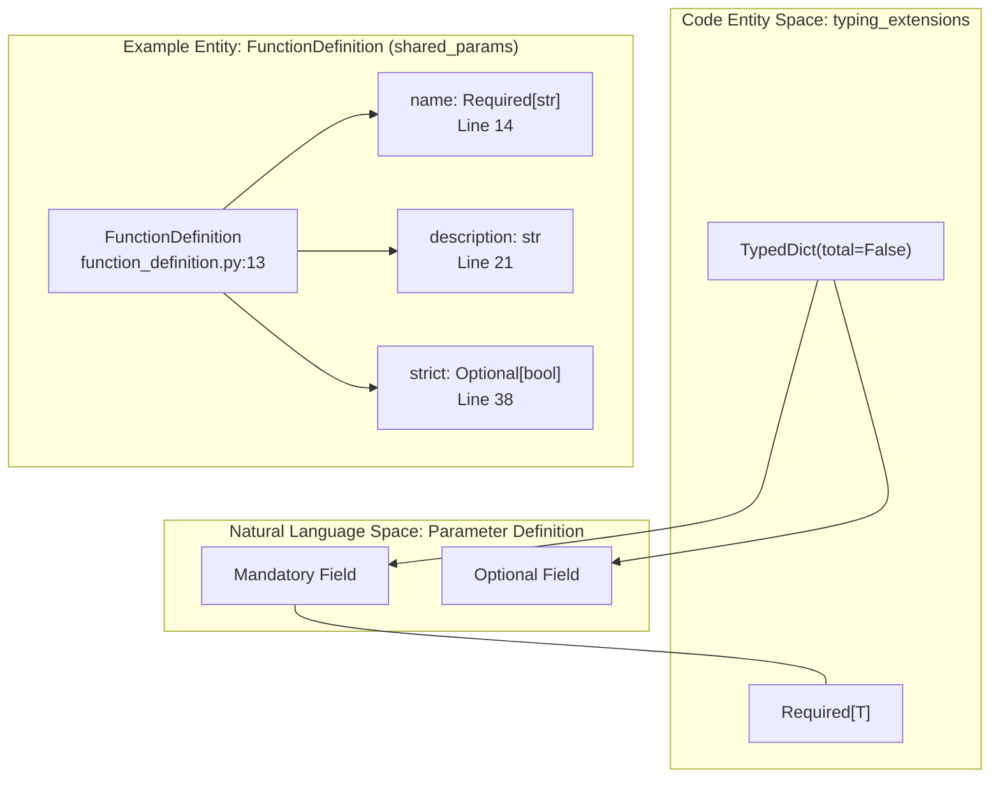
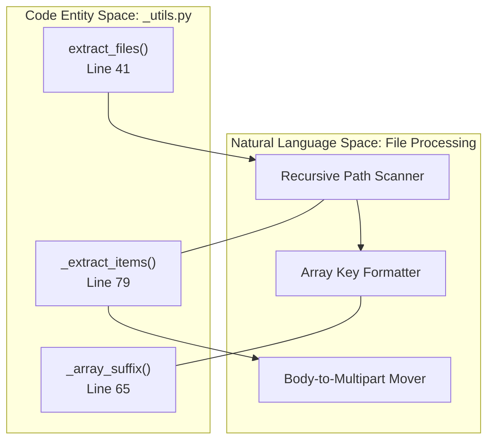

<!-- source: DeepWiki mcp.deepwiki.com · repo openai/openai-python · page 5.2 Request Parameter Types · fetched 2026-10-26 -->

# Request Parameter Types

<details>
<summary>Relevant source files</summary>

The following files were used as context for generating this wiki page:

- [src/openai/_types.py](src/openai/_types.py)
- [src/openai/_utils/__init__.py](src/openai/_utils/__init__.py)
- [src/openai/_utils/_reflection.py](src/openai/_utils/_reflection.py)
- [src/openai/_utils/_sync.py](src/openai/_utils/_sync.py)
- [src/openai/_utils/_transform.py](src/openai/_utils/_transform.py)
- [src/openai/_utils/_typing.py](src/openai/_utils/_typing.py)
- [src/openai/_utils/_utils.py](src/openai/_utils/_utils.py)
- [src/openai/types/beta/assistant_response_format_option.py](src/openai/types/beta/assistant_response_format_option.py)
- [src/openai/types/beta/assistant_response_format_option_param.py](src/openai/types/beta/assistant_response_format_option_param.py)
- [src/openai/types/beta/function_tool_param.py](src/openai/types/beta/function_tool_param.py)
- [src/openai/types/shared/function_definition.py](src/openai/types/shared/function_definition.py)
- [src/openai/types/shared_params/function_definition.py](src/openai/types/shared_params/function_definition.py)
- [tests/test_transform.py](tests/test_transform.py)
- [tests/test_utils/test_typing.py](tests/test_utils/test_typing.py)
- [tests/utils.py](tests/utils.py)

</details>


This document describes the `TypedDict`-based parameter type system used throughout the `openai-python` library. It covers how API method parameters are defined, validated, and transformed into HTTP requests.

For information about response types returned by the API, see [Response Types and Models (5.3)](). For details on sentinel values used in parameters, see [Special Types and Sentinels (5.5)](). For the broader type system architecture, see [Type System Overview (5.1)]().

## Purpose and Scope

Request parameter types in this library are defined as `TypedDict` classes that specify the structure and types of arguments passed to API methods. These types are generated from the OpenAPI specification and provide:

- **Type safety**: Static type checkers can validate parameter structures.
- **Documentation**: Field docstrings describe parameter purposes and constraints.
- **Runtime flexibility**: `TypedDict` allows both required and optional fields.
- **Validation separation**: Type checking occurs at development time; runtime transformation processes the data for the wire.

All parameter types are located in `src/openai/types/` and follow a consistent pattern across all API resources.

**Sources**: [src/openai/types/shared_params/function_definition.py:1-46](), [src/openai/_utils/_transform.py:92-112]()

## TypedDict Parameter Pattern

### Base Parameter Structure

All API method parameters are defined as `TypedDict` classes with `total=False`, meaning all fields are optional by default unless explicitly marked with `Required[]`.



**Diagram: TypedDict Parameter Structure and Code Mapping**

The `total=False` setting combined with `Required[]` provides precise control over which fields must be provided:

| Field Declaration | User Must Provide | Can Be None | Can Be Omitted |
|------------------|------------------|-------------|----------------|
| `Required[T]` | Yes | No | No |
| `Optional[T]` | No | Yes | Yes |
| `T` (no wrapper) | No | No | Yes |

**Sources**: [src/openai/types/shared_params/function_definition.py:13-46](), [src/openai/_utils/_typing.py:44-46]()

## Required and Optional Fields

### Required Field Annotation

Fields marked with `Required[]` must be provided by the caller. The type system enforces this at development time. The utility function `is_required_type` is used internally to detect these markers.

```python
class FunctionDefinition(TypedDict, total=False):
    name: Required[str]
    """The name of the function to be called."""
```

**Sources**: [src/openai/types/shared_params/function_definition.py:14-15](), [src/openai/_utils/_typing.py:44-46]()

### Optional Field Patterns

Optional fields can be declared in several ways. The SDK distinguishes between an explicit `None` and a field being "not given" using the `NotGiven` sentinel.

| Field Name | Type | Meaning |
|-----------|------|---------|
| `description` | `str` | Can provide string or omit entirely |
| `strict` | `Optional[bool]` | Can provide bool, None, or omit |
| `parameters` | `FunctionParameters` | Can provide dict or omit |

**Sources**: [src/openai/types/shared_params/function_definition.py:21-46](), [src/openai/_types.py:133-161]()

## Transformation Logic

The SDK uses a recursive transformation pipeline to prepare `TypedDict` data for the API. This process handles aliases, formatting (like ISO8601 for dates), and recursive processing of nested dictionaries.

### PropertyInfo and Aliasing

The `PropertyInfo` class provides metadata for field transformation, such as mapping a Pythonic field name to an API-expected alias.

```python
class MyParams(TypedDict):
    account_holder_name: Annotated[str, PropertyInfo(alias='accountHolderName')]
```

When `transform` is called, it inspects these annotations to rename keys before the request is sent to the HTTP client.

**Sources**: [src/openai/_utils/_transform.py:44-75](), [src/openai/_utils/_transform.py:131-148]()

### File Extraction

For multipart requests, the SDK recursively extracts file content from parameter dictionaries using `extract_files`. This utility mutates the dictionary by removing file fields and returning them as a separate list.



**Diagram: File Extraction Logic Mapping**

The extraction logic searches for `FileTypes` (which can be `bytes`, `PathLike`, or `IO[bytes]`) along specified paths.

**Sources**: [src/openai/_utils/_utils.py:41-62](), [src/openai/_utils/_utils.py:79-111](), [src/openai/_types.py:72-81]()

## Recursive Transformation Process

The `transform` function in `src/openai/_utils/_transform.py` performs the following operations:

1.  **Key Mapping**: Converts Python snake_case keys to API aliases using `PropertyInfo`.
2.  **Date Formatting**: Converts `date` and `datetime` objects to ISO8601 strings if `PropertyInfo(format="iso8601")` is present.
3.  **Nested Processing**: Recursively applies transformations to `list`, `dict`, and nested `TypedDict` objects.
4.  **Union Handling**: Attempts to transform data against all subtypes in a `Union`.

```python
def transform(data: _T, expected_type: object) -> _T:
    # Recursively processes dictionaries based on TypedDict annotations
    transformed = _transform_recursive(data, annotation=cast(type, expected_type))
    return cast(_T, transformed)
```

**Sources**: [src/openai/_utils/_transform.py:92-112](), [src/openai/_utils/_transform.py:154-209](), [tests/test_transform.py:50-83]()

## Summary of Parameter Types

| Type Category | Implementation | Usage |
|---------------|----------------|-------|
| **Request Parameters** | `TypedDict` | Passed as arguments to `.create()`, `.list()`, etc. |
| **Metadata** | `PropertyInfo` | Annotated on `TypedDict` fields for aliases/formats. |
| **Sentinels** | `NotGiven` / `Omit` | Used to distinguish between `None` and omitted fields. |
| **Files** | `FileTypes` | Union of types accepted for file uploads. |

**Sources**: [src/openai/_utils/_transform.py:44-60](), [src/openai/_types.py:133-189](), [src/openai/_utils/_utils.py:160-161]()

---

