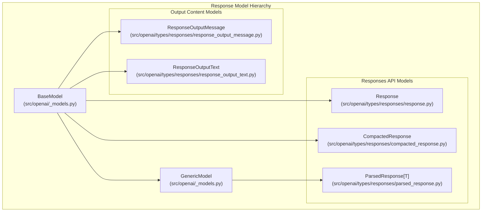
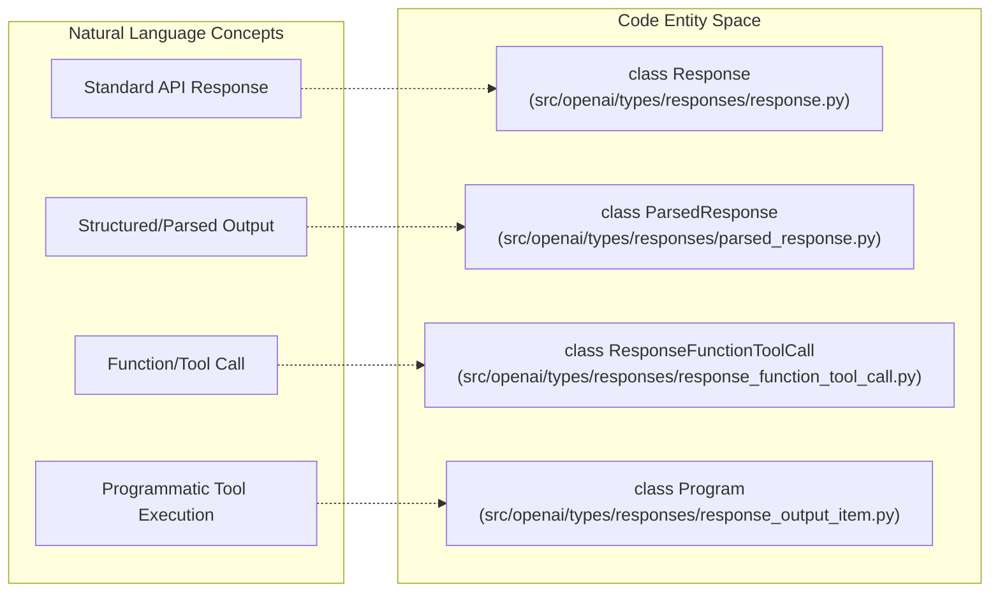
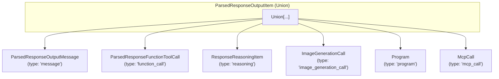

<!-- source: DeepWiki mcp.deepwiki.com · repo openai/openai-python · page 5.3 Response Types and Models · fetched 2026-10-26 -->

# Response Types and Models

<details>
<summary>Relevant source files</summary>

The following files were used as context for generating this wiki page:

- [src/openai/_compat.py](src/openai/_compat.py)
- [src/openai/_models.py](src/openai/_models.py)
- [src/openai/_utils/_json.py](src/openai/_utils/_json.py)
- [src/openai/lib/_parsing/_responses.py](src/openai/lib/_parsing/_responses.py)
- [src/openai/types/conversations/conversation_item.py](src/openai/types/conversations/conversation_item.py)
- [src/openai/types/responses/__init__.py](src/openai/types/responses/__init__.py)
- [src/openai/types/responses/parsed_response.py](src/openai/types/responses/parsed_response.py)
- [src/openai/types/responses/response_item.py](src/openai/types/responses/response_item.py)
- [src/openai/types/responses/response_output_item.py](src/openai/types/responses/response_output_item.py)
- [tests/test_models.py](tests/test_models.py)
- [tests/test_utils/test_json.py](tests/test_utils/test_json.py)

</details>


This page documents the Pydantic-based response models returned by API method calls in the OpenAI Python SDK. These models provide type-safe, validated data structures for API responses across all endpoints.

For information about request parameter types (which use `TypedDict`), see **5.2 Request Parameter Types**. For details about the `BaseModel` foundation and its SDK-specific methods, see **5.4 Pydantic Models and BaseModel**.

## Overview

Response models in the SDK are Pydantic classes that represent structured data returned from OpenAI API endpoints. They differ from request parameter types in key ways:

| Aspect | Response Models | Request Parameter Types |
|--------|----------------|------------------------|
| **Base Class** | `BaseModel` (Pydantic extension) | `TypedDict` |
| **Purpose** | Parse and validate API responses | Type-hint request parameters |
| **Runtime Validation** | Yes, automatic | No (type hints only) |
| **Methods Available** | `.to_dict()`, `.to_json()`, `.model_copy()` | None (plain dictionaries) |
| **Location** | `src/openai/types/` | `src/openai/types/*/params.py` |

Response models are generated from the OpenAPI specification and provide strongly-typed access to API response data with automatic validation and parsing.

**Sources:** [src/openai/_models.py:111-210](), [src/openai/_compat.py:188-201](), [src/openai/types/responses/response.py:1-321]()

## Response Model Architecture

The SDK response models form a hierarchy rooted in a custom `BaseModel` that abstracts Pydantic version differences.

### Class Hierarchy Diagram


**Sources:** [src/openai/_models.py:111-111](), [src/openai/_models.py:140-140](), [src/openai/types/responses/response.py:59-59](), [src/openai/types/responses/parsed_response.py:112-112](), [src/openai/types/responses/response_output_message.py:1-20](), [src/openai/types/responses/response_output_text.py:1-20]()

### Natural Language to Code Entity Mapping
This diagram bridges API concepts to specific implementation classes in the codebase.



**Sources:** [src/openai/types/responses/response.py:59-306](), [src/openai/types/responses/parsed_response.py:112-127](), [src/openai/types/responses/response_function_tool_call.py:1-30](), [src/openai/types/responses/response_output_item.py:45-60]()

## Major Response Types

### Responses API Models
The `Response` model is the primary type for the modern Responses API. It includes a unique `_request_id` property (exposed from `BaseModel`) for debugging.

| Field | Type | Description |
|-------|------|-------------|
| `id` | `str` | Unique identifier for the response [src/openai/types/responses/response.py:61-61]() |
| `output` | `List[ResponseOutputItem]` | Array of content items generated [src/openai/types/responses/response.py:277-277]() |
| `usage` | `Optional[ResponseUsage]` | Token usage details [src/openai/types/responses/response.py:303-303]() |
| `status` | `ResponseStatus` | Current state of the response [src/openai/types/responses/response.py:295-295]() |

**Sources:** [src/openai/types/responses/response.py:59-306](), [src/openai/_models.py:133-147]()

### Parsed and Structured Responses
The SDK provides specialized models for handling structured outputs where the API response is automatically deserialized into a user-defined Pydantic model.

#### `ParsedResponse[ContentType]`
This model extends the standard `Response` and adds a `parsed` field to specific output items. It includes a convenience property `output_parsed` that searches for the first valid parsed content.

```python
# src/openai/types/responses/parsed_response.py
class ParsedResponse(Response, GenericModel, Generic[ContentType]):
    if TYPE_CHECKING:
        output: List[ParsedResponseOutputItem[ContentType]]
    else:
        output: List[ParsedResponseOutputItem]

    @property
    def output_parsed(self) -> Optional[ContentType]:
        for output in self.output:
            if output.type == "message":
                for content in output.content:
                    if content.type == "output_text" and content.parsed:
                        return content.parsed
        return None
```

**Sources:** [src/openai/types/responses/parsed_response.py:112-127](), [src/openai/lib/_parsing/_responses.py:53-141]()

## Accessing Response Data

### Direct Field Access
Response models expose fields as attributes. The SDK's `BaseModel` ensures that even nested objects are correctly instantiated as Pydantic models during parsing via the `construct` method or standard initialization.

```python
# Example of accessing nested data
# response is an instance of src.openai.types.responses.Response
print(response.id) 

# Accessing nested output items
for item in response.output:
    if item.type == "message":
        print(item.content)

# Accessing the Request ID for debugging (top-level only)
print(response._request_id)
```

**Sources:** [src/openai/_models.py:133-147](), [src/openai/types/responses/response.py:59-306](), [tests/test_models.py:26-31]()

### Serialization Methods
Every response model provides methods to export data back to standard Python formats:

1.  **`to_dict()`**: Recursively generates a dictionary representation. By default, it uses API names (aliases) like `fooBar` instead of Python property names like `foo_bar`. [src/openai/_models.py:149-185]()
2.  **`to_json()`**: Generates a JSON string representing the model as it would be received from the API. [src/openai/_models.py:187-210]()

## Type Safety and Discriminated Unions

The SDK heavily utilizes Pydantic discriminated unions for fields that can return multiple types of objects, such as `ResponseOutputItem` and `ParsedResponseOutputItem`. These use the `PropertyInfo(discriminator="type")` annotation to guide parsing.

### Output Item Union Structure


**Sources:** [src/openai/types/responses/parsed_response.py:76-109](), [src/openai/types/responses/response_output_item.py:29-165](), [src/openai/_utils.py:55-55]()

## Data Transformation Pipeline

When a response is received, the SDK uses internal utilities to transform raw JSON into these structured models.

1.  **`model_parse_json`**: Entry point for converting a raw HTTP body into a model instance, supporting both Pydantic v1 and v2. [src/openai/_compat.py:175-178]()
2.  **`construct_type`**: A utility for type coercion, handling unions, and recursive construction of models from dictionaries. [src/openai/_models.py:13-13](), [tests/test_models.py:13-13]()
3.  **`parse_response`**: Specifically handles the logic for `ParsedResponse`, iterating through output items and applying the appropriate Pydantic parsing for structured text and tool arguments. [src/openai/lib/_parsing/_responses.py:53-141]()

**Sources:** [src/openai/_compat.py:175-178](), [src/openai/lib/_parsing/_responses.py:53-141](), [src/openai/_models.py:149-185](), [src/openai/_utils/_json.py:11-25]()

---

