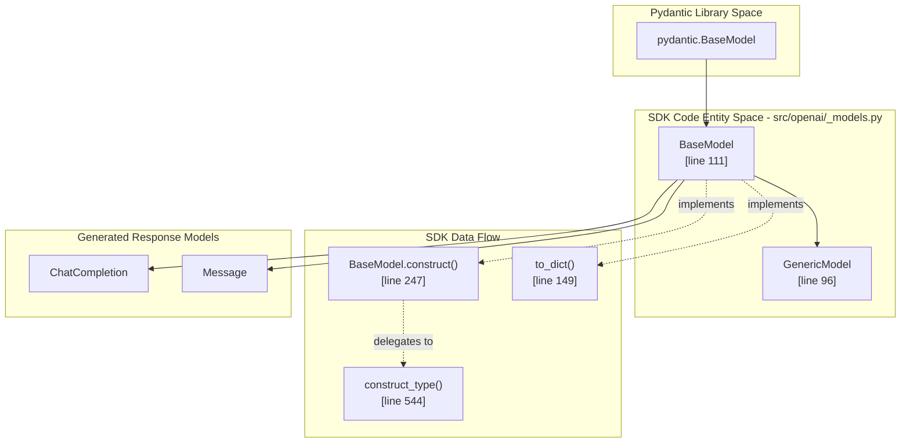
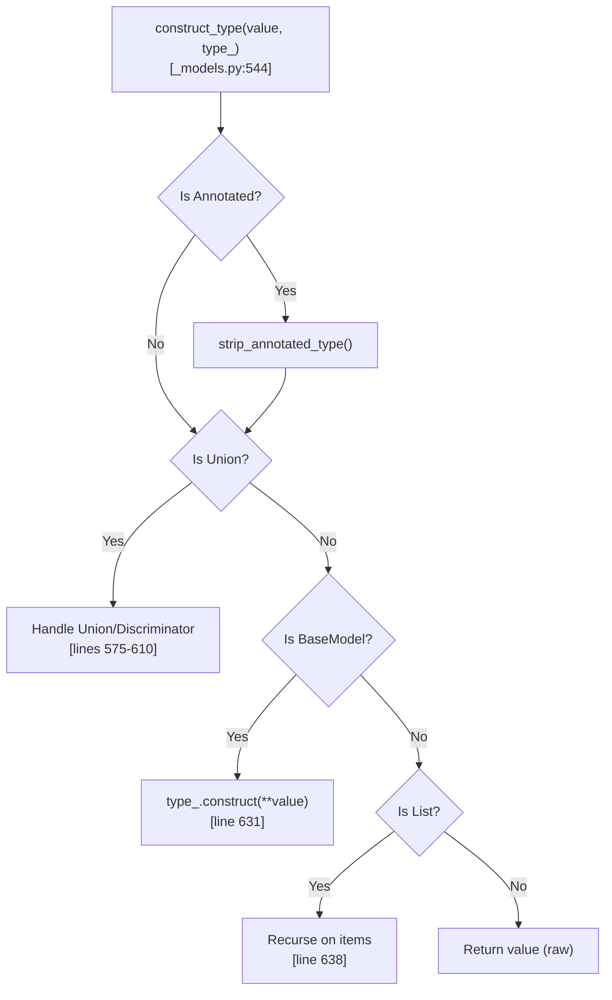

<!-- source: DeepWiki mcp.deepwiki.com · repo openai/openai-python · page 5.4 Pydantic Models and BaseModel · fetched 2026-10-26 -->

# Pydantic Models and BaseModel

Relevant source files

The following files were used as context for generating this wiki page:

- [src/openai/_compat.py](src/openai/_compat.py)
- [src/openai/_models.py](src/openai/_models.py)
- [src/openai/_utils/_json.py](src/openai/_utils/_json.py)
- [tests/test_models.py](tests/test_models.py)
- [tests/test_utils/test_json.py](tests/test_utils/test_json.py)

## Purpose and Scope

This page documents the custom `BaseModel` class that extends Pydantic's `BaseModel` with SDK-specific features. The OpenAI Python SDK defines its own `BaseModel` in [src/openai/_models.py]() to provide:

1.  **Validation-free construction** via the `construct()` method for efficient API response parsing.
2.  **Serialization helpers** (`to_dict()`, `to_json()`) with API-specific conventions.
3.  **Pydantic v1/v2 compatibility** to support both major Pydantic versions seamlessly.
4.  **Loose type coercion** through `construct_type()` for flexible data handling of API responses.

All API response models inherit from this custom `BaseModel`.

**Sources:** [src/openai/_models.py:1-111](), [src/openai/_compat.py:1-21]()

---

## BaseModel Class Hierarchy

The SDK's `BaseModel` extends `pydantic.BaseModel` and serves as the foundation for all response models. It handles the differences between Pydantic versions internally so that the rest of the SDK can use a unified interface.

### Architecture Diagram

**Sources:** [src/openai/_models.py:96-111](), [src/openai/_models.py:247-294](), [src/openai/_models.py:544-661]()

---

## Configuration and Compatibility

The `BaseModel` uses a compatibility layer in [src/openai/_compat.py]() to handle differences between Pydantic v1 and v2.

### Extra Fields and Forward Compatibility
The models are configured with `extra="allow"` to ensure that if the OpenAI API adds new fields to a response, the SDK does not crash during parsing.

*   **Pydantic v1**: Uses a `Config` inner class with `extra: Any = pydantic.Extra.allow` [src/openai/_models.py:120-121]().
*   **Pydantic v2**: Uses `model_config` with `ConfigDict(extra="allow", ...)` [src/openai/_models.py:128-130]().

### Request ID Tracking
Top-level response objects contain a `_request_id` field [src/openai/_models.py:133](). This is populated from the `X-Request-ID` header returned by the API and is useful for debugging. It is only defined for the top-level response object [src/openai/_models.py:136-141]().

**Sources:** [src/openai/_models.py:112-147](), [src/openai/_compat.py:20-21]()

---

## Recursive Construction: construct()

The `construct()` method is the primary way the SDK instantiates models from API responses. Unlike Pydantic's standard validation, this method bypasses strict validation for performance and relies on `construct_type()` for recursive instantiation.

### Execution Logic

1.  **Field Mapping**: It iterates through `model_fields` using `get_model_fields(cls)` [src/openai/_models.py:256]().
2.  **Alias Handling**: It looks for keys in the input dictionary using the field's alias (the API name) first, then the Python property name [src/openai/_models.py:257-260]().
3.  **Recursion**: For each field, it calls `_construct_field()` [src/openai/_models.py:461-473](), which in turn calls `construct_type()` to handle nested models or lists.
4.  **Extra Fields**: Any keys in the input not defined in the model are preserved in the instance's extra storage (`__dict__`) [src/openai/_models.py:267-278]().

### construct_type() Logic Flow

**Sources:** [src/openai/_models.py:247-294](), [src/openai/_models.py:544-661](), [src/openai/_models.py:461-473]()

---

## Serialization: to_dict and to_json

The SDK provides `to_dict()` and `to_json()` as the preferred methods for serializing models, wrapping Pydantic's version-specific dump methods.

### to_dict()
[src/openai/_models.py:149-185]()
Converts the model to a Python dictionary.
*   **use_api_names**: If `True` (default), uses the API keys (e.g., `foo_bar` becomes `fooBar`) via `by_alias=use_api_names` [src/openai/_models.py:180]().
*   **mode**: Can be `python` (preserves objects like `datetime`) or `json` (converts to primitives) [src/openai/_models.py:179]().

### to_json()
[src/openai/_models.py:187-220]()
Returns a JSON string representation.
*   **indent**: Defaults to `2` for readability [src/openai/_models.py:190]().
*   **exclude_unset**: Defaults to `True` to match API response behavior where missing fields are omitted [src/openai/_models.py:192]().

### Custom Encoding for openapi_dumps
The SDK uses a `_CustomEncoder` in [src/openai/_utils/_json.py]() to handle `BaseModel` instances during general JSON serialization. It automatically calls `model_dump` with `exclude_unset=True` and `by_alias=True` to ensure consistency with API formats [src/openai/_utils/_json.py:33-34]().

**Sources:** [src/openai/_models.py:149-220](), [src/openai/_utils/_json.py:28-35]()

---

## Pydantic v1 vs v2 Compatibility Layer

The SDK maintains compatibility through shims in [src/openai/_compat.py](). This allows the codebase to support both `pydantic>=1.9.0` and `pydantic>=2.0.0`.

| Feature | SDK Shim Function | Implementation Detail |
| :--- | :--- | :--- |
| **Parsing** | `parse_obj()` [line 80] | Calls `model.parse_obj` (v1) or `model.model_validate` (v2) [lines 81-84]. |
| **Metadata** | `get_model_fields()` [line 116] | Accesses `__fields__` (v1) or `model_fields` (v2) [lines 117-119]. |
| **Serialization** | `model_dump()` [line 138] | Handles `mode`, `exclude_unset`, and `by_alias` consistently across versions [lines 148-166]. |
| **JSON Serialization** | `model_json()` [line 128] | Calls `model.json()` (v1) or `model.model_dump_json()` (v2) [lines 129-131]. |
| **Schema** | `model_json_schema()` [line 181] | Calls `model.schema()` (v1) or `model.model_json_schema()` (v2) [lines 182-184]. |

**Sources:** [src/openai/_compat.py:20-21](), [src/openai/_compat.py:80-184]()

---

