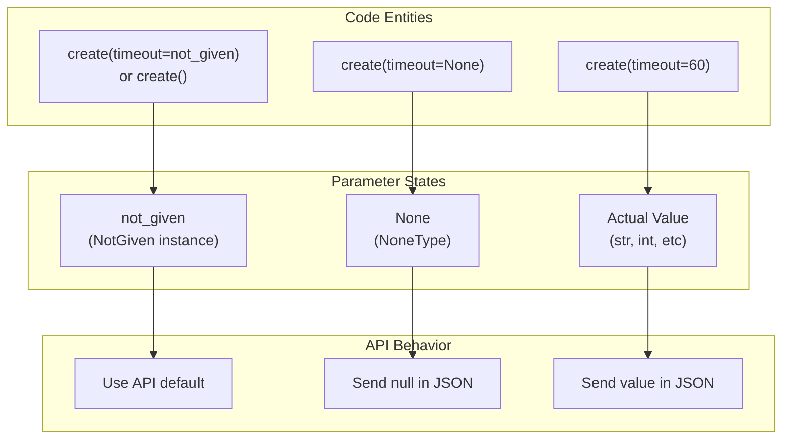
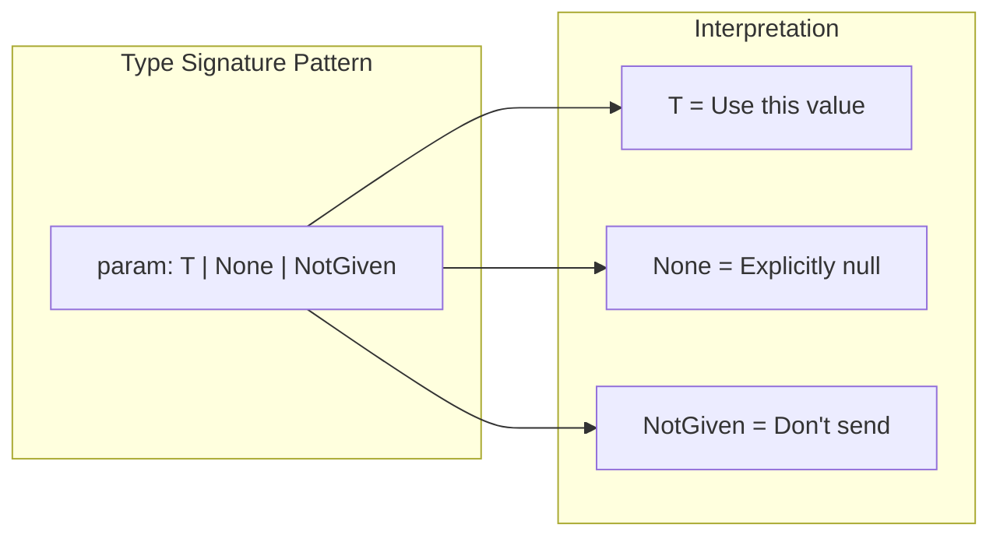
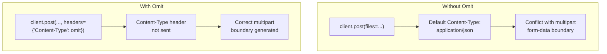
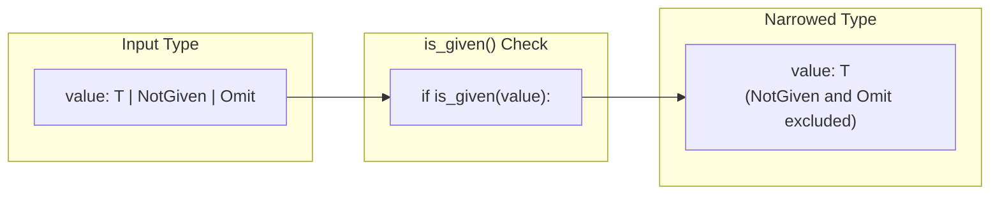
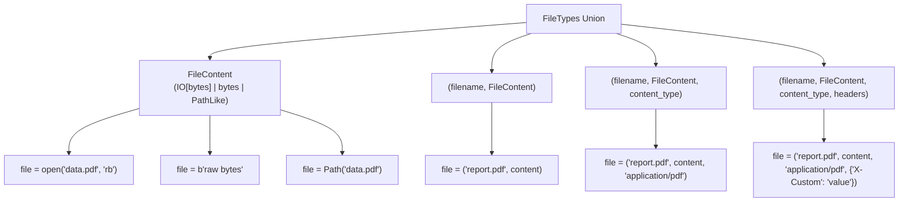
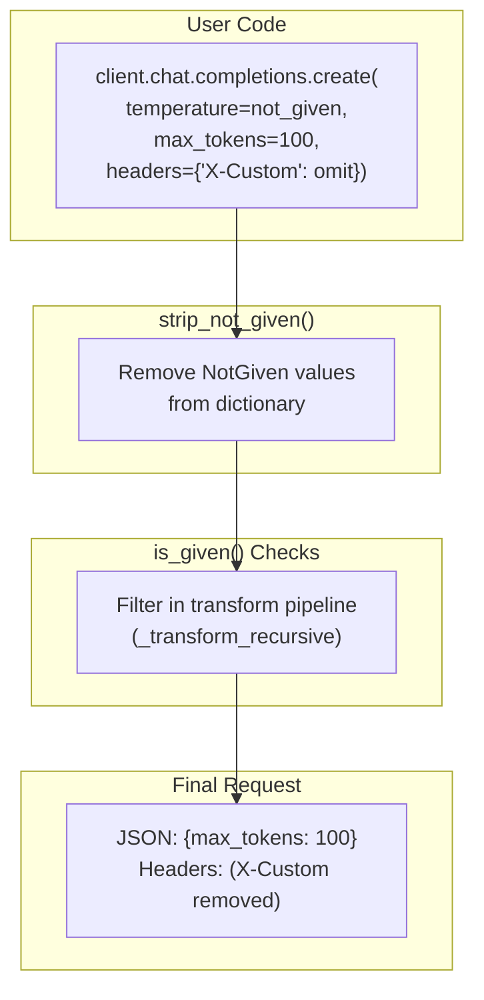

<!-- source: DeepWiki mcp.deepwiki.com · repo openai/openai-python · page 5.5 Special Types and Sentinels · fetched 2026-10-26 -->

# Special Types and Sentinels

<details>
<summary>Relevant source files</summary>

The following files were used as context for generating this wiki page:

- [src/openai/_types.py](src/openai/_types.py)
- [src/openai/_utils/__init__.py](src/openai/_utils/__init__.py)
- [src/openai/_utils/_proxy.py](src/openai/_utils/_proxy.py)
- [src/openai/_utils/_reflection.py](src/openai/_utils/_reflection.py)
- [src/openai/_utils/_sync.py](src/openai/_utils/_sync.py)
- [src/openai/_utils/_transform.py](src/openai/_utils/_transform.py)
- [src/openai/_utils/_typing.py](src/openai/_utils/_typing.py)
- [src/openai/_utils/_utils.py](src/openai/_utils/_utils.py)
- [src/openai/lib/_old_api.py](src/openai/lib/_old_api.py)
- [tests/lib/test_old_api.py](tests/lib/test_old_api.py)
- [tests/test_transform.py](tests/test_transform.py)
- [tests/test_utils/test_proxy.py](tests/test_utils/test_proxy.py)
- [tests/test_utils/test_typing.py](tests/test_utils/test_typing.py)
- [tests/utils.py](tests/utils.py)

</details>


This page documents the special types and sentinel values used throughout the SDK to handle optional parameters, file inputs, and type-safe checking. These constructs enable precise control over API request parameters and distinguish between semantically different states like "not provided", "explicitly None", and "explicitly omitted".

For information about the broader type system and generated types, see [Type System Overview](5.1). For information about request parameter types and response models, see [Request Parameter Types](5.2) and [Response Types and Models](5.3).

---

## Sentinel Values

### NotGiven Sentinel

The `NotGiven` sentinel class provides a way to distinguish between three distinct parameter states:

1.  **Parameter not provided** - `foo()` or `foo(bar=not_given)`
2.  **Parameter explicitly set to None** - `foo(bar=None)`
3.  **Parameter explicitly set to a value** - `foo(bar="value")`

This distinction is critical for APIs where `None` has semantic meaning different from "use the default behavior".

Title: Parameter State Resolution


**Sources:** [src/openai/_types.py:133-164]()

#### Implementation

The `NotGiven` class is defined as a singleton with special behavior:

[src/openai/_types.py:133-164]()
```python
class NotGiven:
    """
    For parameters with a meaningful None value, we need to distinguish between
    the user explicitly passing None, and the user not passing the parameter at
    all.
    """
    def __bool__(self) -> Literal[False]:
        return False

    @override
    def __repr__(self) -> str:
        return "NOT_GIVEN"

not_given = NotGiven()
NOT_GIVEN = NotGiven()  # backwards compatibility
```

The class evaluates to `False` in boolean contexts and has a distinct representation for debugging.

**Sources:** [src/openai/_types.py:133-164]()

#### Usage in Type Signatures

Parameters that may be omitted use `NotGiven` in union types:

Title: Type Interpretation Flow


**Sources:** [src/openai/_types.py:133-151]()

---

### Omit Sentinel

The `Omit` sentinel explicitly removes values that would otherwise be included by default, particularly useful for header management:

[src/openai/_types.py:166-188]()
```python
class Omit:
    """
    To explicitly omit something from being sent in a request, use `omit`.
    
    # as the default `Content-Type` header is `application/json` that will be sent
    client.post("/upload/files", files={"file": b"my raw file content"})
    
    # instead you can remove the default `application/json` header by passing omit
    client.post(..., headers={"Content-Type": omit})
    """
    def __bool__(self) -> Literal[False]:
        return False

omit = Omit()
```

**Use Case: Removing Default Headers**

Title: Header Omission Logic


**Sources:** [src/openai/_types.py:166-188]()

---

### is_given() TypeGuard

The `is_given()` function provides type-safe checking of sentinel values:

[src/openai/_utils/_utils.py:160-161]()
```python
def is_given(obj: _T | NotGiven | Omit) -> TypeGuard[_T]:
    return not isinstance(obj, NotGiven) and not isinstance(obj, Omit)
```

This function narrows the type to `_T`, excluding both `NotGiven` and `Omit`, enabling type checkers to understand that the value is safe to use.

Title: Type Narrowing with is_given


**Usage in Data Transformation**

The transformation logic uses `is_given` to decide whether to process a field:

[src/openai/_utils/_transform.py:15-15](), [src/openai/_utils/_utils.py:160-161]()

**Sources:** [src/openai/_utils/_utils.py:160-161](), [src/openai/_utils/_transform.py:13-15]()

---

## File Type Specifications

### FileTypes

The `FileTypes` type union represents all supported ways to pass file content to the API:

[src/openai/_types.py:72-81]()
```python
FileTypes = Union[
    # file (or bytes)
    FileContent,
    # (filename, file (or bytes))
    Tuple[Optional[str], FileContent],
    # (filename, file (or bytes), content_type)
    Tuple[Optional[str], FileContent, Optional[str]],
    # (filename, file (or bytes), content_type, headers)
    Tuple[Optional[str], FileContent, Optional[str], Mapping[str, str]],
]
```

Title: FileTypes Mapping to Code Entities


**Sources:** [src/openai/_types.py:59-81]()

### Base64FileInput

For APIs that require Base64-encoded file data in JSON payloads:

[src/openai/_types.py:59-64]()
```python
if TYPE_CHECKING:
    Base64FileInput = Union[IO[bytes], PathLike[str]]
else:
    Base64FileInput = Union[IO[bytes], PathLike]
```

Files are automatically encoded during transformation when `PropertyInfo(format="base64")` is specified.

**Sources:** [src/openai/_types.py:59-64](), [src/openai/_utils/_transform.py:41-58]()

---

## Other Special Types

### NoneType

A workaround to support `None` as a valid response type without requiring extensive overloads:

[src/openai/_types.py:114-117]()
```python
if TYPE_CHECKING:
    NoneType: Type[None]
else:
    NoneType = type(None)
```

**Sources:** [src/openai/_types.py:98-117]()

### Omittable

A type alias combining a type with the `Omit` sentinel:

[src/openai/_types.py:189-189]()
```python
Omittable = Union[_T, Omit]
```

**Sources:** [src/openai/_types.py:189-189]()

### PropertyInfo

Metadata used in `Annotated` types to provide transformation information like aliases or formats.

[src/openai/_utils/_transform.py:44-75]()
```python
class PropertyInfo:
    alias: str | None
    format: PropertyFormat | None
    format_template: str | None
    discriminator: str | None
```

**Sources:** [src/openai/_utils/_transform.py:44-75]()

---

## Integration with Request Processing

### Sentinel Value Flow

Title: Data Transformation Pipeline for Sentinels


**Sources:** [src/openai/_utils/_utils.py:160-161](), [src/openai/_utils/__init__.py:28-28]()

### Recursive File Extraction

The `extract_files` utility recursively traverses data structures to find `FileTypes` instances based on a set of paths. It mutates the input dictionary by popping keys that correspond to file locations to prepare them for multipart encoding.

[src/openai/_utils/_utils.py:41-62]()
```python
def extract_files(
    query: Mapping[str, object],
    *,
    paths: Sequence[Sequence[str]],
    array_format: ArrayFormat = "brackets",
) -> list[tuple[str, FileTypes]]:
    # ...
```

**Sources:** [src/openai/_utils/_utils.py:41-157]()

---

## Summary Table

| Type/Sentinel | Purpose | Key Characteristics |
|--------------|---------|-------------------|
| `NotGiven` | Distinguish "not provided" from `None` | Evaluates to `False`, singleton instance `not_given` |
| `Omit` | Explicitly remove default values | Evaluates to `False`, singleton instance `omit` |
| `is_given()` | Type-safe sentinel checking | Returns `TypeGuard[_T]` for type narrowing |
| `FileTypes` | Multiple file input formats | Union of 4 tuple formats plus raw content |
| `Base64FileInput` | Files for JSON embedding | PathLike or IO[bytes] |
| `NoneType` | Typing workaround for `None` | Enables `cast_to=NoneType` without overloads |
| `Omittable[T]` | Optional omission | `Union[T, Omit]` |
| `PropertyInfo` | Field metadata | Used for aliases and formatting |

**Sources:** [src/openai/_types.py:72-189](), [src/openai/_utils/_utils.py:160-161](), [src/openai/_utils/_transform.py:44-75]()

---

