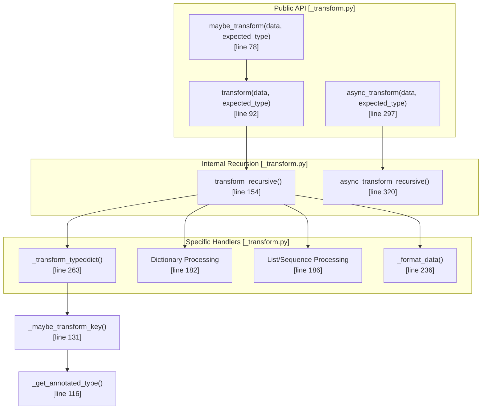
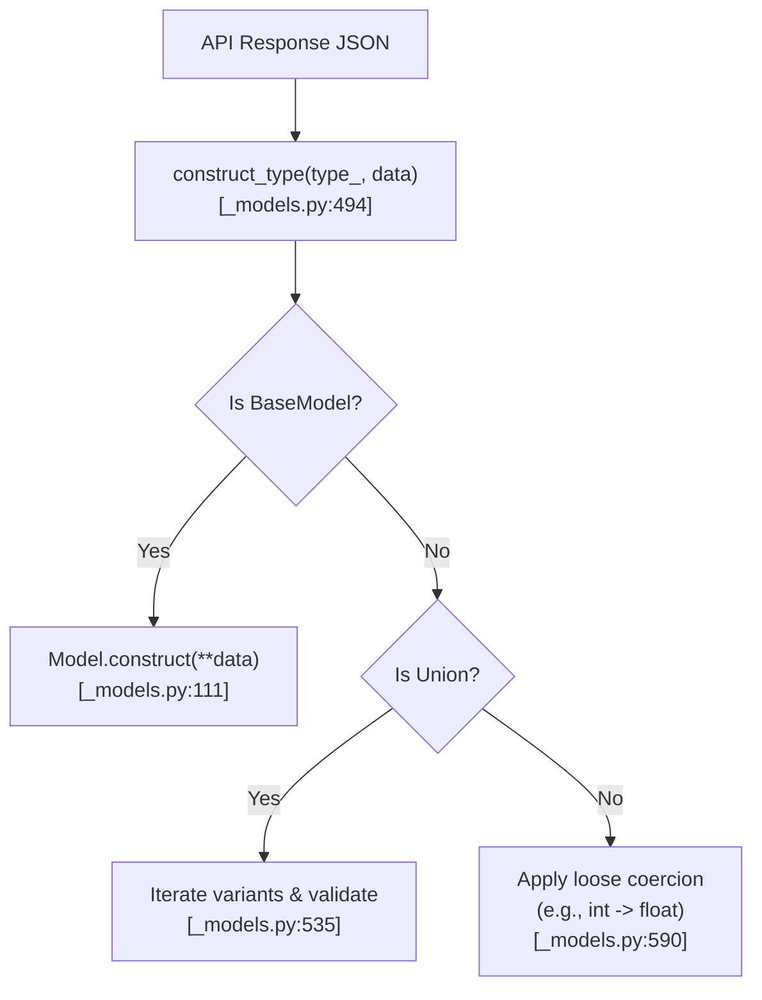

<!-- source: DeepWiki mcp.deepwiki.com · repo openai/openai-python · page 6 Data Transformation and Validation · fetched 2026-10-26 -->

# Data Transformation and Validation

<details>
<summary>Relevant source files</summary>

The following files were used as context for generating this wiki page:

- [src/openai/_compat.py](src/openai/_compat.py)
- [src/openai/_models.py](src/openai/_models.py)
- [src/openai/_types.py](src/openai/_types.py)
- [src/openai/_utils/__init__.py](src/openai/_utils/__init__.py)
- [src/openai/_utils/_json.py](src/openai/_utils/_json.py)
- [src/openai/_utils/_reflection.py](src/openai/_utils/_reflection.py)
- [src/openai/_utils/_sync.py](src/openai/_utils/_sync.py)
- [src/openai/_utils/_transform.py](src/openai/_utils/_transform.py)
- [src/openai/_utils/_typing.py](src/openai/_utils/_typing.py)
- [src/openai/_utils/_utils.py](src/openai/_utils/_utils.py)
- [tests/test_models.py](tests/test_models.py)
- [tests/test_transform.py](tests/test_transform.py)
- [tests/test_utils/test_json.py](tests/test_utils/test_json.py)
- [tests/test_utils/test_typing.py](tests/test_utils/test_typing.py)
- [tests/utils.py](tests/utils.py)

</details>


## Purpose and Scope

This page documents the transformation pipeline in `src/openai/_utils/_transform.py` that converts Python objects and dictionaries into API-compatible JSON before requests are dispatched. The system is responsible for preparing data structures according to the expectations of the OpenAI API.

- **Field aliasing**: Mapping internal `snake_case` keys to API `camelCase` via `PropertyInfo.alias`.
- **Format conversion**: Converting complex types like `datetime` to ISO 8601 strings or local files to base64.
- **Type coercion**: Converting Pydantic models to JSON-serializable dictionaries.
- **Sentinel handling**: Stripping `NotGiven` and `Omit` values to differentiate between default behavior and explicit nulls.

The transformation occurs at request time. For the reverse process of parsing API responses into Python objects, see [Type Coercion and Construction](#6.3).

**Sources:** [src/openai/_utils/_transform.py:1-458]()

---

## PropertyInfo and Field Metadata

### PropertyInfo Class

The `PropertyInfo` class serves as a metadata container used within `Annotated` types to define how a specific field should be treated during the transformation process.

```python
class PropertyInfo:
    alias: str | None           # The key name used in the API request payload
    format: PropertyFormat | None  # Specification for data conversion (iso8601, base64, custom)
    format_template: str | None    # Template string for custom date formatting
    discriminator: str | None      # Field used to identify variants in discriminated unions
```

**Sources:** [src/openai/_utils/_transform.py:44-76]()

### Field Transformation Metadata

| Metadata Field | Purpose | Example |
|---|---|---|
| `alias` | Renames keys during transformation | `PropertyInfo(alias="modelId")` maps `model_id` → `modelId` |
| `format="iso8601"` | Converts date objects to strings | `datetime(2024, 1, 1)` → `"2024-01-01T00:00:00"` |
| `format="base64"` | Encodes file-like objects to base64 | `pathlib.Path("img.png")` → Base64 string |
| `format="custom"` | Applies custom date templates | Uses `format_template` for non-standard formats |
| `discriminator` | Resolves union types | Identifies which class to instantiate in a Union |

**Sources:** [src/openai/_utils/_transform.py:60-71](), [tests/test_transform.py:40-48](), [tests/test_transform.py:164-175]()

### Usage Pattern

`PropertyInfo` is typically embedded in `TypedDict` definitions for request parameters [src/openai/_utils/_transform.py:49-53]().

```python
class ChatParams(TypedDict):
    max_tokens: Annotated[int, PropertyInfo(alias='max_tokens')]
    stop_sequences: Annotated[List[str], PropertyInfo(alias='stop')]
```

**Sources:** [src/openai/_utils/_transform.py:45-53](), [tests/test_transform.py:40-48]()

---

## Transformation Pipeline

### Transformation Pipeline Architecture

**Diagram: Data Transformation Flow**



**Sources:** [src/openai/_utils/_transform.py:78-458](), [src/openai/_utils/_typing.py:76-80]()

### Transform Entry Points

The SDK provides synchronous and asynchronous variants of the transformation logic [src/openai/_utils/_transform.py:78-318]().

| Function | Signature | Purpose |
|---|---|---|
| `transform` | `(data: _T, expected_type: object) -> _T` | Standard synchronous transformation |
| `async_transform` | `async (data: _T, expected_type: object) -> _T` | Asynchronous version supporting `anyio` file reads |
| `maybe_transform` | `(data: object, expected_type: object) -> Any \| None` | Null-safe wrapper for `transform` |

**Sources:** [src/openai/_utils/_transform.py:78-113](), [src/openai/_utils/_transform.py:284-318]()

---

## Format Conversion

### Date and Datetime Formatting

The pipeline handles the conversion of Python `date` and `datetime` objects into API-compliant strings [src/openai/_utils/_transform.py:236-243]().

- **ISO 8601**: Standard format for most timestamp fields [src/openai/_utils/_transform.py:237]().
- **Custom Templates**: Uses `format_template` if the API requires a specific non-ISO string [src/openai/_utils/_transform.py:240]().

**Sources:** [src/openai/_utils/_transform.py:236-243](), [tests/test_transform.py:164-268]()

### Base64 File Encoding

For endpoints that accept files embedded in JSON (rather than multipart), the system encodes content to Base64 [src/openai/_utils/_transform.py:244-260]().

- **Synchronous**: Reads from `io.IOBase` or bytes [src/openai/_utils/_transform.py:251]().
- **Asynchronous**: Uses `anyio` to perform non-blocking reads of `pathlib.Path` objects [src/openai/_utils/_transform.py:412-416]().

**Sources:** [src/openai/_utils/_transform.py:244-260](), [src/openai/_utils/_transform.py:410-426]()

---

## Special Values and Sentinels

### NotGiven vs None vs Omit

The SDK uses sentinel classes in `src/openai/_types.py` to distinguish between three distinct states of a parameter [src/openai/_types.py:133-187]().

| Sentinel | Code Entity | Transformation Behavior |
|---|---|---|
| `NotGiven` | `not_given` | Field is omitted from the JSON payload entirely [src/openai/_utils/_transform.py:270](). |
| `None` | `None` | Field is sent as a JSON `null` [src/openai/_utils/_transform.py:86](). |
| `Omit` | `omit` | Explicitly removes a key from a dictionary (e.g., headers) [src/openai/_utils/_transform.py:270](). |

**Sources:** [src/openai/_types.py:133-187](), [src/openai/_utils/_utils.py:160-161](), [src/openai/_utils/_transform.py:269-273]()

---

## Type System Integration

### Type Inspection and Utility Functions

The transformation logic relies on runtime type inspection to navigate complex nested structures [src/openai/_utils/_typing.py:1-89]().

- `strip_annotated_type`: Unwraps `Annotated[T, ...]` or `Required[T]` to find the base type `T` [src/openai/_utils/_typing.py:76-80]().
- `extract_type_arg`: Extracts generic arguments from types like `List[T]` or `Dict[K, V]` [src/openai/_utils/_typing.py:83-88]().
- `is_typeddict`: Determines if a type is a `TypedDict`, triggering key-alias transformation [src/openai/_compat.py:42]().

**Sources:** [src/openai/_utils/_typing.py:21-88](), [src/openai/_compat.py:30-64]()

---

## Type Coercion and Construction

### Incoming Data Validation

While `transform` handles outgoing data, `construct_type` in `src/openai/_models.py` manages the instantiation of response models from API JSON [src/openai/_models.py:494-611]().

**Diagram: Response Construction Logic**



**Sources:** [src/openai/_models.py:494-611](), [src/openai/_models.py:590-595](), [src/openai/_models.py:111]()

### Discriminated Union Construction

The construction logic uses the `discriminator` field defined in `PropertyInfo` to efficiently route data to the correct class variant within a `Union` [src/openai/_models.py:545-551]().

**Sources:** [src/openai/_models.py:663-721](), [tests/test_models.py:657-834]()

---

