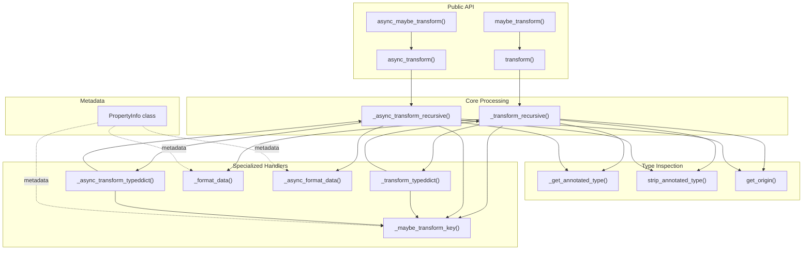
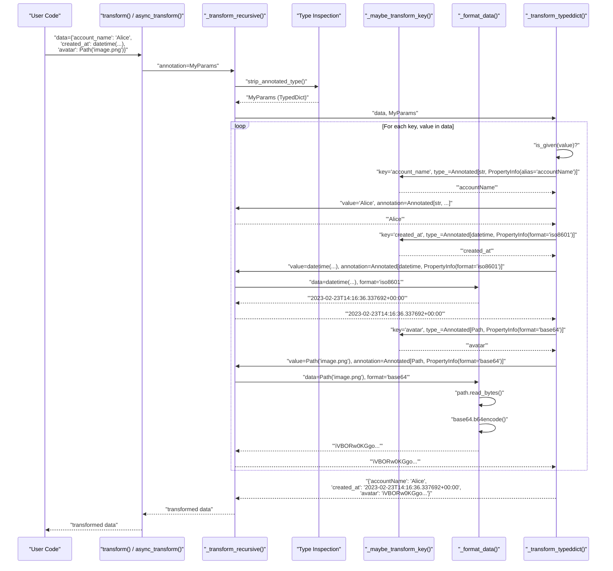

<!-- source: DeepWiki mcp.deepwiki.com · repo openai/openai-python · page 6.1 Data Transformation Pipeline · fetched 2026-10-26 -->

# Data Transformation Pipeline

<details>
<summary>Relevant source files</summary>

The following files were used as context for generating this wiki page:

- [src/openai/_types.py](src/openai/_types.py)
- [src/openai/_utils/__init__.py](src/openai/_utils/__init__.py)
- [src/openai/_utils/_reflection.py](src/openai/_utils/_reflection.py)
- [src/openai/_utils/_sync.py](src/openai/_utils/_sync.py)
- [src/openai/_utils/_transform.py](src/openai/_utils/_transform.py)
- [src/openai/_utils/_typing.py](src/openai/_utils/_typing.py)
- [src/openai/_utils/_utils.py](src/openai/_utils/_utils.py)
- [tests/test_transform.py](tests/test_transform.py)
- [tests/test_utils/test_typing.py](tests/test_utils/test_typing.py)
- [tests/utils.py](tests/utils.py)

</details>


## Purpose and Scope

The Data Transformation Pipeline prepares Python-native data structures for transmission to the OpenAI API. It converts user-friendly Python idioms (snake_case keys, `datetime` objects, `pathlib.Path` instances) into API-compatible formats (camelCase keys, ISO 8601 strings, base64-encoded content). This transformation is metadata-driven, using type annotations to declaratively specify conversion rules.

This document covers the `transform()` and `async_transform()` functions and their supporting infrastructure. For details about the `PropertyInfo` metadata class that drives transformations, see [PropertyInfo and Field Metadata](#6.2). For information about sentinel values used during transformation, see [Special Types and Sentinels](#5.5).

**Sources:** [src/openai/_utils/_transform.py:1-458]()

## Architecture Overview

The transformation pipeline consists of five main components:

| Component | Functions | Purpose |
|-----------|-----------|---------|
| **Entry Points** | `transform()`, `async_transform()`, `maybe_transform()`, `async_maybe_transform()` | Public API for initiating transformations [src/openai/_utils/_transform.py:78-317]() |
| **Recursive Processor** | `_transform_recursive()`, `_async_transform_recursive()` | Core logic that handles nested data structures [src/openai/_utils/_transform.py:154-233](), [src/openai/_utils/_transform.py:320-399]() |
| **Key Transformer** | `_maybe_transform_key()` | Applies alias metadata to dictionary keys [src/openai/_utils/_transform.py:131-147]() |
| **Data Formatter** | `_format_data()`, `_async_format_data()` | Converts values based on format specifications [src/openai/_utils/_transform.py:236-260](), [src/openai/_utils/_transform.py:402-426]() |
| **TypedDict Handler** | `_transform_typeddict()`, `_async_transform_typeddict()` | Processes TypedDict with type hints [src/openai/_utils/_transform.py:263-281](), [src/openai/_utils/_transform.py:429-447]() |

### Data Flow Diagram



**Sources:** [src/openai/_utils/_transform.py:78-447]()

## Entry Point Functions

### transform() and maybe_transform()

The `transform()` function is the synchronous entry point that accepts arbitrary data and an expected type annotation, returning transformed data [src/openai/_utils/_transform.py:92-112]().

```python
def transform(data: _T, expected_type: object) -> _T
```

The `maybe_transform()` wrapper handles the case where `data` is `None`, returning `None` without transformation [src/openai/_utils/_transform.py:78-88]().

```python
def maybe_transform(data: object, expected_type: object) -> Any | None
```

**Sources:** [src/openai/_utils/_transform.py:78-112]()

### async_transform() and async_maybe_transform()

The asynchronous variants provide identical semantics but use non-blocking I/O for file operations [src/openai/_utils/_transform.py:284-317]().

```python
async def async_transform(data: _T, expected_type: object) -> _T
async def async_maybe_transform(data: object, expected_type: object) -> Any | None
```

The async path uses `anyio.Path` for non-blocking file reads when encoding files to base64, while the sync path uses standard `pathlib.Path.read_bytes()` [src/openai/_utils/_transform.py:402-426]().

**Sources:** [src/openai/_utils/_transform.py:284-317](), [src/openai/_utils/_transform.py:402-426]()

## Core Transformation Logic

### _transform_recursive()

The `_transform_recursive()` function implements the core recursive transformation algorithm [src/openai/_utils/_transform.py:154-233](). It processes data based on type annotations, handling various Python type constructs:

| Type Pattern | Behavior |
|--------------|----------|
| `TypedDict` | Delegates to `_transform_typeddict()` for key aliasing and recursive value transformation [src/openai/_utils/_transform.py:179-180]() |
| `dict` | Recursively transforms values using the dictionary's value type annotation [src/openai/_utils/_transform.py:182-184]() |
| `List[T]`, `Iterable[T]`, `Sequence[T]` | Recursively transforms each element [src/openai/_utils/_transform.py:186-209]() |
| `Union[T1, T2, ...]` | Applies transformation against all union variants [src/openai/_utils/_transform.py:211-218]() |
| `pydantic.BaseModel` | Converts to dictionary using `model_dump()` with `exclude_unset=True` [src/openai/_utils/_transform.py:220-221]() |
| Annotated types with `PropertyInfo` | Applies format transformations (ISO 8601, base64, custom) [src/openai/_utils/_transform.py:223-233]() |

The function accepts two type parameters:
- `annotation`: The direct type annotation (may be wrapped in `Required[]`, `Annotated[]`, etc.)
- `inner_type`: The unwrapped type for container elements (defaults to `annotation`)

**Sources:** [src/openai/_utils/_transform.py:154-233](), [src/openai/_utils/_transform.py:320-399]()

### Type Stripping and Inspection

Before processing, the function strips metadata wrappers:

1. `strip_annotated_type()` unwraps `Required[Annotated[T, ...]]` to `T` [src/openai/_utils/_typing.py:75-80]().
2. `get_origin()` extracts the base type from generic types (e.g., `list` from `List[int]`) [src/openai/_utils/_transform.py:178]().
3. Type-checking predicates (`is_typeddict()`, `is_mapping()`, `is_list_type()`, etc.) determine handling strategy [src/openai/_utils/_transform.py:179-192]().

**Sources:** [src/openai/_utils/_transform.py:177-178](), [src/openai/_utils/_typing.py:74-80]()

### Performance Optimizations

The `_no_transform_needed()` function identifies types that require no transformation (`int`, `float`), allowing the pipeline to skip recursive processing for performance [src/openai/_utils/_transform.py:150-151]().

```python
def _no_transform_needed(annotation: type) -> bool:
    return annotation == float or annotation == int
```

**Sources:** [src/openai/_utils/_transform.py:150-151](), [src/openai/_utils/_transform.py:200-207]()

## Key Transformation

### _maybe_transform_key()

The `_maybe_transform_key()` function applies alias metadata to dictionary keys [src/openai/_utils/_transform.py:131-147](). It extracts `PropertyInfo` from annotated types and returns the aliased key name:

```python
def _maybe_transform_key(key: str, type_: type) -> str
```

**Process:**
1. Call `_get_annotated_type()` to check for `Annotated[]` wrapper [src/openai/_utils/_transform.py:136]().
2. Extract annotations (ignoring first argument, which is the actual type) [src/openai/_utils/_transform.py:142]().
3. Find first `PropertyInfo` instance with non-None `alias` [src/openai/_utils/_transform.py:143-145]().
4. Return `alias` if found, otherwise return original `key` [src/openai/_utils/_transform.py:147]().

The `_get_annotated_type()` helper handles `Required[Annotated[T, ...]]` by unwrapping the `Required` first, then checking for `Annotated` [src/openai/_utils/_transform.py:121-126]().

**Sources:** [src/openai/_utils/_transform.py:131-147](), [src/openai/_utils/_transform.py:115-128]()

## Data Formatting

### _format_data()

The `_format_data()` function applies format-specific transformations based on `PropertyInfo.format` [src/openai/_utils/_transform.py:236-260]():

| Format | Input Types | Output | Implementation |
|--------|-------------|--------|----------------|
| `"iso8601"` | `datetime`, `date` | ISO 8601 string | `data.isoformat()` [src/openai/_utils/_transform.py:241-242]() |
| `"custom"` | `datetime`, `date` | Custom format string | `data.strftime(format_template)` [src/openai/_utils/_transform.py:244-245]() |
| `"base64"` | `pathlib.Path`, `IO[bytes]` | Base64-encoded string | `base64.b64encode(binary).decode("ascii")` [src/openai/_utils/_transform.py:259]() |

**Base64 Processing:**
- For `pathlib.Path`: reads bytes using `path.read_bytes()` [src/openai/_utils/_transform.py:250]()
- For `IO[bytes]`: reads using `io.read()` [src/openai/_utils/_transform.py:252]()
- For `StringIO`: encodes string to bytes before encoding [src/openai/_utils/_transform.py:254-255]()

**Sources:** [src/openai/_utils/_transform.py:236-260]()

### _async_format_data()

The async variant uses `anyio.Path(data).read_bytes()` for non-blocking file I/O when encoding `pathlib.Path` instances [src/openai/_utils/_transform.py:416-417](). All other logic is identical to the synchronous version.

**Sources:** [src/openai/_utils/_transform.py:402-426]()

## TypedDict Processing

### _transform_typeddict()

The `_transform_typeddict()` function processes TypedDict mappings [src/openai/_utils/_transform.py:263-281]() by:

1. Extracting type hints using `get_type_hints(expected_type, include_extras=True)` [src/openai/_utils/_transform.py:265]().
2. Iterating over input dictionary items [src/openai/_utils/_transform.py:269]().
3. Filtering out `NotGiven` and `Omit` sentinel values using `is_given()` [src/openai/_utils/_transform.py:270]().
4. For each present value:
   - Look up type annotation [src/openai/_utils/_transform.py:275]().
   - Apply `_maybe_transform_key()` for aliasing [src/openai/_utils/_transform.py:276]().
   - Recursively transform value using `_transform_recursive()` [src/openai/_utils/_transform.py:278]().
5. Return transformed dictionary [src/openai/_utils/_transform.py:281]().

**Sentinel Handling:**
- `NotGiven` values are excluded (distinguishes "not provided" from "explicitly None") [src/openai/_utils/_utils.py:160-161]().
- `Omit` values are excluded (explicitly removes default values) [src/openai/_utils/_utils.py:160-161]().

**Sources:** [src/openai/_utils/_transform.py:263-281](), [src/openai/_utils/_transform.py:429-447](), [src/openai/_utils/_utils.py:160-161]()

## Transformation Flow Diagram



**Sources:** [src/openai/_utils/_transform.py:78-281]()

## Code Entity Mapping

```mermaid
graph TB
    subgraph "User Data Layer"
        UserDict["Python dict<br/>{snake_case: values}"]
        UserDateTime["datetime objects"]
        UserPath["pathlib.Path"]
        UserModel["pydantic.BaseModel"]
    end
    
    subgraph "Type Annotation Layer"
        TypedDictType["TypedDict with<br/>Annotated fields"]
        PropertyInfoMeta["PropertyInfo metadata<br/>alias, format, format_template"]
        RequiredWrapper["Required[] wrapper"]
    end
    
    subgraph "Transform Functions"
        TransformEntry["transform()<br/>maybe_transform()"]
        AsyncTransformEntry["async_transform()<br/>async_maybe_transform()"]
        TransformRecursive["_transform_recursive()"]
        AsyncTransformRecursive["_async_transform_recursive()"]
    end
    
    subgraph "Key Processing"
        GetAnnotatedType["_get_annotated_type()"]
        MaybeTransformKey["_maybe_transform_key()"]
    end
    
    subgraph "Value Processing"
        TransformTypedDict["_transform_typeddict()"]
        AsyncTransformTypedDict["_async_transform_typeddict()"]
        FormatData["_format_data()"]
        AsyncFormatData["_async_format_data()"]
    end
    
    subgraph "Type Utilities"
        StripAnnotated["strip_annotated_type()"]
        IsTypedDict["is_typeddict()"]
        IsMapping["is_mapping()"]
        IsGiven["is_given()"]
        GetOrigin["get_origin()"]
    end
    
    subgraph "Format Operations"
        IsoFormat["datetime.isoformat()"]
        Strftime["datetime.strftime()"]
        Base64Encode["base64.b64encode()"]
        PathReadBytes["pathlib.Path.read_bytes()<br/>anyio.Path.read_bytes()"]
    end
    
    subgraph "Output Data Layer"
        APIDict["JSON-serializable dict<br/>{camelCase: values}"]
        ISOString["ISO 8601 strings"]
        Base64String["base64 strings"]
    end
    
    UserDict --> TransformEntry
    UserDateTime --> TransformEntry
    UserPath --> TransformEntry
    UserModel --> TransformEntry
    
    TypedDictType --> TransformEntry
    PropertyInfoMeta --> MaybeTransformKey
    PropertyInfoMeta --> FormatData
    RequiredWrapper --> GetAnnotatedType
    
    TransformEntry --> TransformRecursive
    AsyncTransformEntry --> AsyncTransformRecursive
    
    TransformRecursive --> StripAnnotated
    TransformRecursive --> GetOrigin
    TransformRecursive --> IsTypedDict
    TransformRecursive --> IsMapping
    TransformRecursive --> TransformTypedDict
    
    TransformTypedDict --> IsGiven
    TransformTypedDict --> MaybeTransformKey
    TransformTypedDict --> TransformRecursive
    
    AsyncTransformRecursive --> AsyncTransformTypedDict
    AsyncTransformTypedDict --> AsyncTransformRecursive
    
    MaybeTransformKey --> GetAnnotatedType
    GetAnnotatedType --> StripAnnotated
    
    TransformRecursive --> FormatData
    AsyncTransformRecursive --> AsyncFormatData
    
    FormatData --> IsoFormat
    FormatData --> Strftime
    FormatData --> Base64Encode
    FormatData --> PathReadBytes
    
    AsyncFormatData --> IsoFormat
    AsyncFormatData --> Strftime
    AsyncFormatData --> Base64Encode
    AsyncFormatData --> PathReadBytes
    
    TransformRecursive --> APIDict
    FormatData --> ISOString
    FormatData --> Base64String
    
    APIDict --> ISOString
    APIDict --> Base64String
```



**Sources:** [src/openai/_utils/_transform.py:1-458](), [src/openai/_utils/_utils.py:133-134](), [src/openai/_utils/_typing.py:74-80]()

## Practical Examples

### Example 1: Key Aliasing

**Input:**
```python
class Params(TypedDict):
    account_holder_name: Annotated[str, PropertyInfo(alias='accountHolderName')]

transform({'account_holder_name': 'Robert'}, Params)
```

**Output:**
```python
{'accountHolderName': 'Robert'}
```

**Sources:** [tests/test_transform.py:40-47]()

### Example 2: DateTime Formatting

**Input:**
```python
class DatetimeParams(TypedDict):
    created_at: Annotated[datetime, PropertyInfo(format='iso8601')]

dt = datetime.fromisoformat('2023-02-23T14:16:36.337692+00:00')
transform({'created_at': dt}, DatetimeParams)
```

**Output:**
```python
{'created_at': '2023-02-23T14:16:36.337692+00:00'}
```

**Sources:** [tests/test_transform.py:164-206]()

### Example 3: Sentinel Value Filtering

**Input:**
```python
from openai._types import not_given, omit

class Params(TypedDict):
    foo_bar: Annotated[str, PropertyInfo(alias='fooBar')]

transform({'foo_bar': not_given}, Params)  # Returns {}
transform({'foo_bar': omit}, Params)       # Returns {}
transform({'foo_bar': None}, Params)       # Returns {'fooBar': None}
```

**Sources:** [tests/test_transform.py:449-460](), [src/openai/_utils/_transform.py:270-273]()

---

