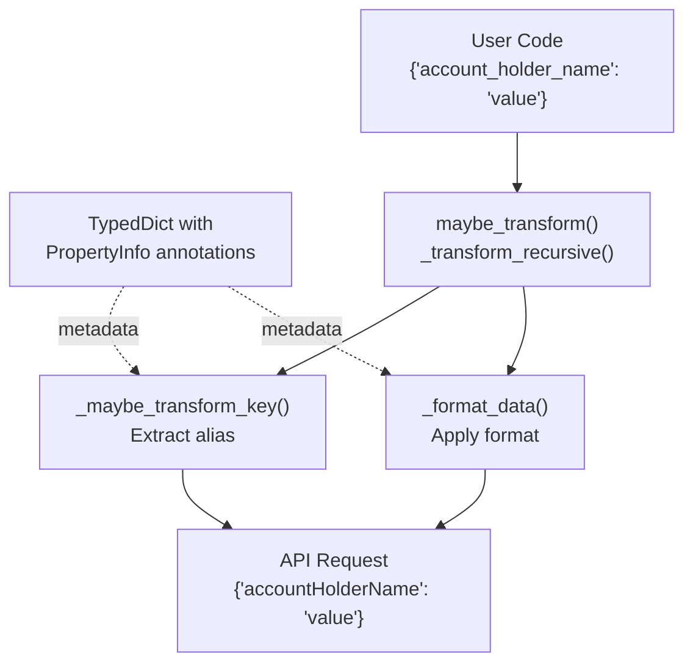
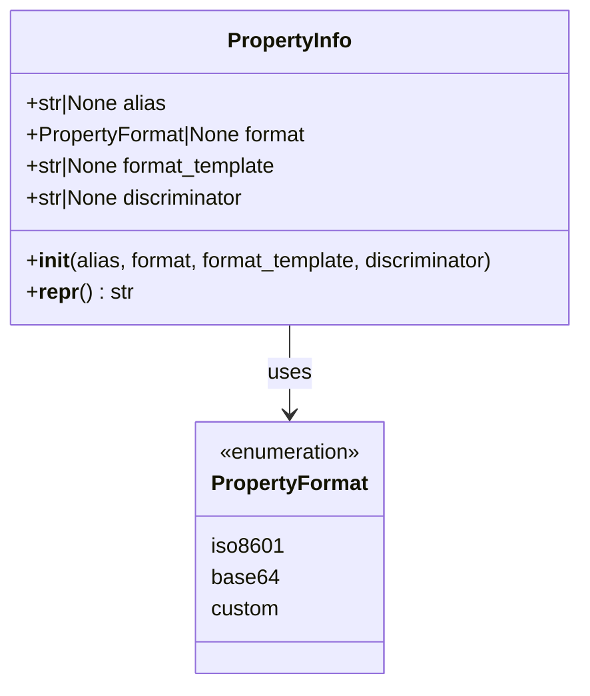
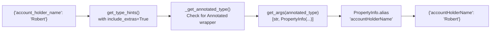
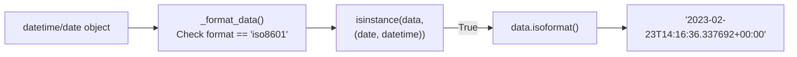
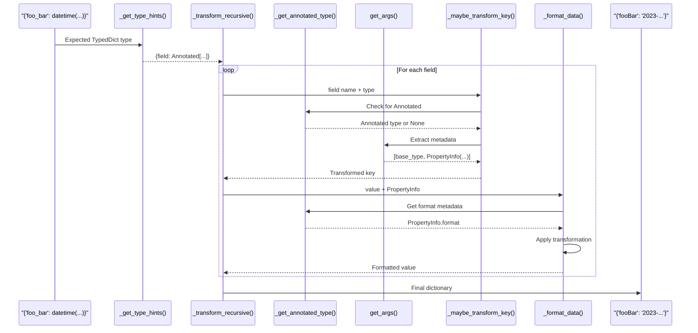

<!-- source: DeepWiki mcp.deepwiki.com · repo openai/openai-python · page 6.2 PropertyInfo and Field Metadata · fetched 2026-10-26 -->

# PropertyInfo and Field Metadata

<details>
<summary>Relevant source files</summary>

The following files were used as context for generating this wiki page:

- [src/openai/_types.py](src/openai/_types.py)
- [src/openai/_utils/__init__.py](src/openai/_utils/__init__.py)
- [src/openai/_utils/_reflection.py](src/openai/_utils/_reflection.py)
- [src/openai/_utils/_sync.py](src/openai/_utils/_sync.py)
- [src/openai/_utils/_transform.py](src/openai/_utils/_transform.py)
- [src/openai/_utils/_typing.py](src/openai/_utils/_typing.py)
- [src/openai/_utils/_utils.py](src/openai/_utils/_utils.py)
- [tests/test_transform.py](tests/test_transform.py)
- [tests/test_utils/test_typing.py](tests/test_utils/test_typing.py)
- [tests/utils.py](tests/utils.py)

</details>


The `PropertyInfo` class provides declarative field-level transformation metadata used by the SDK's data transformation pipeline. It controls how Python field names and values are transformed when preparing API requests.

For the overall transformation pipeline that consumes this metadata, see [Data Transformation Pipeline](6.1). For type coercion during response parsing, see [Type Coercion and Construction](6.3).

---

## Overview

`PropertyInfo` enables declarative transformation rules through Python's `Annotated` type system:

- **Field aliasing**: Maps Python `snake_case` names to API `camelCase` names.
- **Format specifications**: Converts `datetime`, `date`, or file objects to API-compatible strings (e.g., ISO 8601 or Base64).
- **Discriminator metadata**: Supports discriminated union type resolution during serialization.

`PropertyInfo` instances attach to type annotations and are extracted by transformation functions (`transform()`, `async_transform()`) during request serialization.

### Role in Transformation Pipeline



**Sources:** [src/openai/_utils/_transform.py:44-76](), [src/openai/_utils/_transform.py:78-113]()

---

## PropertyInfo Class Definition

### Attributes



| Attribute | Type | Purpose |
|-----------|------|---------|
| `alias` | `str \| None` | Alternative field name to use in serialized output. |
| `format` | `PropertyFormat \| None` | Formatting strategy for the field value (e.g., ISO8601). |
| `format_template` | `str \| None` | Template string for custom datetime formatting via `strftime`. |
| `discriminator` | `str \| None` | Discriminator field name for union types. |

The `PropertyFormat` type is defined as:
`PropertyFormat = Literal["iso8601", "base64", "custom"]` [src/openai/_utils/_transform.py:41-41]()

**Sources:** [src/openai/_utils/_transform.py:41-76]()

---

## Field Aliasing

Field aliasing allows Python code to use idiomatic `snake_case` field names while transforming them to the API's naming conventions (typically `camelCase`).

### Transformation Flow



### Implementation

The `_maybe_transform_key()` function at [src/openai/_utils/_transform.py:131-148]() extracts aliases:

1. Calls `_get_annotated_type(type_)` to check for `Annotated` wrapper.
2. If found, calls `get_args(annotated_type)[1:]` to extract metadata (index 0 is the base type).
3. Iterates annotations to find `PropertyInfo` instances.
4. Returns `PropertyInfo.alias` if set, otherwise returns the original key unchanged.

The `_transform_typeddict()` function at [src/openai/_utils/_transform.py:263-282]() obtains type hints using `_get_type_hints(expected_type, include_extras=True)`, which is critical for preserving `Annotated` metadata.

**Sources:** [src/openai/_utils/_transform.py:131-148](), [src/openai/_utils/_transform.py:263-282](), [src/openai/_utils/_transform.py:450-458]()

### Usage Example

```python
class MyParams(TypedDict):
    account_holder_name: Annotated[str, PropertyInfo(alias='accountHolderName')]

# Input: {'account_holder_name': 'Robert'}
# Output: {'accountHolderName': 'Robert'}
```

**Sources:** [src/openai/_utils/_transform.py:48-52](), [tests/test_transform.py:40-47]()

---

## Format Specifications

The `format` attribute in `PropertyInfo` controls how field values are serialized.

### ISO 8601 Datetime Formatting



**Behavior at [src/openai/_utils/_transform.py:237-243]():**
- Checks `isinstance(data, (date, datetime))`.
- If `format_ == "iso8601"`, calls `data.isoformat()`.
- Preserves timezone information if present.

**Sources:** [src/openai/_utils/_transform.py:236-243]()

### Base64 File Encoding

Automatically encodes file content to base64 for JSON-embedded file transmission (e.g., for DALL-E image edits or specific Vision inputs):

| Input Type | Processing |
|------------|------------|
| `pathlib.Path` | Reads file bytes via `read_bytes()`, encodes to base64. |
| `io.IOBase` | Reads stream content via `read()`, encodes to base64. |
| `str` | Passes through unchanged (assumed pre-encoded). |

**Implementation at [src/openai/_utils/_transform.py:244-260]():**
1. Checks `format_ == "base64"` and `is_base64_file_input(data)`.
2. If `pathlib.Path`: reads bytes via `data.read_bytes()`.
3. If `io.IOBase`: reads via `data.read()`, converts str to bytes if needed.
4. Calls `base64.b64encode(binary).decode("ascii")`.

**Sync vs Async:**
- Synchronous `_format_data()` uses blocking `pathlib.Path.read_bytes()` [src/openai/_utils/_transform.py:248]().
- Asynchronous `_async_format_data()` uses `anyio.Path(data).read_bytes()` [src/openai/_utils/_transform.py:414]().

**Sources:** [src/openai/_utils/_transform.py:244-260](), [src/openai/_utils/_transform.py:410-426]()

---

## Integration with Annotated Types

`PropertyInfo` is used as metadata in Python's `Annotated` type construct.

### Type Structure Unwrapping

The `_get_annotated_type()` function at [src/openai/_utils/_transform.py:116-129]():
- Checks `is_required_type(type_)` via `get_origin(type_) == Required` [src/openai/_utils/_typing.py:45]().
- If true, unwraps via `get_args(type_)[0]` to strip `Required[]`.
- Checks `is_annotated_type(type_)` via `get_origin(type_) == Annotated` [src/openai/_utils/_typing.py:22]().
- Returns the `Annotated` type or `None`.

**Performance:** Decorated with `@lru_cache(maxsize=8096)` [src/openai/_utils/_transform.py:115]() for repeated type lookups.

**Sources:** [src/openai/_utils/_transform.py:115-129](), [src/openai/_utils/_typing.py:21-46]()

---

## Transformation Pipeline Integration

`PropertyInfo` metadata is consumed by the recursive transformation pipeline.

### Transformation Sequence



### Key Functions

| Function | Purpose | Location |
|----------|---------|----------|
| `transform()` | Entry point for synchronous transformation. | [src/openai/_utils/_transform.py:92-113]() |
| `_transform_recursive()` | Handles nested structures (dict, list, union). | [src/openai/_utils/_transform.py:154-234]() |
| `_maybe_transform_key()` | Extracts alias from `PropertyInfo` metadata. | [src/openai/_utils/_transform.py:131-148]() |
| `_format_data()` | Applies format transformation logic (ISO 8601, Base64). | [src/openai/_utils/_transform.py:236-261]() |
| `_get_annotated_type()` | Unwraps `Required`/`Annotated` metadata. | [src/openai/_utils/_transform.py:116-129]() |

**Sources:** [src/openai/_utils/_transform.py:92-282](), [src/openai/_utils/_transform.py:450-458]()

---

## Synchronous vs Asynchronous Processing

The transformation system provides parallel implementations to support both `OpenAI` and `AsyncOpenAI` clients:

| Operation | Sync Function | Async Function |
|-----------|---------------|----------------|
| Entry point | `transform()` [src/openai/_utils/_transform.py:92]() | `async_transform()` [src/openai/_utils/_transform.py:297]() |
| Recursive transform | `_transform_recursive()` [src/openai/_utils/_transform.py:154]() | `_async_transform_recursive()` [src/openai/_utils/_transform.py:320]() |
| Format data | `_format_data()` [src/openai/_utils/_transform.py:236]() | `_async_format_data()` [src/openai/_utils/_transform.py:402]() |

Both implementations share the same metadata extraction logic via `_get_annotated_type()` and `_maybe_transform_key()`. The async version uses `anyio` for non-blocking file reads during Base64 encoding [src/openai/_utils/_transform.py:414]().

**Sources:** [src/openai/_utils/_transform.py:92-447]()

---

## Export and Availability

`PropertyInfo` is exported through the internal utility module for use throughout the SDK:

```python
from openai._utils import PropertyInfo
```

**Sources:** [src/openai/_utils/__init__.py:56-62]()

---

