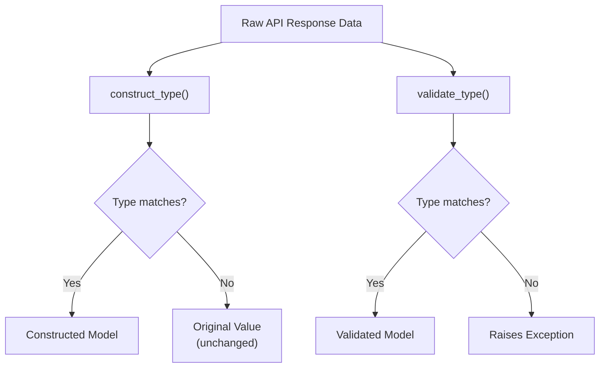
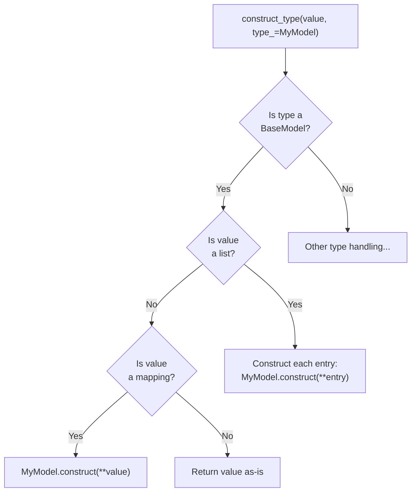
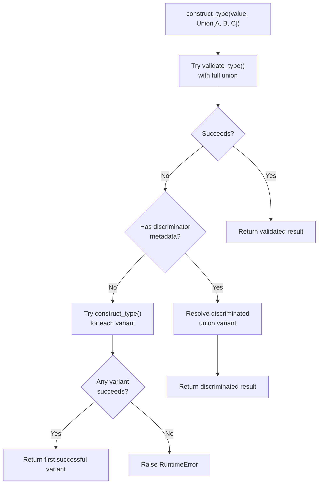
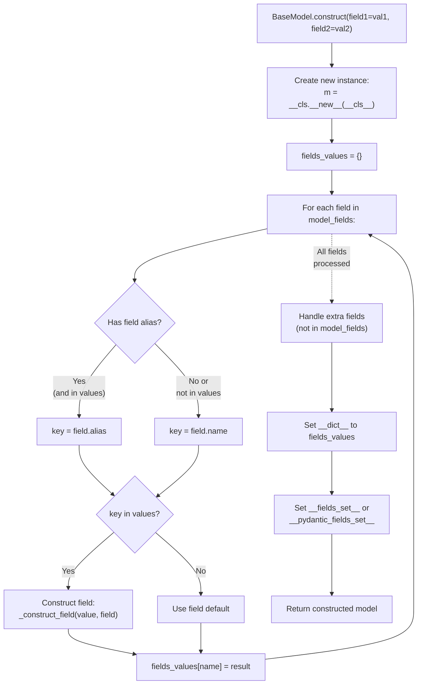

<!-- source: DeepWiki mcp.deepwiki.com · repo openai/openai-python · page 6.3 Type Coercion and Construction · fetched 2026-10-26 -->

# Type Coercion and Construction

<details>
<summary>Relevant source files</summary>

The following files were used as context for generating this wiki page:

- [src/openai/_compat.py](src/openai/_compat.py)
- [src/openai/_models.py](src/openai/_models.py)
- [src/openai/_utils/_json.py](src/openai/_utils/_json.py)
- [tests/test_models.py](tests/test_models.py)
- [tests/test_utils/test_json.py](tests/test_utils/test_json.py)

</details>


This page documents the type coercion and construction system used for deserializing API responses and constructing model instances without strict validation. This system enables "loose coercion" where data is transformed into the expected types on a best-effort basis, returning values as-is when coercion is not possible.

---

## Purpose and Scope

The type coercion system serves two primary purposes:

1. **Response Deserialization**: Constructing strongly-typed Pydantic models from raw API response data without triggering validation errors [src/openai/_models.py:494-611]().
2. **Graceful Type Handling**: Allowing mismatched or unexpected data to pass through the system rather than failing, enabling flexibility when the API behavior differs from the specification [tests/test_models.py:19-35]().

This approach is critical for API clients because:
- APIs may return data that doesn't perfectly match the OpenAPI specification [tests/test_models.py:283-303]().
- Forward compatibility is maintained when new fields are added [tests/test_models.py:148-158]().
- Partial or incomplete data can still be represented as model instances [src/openai/_models.py:203-264]().
- Type safety is preserved at the Python level while remaining lenient with API responses [src/openai/_models.py:485-491]().

**Sources**: [src/openai/_models.py:494-611](), [tests/test_models.py:19-35](), [tests/test_models.py:283-303](), [tests/test_models.py:148-158](), [src/openai/_models.py:203-264](), [src/openai/_models.py:485-491]()

---

## Core Functions

### construct_type()

The primary entry point for loose type coercion:

```python
construct_type(*, value: object, type_: object, metadata: Optional[List[Any]] = None) -> object
```

**Behavior**:
- Recursively constructs nested types (models, lists, dicts) [src/openai/_models.py:562-588]().
- Returns the value as-is if coercion is not possible or appropriate [src/openai/_models.py:611]().
- Does not raise validation errors for type mismatches [tests/test_models.py:33-34]().
- Extracts and processes `Annotated` type metadata (e.g., `PropertyInfo`) [src/openai/_models.py:502-505]().

**Key characteristics**:
- **Non-strict**: Unlike `validate_type()`, this function does not enforce type correctness [src/openai/_models.py:494-611]().
- **Recursive**: Processes nested structures (models within models, lists of models, etc.) [src/openai/_models.py:562-588]().
- **Metadata-aware**: Respects `PropertyInfo` annotations for discriminated unions [src/openai/_models.py:545-551]().
- **Type-preserving**: Maintains the original value when coercion is not applicable [src/openai/_models.py:611]().

**Sources**: [src/openai/_models.py:494-611](), [src/openai/_models.py:562-588](), [tests/test_models.py:33-34](), [src/openai/_models.py:502-505](), [src/openai/_models.py:545-551]()

### construct_type_unchecked()

Type-safe wrapper for `construct_type()`:

```python
construct_type_unchecked(*, value: object, type_: type[_T]) -> _T
```

Returns a value cast to the expected type, providing better type checker support [src/openai/_models.py:485-491](). The "unchecked" name indicates that the cast is not guaranteed to be accurate—the returned value may not actually match the declared type if coercion failed.

**Sources**: [src/openai/_models.py:485-491]()

### build()

Higher-level helper for constructing `BaseModel` instances:

```python
build(base_model_cls: Callable[P, _BaseModelT], *args: P.args, **kwargs: P.kwargs) -> _BaseModelT
```

Provides type-safe construction of `BaseModel` instances using keyword arguments only [src/openai/_models.py:462-482](). This wrapper ensures that the construction call matches the model's field signatures at the type-checking level.

**Sources**: [src/openai/_models.py:462-482]()

### validate_type()

Strict validation alternative:

```python
validate_type(*, type_: type[_T], value: object) -> _T
```

Unlike `construct_type()`, this function performs strict validation and raises errors if the value doesn't match the expected type [src/openai/_models.py:744-749]().

**Sources**: [src/openai/_models.py:744-749]()

---

## Construction vs Validation

The library provides two distinct approaches for handling typed data:

### Type Processing Flow


**When construct_type() is used**:
- Deserializing API responses via `BaseModel.construct()` [src/openai/_models.py:203-264]().
- Building models from potentially incomplete data [tests/test_models.py:148-158]().
- Parsing data where the API may not match the spec exactly [tests/test_models.py:283-303]().

**When validate_type() is used**:
- User-provided input that must conform to strict types [src/openai/_models.py:744-749]().
- Union type resolution when discriminator matching is attempted [src/openai/_models.py:530-535]().

**Sources**: [src/openai/_models.py:494-749](), [src/openai/_models.py:203-264](), [tests/test_models.py:148-158](), [tests/test_models.py:283-303](), [src/openai/_models.py:744-749](), [src/openai/_models.py:530-535]()

---

## Type Handling

### BaseModel Construction

When the target type is a `BaseModel` or `GenericModel` subclass, construction follows special rules:

### BaseModel Dispatch Logic


**List of models**: If the value is a list and each entry is a mapping, each entry is constructed separately via `MyModel.construct(**entry)` [src/openai/_models.py:569-581]().

**Single model**: If the value is a mapping (dict), it's passed directly to `construct()` [src/openai/_models.py:575-581]().

**Sources**: [src/openai/_models.py:569-581](), [tests/test_models.py:54-71]()

### Union Type Resolution

Union types are handled with a fallback strategy: try each variant in order until one succeeds [src/openai/_models.py:525-560]().

#### Basic Union Resolution



**Sources**: [src/openai/_models.py:525-560]()

#### Discriminated Unions

Discriminated unions use a special field to determine which variant to construct, even when the data doesn't perfectly match the expected type [src/openai/_models.py:614-720]().

**Metadata specification**:
```python
Annotated[Union[A, B], PropertyInfo(discriminator="type")]
```

**Resolution algorithm**:
1. Build discriminator metadata via `_build_discriminated_union_meta()` (or retrieve from `DISCRIMINATOR_CACHE`) [src/openai/_models.py:545-551]().
2. Extract the discriminator field value from the input data [src/openai/_models.py:614-720]().
3. Look up the corresponding variant type in the mapping [src/openai/_models.py:614-720]().
4. Construct that specific variant, bypassing the fallback loop [src/openai/_models.py:551]().

**Caching**: Discriminator details are cached in `DISCRIMINATOR_CACHE` (a `WeakKeyDictionary`) to avoid rebuilding the mapping on every call [src/openai/_models.py:614-615]().

**Sources**: [src/openai/_models.py:545-551](), [src/openai/_models.py:614-720](), [tests/test_models.py:657-833]()

### Container Types

#### Dictionary Construction
For `Dict[str, T]` types, each value is recursively constructed via `construct_type` [src/openai/_models.py:562-567]().

#### List Construction
For `List[T]` types, each element is recursively constructed [src/openai/_models.py:583-588](). If `inner_type` is `float` or `int`, transformation is skipped for performance [src/openai/_models.py:584-585]().

**Sources**: [src/openai/_models.py:562-567](), [src/openai/_models.py:583-588]()

### Primitive Type Coercion

#### Integer to Float
Special handling exists for safely coercing integers to floats only when the conversion is lossless (e.g., within 2^53 range) [src/openai/_models.py:590-597]().

#### Date and DateTime Parsing
String values are automatically parsed to `datetime` or `date` objects using `parse_datetime` or `parse_date` [src/openai/_models.py:599-609](). If parsing fails, the original value is returned unchanged [src/openai/_models.py:603, 609]().

**Sources**: [src/openai/_models.py:590-597](), [src/openai/_models.py:599-609](), [tests/test_models.py:423-441](), [tests/test_models.py:453-469]()

---

## BaseModel.construct() Override

The library overrides Pydantic's `construct()` method to provide custom construction logic that handles aliases and nested construction [src/openai/_models.py:203-264]().

### BaseModel.construct() Logic


**Sources**: [src/openai/_models.py:203-264]()

---

## Field Construction with _construct_field()

Individual fields are constructed via the `_construct_field()` helper [src/openai/_models.py:411-423]():

```python
def _construct_field(value: object, field: FieldInfo, key: str) -> object:
    if value is None:
        return field_get_default(field)
    
    # ... type extraction logic ...
    
    return construct_type(value=value, type_=type_, metadata=getattr(field, "metadata", None))
```

**Process**:
1. If the value is `None`, return the field's default value [src/openai/_models.py:412-413]().
2. Extract the field's type annotation (`outer_type_` in v1, `annotation` in v2) [src/openai/_models.py:415-418]().
3. Call `construct_type()` with the field's metadata for `Annotated` types [src/openai/_models.py:423]().

**Sources**: [src/openai/_models.py:411-423]()

---

## Discriminator Caching System

The discriminated union resolution system uses aggressive caching via `DISCRIMINATOR_CACHE` [src/openai/_models.py:614-741]().

**DiscriminatorDetails structure**:

| Field | Type | Purpose |
|-------|------|---------|
| `field_name` | `str` | The discriminator field in the Python model [src/openai/_models.py:619](). |
| `field_alias_from` | `str \| None` | The discriminator field in the API response if an alias is used [src/openai/_models.py:620](). |
| `mapping` | `dict[str, type]` | Maps discriminator values to variant types [src/openai/_models.py:618](). |

**Sources**: [src/openai/_models.py:614-741](), [tests/test_models.py:799-833]()

---

## Extra Fields Handling

The construction system preserves unknown fields (those not defined in the model). In Pydantic v2, these are stored in `__pydantic_extra__` [src/openai/_models.py:237-248](). If the model defines an `extra` field type, extra fields are constructed using that type via `construct_type` [src/openai/_models.py:426-440]().

**Sources**: [src/openai/_models.py:237-248](), [src/openai/_models.py:426-440]()

---

## TypeAliasType Support

Python 3.12+ `TypeAliasType` annotations are unwrapped before processing by `construct_type` [src/openai/_models.py:507-509]().

**Sources**: [src/openai/_models.py:507-509](), [tests/test_models.py:836-849]()

---

