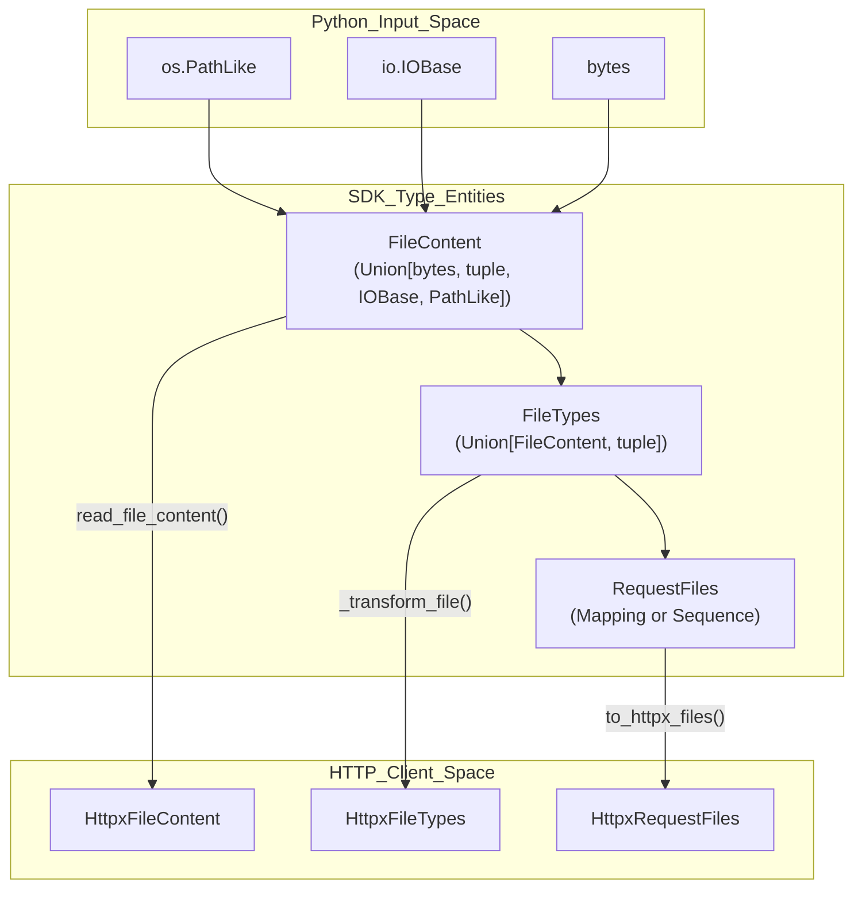
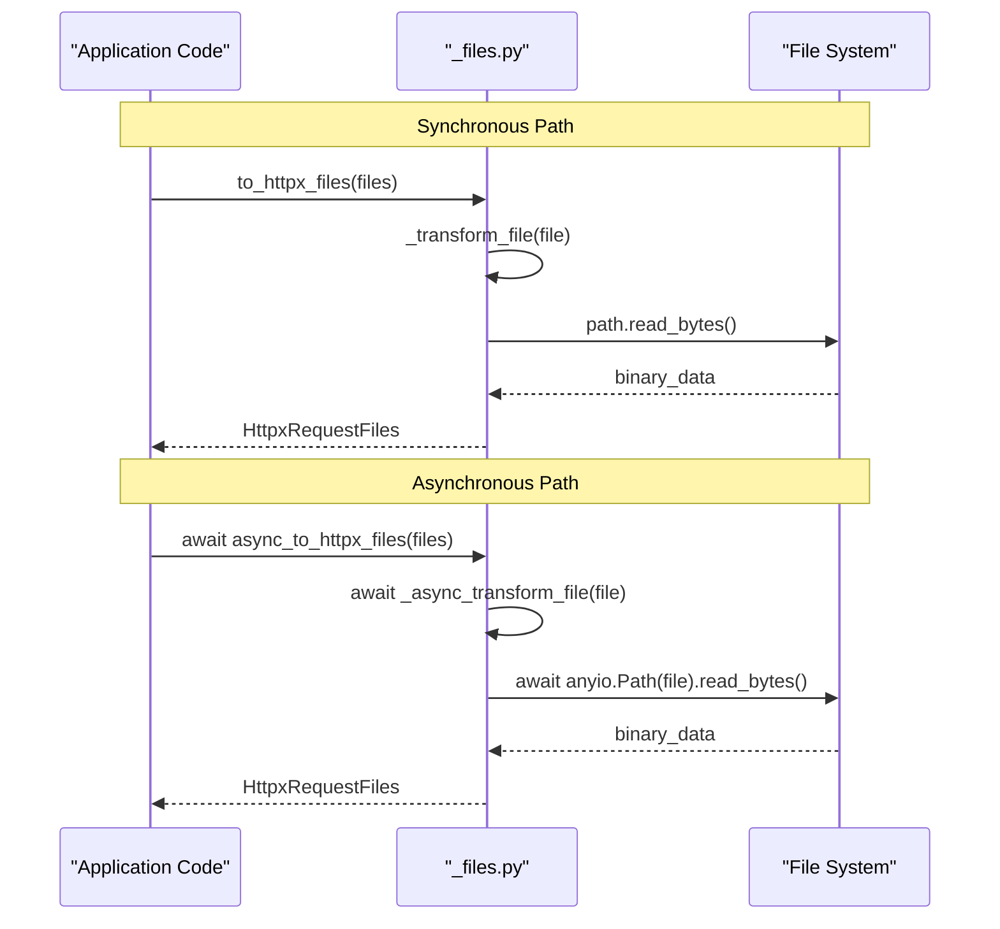

<!-- source: DeepWiki mcp.deepwiki.com · repo openai/openai-python · page 6.5 File Extraction and Processing · fetched 2026-10-26 -->

# File Extraction and Processing

Relevant source files

The following files were used as context for generating this wiki page:

- [Brewfile](Brewfile)
- [examples/httpx2_client.py](examples/httpx2_client.py)
- [scripts/bootstrap](scripts/bootstrap)
- [scripts/format](scripts/format)
- [scripts/lint](scripts/lint)
- [scripts/mock](scripts/mock)
- [scripts/test](scripts/test)
- [src/openai/_files.py](src/openai/_files.py)
- [src/openai/_httpx2.py](src/openai/_httpx2.py)
- [src/openai/_qs.py](src/openai/_qs.py)
- [tests/test_extract_files.py](tests/test_extract_files.py)
- [tests/test_files.py](tests/test_files.py)

This document describes the file handling system in the OpenAI Python SDK. It covers mechanisms for transmitting files to the API: extracting files from request dictionaries for multipart form data encoding and processing file content for `httpx` compatibility.

## Overview

The SDK handles files primarily for multipart form data requests (e.g., file uploads, audio transcriptions). The system relies on utility functions to locate, extract, and transform various Python file-like objects into formats compatible with the underlying HTTP client.

| Mechanism | Use Case | Implementation | Location |
|-----------|----------|----------------|----------|
| **File Extraction** | Multipart form data requests | `extract_files()` recursively locates and removes file objects from request dictionaries | [src/openai/_utils.py:8-9]() |
| **HTTPX Transformation** | Standardizing file inputs | `to_httpx_files()` and `async_to_httpx_files()` convert inputs to `httpx`-compatible structures | [src/openai/_files.py:51-62](), [src/openai/_files.py:93-104]() |
| **Path Preservation** | Safe mutation | `deepcopy_with_paths()` copies only containers on specific paths to prevent side effects | [src/openai/_files.py:128-145]() |

Sources: [src/openai/_utils.py:8-9](), [src/openai/_files.py:51-62](), [src/openai/_files.py:93-104](), [src/openai/_files.py:128-145]()

## File Type System

The SDK defines a hierarchy of file-related types to support different input formats, including raw bytes, file handles, and filesystem paths.

### File Entity Space Mapping

Sources: [src/openai/_files.py:25-33](), [src/openai/_files.py:65-76](), [src/openai/_files.py:79-83]()

### Type Hierarchy Table

| Type | Definition | Purpose |
|------|------------|---------|
| `FileContent` | `Union[bytes, tuple, IOBase, PathLike]` | Acceptable raw content sources for files. [src/openai/_files.py:29-32]() |
| `FileTypes` | `Union[FileContent, Tuple[str, FileContent, ...]]` | Flexible file specification allowing for optional filenames and MIME types. [src/openai/_files.py:65-76]() |
| `RequestFiles` | `Union[Mapping[str, FileTypes], Sequence[Tuple[str, FileTypes]]]` | The structure used to pass multiple files in a single request. [src/openai/_files.py:51-62]() |
| `Base64FileInput` | `Union[io.IOBase, os.PathLike]` | Types specifically recognized as sources for file input. [src/openai/_files.py:25-26]() |

Sources: [src/openai/_files.py:25-33](), [src/openai/_files.py:65-76](), [src/openai/_files.py:51-62]()

## File Transformation and Reading

The SDK must convert high-level Python types (like `pathlib.Path`) into raw data that `httpx` can transmit.

### Transformation Logic

The function `_transform_file` handles the conversion logic:
1. If the input is a `PathLike` object, it extracts the filename and reads the bytes immediately. [src/openai/_files.py:67-69]()
2. If the input is a tuple, it recursively processes the content element (index 1) using `read_file_content`. [src/openai/_files.py:73-74]()

### Synchronous vs Asynchronous Processing

The SDK provides parallel implementations for reading file content.

Sources: [src/openai/_files.py:51-83](), [src/openai/_files.py:93-126]()

## Safe Mutation with Path Deepcopy

When extracting files from a request dictionary, the SDK avoids mutating the user's original input objects by using a targeted deepcopy mechanism.

### deepcopy_with_paths Implementation

The `deepcopy_with_paths` utility performs a selective copy. It only creates new instances of dictionaries and lists that exist on the paths where files will be extracted. [src/openai/_files.py:128-145]()

- **Input**: A data structure and a sequence of paths (e.g., `[["documents", "<array>", "file"]]`). [src/openai/_files.py:145]()
- **Logic**:
    - If a dictionary key is on a path, that dictionary is copied. [src/openai/_files.py:161-165]()
    - If a list is encountered and the path contains `"<array>"`, the list and its relevant elements are copied. [src/openai/_files.py:167-172]()
    - All other values (like the actual file bytes or irrelevant metadata) are kept by reference to save memory. [src/openai/_files.py:173]()

Sources: [src/openai/_files.py:128-173]()

## Integration with Multipart Requests

The extraction process prepares the request for `multipart/form-data` encoding.

### Extraction Flow

1. **Path Specification**: The SDK identifies where files are located in the schema using path arrays (e.g., `["file"]` or `["purpose"]`). [tests/test_extract_files.py:17-21]()
2. **Extraction**: `extract_files` traverses the dictionary, pops the file content out, and returns it as a list of tuples formatted for the HTTP client. [tests/test_extract_files.py:11-27]()
3. **Naming**: The field names are generated based on the path. For nested structures, it uses bracket notation (e.g., `foo[bar]`). [tests/test_extract_files.py:21-25]()
4. **Array Formatting**: Supports multiple array formats like `brackets` (`files[]`), `indices` (`files[0]`), or `repeat` (`files`). [src/openai/_qs.py:86-114](), [tests/test_extract_files.py:73-86]()

### Array Format Comparison

| Format | Output Example (Nested) | Output Example (Top Level) |
|--------|-------------------------|----------------------------|
| `brackets` | `items[][file]` | `files[]` |
| `indices` | `items[0][file]` | `files[0]` |
| `repeat` | `items[file]` | `files` |

Sources: [src/openai/_qs.py:86-114](), [tests/test_extract_files.py:73-92]()

---

