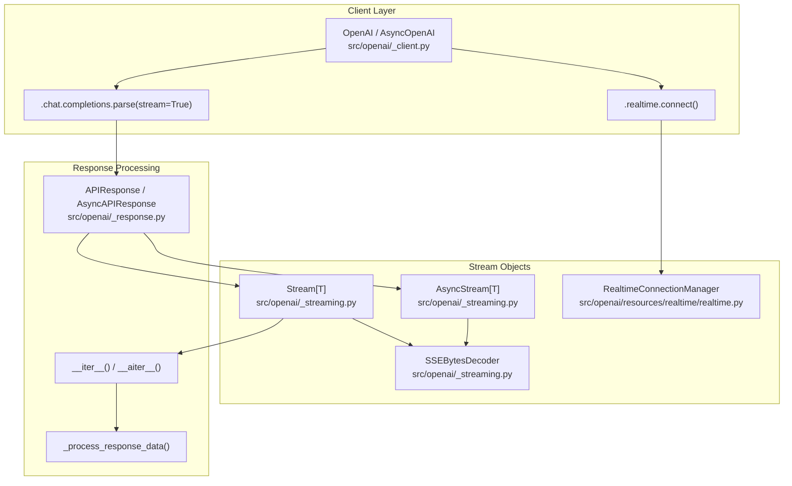
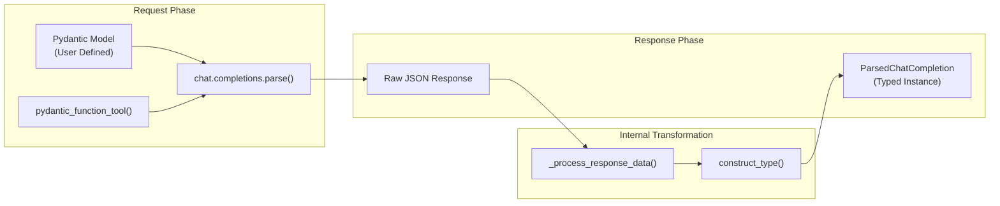

<!-- source: DeepWiki mcp.deepwiki.com · repo openai/openai-python · page 7 Advanced Features · fetched 2026-10-26 -->

# Advanced Features

Relevant source files

The following files were used as context for generating this wiki page:

- [README.md](README.md)
- [src/openai/__init__.py](src/openai/__init__.py)
- [src/openai/_base_client.py](src/openai/_base_client.py)
- [src/openai/_client.py](src/openai/_client.py)
- [src/openai/_legacy_response.py](src/openai/_legacy_response.py)
- [src/openai/_response.py](src/openai/_response.py)
- [src/openai/_streaming.py](src/openai/_streaming.py)
- [src/openai/lib/azure.py](src/openai/lib/azure.py)
- [src/openai/resources/beta/realtime/realtime.py](src/openai/resources/beta/realtime/realtime.py)
- [src/openai/resources/realtime/realtime.py](src/openai/resources/realtime/realtime.py)
- [tests/lib/test_azure.py](tests/lib/test_azure.py)
- [tests/test_client.py](tests/test_client.py)
- [tests/test_legacy_response.py](tests/test_legacy_response.py)
- [tests/test_response.py](tests/test_response.py)
- [tests/test_streaming.py](tests/test_streaming.py)
- [tests/test_utils/test_logging.py](tests/test_utils/test_logging.py)

This page covers advanced capabilities and patterns available in the OpenAI Python SDK for specialized use cases. These features enable sophisticated tool integration, real-time event handling, security validation, and deep customization of the HTTP transport layer.

## Overview of Advanced Capabilities

The OpenAI Python SDK provides several high-level abstractions for complex interaction patterns:

| Feature | Purpose | Key Classes/Methods |
|---------|---------|---------------------|
| **Tool Calling** | Structured function execution and multi-tool integration | `pydantic_function_tool`, `.parse()` |
| **Streaming & Events** | Real-time response processing and event-driven architectures | `Stream`, `AsyncStream`, `AssistantEventHandler` |
| **Webhook Verification** | Securely validate and parse incoming webhook signatures | `client.webhooks.unwrap()`, `verify_signature()` |
| **Custom HTTP Clients** | Configure proxies, custom transports, or alternative event loops | `DefaultHttpxClient`, `http_client` param |
| **Structured Outputs** | Automatic parsing of responses into Pydantic models | `.chat.completions.parse()` |
| **Realtime API** | Low-latency WebSocket-based multi-modal interaction | `RealtimeConnectionManager` |

Detailed documentation for each feature is available in subsections [Tool Calling and Integration](#7.1) through [Custom HTTP Clients and Proxies](#7.4).

Sources: [src/openai/_client.py:137-156](), [src/openai/_streaming.py:23-132](), [src/openai/resources/realtime/realtime.py:99-136]()

## Advanced Streaming Architecture

The SDK handles streaming via Server-Sent Events (SSE). It provides specialized classes to iterate over these streams while maintaining type safety and handling connection lifecycles.

### Streaming Component Architecture

**Streaming Flow**: When a streaming request is made, the client returns a `Stream` or `AsyncStream` instance [src/openai/_streaming.py:23-132](). These classes wrap an `SSEBytesDecoder` that parses raw bytes from the `httpx.Response` into `ServerSentEvent` objects [src/openai/_streaming.py:52-53](). For low-latency multi-modal use cases, the `Realtime` resource provides a `connect()` method returning a `RealtimeConnectionManager` for stateful WebSocket communication [src/openai/resources/realtime/realtime.py:99-136]().

For details, see [Streaming and Event Handling](#7.2).

Sources: [src/openai/_streaming.py:23-160](), [src/openai/_response.py:142-183](), [src/openai/resources/realtime/realtime.py:99-182]()

## Structured Outputs and Parsing

The SDK includes a `.parse()` helper that integrates with Pydantic to provide "Structured Outputs." This feature automatically converts Pydantic models into JSON schemas for the API and deserializes the results back into typed Python objects.

### Structured Output Flow

**Key Behaviors**:
- **Automatic Schema Generation**: Pydantic models passed to the SDK are processed via `construct_type` to ensure correct serialization and validation [src/openai/_base_client.py:76-77]().
- **Validation**: If the API responds with invalid data for the expected schema, an `APIResponseValidationError` is raised if `_strict_response_validation` is enabled [src/openai/_client.py:154-156]().
- **Tool Integration**: Using `pydantic_function_tool` (exported in `openai.__init__`) allows function arguments to be automatically validated against Pydantic models [src/openai/__init__.py:104]().

For details, see [Tool Calling and Integration](#7.1).

Sources: [src/openai/_response.py:129-183](), [src/openai/_client.py:154-156](), [src/openai/__init__.py:104]()

## Response Wrapper Patterns

The SDK provides `with_raw_response` and `with_streaming_response` methods on every resource to allow access to underlying HTTP metadata.

- **`with_raw_response`**: Returns an `APIResponse` object containing the parsed data as well as `headers` (e.g., `x-request-id`) and the `status_code` [src/openai/_response.py:49-93]().
- **`with_streaming_response`**: Returns a context manager that yields an `APIResponse`, allowing manual control over when the response body is read via `.read()`, `.text()`, or `.json()` [src/openai/_response.py:114-121]().

Sources: [src/openai/_response.py:49-127](), [src/openai/_legacy_response.py:46-146]()

## Webhook Verification

The SDK includes utilities to verify the authenticity of webhooks sent by OpenAI. This prevents unauthorized requests by validating the signature using a shared `webhook_secret`.

**Security Flow**: The `webhook_secret` is typically configured during client initialization [src/openai/_client.py:134](). The `Webhooks` resource (available via `client.webhooks`) provides methods to validate signatures. If validation fails, it raises an `InvalidWebhookSignatureError` [src/openai/__init__.py:36]().

For details, see [Webhook Verification](#7.3).

Sources: [src/openai/_client.py:134](), [src/openai/__init__.py:36-74]()

## Custom HTTP Clients and Proxies

For advanced networking environments, the SDK allows users to provide their own `httpx` client. This is useful for:
- **Proxies**: Configuring corporate proxies via `httpx.Proxy`.
- **Custom Timeouts**: Setting specific connection, read, or write timeouts [src/openai/_base_client.py:84-91]().
- **Alternative Backends**: Using `aiohttp` for improved concurrency performance in the async client [src/openai/_base_client.py:40]().

**Customization**: Pass a `httpx.Client` (or `httpx.AsyncClient`) to the `http_client` parameter of the `OpenAI` constructor [src/openai/_client.py:145]().

For details, see [Custom HTTP Clients and Proxies](#7.4).

Sources: [src/openai/_client.py:145](), [src/openai/_base_client.py:40](), [src/openai/_types.py:19-20]()

---

