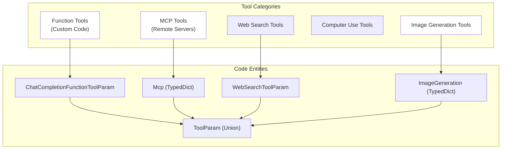
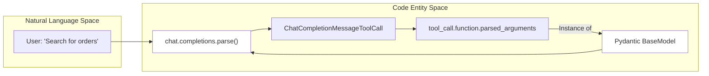
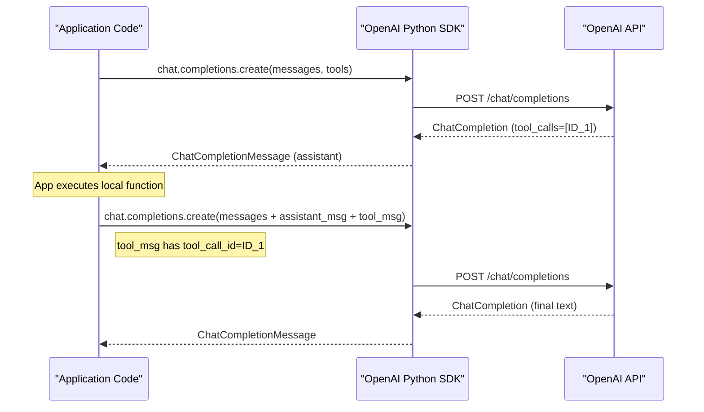

<!-- source: DeepWiki mcp.deepwiki.com · repo openai/openai-python · page 7.1 Tool Calling and Integration · fetched 2026-10-26 -->

# Tool Calling and Integration

<details>
<summary>Relevant source files</summary>

The following files were used as context for generating this wiki page:

- [src/openai/resources/images.py](src/openai/resources/images.py)
- [src/openai/types/beta/assistant_response_format_option.py](src/openai/types/beta/assistant_response_format_option.py)
- [src/openai/types/beta/assistant_response_format_option_param.py](src/openai/types/beta/assistant_response_format_option_param.py)
- [src/openai/types/beta/function_tool_param.py](src/openai/types/beta/function_tool_param.py)
- [src/openai/types/chat/__init__.py](src/openai/types/chat/__init__.py)
- [src/openai/types/chat/chat_completion_assistant_message_param.py](src/openai/types/chat/chat_completion_assistant_message_param.py)
- [src/openai/types/chat/chat_completion_message.py](src/openai/types/chat/chat_completion_message.py)
- [src/openai/types/chat/chat_completion_message_tool_call.py](src/openai/types/chat/chat_completion_message_tool_call.py)
- [src/openai/types/chat/chat_completion_message_tool_call_param.py](src/openai/types/chat/chat_completion_message_tool_call_param.py)
- [src/openai/types/chat/chat_completion_message_tool_call_union_param.py](src/openai/types/chat/chat_completion_message_tool_call_union_param.py)
- [src/openai/types/chat/chat_completion_tool_param.py](src/openai/types/chat/chat_completion_tool_param.py)
- [src/openai/types/image_edit_params.py](src/openai/types/image_edit_params.py)
- [src/openai/types/image_generate_params.py](src/openai/types/image_generate_params.py)
- [src/openai/types/responses/tool.py](src/openai/types/responses/tool.py)
- [src/openai/types/responses/tool_param.py](src/openai/types/responses/tool_param.py)
- [src/openai/types/shared/function_definition.py](src/openai/types/shared/function_definition.py)
- [src/openai/types/shared_params/function_definition.py](src/openai/types/shared_params/function_definition.py)
- [tests/api_resources/test_images.py](tests/api_resources/test_images.py)
- [tests/compat/test_tool_param.py](tests/compat/test_tool_param.py)

</details>


This document covers tool calling and integration mechanisms in the OpenAI Python library. It explains how to define tools (functions that the model can call), configure tool selection strategies, handle tool outputs, and leverage automatic parsing of tool call arguments using Pydantic.

---

## Purpose and Scope

Tool calling enables language models to invoke external functions and built-in capabilities. This document covers:

- **Tool types**: Function tools (custom code) and built-in tools like MCP, Web Search, and Code Interpreter.
- **Tool definition patterns**: Manual schema creation and specialized parameters for different tool categories.
- **Tool choice strategies**: Controlling which tools the model can or must use.
- **Tool output handling**: Handling tool call responses and continuing the conversation.
- **Automatic parsing**: Using the `parse()` method to convert tool call arguments into typed Python objects.

---

## Tool Types and Categories

The library supports a wide array of tools, ranging from standard `function` tools to advanced Model Context Protocol (MCP) and multi-modal tools.

### Tool Type Overview



**Sources:** [src/openai/types/responses/tool_param.py:26-42](), [src/openai/types/chat/__init__.py:24-31]()

### Function Tools

Function tools are user-defined functions with schemas. The model generates JSON arguments matching the schema.

**Core type definitions:**
- `ChatCompletionToolParam`: A `TypeAlias` for `ChatCompletionFunctionToolParam` [src/openai/types/chat/chat_completion_tool_param.py:14]().
- `ChatCompletionMessageToolCall`: Represents a tool call generated by the model [src/openai/types/chat/chat_completion_message_tool_call.py:17]().
- `FunctionDefinition`: The inner schema containing name, description, and parameters [src/openai/types/shared_params/function_definition.py:13-46]().

**Sources:** [src/openai/types/chat/chat_completion_tool_param.py:1-15](), [src/openai/types/chat/chat_completion_message_tool_call.py:1-18](), [src/openai/types/shared_params/function_definition.py:1-46]()

### Model Context Protocol (MCP) Tools

MCP tools allow the model to access remote servers. These tools require a `server_label`, `server_url` (or `connector_id`/`tunnel_id`), and authorization tokens [src/openai/types/responses/tool_param.py:115-194](). The SDK provides filters for allowed tools via `McpAllowedToolsMcpToolFilter` [src/openai/types/responses/tool_param.py:49-63]() and approval requirements via `McpRequireApproval` [src/openai/types/responses/tool_param.py:112]().

**Sources:** [src/openai/types/responses/tool_param.py:115-194](), [src/openai/types/responses/tool.py:113-194](), [src/openai/types/responses/tool_param.py:49-112]()

---

## Defining Function Tools

Tools can be defined as dictionaries or generated from Pydantic models.

### Manual Tool Definition

Manual definitions use the `ChatCompletionToolParam` structure:

```python
# Example of manual instantiation
from openai.types.chat import ChatCompletionToolParam

tool = ChatCompletionToolParam(
    type="function",
    function={
        "name": "get_weather",
        "parameters": {"type": "object", "properties": {"location": {"type": "string"}}}
    }
)
```

**Sources:** [tests/compat/test_tool_param.py:4-8](), [src/openai/types/chat/chat_completion_tool_param.py:14]()

### Strict Mode and JSON Schema

When using `strict: True` in a `FunctionDefinition`, the model will follow the exact schema defined. This is a requirement for Structured Outputs [src/openai/types/shared_params/function_definition.py:38-44]().

**Sources:** [src/openai/types/shared_params/function_definition.py:38-46]()

---

## Tool Choice Strategies

The `tool_choice` parameter controls model behavior regarding tools.

| Strategy | Type | Behavior |
|----------|------|----------|
| **Auto** | `Literal["auto"]` | Model decides whether to call a tool [src/openai/types/chat/chat_completion_tool_choice_option_param.py](). |
| **Required**| `Literal["required"]`| Model must call at least one tool. |
| **None** | `Literal["none"]` | Model will not call any tools. |
| **Named** | `ChatCompletionNamedToolChoiceParam` | Forces the model to call a specific tool by name [src/openai/types/chat/chat_completion_named_tool_choice_param.py:11](). |

**Sources:** [src/openai/types/chat/chat_completion_tool_choice_option_param.py:1-15](), [src/openai/types/chat/chat_completion_named_tool_choice_param.py:1-15]()

---

## Automatic Parsing with parse()

The `client.chat.completions.parse()` method provides automatic deserialization of tool call arguments into Pydantic models.

### Parsing Flow



**Sources:** [src/openai/types/chat/parsed_chat_completion.py:10-14](), [src/openai/types/chat/parsed_function_tool_call.py:20-23]()

---

## Handling Tool Call Responses

To provide tool results back to the model, the user must create a message with the `tool` role, referencing the `tool_call_id`.

### Message Sequence for Tool Execution



**Sources:** [src/openai/types/chat/chat_completion_assistant_message_param.py:81-83](), [src/openai/types/chat/chat_completion_tool_message_param.py:16-24]()

### Data Structures for Responses

- **Assistant Message**: Contains `tool_calls` which is an iterable of `ChatCompletionMessageToolCallUnionParam` [src/openai/types/chat/chat_completion_assistant_message_param.py:81-83]().
- **Tool Message**: A `ChatCompletionToolMessageParam` containing the `content` (result) and the `tool_call_id` [src/openai/types/chat/chat_completion_tool_message_param.py:16-24]().
- **Legacy Function Call**: The `function_call` field in `ChatCompletionMessage` is deprecated and replaced by `tool_calls` [src/openai/types/chat/chat_completion_message.py:82-90]().

**Sources:** [src/openai/types/chat/chat_completion_assistant_message_param.py:46-83](), [src/openai/types/chat/chat_completion_tool_message_param.py:1-25](), [src/openai/types/chat/chat_completion_message.py:82-90]()

---

## Specialized Tool Integration: Images

The SDK provides specialized methods for image-related tools through the `Images` resource [src/openai/resources/images.py:28](). These methods support both standard and streaming tool-like behaviors.

- **Image Variations**: `create_variation` generates new images based on an input [src/openai/resources/images.py:50-126]().
- **Image Editing**: `edit` allows for prompt-based modifications and supports streaming events via `ImageEditStreamEvent` [src/openai/resources/images.py:129-154](), [src/openai/types/image_edit_stream_event.py]().
- **Parameters**: Defined in `ImageEditParams` [src/openai/types/image_edit_params.py:160]() and `ImageGenerateParams` [src/openai/types/image_generate_params.py:159]().

**Sources:** [src/openai/resources/images.py:28-154](), [src/openai/types/image_edit_params.py:1-161](), [src/openai/types/image_generate_params.py:1-160]()

---

