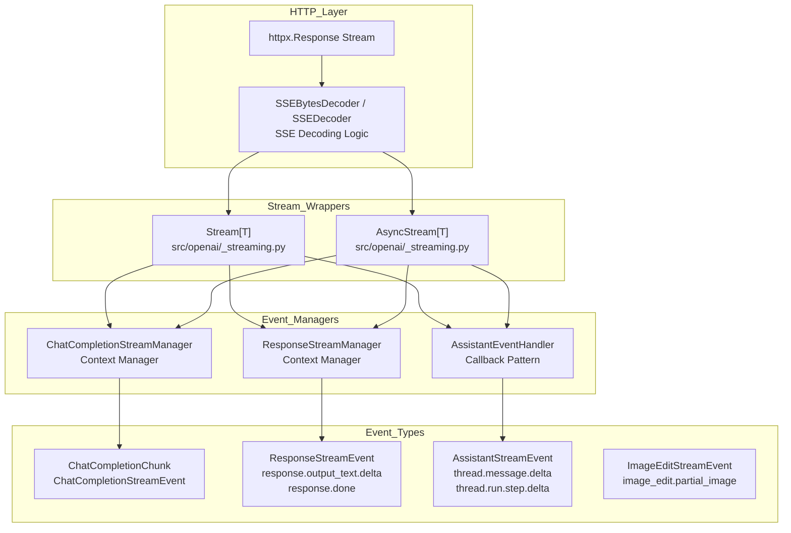
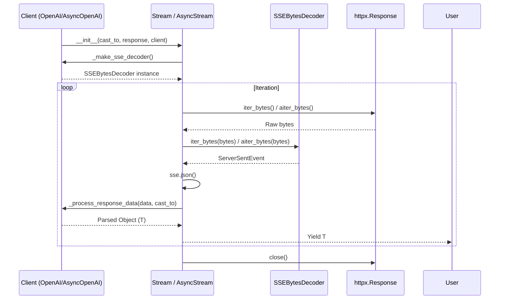
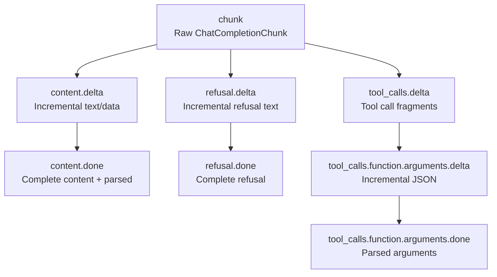
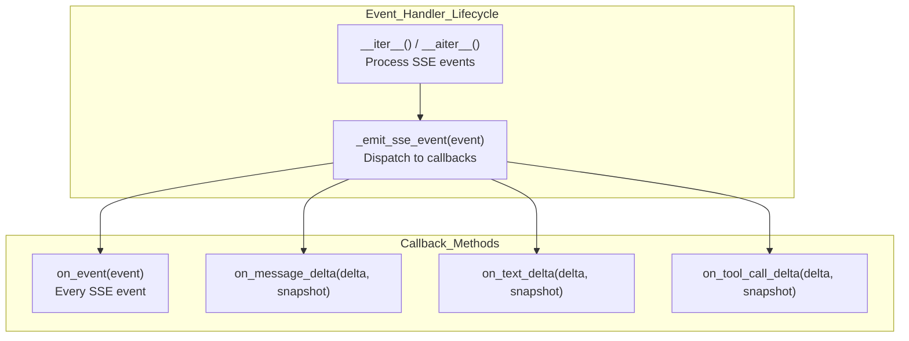
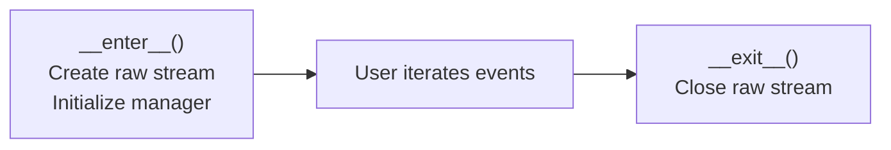

<!-- source: DeepWiki mcp.deepwiki.com · repo openai/openai-python · page 7.2 Streaming and Event Handling · fetched 2026-10-26 -->

# Streaming and Event Handling

Relevant source files

The following files were used as context for generating this wiki page:

- [examples/image_stream.py](examples/image_stream.py)
- [src/openai/_legacy_response.py](src/openai/_legacy_response.py)
- [src/openai/_response.py](src/openai/_response.py)
- [src/openai/_streaming.py](src/openai/_streaming.py)
- [src/openai/lib/streaming/_assistants.py](src/openai/lib/streaming/_assistants.py)
- [src/openai/lib/streaming/responses/_events.py](src/openai/lib/streaming/responses/_events.py)
- [src/openai/types/image_edit_partial_image_event.py](src/openai/types/image_edit_partial_image_event.py)
- [src/openai/types/image_edit_stream_event.py](src/openai/types/image_edit_stream_event.py)
- [tests/test_legacy_response.py](tests/test_legacy_response.py)
- [tests/test_response.py](tests/test_response.py)
- [tests/test_streaming.py](tests/test_streaming.py)

## Purpose and Scope

This document explains the streaming architecture in the OpenAI Python SDK, which enables real-time processing of model responses as they are generated. Streaming is supported across multiple API endpoints including Chat Completions, Responses, Assistants, and Image Generation APIs. The SDK provides both synchronous and asynchronous streaming interfaces with event-driven patterns for processing incremental data.

For information about parsed responses and structured outputs without streaming, see [Parsed Responses and Structured Outputs](#4.1.3). For tool calling patterns, see [7.1 Tool Calling and Integration]().

## Architecture Overview

The streaming system is built on three foundational layers: HTTP transport via Server-Sent Events (SSE), generic stream wrappers, and API-specific event managers.

**Streaming System Layers**

Sources: [src/openai/_streaming.py:23-42](), [src/openai/lib/streaming/chat/_completions.py:122-143](), [src/openai/lib/streaming/chat/_completions.py:46-65](), [src/openai/types/image_edit_stream_event.py:12-14]()

## Core Streaming Classes

### Stream and AsyncStream

The `Stream[T]` and `AsyncStream[T]` classes provide generic wrappers over HTTP SSE connections. They implement iterator protocols and handle connection lifecycle management.

**Key characteristics:**
- `Stream[T]` implements `Iterator[T]` for synchronous iteration [src/openai/_streaming.py:48-50]().
- `AsyncStream[T]` implements `AsyncIterator[T]` for asynchronous iteration [src/openai/_streaming.py:157-159]().
- Both provide `close()` methods for connection cleanup [src/openai/_streaming.py:123-129](), [src/openai/_streaming.py:235-241]().
- Events are yielded as they arrive from the API, filtered for `[DONE]` sentinels [src/openai/_streaming.py:62-64]().
- Type parameter `_T` specifies the event type (e.g., `ChatCompletionChunk`) [src/openai/_streaming.py:20-23]().

**Data Flow in Stream Classes**

Sources: [src/openai/_streaming.py:30-43](), [src/openai/_streaming.py:55-107](), [src/openai/_streaming.py:165-219]()

## Chat Completions Streaming

### Event Types and Stream Manager

Chat Completions streaming uses `ChatCompletionStreamManager` which provides high-level event processing and state accumulation. The manager wraps the raw `Stream[ChatCompletionChunk]` and emits structured events defined in `ChatCompletionStreamEvent`.

**Chat Completion Stream Events**

Sources: [src/openai/lib/streaming/chat/_completions.py:11-24](), [src/openai/lib/streaming/chat/_completions.py:113-120]()

### State Accumulation

The stream manager maintains a `ChatCompletionStreamState` that accumulates deltas into a complete `ParsedChatCompletion` object. This allows accessing the current state at any point during streaming via the `current_completion_snapshot` property [src/openai/lib/streaming/chat/_completions.py:65-66](), [src/openai/lib/streaming/chat/_completions.py:110-111]().

### Parsed Streaming with Structured Outputs

When using `response_format` with a Pydantic model, the stream manager incrementally parses JSON and emits the fully parsed object in `content.done` events [src/openai/lib/streaming/chat/_completions.py:93-102](). The `to_strict_json_schema` utility ensures that the Pydantic model is converted into a schema the API can handle for structured output [src/openai/lib/_pydantic.py:16-24]().

Sources: [src/openai/lib/streaming/chat/_completions.py:113-120](), [src/openai/lib/_parsing/_completions.py:190-195](), [src/openai/lib/_pydantic.py:16-24]()

## Responses API Streaming

The Responses API uses `ResponseStreamEvent` types which include wrappers with snapshots added on. Events are namespaced under the response object structure.

**Response Stream Event Types:**
- `ResponseTextDeltaEvent`: Includes incremental text and a cumulative `snapshot` string [src/openai/lib/streaming/responses/_events.py:72-74]().
- `ResponseTextDoneEvent`: Includes the final `parsed` object [src/openai/lib/streaming/responses/_events.py:76-77]().
- `ResponseFunctionCallArgumentsDeltaEvent`: Includes incremental arguments and a `snapshot` [src/openai/lib/streaming/responses/_events.py:80-82]().
- `ResponseCompletedEvent`: Contains the final `ParsedResponse` [src/openai/lib/streaming/responses/_events.py:84-85]().

Sources: [src/openai/lib/streaming/responses/_events.py:88-148]()

## Assistants API Streaming

### AssistantEventHandler Pattern

The Assistants API uses a callback-based event handler pattern. `AssistantEventHandler` and `AsyncAssistantEventHandler` define lifecycle methods that are called as events arrive.

**AssistantEventHandler Architecture**

Sources: [src/openai/lib/streaming/_assistants.py:31-60](), [src/openai/lib/streaming/_assistants.py:146-203](), [src/openai/_streaming.py:66-84]() (Assistants events special casing).

## Image Generation Streaming

The Image API supports streaming partial image data during generation. This is controlled by the `stream=True` and `partial_images` parameters in the `images.generate` call [examples/image_stream.py:13-20]().

**Image Stream Events:**
- `ImageEditPartialImageEvent`: Emitted when a partial image is available. Contains `b64_json` and a `partial_image_index` [src/openai/types/image_edit_partial_image_event.py:10-35]().
- `ImageEditCompletedEvent`: Emitted when the final image is generated.

Sources: [src/openai/types/image_edit_stream_event.py:12-14](), [examples/image_stream.py:22-46]()

## Stream Managers and Context Managers

Stream managers ensure the response cannot be leaked if you don't read the stream to completion by providing context manager support.

**Stream Manager Lifecycle**

Sources: [src/openai/lib/streaming/chat/_completions.py:148-157](), [src/openai/lib/streaming/chat/_completions.py:159-167](), [src/openai/_streaming.py:112-121]()

## Event Accumulation Internals

### The accumulate_delta Utility

The `accumulate_delta` function is the core logic for merging delta objects into snapshot objects [src/openai/lib/streaming/chat/_completions.py:25](). This is used by stream states to maintain the "current completion" view.

For structured outputs and tool calls, the SDK accumulates JSON string fragments. The `construct_type` function handles:
1. **Partial dictionaries**: Interim delta events contain incomplete JSON represented as dictionaries.
2. **Type coercion**: Converts raw values to expected types.
3. **Nested model construction**: Recursively builds nested Pydantic models.

Sources: [src/openai/lib/streaming/chat/_completions.py:25-29](), [src/openai/lib/_parsing/_completions.py:113-125](), [src/openai/lib/_parsing/_completions.py:140-154]()

## Summary Table of Streaming Classes

| Class | Purpose | Primary Interface |
| :--- | :--- | :--- |
| `Stream[_T]` | Low-level sync SSE wrapper | `Iterator[_T]` |
| `AsyncStream[_T]` | Low-level async SSE wrapper | `AsyncIterator[_T]` |
| `ChatCompletionStream` | High-level Chat manager | `__iter__` yielding `ChatCompletionStreamEvent` |
| `AssistantEventHandler` | Assistant callback manager | `on_text_delta`, `on_tool_call_delta`, etc. |
| `ResponseStreamEvent` | Responses API events | Discriminator-based Union with snapshots |

Sources: [src/openai/_streaming.py:23-132](), [src/openai/lib/streaming/chat/_completions.py:46-120](), [src/openai/lib/streaming/responses/_events.py:88-148](), [src/openai/lib/streaming/_assistants.py:31-60]()

---

