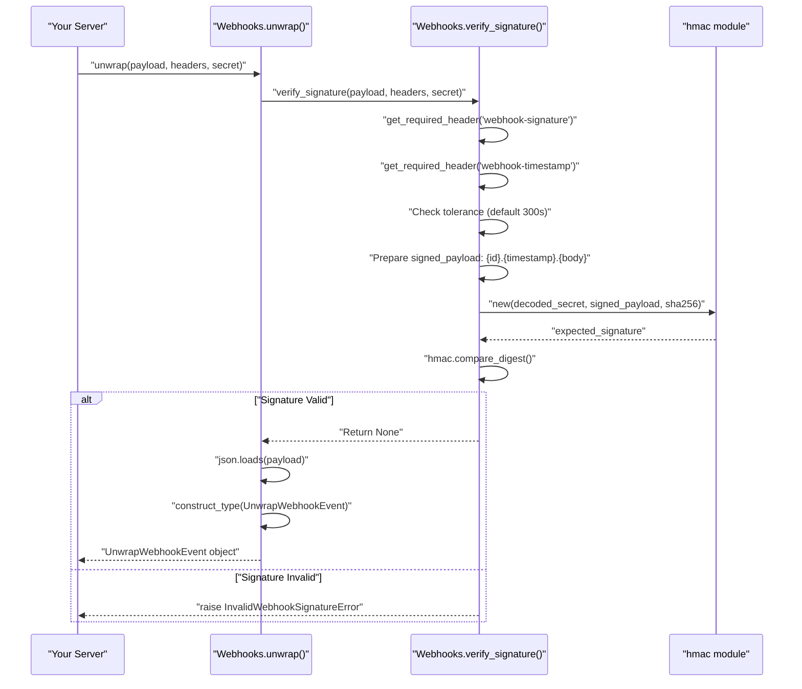
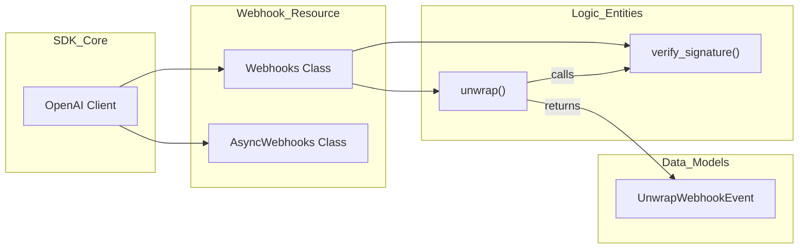

<!-- source: DeepWiki mcp.deepwiki.com · repo openai/openai-python · page 7.3 Webhook Verification · fetched 2026-10-26 -->

# Webhook Verification

Relevant source files

The following files were used as context for generating this wiki page:

- [src/openai/resources/conversations/api.md](src/openai/resources/conversations/api.md)
- [src/openai/resources/realtime/api.md](src/openai/resources/realtime/api.md)
- [src/openai/resources/webhooks/__init__.py](src/openai/resources/webhooks/__init__.py)
- [src/openai/resources/webhooks/webhooks.py](src/openai/resources/webhooks/webhooks.py)
- [tests/api_resources/webhooks/__init__.py](tests/api_resources/webhooks/__init__.py)

## Purpose and Scope

This document explains how to verify webhook signatures sent by the OpenAI API to ensure that webhook requests to your application originate from OpenAI and have not been tampered with. Webhook verification is a critical security measure for production deployments.

The SDK provides specialized resource classes, `Webhooks` and `AsyncWebhooks`, to handle the extraction of signatures, validation of timestamps (replay protection), and HMAC verification against a shared secret.

---

## Overview

The OpenAI API sends webhooks to notify your application about asynchronous events such as batch completions, fine-tuning job updates, or realtime call events. To ensure these requests are authentic, OpenAI signs each webhook payload.

The verification process involves:
1.  **Timestamp Validation**: Checking the `webhook-timestamp` header against the current time to prevent replay attacks [src/openai/resources/webhooks/webhooks.py:73-86]().
2.  **Signature Comparison**: Computing an HMAC-SHA256 hash of the payload and comparing it with the values in the `webhook-signature` header [src/openai/resources/webhooks/webhooks.py:105-115]().

### Webhook Verification Data Flow

This diagram illustrates the internal logic of the `unwrap` method and its interaction with the underlying verification utility.

Sources: [src/openai/resources/webhooks/webhooks.py:23-42](), [src/openai/resources/webhooks/webhooks.py:44-117](), [src/openai/resources/webhooks/webhooks.py:118-139](), [src/openai/resources/webhooks/webhooks.py:141-213]()

---

## Configuration

### Webhook Secret
The secret key is used as the HMAC key. It can be provided in three ways:
1.  **Environment Variable**: Setting `OPENAI_WEBHOOK_SECRET`.
2.  **Client Initialization**: Passing `webhook_secret` to the `OpenAI` or `AsyncOpenAI` constructor [src/openai/resources/webhooks/webhooks.py:60-67]().
3.  **Method Argument**: Passing `secret` directly to `unwrap()` or `verify_signature()` [src/openai/resources/webhooks/webhooks.py:28-32]().

If the secret starts with the prefix `whsec_`, the SDK automatically strips the prefix and base64-decodes the remainder before use [src/openai/resources/webhooks/webhooks.py:98-99](). Otherwise, it is encoded as UTF-8 [src/openai/resources/webhooks/webhooks.py:101]().

Sources: [src/openai/resources/webhooks/webhooks.py:60-67](), [src/openai/resources/webhooks/webhooks.py:98-102]()

---

## Verification Implementation

The SDK provides two primary methods within the `Webhooks` (sync) and `AsyncWebhooks` (async) classes [src/openai/resources/webhooks/__init__.py:6-11]().

### 1. `unwrap()`
This is the high-level convenience method. It verifies the signature and then parses the raw payload into a typed `UnwrapWebhookEvent` object [src/openai/resources/webhooks/webhooks.py:23-42]().

*   **Implementation**: It calls `verify_signature` internally [src/openai/resources/webhooks/webhooks.py:34]().
*   **Parsing**: It uses the `construct_type` utility to transform the JSON payload into a model [src/openai/resources/webhooks/webhooks.py:38-41]().

### 2. `verify_signature()`
This method performs the cryptographic validation without parsing the body.

*   **Headers Required**: It expects `webhook-id`, `webhook-timestamp`, and `webhook-signature` [src/openai/resources/webhooks/webhooks.py:69-71]().
*   **Replay Protection**: It enforces a default `tolerance` of 300 seconds (5 minutes). If the `webhook-timestamp` is older or newer than this window relative to the server time, it raises `InvalidWebhookSignatureError` [src/openai/resources/webhooks/webhooks.py:81-85]().
*   **Multi-Signature Support**: The `webhook-signature` header can contain multiple signatures separated by spaces. The SDK splits these and accepts the payload if *any* signature matches [src/openai/resources/webhooks/webhooks.py:90-95]().

### Entity Mapping: Natural Language to Code

| Concept | Code Entity | File Location |
| :--- | :--- | :--- |
| **Webhook Resource** | `Webhooks` / `AsyncWebhooks` | [src/openai/resources/webhooks/webhooks.py:22]() |
| **Verification Logic** | `verify_signature` | [src/openai/resources/webhooks/webhooks.py:44]() |
| **Parsing & Verification** | `unwrap` | [src/openai/resources/webhooks/webhooks.py:23]() |
| **Event Model** | `UnwrapWebhookEvent` | [src/openai/types/webhooks/unwrap_webhook_event.py]() |
| **Error Type** | `InvalidWebhookSignatureError` | [src/openai/resources/webhooks/webhooks.py:16]() |

Sources: [src/openai/resources/webhooks/webhooks.py:22-118](), [src/openai/resources/webhooks/__init__.py:6-11](), [src/openai/resources/webhooks/webhooks.py:15-17]()

---

## Event Types

The `UnwrapWebhookEvent` can represent various events occurring within the OpenAI platform. These events are handled via the `construct_type` utility during the `unwrap` process [src/openai/resources/webhooks/webhooks.py:38-41]().

While the specific event types are defined in the types directory, the `Webhooks` resource is designed to handle any event conforming to the `UnwrapWebhookEvent` structure [src/openai/resources/webhooks/webhooks.py:17](). This includes events for:
*   **Batch Operations**: Notifications for batch success or failure.
*   **Fine-Tuning**: Updates on training progress and job completion.
*   **Realtime**: Incoming call events or session updates.
*   **Conversations**: Management of persistent state and items [src/openai/resources/conversations/api.md:6-19]().

Sources: [src/openai/resources/webhooks/webhooks.py:17](), [src/openai/resources/conversations/api.md:6-19]()

---

## Error Handling

When verification fails, the SDK raises `InvalidWebhookSignatureError` [src/openai/resources/webhooks/webhooks.py:16]().

Common reasons for failure:
*   **Timestamp Drift**: The server's clock is out of sync with OpenAI's clock beyond the 300s tolerance [src/openai/resources/webhooks/webhooks.py:81-85]().
*   **Incorrect Secret**: The `webhook_secret` provided does not match the one configured. If no secret is provided and none is found on the client, a `ValueError` is raised [src/openai/resources/webhooks/webhooks.py:63-67]().
*   **Payload Modification**: If the request body was modified before reaching the verification logic, the HMAC check will fail [src/openai/resources/webhooks/webhooks.py:112-115]().

Sources: [src/openai/resources/webhooks/webhooks.py:16](), [src/openai/resources/webhooks/webhooks.py:63-67](), [src/openai/resources/webhooks/webhooks.py:81-85](), [src/openai/resources/webhooks/webhooks.py:112-115]()

---

