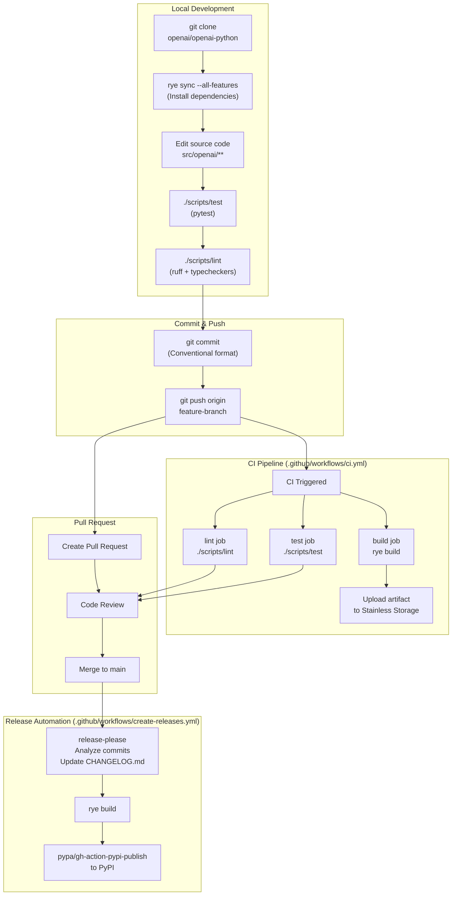
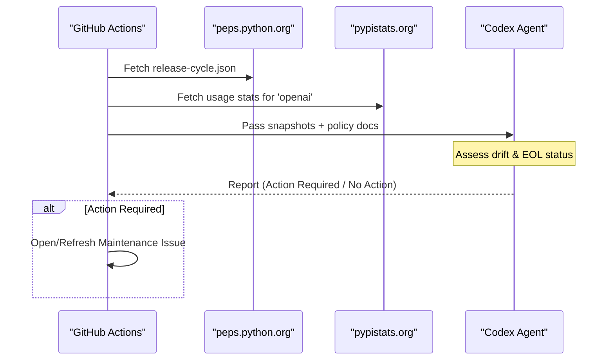

<!-- source: DeepWiki mcp.deepwiki.com · repo openai/openai-python · page 8 Development and Contribution · fetched 2026-10-26 -->

# Development and Contribution

Relevant source files

The following files were used as context for generating this wiki page:

- [.devcontainer/Dockerfile](.devcontainer/Dockerfile)
- [.devcontainer/devcontainer.json](.devcontainer/devcontainer.json)
- [.github/codex/prompts/python-version-review.md](.github/codex/prompts/python-version-review.md)
- [.github/codex/python-version-review-config.toml](.github/codex/python-version-review-config.toml)
- [.github/workflows/ci.yml](.github/workflows/ci.yml)
- [.github/workflows/create-releases.yml](.github/workflows/create-releases.yml)
- [.github/workflows/publish-pypi.yml](.github/workflows/publish-pypi.yml)
- [.github/workflows/python-version-review.yml](.github/workflows/python-version-review.yml)
- [.python-version](.python-version)
- [AGENTS.md](AGENTS.md)
- [CONTRIBUTING.md](CONTRIBUTING.md)
- [PYTHON_VERSION_POLICY.md](PYTHON_VERSION_POLICY.md)
- [examples/realtime/push_to_talk_app.py](examples/realtime/push_to_talk_app.py)

This document provides an overview of the development workflow, tooling, and contribution process for the OpenAI Python SDK. It covers the complete lifecycle from setting up a local development environment through testing, code quality checks, and automated release processes.

For detailed information on specific topics:
- Development environment setup and tooling: see [Development Environment Setup](#8.1)
- Testing infrastructure and practices: see [Testing Framework and Practices](#8.2)
- Code quality tools and configurations: see [Code Quality and Type Checking](#8.3)
- CI/CD workflows and release automation: see [CI/CD Pipeline and Release Process](#8.4)

## Development Workflow Overview

The SDK uses a modern Python development stack centered on **Rye 0.44.0** for dependency management and package building. All configuration is consolidated in `pyproject.toml`, which defines project metadata, dependencies, development tools, and their settings.

### Core Development Tools

| Tool | Purpose | Configuration |
|------|---------|---------------|
| **Rye 0.44.0** | Package manager, virtual environment management | [CONTRIBUTING.md:8-20]() |
| **pytest** | Test framework with async support | [.github/workflows/ci.yml:144]() |
| **ruff** | Code formatting and linting | [CONTRIBUTING.md:105-113]() |
| **release-please** | Automated release management | [.github/workflows/create-releases.yml:21-25]() |

### Development Lifecycle

**Sources:** [.github/workflows/ci.yml:23-145](), [CONTRIBUTING.md:8-127](), [.github/workflows/create-releases.yml:1-79]()

## Project Configuration Structure

The project uses `rye` for dependency orchestration. While most of the SDK is generated, manual modifications are persisted in `src/openai/lib/` and `examples/` [CONTRIBUTING.md:42-48]().

### Dependency Management

The project manages dependencies via Rye, ensuring reproducible environments.
- **Syncing:** `rye sync --all-features` [CONTRIBUTING.md:19]().
- **Bootstrapping:** `./scripts/bootstrap` [CONTRIBUTING.md:13]().
- **Build System:** Uses `rye build` to generate `.tar.gz` and `.whl` files [CONTRIBUTING.md:80]().

**Sources:** [CONTRIBUTING.md:1-89]()

## Development Environment Options

### Option 1: Dev Container (Recommended)

A pre-configured environment is provided for VS Code users:
- **Base Image:** `mcr.microsoft.com/vscode/devcontainers/python:0-3.9` [.devcontainer/Dockerfile:2]().
- **Tooling:** Rye 0.44.0 is pre-installed [.devcontainer/Dockerfile:6]().
- **Post-Start:** Automatically runs `rye sync --all-features` [.devcontainer/devcontainer.json:10]().

### Option 2: Local Development with Rye

Install Rye manually and run the bootstrap script to provision the environment [CONTRIBUTING.md:8-20](). The SDK follows a strict Python version policy, currently supporting Python 3.10 through 3.14 [PYTHON_VERSION_POLICY.md:65-72]().

**Sources:** [.devcontainer/Dockerfile:1-10](), [.devcontainer/devcontainer.json:1-44](), [CONTRIBUTING.md:8-39](), [PYTHON_VERSION_POLICY.md:1-83]()

## Testing and Quality Assurance

### Testing Framework

Tests are executed using `pytest`. The suite includes specific validations for different HTTP clients like `httpx` and `httpx2` [.github/workflows/ci.yml:174-179]().

| Script | Purpose |
|--------|---------|
| `./scripts/mock` | Starts the mock server against the OpenAPI spec [CONTRIBUTING.md:96](). |
| `./scripts/test` | Runs the test suite using the configured environment [.github/workflows/ci.yml:144](). |
| `./scripts/lint` | Runs ruff and type checking [CONTRIBUTING.md:111](). |

**Sources:** [.github/workflows/ci.yml:110-181](), [CONTRIBUTING.md:91-119]()

## CI/CD Pipeline and Releases

### Continuous Integration

The CI workflow in `.github/workflows/ci.yml` performs:
1. **Linting:** Runs `./scripts/lint` [.github/workflows/ci.yml:41]().
2. **Building:** Executes `rye build` [.github/workflows/ci.yml:64]().
3. **Testing:** Executes `./scripts/test` across supported Python versions [.github/workflows/ci.yml:144]().
4. **Artifact Upload:** Uploads built wheels for internal tracking [.github/workflows/ci.yml:100-108]().

### Release Process

Releases are managed via `release-please` automation [.github/workflows/create-releases.yml:21-25]().
- **PyPI Publishing:** Handled by `pypa/gh-action-pypi-publish` using Trusted Publishing (OIDC) [.github/workflows/create-releases.yml:77-79]().
- **Manual Release:** Can be triggered via the `Publish PyPI` workflow dispatch [.github/workflows/publish-pypi.yml:3-5]().

### Version Policy Monitoring

The SDK includes an automated monthly review process to assess Python version support:

**Sources:** [.github/workflows/ci.yml:1-181](), [.github/workflows/create-releases.yml:1-79](), [.github/workflows/publish-pypi.yml:1-60](), [.github/workflows/python-version-review.yml:1-190](), [PYTHON_VERSION_POLICY.md:51-59]()

---

