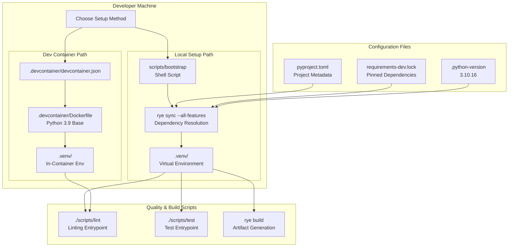
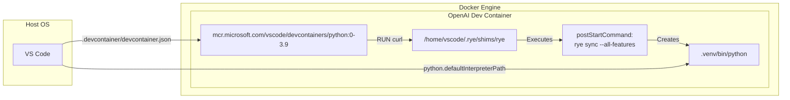

<!-- source: DeepWiki mcp.deepwiki.com · repo openai/openai-python · page 8.1 Development Environment Setup · fetched 2026-10-26 -->

# Development Environment Setup

<details>
<summary>Relevant source files</summary>

The following files were used as context for generating this wiki page:

- [.devcontainer/Dockerfile](.devcontainer/Dockerfile)
- [.devcontainer/devcontainer.json](.devcontainer/devcontainer.json)
- [.github/codex/prompts/python-version-review.md](.github/codex/prompts/python-version-review.md)
- [.github/codex/python-version-review-config.toml](.github/codex/python-version-review-config.toml)
- [.github/workflows/ci.yml](.github/workflows/ci.yml)
- [.github/workflows/create-releases.yml](.github/workflows/create-releases.yml)
- [.github/workflows/publish-pypi.yml](.github/workflows/publish-pypi.yml)
- [.github/workflows/python-version-review.yml](.github/workflows/python-version-review.yml)
- [.python-version](.python-version)
- [AGENTS.md](AGENTS.md)
- [CONTRIBUTING.md](CONTRIBUTING.md)
- [PYTHON_VERSION_POLICY.md](PYTHON_VERSION_POLICY.md)
- [examples/realtime/push_to_talk_app.py](examples/realtime/push_to_talk_app.py)

</details>


This page explains how to set up a local development environment for contributing to the OpenAI Python SDK. It covers installing the Rye package manager, syncing dependencies, using dev containers, and verifying your setup.

## Overview

The OpenAI Python SDK uses **Rye 0.44.0** as its primary tool for dependency management, virtual environment creation, and task execution [.github/workflows/ci.yml:34](), [.devcontainer/Dockerfile:6](). The project supports a range of Python versions from 3.10 through 3.14 [PYTHON_VERSION_POLICY.md:70-71]().

Development is supported through two primary paths:
- **Local setup**: Using Rye directly on a host machine [CONTRIBUTING.md:9-30]().
- **Dev container**: Using a pre-configured Docker environment with VS Code [.devcontainer/devcontainer.json:1-43]().

Sources: [.github/workflows/ci.yml:34](), [.devcontainer/Dockerfile:6](), [PYTHON_VERSION_POLICY.md:70-71](), [CONTRIBUTING.md:9-30]()

## Development Environment Architecture

The following diagram bridges the setup methods with the specific tools and scripts defined in the codebase.

**Setup Path to Code Entity Mapping**


Sources: [.devcontainer/Dockerfile:1-10](), [.devcontainer/devcontainer.json:1-43](), [CONTRIBUTING.md:1-39](), [.python-version:1](), [.github/workflows/ci.yml:38-41]()

## Prerequisites

| Requirement | Version / Policy | Notes |
|------------|----------------|-------|
| Python | 3.10+ | Minimum supported version is 3.10 [PYTHON_VERSION_POLICY.md:67]() |
| Rye | 0.44.0 | Pinned version for consistency [.github/workflows/ci.yml:34]() |
| Docker | Latest | Required for Dev Container path |
| API Key | `OPENAI_API_KEY` | Required for running examples and some tests [examples/realtime/push_to_talk_app.py:4]() |

Sources: [PYTHON_VERSION_POLICY.md:67](), [.github/workflows/ci.yml:34](), [examples/realtime/push_to_talk_app.py:4]()

## Local Setup with Rye

### Installation and Bootstrapping

The project recommends using `rye` to provision the environment automatically.

1. **Automatic Setup**: Run the provided bootstrap script.
   ```sh
   ./scripts/bootstrap
   ```
   This script automates environment configuration and dependency syncing [CONTRIBUTING.md:13]().

2. **Manual Setup**: If you prefer manual steps, install Rye 0.44.0 and run:
   ```sh
   rye sync --all-features
   ```
   The `--all-features` flag ensures that all optional dependency groups (like `realtime`) are installed [CONTRIBUTING.md:19](), [examples/realtime/push_to_talk_app.py:20]().

### Virtual Environment Management

Rye creates a virtual environment in the `.venv` directory. You can interact with it in two ways:
- **Prefixing commands**: `rye run python script.py` [CONTRIBUTING.md:22]().
- **Activation**: `source .venv/bin/activate` [CONTRIBUTING.md:26]().

### Alternative: Setup Without Rye

If you choose not to use Rye, you must ensure your Python version matches `.python-version` (currently 3.10.16) and install dependencies via the lock file:
```sh
pip install -r requirements-dev.lock
```
Sources: [CONTRIBUTING.md:34-38](), [.python-version:1]()

## Dev Container Setup

The repository includes a `.devcontainer` configuration for an isolated development environment in VS Code.

**Dev Container Entity Relationship**


Sources: [.devcontainer/Dockerfile:1-10](), [.devcontainer/devcontainer.json:1-43]()

### Configuration Details
- **Base Image**: Uses Python 3.9 as the build variant [.devcontainer/Dockerfile:1-2]().
- **Tooling**: Automatically installs Rye 0.44.0 and configures the shell PATH [.devcontainer/Dockerfile:6-7]().
- **Automation**: The `postStartCommand` ensures the environment is synced every time the container starts [.devcontainer/devcontainer.json:10]().
- **VS Code Settings**: Configures the Python extension to use the internal `.venv` and enables basic type checking [.devcontainer/devcontainer.json:19-21]().

## Verification and Quality Tools

After setup, verify your environment using the following scripts:

### Linting and Formatting
The SDK uses `ruff` and `black` for code quality [CONTRIBUTING.md:105-106]().
- **Lint**: `./scripts/lint` [CONTRIBUTING.md:111]()
- **Format**: `./scripts/format` [CONTRIBUTING.md:117]()

### Testing
Tests typically require a mock server to be running:
1. **Start Mock Server**: `./scripts/mock` [CONTRIBUTING.md:96]()
2. **Run Tests**: `./scripts/test` [CONTRIBUTING.md:100]()

### Build Verification
To verify the package builds correctly for distribution:
```sh
rye build
```
This command generates `.tar.gz` and `.whl` files in the `dist/` directory [CONTRIBUTING.md:73-80]().

Sources: [CONTRIBUTING.md:73-117](), [.github/workflows/ci.yml:41-42](), [.github/workflows/ci.yml:64]()

---

