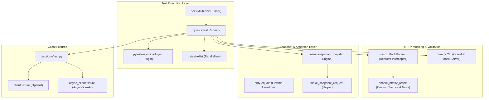
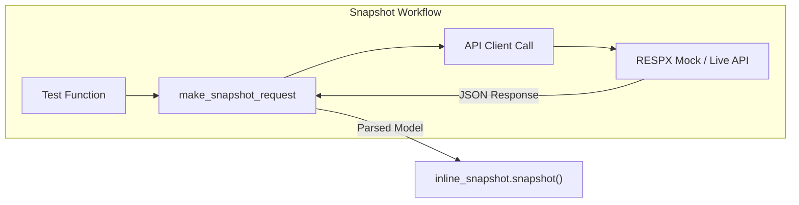

<!-- source: DeepWiki mcp.deepwiki.com · repo openai/openai-python · page 8.2 Testing Framework and Practices · fetched 2026-10-26 -->

# Testing Framework and Practices

<details>
<summary>Relevant source files</summary>

The following files were used as context for generating this wiki page:

- [Brewfile](Brewfile)
- [examples/httpx2_client.py](examples/httpx2_client.py)
- [requirements-dev.lock](requirements-dev.lock)
- [requirements.lock](requirements.lock)
- [scripts/bootstrap](scripts/bootstrap)
- [scripts/format](scripts/format)
- [scripts/lint](scripts/lint)
- [scripts/mock](scripts/mock)
- [scripts/test](scripts/test)
- [scripts/utils/validate-bedrock-wheel.py](scripts/utils/validate-bedrock-wheel.py)
- [scripts/utils/validate-httpx2-wheel.py](scripts/utils/validate-httpx2-wheel.py)
- [src/openai/_httpx2.py](src/openai/_httpx2.py)
- [src/openai/_qs.py](src/openai/_qs.py)
- [src/openai/lib/_parsing/__init__.py](src/openai/lib/_parsing/__init__.py)
- [tests/conftest.py](tests/conftest.py)
- [tests/lib/chat/test_completions.py](tests/lib/chat/test_completions.py)
- [tests/lib/chat/test_completions_streaming.py](tests/lib/chat/test_completions_streaming.py)
- [tests/lib/responses/__init__.py](tests/lib/responses/__init__.py)
- [tests/lib/responses/test_responses.py](tests/lib/responses/test_responses.py)
- [tests/lib/snapshots.py](tests/lib/snapshots.py)
- [tests/lib/test_bedrock_auth_conformance.py](tests/lib/test_bedrock_auth_conformance.py)
- [tests/lib/utils.py](tests/lib/utils.py)
- [tests/test_extract_files.py](tests/test_extract_files.py)
- [tests/test_files.py](tests/test_files.py)
- [uv.lock](uv.lock)

</details>


This document describes the testing infrastructure, tools, and practices used in the OpenAI Python library. It covers the pytest-based testing framework, HTTP mocking strategies, snapshot testing, and guidelines for writing and running tests.

For information about code quality tooling (linting and type checking), see **8.3 Code Quality and Type Checking**. For CI/CD workflows, see **8.4 CI/CD Pipeline and Release Process**.

---

## Overview

The library uses a comprehensive testing framework built on `pytest` with specialized tools for HTTP mocking, snapshot testing, and asynchronous test execution. Tests are organized by API resource and feature area, with support for both mocked testing (default) and live API testing (opt-in).

**Key Characteristics:**
- **Framework**: `pytest` with async support via `pytest-asyncio` [requirements-dev.lock:173, 177]().
- **HTTP Mocking**: `respx` library for request interception [requirements-dev.lock:191]().
- **Snapshot Testing**: `inline-snapshot` for response validation and regression testing [requirements-dev.lock:111]().
- **Parallel Execution**: `pytest-xdist` for concurrent test runs [requirements-dev.lock:178]().
- **Live Testing**: Optional real API calls via environment flag `OPENAI_LIVE=1` [tests/lib/chat/test_completions.py:28]().
- **Mock Server**: Local `steady` server based on OpenAPI spec [scripts/mock:29-60]().

Sources: [requirements-dev.lock:111](), [requirements-dev.lock:173](), [requirements-dev.lock:177](), [requirements-dev.lock:178](), [requirements-dev.lock:191](), [scripts/mock:29-60](), [tests/lib/chat/test_completions.py:28]()

---

## Testing Framework Architecture

The following diagram bridges the high-level testing concepts to the specific code entities and scripts used in the SDK.

**Testing System Entity Map**

Sources: [requirements-dev.lock:111](), [requirements-dev.lock:137](), [requirements-dev.lock:173-178](), [requirements-dev.lock:191](), [tests/conftest.py:68-119](), [tests/lib/snapshots.py:1-20](), [tests/_httpx2_respx.py:1-10]()

**Testing Framework Components**

| Component | Purpose | Code Entities |
|-----------|---------|---------------|
| **pytest** | Primary test discovery and execution engine. | `pytest` [requirements-dev.lock:173]() |
| **pytest-asyncio** | Handles async test loops and fixtures. | `pytest_asyncio` [requirements-dev.lock:177]() |
| **respx** | Mocks `httpx` and `httpx2` calls without a real server. | `respx.MockRouter` [requirements-dev.lock:191]() |
| **inline-snapshot** | Manages inline and external snapshots for API responses. | `snapshot()`, `external()` [requirements-dev.lock:111]() |
| **Steady** | Mock server validating requests against OpenAPI specs. | `@stdy/cli` [scripts/mock:36]() |
| **nox** | Runs tests across different Pydantic versions. | `nox` [requirements-dev.lock:137]() |

Sources: [requirements-dev.lock:111](), [requirements-dev.lock:137](), [requirements-dev.lock:173](), [requirements-dev.lock:177](), [requirements-dev.lock:191](), [scripts/mock:36]()

---

## Test Configuration and Fixtures

### Pytest Configuration

The testing environment is configured via `tests/conftest.py`. It handles automatic async marking and provides client fixtures.

**Async Test Automation**: The `pytest_collection_modifyitems` hook automatically applies `pytest.mark.asyncio(loop_scope="session")` to all async tests [tests/conftest.py:29-33]().

**Client Fixtures**:
- `client`: A session-scoped `OpenAI` client pointing to the mock server (default: `http://127.0.0.1:4010`) [tests/conftest.py:68-83]().
- `async_client`: A session-scoped `AsyncOpenAI` client. It can be parameterized to use `httpx`, `httpx2`, or `aiohttp` backends [tests/conftest.py:86-119]().

```python
@pytest.fixture(scope="session")
def client(request: FixtureRequest) -> Iterator[OpenAI]:
    # ... setup logic ...
    with OpenAI(
        base_url=base_url,
        api_key=api_key,
        _strict_response_validation=strict,
        http_client=http_client,
    ) as client:
        yield client
```
Sources: [tests/conftest.py:29-33](), [tests/conftest.py:68-119]()

### Mock Server (Steady)

The SDK uses `steady` to provide a local mock server that validates requests against the OpenAI OpenAPI spec.

- **Startup**: The `./scripts/mock` script starts the server [scripts/mock:29-60]().
- **Health Check**: The test runner waits for `/_x-steady/health` before starting execution [scripts/test:12-14]().
- **Validation**: It uses bracket formatting for arrays and objects in queries and forms [scripts/mock:36]().

Sources: [scripts/mock:29-60](), [scripts/test:12-14]()

---

## Snapshot Testing Practices

The SDK extensively uses `inline-snapshot` to verify that API responses are parsed correctly into Pydantic models.

**Data Flow: Snapshot Generation**

Sources: [tests/lib/chat/test_completions.py:33-49](), [tests/lib/snapshots.py:1-20]()

### Updating Snapshots
Snapshots can be updated from the live API by setting the `OPENAI_LIVE` environment variable and running pytest with the `--inline-snapshot=fix` flag [tests/lib/chat/test_completions.py:28]().

### Streaming Snapshots
For streaming responses, the SDK uses `_make_stream_snapshot_request` which captures chunks and final states into binary external snapshots [tests/lib/chat/test_completions_streaming.py:48-61]().

Sources: [tests/lib/chat/test_completions.py:28-49](), [tests/lib/chat/test_completions_streaming.py:48-61]()

---

## Multi-Backend and Version Testing

### HTTP Client Backends
The test suite validates multiple HTTP backends via the `OPENAI_TEST_HTTP_CLIENT` environment variable:
- `httpx`: The default backend [tests/conftest.py:52]().
- `httpx2`: A modern alternative backend [tests/conftest.py:73]().
- `aiohttp`: Supported for async operations [tests/conftest.py:104]().

**Compatibility Note**: Tests using `aiohttp` are skipped when `respx_mock` is required, as `respx` does not support the `aiohttp` adapter [tests/conftest.py:35-48]().

### Pydantic Compatibility
The SDK supports Pydantic v1 and v2. The `./scripts/test` script ensures both are tested:
1. Runs standard tests (usually v2) [scripts/test:62]().
2. Runs `nox -s test-pydantic-v1` to specifically test the v1 compatibility layer [scripts/test:65]().

Sources: [scripts/test:62-65](), [tests/conftest.py:35-52](), [tests/conftest.py:73-104]()

---

## Test Execution Scripts

The project provides several bash scripts to manage the testing lifecycle:

| Script | Purpose |
|--------|---------|
| `./scripts/test` | Main entry point. Starts the mock server and runs pytest and nox [scripts/test:1-66](). |
| `./scripts/mock` | Starts the Steady OpenAPI mock server [scripts/mock:1-61](). |
| `./scripts/bootstrap` | Installs Python dependencies using `rye sync` [scripts/bootstrap:22-27](). |
| `./scripts/lint` | Runs `ruff` for linting and formatting [scripts/lint:1-13](). |

Sources: [scripts/bootstrap:22-27](), [scripts/lint:1-13](), [scripts/mock:1-61](), [scripts/test:1-66]()

---

