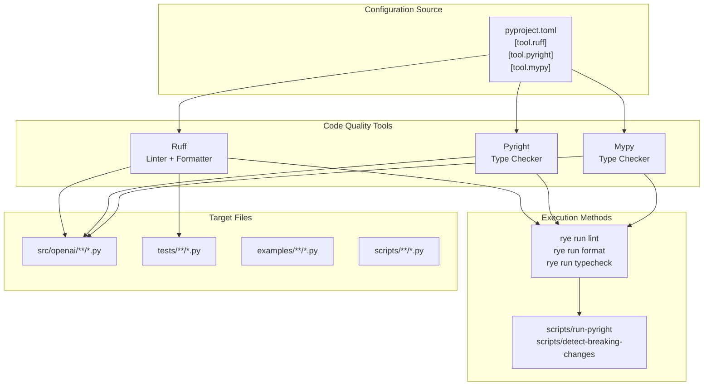
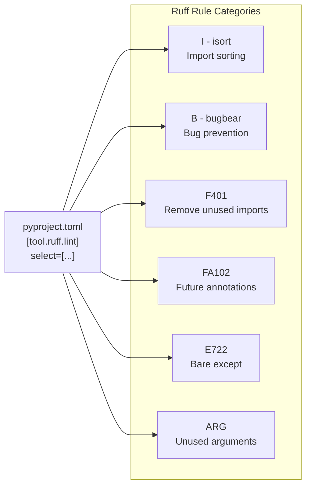
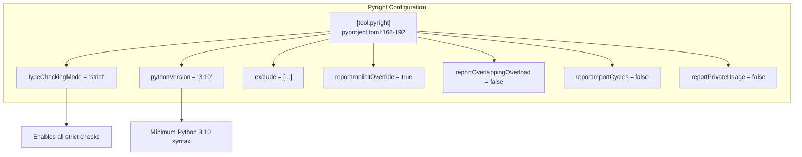
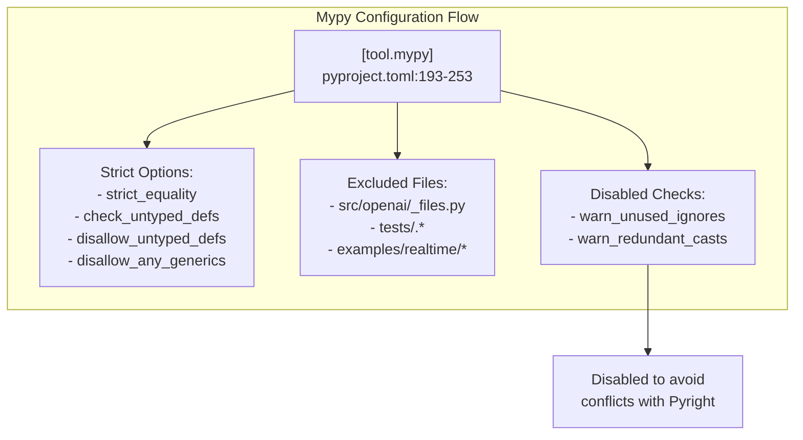
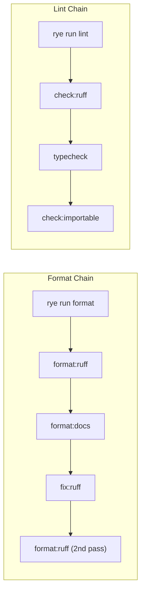

<!-- source: DeepWiki mcp.deepwiki.com · repo openai/openai-python · page 8.3 Code Quality and Type Checking · fetched 2026-10-26 -->

# Code Quality and Type Checking

<details>
<summary>Relevant source files</summary>

The following files were used as context for generating this wiki page:

- [.github/workflows/detect-breaking-changes.yml](.github/workflows/detect-breaking-changes.yml)
- [.release-please-manifest.json](.release-please-manifest.json)
- [CHANGELOG.md](CHANGELOG.md)
- [pyproject.toml](pyproject.toml)
- [scripts/detect-breaking-changes](scripts/detect-breaking-changes)
- [scripts/detect-breaking-changes.py](scripts/detect-breaking-changes.py)
- [scripts/pyrightconfig.breaking-changes.json](scripts/pyrightconfig.breaking-changes.json)
- [scripts/run-pyright](scripts/run-pyright)
- [src/openai/_version.py](src/openai/_version.py)

</details>


This document covers the code quality and type checking infrastructure used in the OpenAI Python SDK. It explains the configuration and usage of linting tools (Ruff), type checkers (Pyright and Mypy), and how these tools are integrated into the development workflow and CI pipeline.

For information about the testing framework and test execution, see [8.2 Testing Framework and Practices](). For details about the CI/CD pipeline and release automation, see [8.4 CI/CD Pipeline and Release Process]().

## Overview

The OpenAI Python SDK enforces strict code quality standards through automated tooling. Three primary tools work together to maintain code quality:

Title: Code Quality Toolchain Architecture


**Sources:** [pyproject.toml:88-116](), [scripts/run-pyright:1-8](), [scripts/detect-breaking-changes:1-25]()

## Ruff Configuration

Ruff serves as both the linter and code formatter for the project. It replaces multiple tools with a single fast implementation.

### Basic Settings

The base Ruff configuration is defined in `[tool.ruff]`:

| Setting | Value | Purpose |
|---------|-------|---------|
| `line-length` | 120 | Maximum characters per line |
| `output-format` | "grouped" | Groups errors by file for readability |
| `target-version` | "py310" | Compatibility checks target Python 3.10+ |

**Sources:** [pyproject.toml:255-257]()

### Enabled Linting Rules

The `[tool.ruff.lint]` section specifies which rule categories are enabled:

Title: Ruff Lint Rule Selection


**Sources:** [pyproject.toml:262-275]()

The configuration includes specific rules:

- **I (isort)**: Enforces import ordering [pyproject.toml:265]().
- **B (bugbear)**: Detects common Python bugs and design issues [pyproject.toml:267]().
- **F401**: Automatically removes unused imports [pyproject.toml:269]().
- **FA102**: Requires `from __future__ import annotations` for forward reference support [pyproject.toml:271]().
- **E722**: Disallows bare `except:` statements [pyproject.toml:273]().

### Per-File Overrides

Specific rules are relaxed for directories where they are less relevant:

- **Tests, Scripts, Examples**: Print statements (`T201`, `T203`) are allowed in `bin/**.py`, `scripts/**.py`, `tests/**.py`, and `examples/**.py`.
- **Global Ignores**: Rule `B006` (mutable default arguments) is ignored globally.

**Sources:** [pyproject.toml:277-300]()

## Pyright Type Checking

Pyright is the primary type checker for the SDK, configured to use the strictest possible settings.

### Core Configuration

Title: Pyright Configuration Logic


**Sources:** [pyproject.toml:168-192]()

### Key Settings

| Setting | Value | Rationale |
|---------|-------|-----------|
| `typeCheckingMode` | `"strict"` | Enables all available type checks |
| `pythonVersion` | `"3.10"` | Matches minimum required Python version [pyproject.toml:22]() |
| `reportImplicitOverride` | `true` | Requires explicit `@override` decorator |
| `reportOverlappingOverload` | `false` | Allows intentional overload overlaps |
| `reportImportCycles` | `false` | Permits circular imports |
| `reportPrivateUsage` | `false` | Allows access to `_private` members |

**Sources:** [pyproject.toml:168-192]()

### Excluded Directories

Pyright skips type checking for specific paths, primarily examples with inline `uv` script dependencies:

```python
# From pyproject.toml:175-185
exclude = [
    "_dev",
    ".venv",
    ".nox",
    ".git",
    "examples/realtime/audio_util.py",
    "examples/realtime/push_to_talk_app.py"
]
```

**Sources:** [pyproject.toml:175-185]()

### Running Pyright

Pyright is invoked via Rye scripts or the `scripts/run-pyright` wrapper:

```bash
# Run all type checks (Pyright + Mypy)
rye run typecheck

# Run only Pyright
rye run typecheck:pyright

# Verify the package exports types correctly
rye run typecheck:verify-types
```

**Sources:** [pyproject.toml:109-116](), [scripts/run-pyright:1-8]()

## Mypy Type Checking

Mypy serves as a secondary type checker, providing additional validation and catching edge cases.

### Configuration Strategy

The Mypy configuration at `[tool.mypy]` is set to strict mode with specific exclusions:

Title: Mypy Configuration and Exclusions


**Sources:** [pyproject.toml:193-253]()

### Strict Mode Settings

The following strict checks are enabled:

| Setting | Purpose |
|---------|---------|
| `strict_equality` | Requires compatible types for `==` comparisons |
| `check_untyped_defs` | Type-checks function bodies even without annotations |
| `disallow_any_generics` | Requires type parameters for generics |
| `disallow_untyped_defs` | Requires type annotations on all functions |
| `disallow_untyped_calls` | Disallows calling untyped functions |
| `disallow_subclassing_any` | Prevents subclassing `Any` |

**Sources:** [pyproject.toml:215-235]()

### Excluded Files and Reasons

Mypy excludes specific files where its type inference is less effective or where it would be redundant:

```python
# From pyproject.toml:206-213
exclude = [
  'src/openai/_files.py',      # Mypy type narrowing issues
  '_dev/.*.py',                 # Development utilities
  'tests/.*',                   # Test inference issues
  'src/openai/_utils/_logs.py', # Internal logging utilities
  'examples/realtime/audio_util.py',
  'examples/realtime/push_to_talk_app.py',
]
```

**Sources:** [pyproject.toml:206-213]()

### Disabled Error Codes

Specific error codes are disabled to support the SDK's coding patterns:

```python
# From pyproject.toml:246
disable_error_code = "func-returns-value,overload-cannot-match"
```

**Sources:** [pyproject.toml:246]()

## Development Workflow Integration

### Script Commands

The `[tool.rye.scripts]` section defines command chains for quality checks:

Title: Development Command Workflow


**Sources:** [pyproject.toml:88-116]()

### Breaking Change Detection

The SDK includes a specialized script to detect breaking changes in the public API using `griffe`.

- **scripts/detect-breaking-changes.py**: Uses `griffe.load` and `griffe.load_git` to compare the current source with a previous git ref [scripts/detect-breaking-changes.py:56-64]().
- **find_breaking_changes**: A recursive function that identifies removed public members between two versions of the package [scripts/detect-breaking-changes.py:23-48]().
- **scripts/detect-breaking-changes**: A bash wrapper that checks out old test files and runs linting against them using a specialized pyright config to find incompatibilities [scripts/detect-breaking-changes:1-25]().

**Sources:** [scripts/detect-breaking-changes.py:1-80](), [scripts/detect-breaking-changes:1-25](), [scripts/pyrightconfig.breaking-changes.json:1-5]()

## Tool Version Management

### Pinned Versions

Development tool versions are pinned in `[tool.rye] dev-dependencies`:

| Tool | Version | Purpose |
|------|---------|---------|
| `pyright` | `==1.1.399` | Consistent type checking [pyproject.toml:65]() |
| `mypy` | `==1.17` | Secondary type checker [pyproject.toml:66]() |
| `ruff` | (managed) | Linter and formatter [pyproject.toml:71]() |
| `griffe` | `>=1` | Breaking change detection [pyproject.toml:85]() |

**Sources:** [pyproject.toml:61-86]()

---

