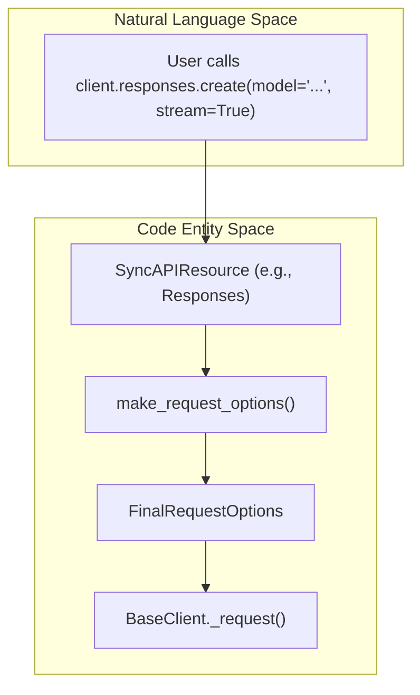
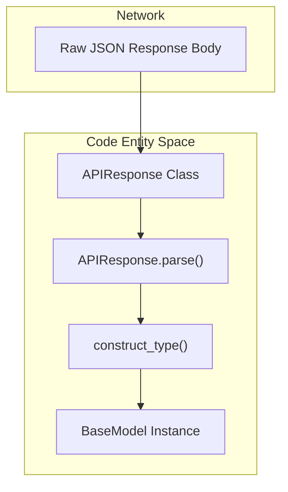

<!-- source: DeepWiki mcp.deepwiki.com · repo openai/openai-python · page 9 Glossary · fetched 2026-10-26 -->

# Glossary

Relevant source files

The following files were used as context for generating this wiki page:

- [.release-please-manifest.json](.release-please-manifest.json)
- [.stats.yml](.stats.yml)
- [CHANGELOG.md](CHANGELOG.md)
- [README.md](README.md)
- [api.md](api.md)
- [pyproject.toml](pyproject.toml)
- [src/openai/__init__.py](src/openai/__init__.py)
- [src/openai/_base_client.py](src/openai/_base_client.py)
- [src/openai/_client.py](src/openai/_client.py)
- [src/openai/_compat.py](src/openai/_compat.py)
- [src/openai/_models.py](src/openai/_models.py)
- [src/openai/_types.py](src/openai/_types.py)
- [src/openai/_utils/__init__.py](src/openai/_utils/__init__.py)
- [src/openai/_utils/_json.py](src/openai/_utils/_json.py)
- [src/openai/_utils/_reflection.py](src/openai/_utils/_reflection.py)
- [src/openai/_utils/_sync.py](src/openai/_utils/_sync.py)
- [src/openai/_utils/_transform.py](src/openai/_utils/_transform.py)
- [src/openai/_utils/_typing.py](src/openai/_utils/_typing.py)
- [src/openai/_utils/_utils.py](src/openai/_utils/_utils.py)
- [src/openai/_version.py](src/openai/_version.py)
- [src/openai/lib/azure.py](src/openai/lib/azure.py)
- [src/openai/resources/beta/realtime/realtime.py](src/openai/resources/beta/realtime/realtime.py)
- [src/openai/resources/chat/completions/completions.py](src/openai/resources/chat/completions/completions.py)
- [src/openai/resources/realtime/realtime.py](src/openai/resources/realtime/realtime.py)
- [src/openai/resources/responses/responses.py](src/openai/resources/responses/responses.py)
- [src/openai/types/__init__.py](src/openai/types/__init__.py)
- [src/openai/types/chat/completion_create_params.py](src/openai/types/chat/completion_create_params.py)
- [src/openai/types/responses/response.py](src/openai/types/responses/response.py)
- [src/openai/types/responses/response_compact_params.py](src/openai/types/responses/response_compact_params.py)
- [src/openai/types/responses/response_create_params.py](src/openai/types/responses/response_create_params.py)
- [src/openai/types/responses/responses_client_event.py](src/openai/types/responses/responses_client_event.py)
- [src/openai/types/responses/responses_client_event_param.py](src/openai/types/responses/responses_client_event_param.py)
- [src/openai/types/shared/__init__.py](src/openai/types/shared/__init__.py)
- [src/openai/types/shared_params/__init__.py](src/openai/types/shared_params/__init__.py)
- [tests/api_resources/chat/test_completions.py](tests/api_resources/chat/test_completions.py)
- [tests/api_resources/test_responses.py](tests/api_resources/test_responses.py)
- [tests/lib/test_azure.py](tests/lib/test_azure.py)
- [tests/test_client.py](tests/test_client.py)
- [tests/test_models.py](tests/test_models.py)
- [tests/test_transform.py](tests/test_transform.py)
- [tests/test_utils/test_json.py](tests/test_utils/test_json.py)
- [tests/test_utils/test_logging.py](tests/test_utils/test_logging.py)
- [tests/test_utils/test_typing.py](tests/test_utils/test_typing.py)
- [tests/utils.py](tests/utils.py)

This glossary defines codebase-specific terms, architectural patterns, and domain concepts used within the OpenAI Python SDK. It serves as a reference for onboarding engineers to understand the mapping between API concepts and their internal implementations.

## Core Client Concepts

### BaseClient
The foundational abstract class for all SDK clients. It encapsulates the logic for HTTP communication, retry mechanisms, and request lifecycle management. It has two primary concrete implementations: `SyncAPIClient` and `AsyncAPIClient` [src/openai/_base_client.py:40-41](). It abstracts the underlying `httpx` client behavior [src/openai/_base_client.py:12-13]().

### FinalRequestOptions
An internal container used to store the fully processed state of a request (headers, query params, body, files) before it is handed off to the underlying HTTP transport (`httpx`) [src/openai/_models.py:33](), [src/openai/_base_client.py:76]().

### NotGiven / Omit
Sentinel values used to distinguish between a parameter being explicitly set to `None` (which may be meaningful to the API) and a parameter being entirely absent from the request [src/openai/_types.py:47-51](), [src/openai/_base_client.py:62-63]().

**Diagram: Request Option Construction**

Sources: [src/openai/_base_client.py:58-76](), [src/openai/resources/responses/responses.py:133-166](), [tests/test_client.py:38-39]()

---

## Data Modeling and Transformation

### BaseModel / GenericModel
A customized wrapper around Pydantic's `BaseModel`. It provides compatibility between Pydantic v1 and v2 via a compatibility shim [src/openai/_compat.py:65-73](), along with helper methods like `to_dict()` and `to_json()` that respect API aliases [src/openai/_models.py:111-212]().

### PropertyInfo
A metadata class used within `Annotated` types to provide instructions to the transformation pipeline. It handles field aliasing (mapping Python snake_case to API camelCase) and specific formatting requirements [src/openai/_models.py:55](), [src/openai/_utils/_transform.py]().

### construct_type
A core utility function used to instantiate complex types (unions, lists of models) from raw API response dictionaries. It performs loose type coercion to ensure robustness against API changes [src/openai/_base_client.py:76](), [src/openai/_models.py:36]().

**Diagram: Data Flow - Response Parsing**

Sources: [src/openai/_base_client.py:76-82](), [src/openai/_response.py:78-82](), [src/openai/_models.py:111-130]()

---

## Authentication Patterns

### Workload Identity
A secure authentication mechanism for automated environments (Kubernetes, Azure, GCP). It replaces long-lived API keys with short-lived tokens provided by an identity provider [src/openai/_client.py:13-14](), [src/openai/_client.py:110-114]().

### Admin API Key
A specialized credential used for organization-level management tasks, typically passed via environment variables like `OPENAI_ADMIN_KEY` [src/openai/_client.py:130-131](), [src/openai/_client.py:161-162]().

---

## Technical Abbreviations & Jargon

| Term | Definition | Code Pointer |
| :--- | :--- | :--- |
| **SSE** | Server-Sent Events. Used for streaming responses in Chat and Responses API. | [src/openai/_base_client.py:92]() |
| **CastTo** | An internal type hint or class passed to request methods to define the expected return type. | [src/openai/_base_client.py:52]() |
| **HttpxSendArgs** | Dictionary of arguments compatible with `httpx.Client.send()`. | [src/openai/_types.py:57]() |
| **BinaryTypes** | Union of types acceptable for file uploads (bytes, file-like objects, etc.). | [src/openai/_types.py:55]() |
| **SensitiveHeadersFilter** | A logging filter that prevents API keys and other secrets from appearing in trace logs. | [src/openai/_base_client.py:104]() |
| **Jiter** | A high-performance JSON parser used as a dependency for speed. | [pyproject.toml:19]() |

---

## Tooling and Infrastructure

### Rye
The primary project manager used for dependency management, virtual environment handling, and script execution [pyproject.toml:61-63]().

### Stainless
The code generation platform used to produce this SDK from the OpenAI OpenAPI specification [README.md:10-11]().

### Release-Please
An automated tool that manages the `CHANGELOG.md` and bumps versions in `_version.py` based on conventional commit messages [src/openai/_version.py:4](), [.release-please-manifest.json:1-3]().

Sources: [pyproject.toml:1-110](), [src/openai/_base_client.py:1-230](), [src/openai/_models.py:1-213](), [src/openai/_client.py:1-185](), [src/openai/resources/responses/responses.py:1-130]()