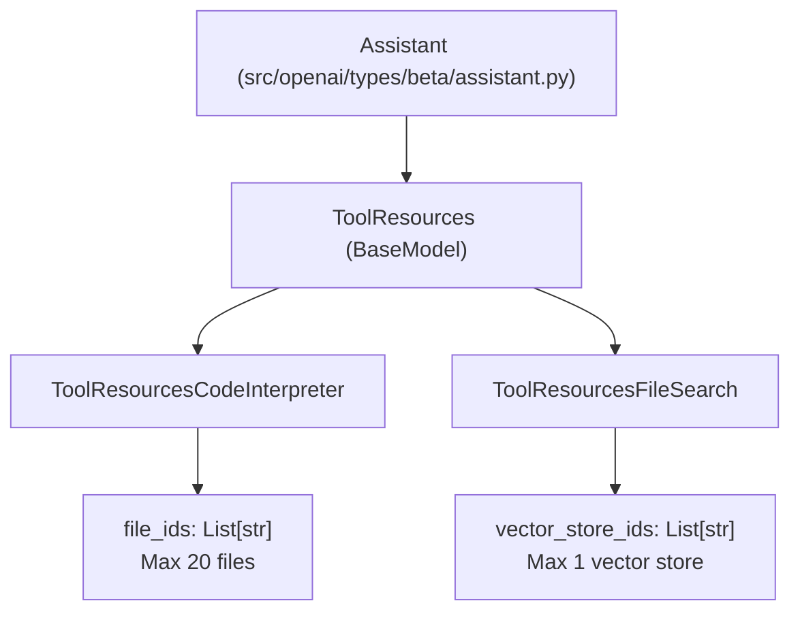
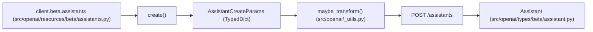
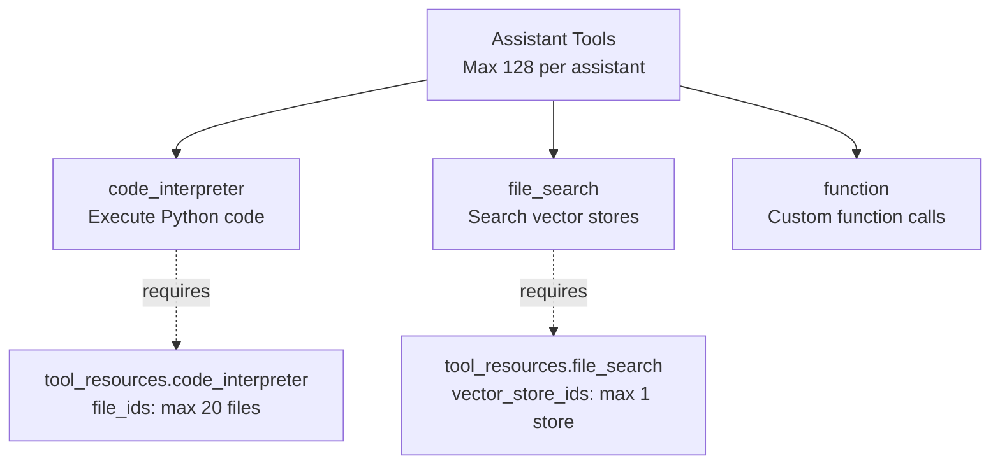
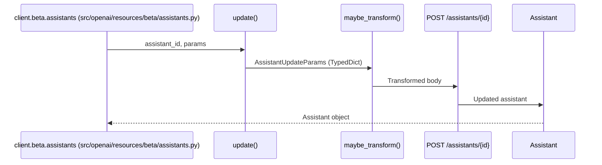
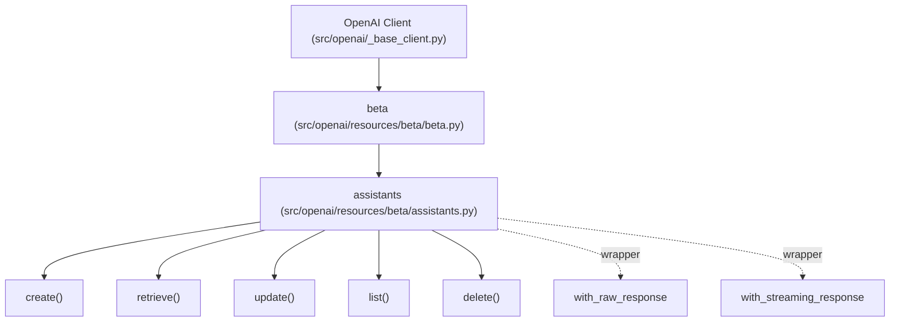

<!-- source: DeepWiki mcp.deepwiki.com · repo openai/openai-python · extra page Assistants and Configuration · fetched 2026-10-26 -->

# Assistants and Configuration

Relevant source files

The following files were used as context for generating this wiki page:

- [src/openai/resources/beta/assistants.py](src/openai/resources/beta/assistants.py)
- [src/openai/resources/beta/threads/runs/runs.py](src/openai/resources/beta/threads/runs/runs.py)
- [src/openai/resources/beta/threads/threads.py](src/openai/resources/beta/threads/threads.py)
- [src/openai/types/beta/assistant.py](src/openai/types/beta/assistant.py)
- [src/openai/types/beta/assistant_create_params.py](src/openai/types/beta/assistant_create_params.py)
- [src/openai/types/beta/assistant_update_params.py](src/openai/types/beta/assistant_update_params.py)
- [src/openai/types/beta/thread_create_and_run_params.py](src/openai/types/beta/thread_create_and_run_params.py)
- [src/openai/types/beta/threads/run.py](src/openai/types/beta/threads/run.py)
- [src/openai/types/beta/threads/run_create_params.py](src/openai/types/beta/threads/run_create_params.py)
- [src/openai/types/chat_model.py](src/openai/types/chat_model.py)
- [tests/api_resources/beta/test_assistants.py](tests/api_resources/beta/test_assistants.py)
- [tests/api_resources/beta/test_threads.py](tests/api_resources/beta/test_threads.py)
- [tests/api_resources/beta/threads/runs/test_steps.py](tests/api_resources/beta/threads/runs/test_steps.py)
- [tests/api_resources/beta/threads/test_messages.py](tests/api_resources/beta/threads/test_messages.py)
- [tests/api_resources/beta/threads/test_runs.py](tests/api_resources/beta/threads/test_runs.py)
- [tests/api_resources/fine_tuning/test_jobs.py](tests/api_resources/fine_tuning/test_jobs.py)
- [tests/api_resources/test_models.py](tests/api_resources/test_models.py)

This document covers the creation and configuration of Assistants in the OpenAI Python library. Assistants are stateful AI agents that can be configured with custom instructions, tools, and resources. For information about managing conversations with threads and messages, see [Threads and Messages](#4.3.2). For details on executing assistant runs, see [Runs and Execution](#4.3.3).

**Note**: The Assistants API is deprecated in favor of the Responses API. All methods in the Assistants API include deprecation warnings directing users to the newer Responses API [src/openai/resources/beta/assistants.py:57-57]().

## Overview

An Assistant represents a configured AI agent with specific behavior, capabilities, and resources. Assistants are created once and can be used across multiple conversation threads. The library provides methods for creating, updating, retrieving, listing, and deleting assistants through the `beta.assistants` resource [src/openai/resources/beta/assistants.py:35-35]().

## Assistant Object Structure

### Core Properties

The `Assistant` object returned by API operations is a Pydantic-based `BaseModel` containing the following properties:

| Property | Type | Description |
|----------|------|-------------|
| `id` | `str` | Unique identifier for the assistant |
| `object` | `Literal["assistant"]` | Object type, always "assistant" |
| `created_at` | `int` | Unix timestamp of creation |
| `name` | `Optional[str]` | Name (max 256 characters) |
| `description` | `Optional[str]` | Description (max 512 characters) |
| `model` | `str` | Model ID being used |
| `instructions` | `Optional[str]` | System instructions (max 256,000 characters) |
| `tools` | `List[AssistantTool]` | Enabled tools (max 128) |
| `tool_resources` | `Optional[ToolResources]` | Resources for tools |
| `metadata` | `Optional[Metadata]` | Custom key-value pairs (16 max) |
| `temperature` | `Optional[float]` | Sampling temperature (0-2) |
| `top_p` | `Optional[float]` | Nucleus sampling parameter |
| `response_format` | `Optional[AssistantResponseFormatOption]` | Output format specification |

**Sources**: [src/openai/types/beta/assistant.py:44-142]()

### Tool Resources Structure

Title: Assistant Tool Resource Mapping

**Tool Resources Schema**

The `tool_resources` property provides resources specific to each tool type:

- **code_interpreter**: Requires `file_ids` - a list of up to 20 file IDs available to the code interpreter [src/openai/types/beta/assistant.py:14-21]().
- **file_search**: Requires `vector_store_ids` - a single vector store ID for search capabilities [src/openai/types/beta/assistant.py:23-31]().

**Sources**: [src/openai/types/beta/assistant.py:11-43]()

## Creating Assistants

### Basic Creation

The `create` method requires a `model` parameter. All other configuration is optional.

Title: Assistant Creation Data Flow

**Minimum Example Flow**: The simplest assistant creation requires specifying a model. The library transforms parameters using `maybe_transform` [src/openai/_utils.py:26-26]() and sends a POST request to `/assistants` with the `OpenAI-Beta: assistants=v2` header [src/openai/resources/beta/assistants.py:135-135]().

**Sources**: [src/openai/resources/beta/assistants.py:58-183](), [src/openai/_utils.py:26-26]()

### Required Parameters

| Parameter | Type | Description |
|-----------|------|-------------|
| `model` | `Union[str, ChatModel]` | Model ID or ChatModel constant |

**Sources**: [src/openai/types/beta/assistant_create_params.py:28-37]()

### Optional Configuration Parameters

| Parameter | Type | Default | Description |
|-----------|------|---------|-------------|
| `name` | `Optional[str]` | `None` | Assistant name (max 256 chars) |
| `description` | `Optional[str]` | `None` | Description (max 512 chars) |
| `instructions` | `Optional[str]` | `None` | System instructions (max 256,000 chars) |
| `tools` | `Iterable[AssistantToolParam]` | `[]` | Enabled tools (max 128) |
| `tool_resources` | `Optional[ToolResources]` | `None` | Resources for tools |
| `metadata` | `Optional[Metadata]` | `None` | Custom key-value pairs |
| `temperature` | `Optional[float]` | Model default | Sampling temperature (0-2) |
| `top_p` | `Optional[float]` | Model default | Nucleus sampling |
| `response_format` | `Optional[AssistantResponseFormatOptionParam]` | `None` | Output format |
| `reasoning_effort` | `Optional[ReasoningEffort]` | Model default | Reasoning effort level |

**Sources**: [src/openai/types/beta/assistant_create_params.py:28-132](), [src/openai/resources/beta/assistants.py:58-183]()

### Reasoning Effort Configuration

For reasoning models, the `reasoning_effort` parameter constraints computational effort. Supported values are `none`, `minimal`, `low`, `medium`, `high`, `xhigh`, and `max` [src/openai/types/beta/assistant_create_params.py:61-70]().

**Sources**: [src/openai/types/beta/assistant_create_params.py:61-70](), [src/openai/resources/beta/assistants.py:103-108]()

## Tool Configuration

### Available Tool Types

Title: Assistant Tool Hierarchy

**Tool Types and Resources**: Each tool type requires specific resources configured via `tool_resources` [src/openai/types/beta/assistant_create_params.py:103-116]().

**Sources**: [src/openai/types/beta/assistant_create_params.py:103-116]()

### Tool Resources Configuration

#### Code Interpreter Resources

The `code_interpreter` tool resources contain a `file_ids` list with a maximum of 20 file IDs [src/openai/types/beta/assistant_create_params.py:128-134]().

**Sources**: [src/openai/types/beta/assistant_create_params.py:128-134]()

#### File Search Resources

The `file_search` tool resources can be configured using existing vector stores or by creating new ones with specific chunking strategies [src/openai/types/beta/assistant_create_params.py:174-188]().

#### Chunking Strategies

For new vector stores, chunking strategies control how files are split [src/openai/types/beta/assistant_create_params.py:137-171]():

| Strategy | Configuration | Description |
|----------|---------------|-------------|
| `auto` | `{"type": "auto"}` | Automatic chunking (800 token size, 400 overlap) |
| `static` | `{"type": "static", "static": {...}}` | Manual configuration |

**Static Chunking Parameters**:
- `max_chunk_size_tokens`: 100-4096 tokens (default 800) [src/openai/types/beta/assistant_create_params.py:154-160]().
- `chunk_overlap_tokens`: Overlap between chunks (default 400, max 50% of chunk size) [src/openai/types/beta/assistant_create_params.py:148-152]().

**Sources**: [src/openai/types/beta/assistant_create_params.py:137-171]()

## Response Format Configuration

The `response_format` parameter controls the assistant's output format [src/openai/types/beta/assistant_create_params.py:72-94]():

| Format Type | Configuration | Description |
|-------------|---------------|-------------|
| `json_object` | `{"type": "json_object"}` | Valid JSON output |
| `json_schema` | `{"type": "json_schema", "json_schema": {...}}` | Structured outputs matching schema |

**Compatibility**: Response format is compatible with GPT-4o, GPT-4 Turbo, and GPT-3.5 Turbo models since `gpt-3.5-turbo-1106` [src/openai/types/beta/assistant_create_params.py:75-77]().

**Sources**: [src/openai/types/beta/assistant_create_params.py:72-94]()

## Updating Assistants

### Update Method

The `update` method allows modifying any assistant property. Updates are sent as POST requests to `/assistants/{assistant_id}` [src/openai/resources/beta/assistants.py:219-399]().

Title: Assistant Update Lifecycle

**Sources**: [src/openai/resources/beta/assistants.py:219-399]()

### Updatable Fields

Fields available in `AssistantUpdateParams` include [src/openai/types/beta/assistant_update_params.py:17-152]():

- `description`, `instructions`, `metadata`, `name`
- `reasoning_effort`, `response_format`, `temperature`
- `tool_resources`, `tools`, `top_p`, `model`

**Sources**: [src/openai/types/beta/assistant_update_params.py:17-152]()

## Additional Operations

### Retrieve Assistant

Retrieves an assistant by its ID.
**Sources**: [src/openai/resources/beta/assistants.py:185-217]()

### List Assistants

The `list` method returns a paginated cursor page of assistants [src/openai/resources/beta/assistants.py:401-464]().

| Parameter | Type | Description |
|-----------|------|-------------|
| `limit` | `int` | Objects per page (1-100) |
| `order` | `Literal["asc", "desc"]` | Sort by `created_at` |

**Sources**: [src/openai/resources/beta/assistants.py:401-464]()

### Delete Assistant

Deletes an assistant and returns an `AssistantDeleted` confirmation object.
**Sources**: [src/openai/resources/beta/assistants.py:466-498]()

## Client Integration

### API Resource Hierarchy

Title: Assistants Resource Organization

**Sources**: [src/openai/resources/beta/assistants.py:35-55]()

### Beta Header

All assistant API requests include the header `OpenAI-Beta: assistants=v2` [src/openai/resources/beta/assistants.py:135-135]().

**Sources**: [src/openai/resources/beta/assistants.py:135-135](), [src/openai/resources/beta/assistants.py:377-377]()

---

