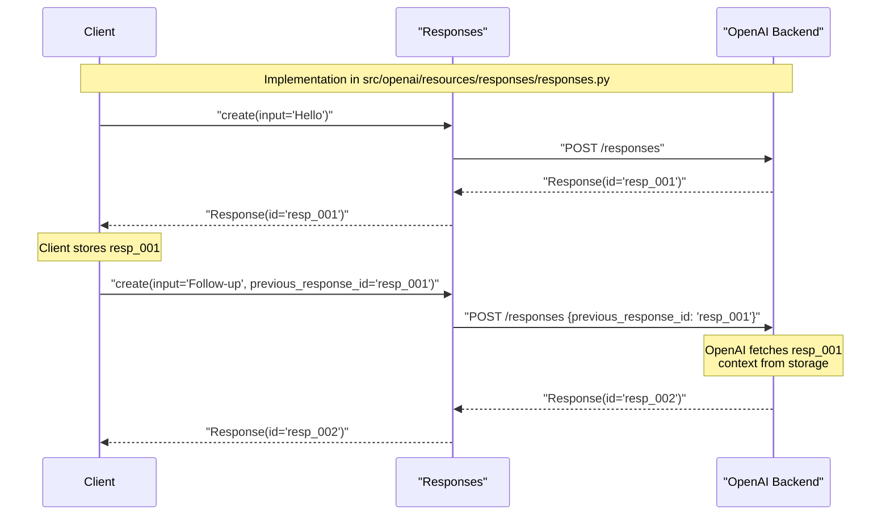
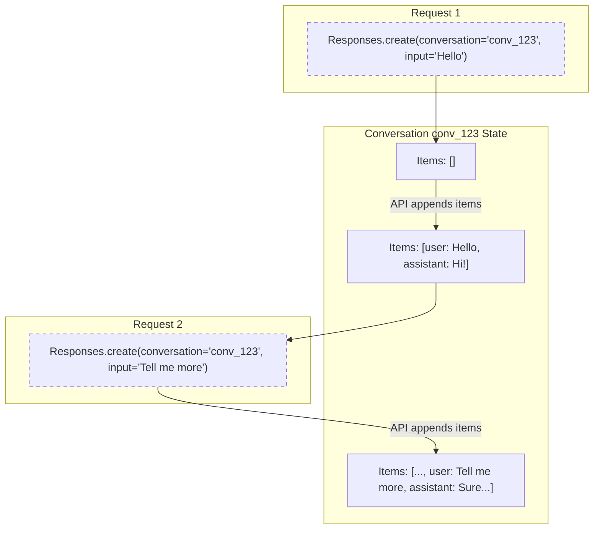
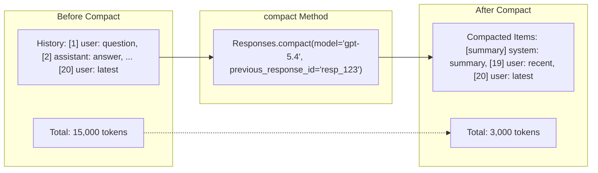

<!-- source: DeepWiki mcp.deepwiki.com · repo openai/openai-python · extra page Conversation and State Management · fetched 2026-10-26 -->

# Conversation and State Management

<details>
<summary>Relevant source files</summary>

The following files were used as context for generating this wiki page:

- [src/openai/resources/chat/completions/completions.py](src/openai/resources/chat/completions/completions.py)
- [src/openai/resources/conversations/conversations.py](src/openai/resources/conversations/conversations.py)
- [src/openai/resources/conversations/items.py](src/openai/resources/conversations/items.py)
- [src/openai/resources/responses/input_items.py](src/openai/resources/responses/input_items.py)
- [src/openai/resources/responses/responses.py](src/openai/resources/responses/responses.py)
- [src/openai/types/chat/completion_create_params.py](src/openai/types/chat/completion_create_params.py)
- [src/openai/types/chat/completion_list_params.py](src/openai/types/chat/completion_list_params.py)
- [src/openai/types/conversations/conversation_create_params.py](src/openai/types/conversations/conversation_create_params.py)
- [src/openai/types/conversations/conversation_update_params.py](src/openai/types/conversations/conversation_update_params.py)
- [src/openai/types/conversations/item_list_params.py](src/openai/types/conversations/item_list_params.py)
- [src/openai/types/conversations/message.py](src/openai/types/conversations/message.py)
- [src/openai/types/conversations/summary_text_content.py](src/openai/types/conversations/summary_text_content.py)
- [src/openai/types/responses/response.py](src/openai/types/responses/response.py)
- [src/openai/types/responses/response_compact_params.py](src/openai/types/responses/response_compact_params.py)
- [src/openai/types/responses/response_content_part_added_event.py](src/openai/types/responses/response_content_part_added_event.py)
- [src/openai/types/responses/response_content_part_done_event.py](src/openai/types/responses/response_content_part_done_event.py)
- [src/openai/types/responses/response_create_params.py](src/openai/types/responses/response_create_params.py)
- [src/openai/types/responses/responses_client_event.py](src/openai/types/responses/responses_client_event.py)
- [src/openai/types/responses/responses_client_event_param.py](src/openai/types/responses/responses_client_event_param.py)
- [tests/api_resources/chat/test_completions.py](tests/api_resources/chat/test_completions.py)
- [tests/api_resources/test_responses.py](tests/api_resources/test_responses.py)

</details>


This page documents how to manage conversation state and context when using the Responses API. It covers the primary mechanisms for multi-turn conversations (`previous_response_id` and `conversation`), context window management strategies, and the persistent `Conversations` resource.

---

## Overview

The Responses API provides two distinct mechanisms for managing conversation state across multiple API calls:

| Approach | Management Style | Use Case | State Location |
|----------|-----------------|----------|----------------|
| `previous_response_id` | Stateless chaining | Manual control, explicit state passing | Client-managed reference |
| `conversation` | Automatic state tracking | Simplified multi-turn flows | Server-managed persistence |

Both approaches enable multi-turn conversations where the model retains context from previous interactions, but they differ in how state is maintained and passed between requests.

**Sources:** [src/openai/resources/responses/responses.py:131-165](), [src/openai/types/responses/response.py:197-216]()

---

## State Management with `previous_response_id`

### Stateless Conversation Chaining

The `previous_response_id` parameter creates a stateless chain of responses where each request explicitly references its predecessor. The SDK client does not automatically track conversation state—developers must manually pass the response ID from one call to the next.

**Diagram: Stateless Chaining with `previous_response_id`**



**Sources:** [src/openai/resources/responses/responses.py:147](), [src/openai/types/responses/response.py:198-216]()

### Key Characteristics

- **Context Inheritance**: The new response inherits the full conversation context (input items and output items) from the referenced response [src/openai/types/responses/response_create_params.py:143-147]().
- **Instruction Override**: When specified with `previous_response_id`, the `instructions` parameter replaces the system message from the previous response rather than appending to it [src/openai/types/responses/response.py:210-216]().
- **Mutual Exclusivity**: Cannot be used simultaneously with the `conversation` parameter [src/openai/types/responses/response_create_params.py:148-149]().
- **Storage Requirement**: The referenced response must have been created with `store=True` (or stored by default) to be accessible [src/openai/types/responses/response_create_params.py:155-155]().

---

## State Management with `conversation`

### Server-Managed State

The `conversation` parameter enables server-managed state where the API automatically appends input and output items to a persistent conversation object.

**Diagram: Conversation State Transitions**



**Sources:** [src/openai/types/responses/response_create_params.py:53-59](), [src/openai/types/responses/response.py:70-79, 197-203]()

### The Conversations Resource

The `Conversations` resource allows for explicit management of these persistent state objects, separate from individual response generations.

- **Create**: Initialize a new conversation via `client.conversations.create()` with optional starting items [src/openai/resources/conversations/conversations.py:60-111]().
- **Retrieve**: Fetch the current state and metadata of a conversation [src/openai/resources/conversations/conversations.py:113-148]().
- **Update**: Modify metadata associated with the conversation [src/openai/resources/conversations/conversations.py:150-193]().
- **Delete**: Remove the conversation and its history [src/openai/resources/conversations/conversations.py:195-230]().

**Sources:** [src/openai/resources/conversations/conversations.py:33-230]()

---

## Context Window Management

### Truncation Strategy

The `truncation` parameter in the Responses API controls automatic context window overflow handling [src/openai/types/responses/response_create_params.py:164-164]():

| Value | Behavior |
|-------|----------|
| `"disabled"` | No automatic truncation. Returns 400 error if context exceeds model limit. |
| `"auto"` | Automatic truncation enabled. Drops items from the beginning of the conversation to fit. |

**Sources:** [src/openai/resources/responses/responses.py:164](), [src/openai/types/responses/response_create_params.py:164-164]()

### Compaction

The `compact()` method explicitly compresses a conversation history by summarizing or removing items to reduce token usage.

**Diagram: Compaction Flow**



**Sources:** [src/openai/resources/responses/responses.py:62](), [src/openai/types/responses/response_compact_params.py:13-166]()

### Context Management Configuration

Requests can include a `context_management` parameter to define automatic behavior, such as setting thresholds for when compaction should be triggered [src/openai/types/responses/responses_client_event_param.py:41-47]().

- **type**: Currently only `"compaction"` is supported [src/openai/types/responses/responses_client_event_param.py:42]().
- **compact_threshold**: Token threshold at which compaction should be triggered for this entry [src/openai/types/responses/responses_client_event_param.py:45]().

**Sources:** [src/openai/types/responses/responses_client_event_param.py:41-47](), [src/openai/resources/responses/responses.py:136]()

---

## Response Storage and Retrieval

### The `store` Parameter

The `store` parameter controls whether responses are persisted in the OpenAI backend [src/openai/types/responses/response_create_params.py:155-155]():

- `True`: Response is stored. Enables retrieval via `retrieve()` and allows referencing via `previous_response_id`.
- `False`: Response is not persisted. Useful for minimizing data retention or purely stateless operations.

**Sources:** [src/openai/resources/responses/responses.py:155](), [src/openai/types/responses/response_create_params.py:155-155]()

### Encrypted Reasoning in Stateless Turns

When using reasoning models in stateless mode (`store=false`), reasoning tokens are not stored. To enable multi-turn conversations in this mode, use the `include` parameter:

```python
include=["reasoning.encrypted_content"]
```

This includes an encrypted version of reasoning tokens in the response output. These can be passed back in the `input` of a subsequent turn to provide the model with its previous reasoning context without server-side storage.

**Sources:** [src/openai/types/responses/response_create_params.py:76-80](), [src/openai/resources/responses/responses.py:138]()

---

## Code Entities Summary

| Class / Type | File Path | Role |
|--------------|-----------|------|
| `Responses` | [src/openai/resources/responses/responses.py:103]() | Main resource for generating responses and compacting history. |
| `Conversations` | [src/openai/resources/conversations/conversations.py:33]() | Resource for managing persistent conversation objects. |
| `Response` | [src/openai/types/responses/response.py:197]() | The Pydantic model representing a generated response and its state metadata. |
| `ResponseCreateParams` | [src/openai/types/responses/response_create_params.py:27]() | TypedDict defining parameters for state management in creation requests. |
| `ResponseCompactParams` | [src/openai/types/responses/response_compact_params.py:13]() | Parameters for the compaction process. |
| `ContextManagement` | [src/openai/types/responses/responses_client_event_param.py:41]() | Configuration for automatic context handling (compaction). |

**Sources:** [src/openai/resources/responses/responses.py](), [src/openai/resources/conversations/conversations.py](), [src/openai/types/responses/response.py](), [src/openai/types/responses/response_create_params.py]()

---

