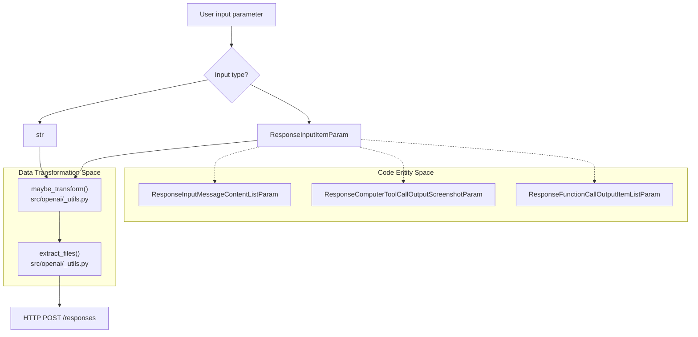
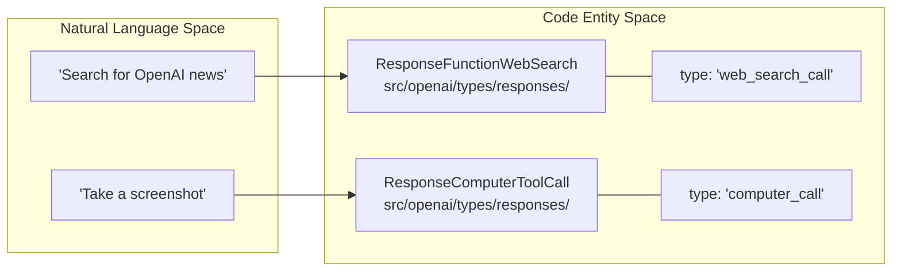

<!-- source: DeepWiki mcp.deepwiki.com · repo openai/openai-python · extra page Multi-Modal Inputs and Tool Integration · fetched 2026-10-26 -->

# Multi-Modal Inputs and Tool Integration

Relevant source files

The following files were used as context for generating this wiki page:

- [src/openai/resources/images.py](src/openai/resources/images.py)
- [src/openai/types/image_edit_params.py](src/openai/types/image_edit_params.py)
- [src/openai/types/image_generate_params.py](src/openai/types/image_generate_params.py)
- [src/openai/types/responses/computer_tool.py](src/openai/types/responses/computer_tool.py)
- [src/openai/types/responses/computer_tool_param.py](src/openai/types/responses/computer_tool_param.py)
- [src/openai/types/responses/namespace_tool.py](src/openai/types/responses/namespace_tool.py)
- [src/openai/types/responses/namespace_tool_param.py](src/openai/types/responses/namespace_tool_param.py)
- [src/openai/types/responses/response_function_web_search.py](src/openai/types/responses/response_function_web_search.py)
- [src/openai/types/responses/response_function_web_search_param.py](src/openai/types/responses/response_function_web_search_param.py)
- [src/openai/types/responses/response_input_item.py](src/openai/types/responses/response_input_item.py)
- [src/openai/types/responses/response_input_item_param.py](src/openai/types/responses/response_input_item_param.py)
- [src/openai/types/responses/response_input_param.py](src/openai/types/responses/response_input_param.py)
- [src/openai/types/responses/tool.py](src/openai/types/responses/tool.py)
- [src/openai/types/responses/tool_param.py](src/openai/types/responses/tool_param.py)
- [tests/api_resources/test_images.py](tests/api_resources/test_images.py)

## Purpose and Scope

This page documents how the Responses API handles multi-modal inputs and tool integration within the OpenAI Python SDK. It covers the `input` parameter for providing text, images, and file content, the `tools` parameter for defining callable functions and built-in capabilities, and the integration of specialized tools such as Web Search, Computer Use, and Model Context Protocol (MCP) servers.

For information about conversation state management, see [Conversation and State Management](#4.2.2).

## Multi-Modal Input Parameter

The `input` parameter in the Responses API accepts either a plain string for simple text or structured multi-modal content via `ResponseInputItemParam` and `ResponseInputParam`.

### Input Type Structure

The input system uses a discriminated union pattern to handle different content types and message roles.

| Modality | Implementation Class | Description |
|----------|----------------------|-------------|
| **Message** | `Message` | A message input with roles `user`, `system`, or `developer`. |
| **Tool Call Output** | `FunctionCallOutput` | The result of a previous function tool call. |
| **Computer Output** | `ComputerCallOutput` | Screenshot data returned from a computer tool. |
| **MCP Integration** | `McpCall` | Interaction data for Model Context Protocol servers. |

**Sources:** [src/openai/types/responses/response_input_item_param.py:78-103](), [src/openai/types/responses/response_input_item_param.py:119-147](), [src/openai/types/responses/response_input_item_param.py:164-191]()

### Input Processing Flow

The following diagram illustrates how multi-modal inputs are transformed from Python types into API-ready payloads.

**Input Transformation Flow Diagram**

**Sources:** [src/openai/resources/images.py:109-117](), [src/openai/_utils.py:14-14](), [src/openai/types/responses/response_input_item_param.py:23-27]()

## Tool Definitions and Integration

The `tools` parameter accepts an iterable of `ToolParam` objects. These define capabilities the model can invoke, ranging from custom Python functions to complex remote interactions.

### Tool Categories

The SDK organizes tools into several distinct functional categories:

| Category | Type Literal | Implementation |
|----------|--------------|----------------|
| **Function** | `function` | Custom user-defined functions via `FunctionToolParam`. |
| **Web Search** | `web_search` | Built-in internet search via `WebSearchToolParam`. |
| **Computer Use** | `computer` | Control of a virtual computer via `ComputerToolParam`. |
| **MCP** | `mcp` | Remote tools via Model Context Protocol via `Mcp`. |
| **File Search** | `file_search` | Retrieval augmented generation via `FileSearchToolParam`. |

**Sources:** [src/openai/types/responses/tool_param.py:11-24](), [src/openai/types/responses/tool.py:24-41](), [src/openai/types/responses/computer_tool.py:10-17]()

### Model Context Protocol (MCP) Integration

The SDK supports the Model Context Protocol, allowing models to interact with remote servers or service connectors. The `Mcp` class manages connection details including `server_url`, `connector_id` (e.g., `connector_gmail`), and `authorization` tokens.

**Sources:** [src/openai/types/responses/tool_param.py:115-194](), [src/openai/types/responses/tool.py:113-195]()

### Computer Use and Web Search

Specialized tool call results like `ResponseFunctionWebSearch` provide structured feedback on complex multi-step actions, including specific actions like `search`, `open_page`, and `find_in_page`.

**Tool Response Entity Mapping**

**Sources:** [src/openai/types/responses/response_function_web_search.py:71-92](), [src/openai/types/responses/response_input_item.py:118-144]()

## Image Generation and Editing

While the Responses API handles multi-modal input, the `Images` resource handles dedicated generation and editing tasks using models like `dall-e-3` or the `gpt-image` series.

### Image Resource Methods

- `generate`: Creates an image from a text prompt. [src/openai/resources/images.py:176-180]()
- `edit`: Modifies an existing image based on a prompt and optional mask. [src/openai/resources/images.py:129-154]()
- `create_variation`: Generates a variation of a provided image (DALL-E 2 only). [src/openai/resources/images.py:50-65]()

### Parameters and Streaming
For GPT image models, the SDK supports `stream=True`, which returns an `ImageGenStreamEvent` or `ImageEditStreamEvent`. This allows processing partial images or progress updates.

**Sources:** [src/openai/resources/images.py:22-23](), [src/openai/types/image_generate_params.py:149-157](), [src/openai/types/image_edit_params.py:150-158]()

## Implementation Details

### Tool Call Statuses
Tools within the Responses API lifecycle move through specific statuses:
- `ResponseFunctionWebSearch`: `in_progress`, `searching`, `completed`, `failed`. [src/openai/types/responses/response_function_web_search.py:87-88]()
- `Message`: `in_progress`, `completed`, `incomplete`. [src/openai/types/responses/response_input_item.py:93-98]()

### Data Transformation
The SDK uses `extract_files` and `deepcopy_with_paths` to prepare multi-part form data when images or files are passed as raw bytes or file-like objects.

**Sources:** [src/openai/resources/images.py:98-117](), [src/openai/_utils.py:14-14]()

---

