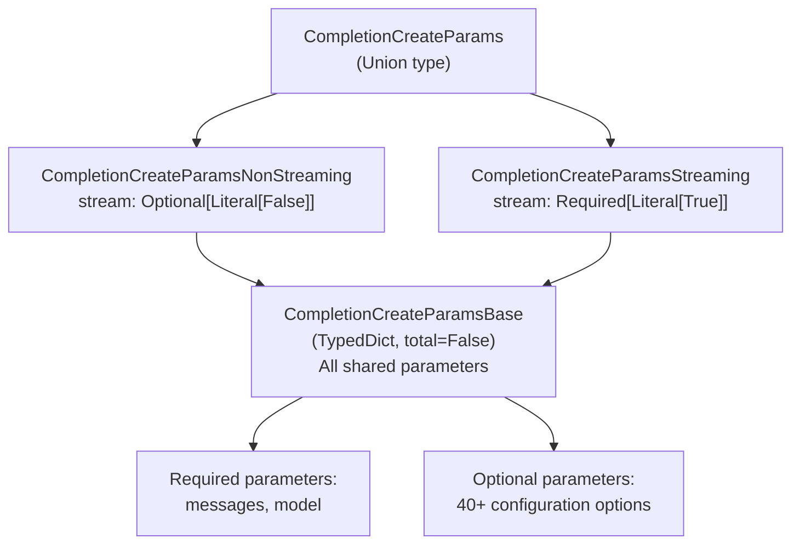
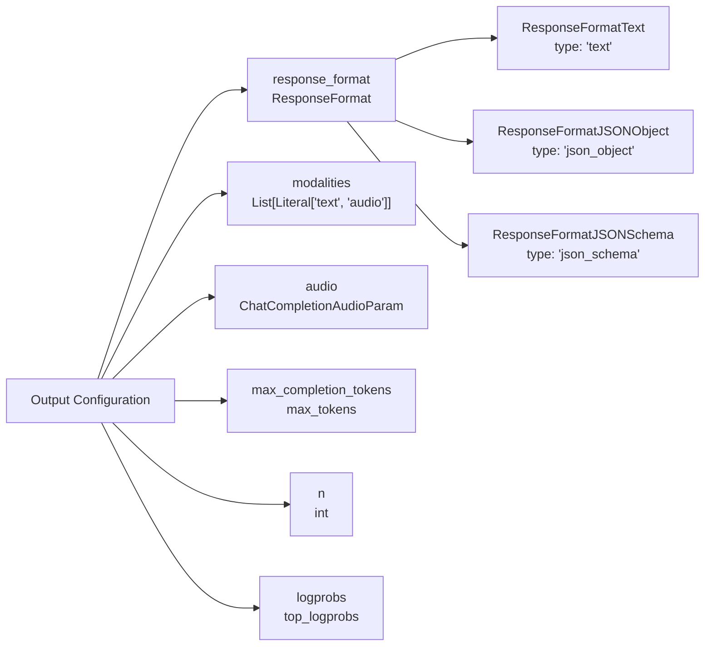
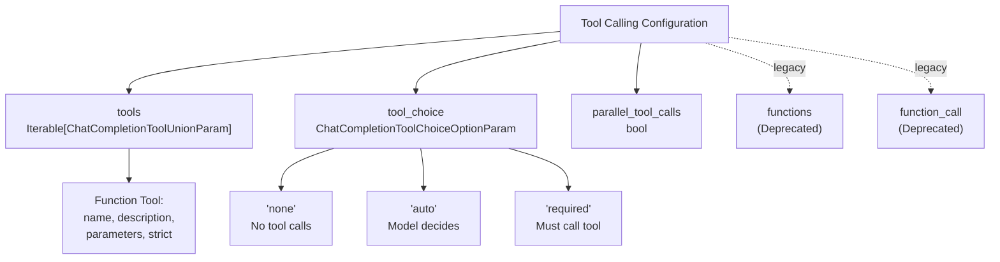
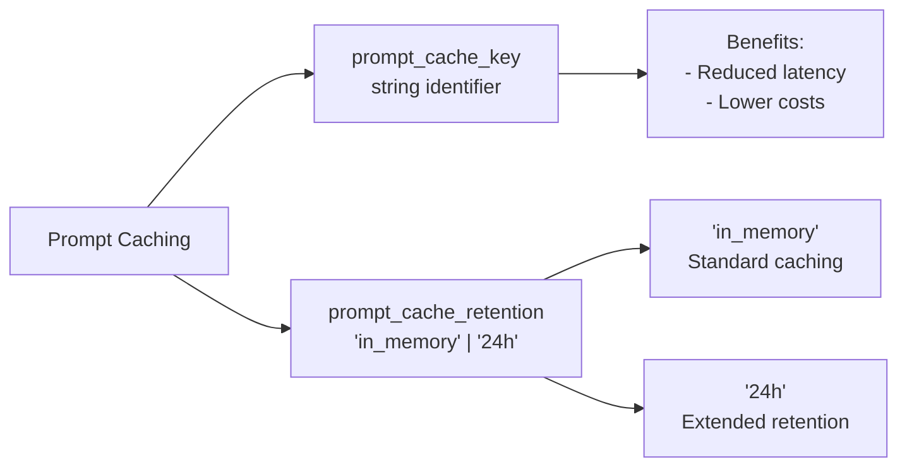
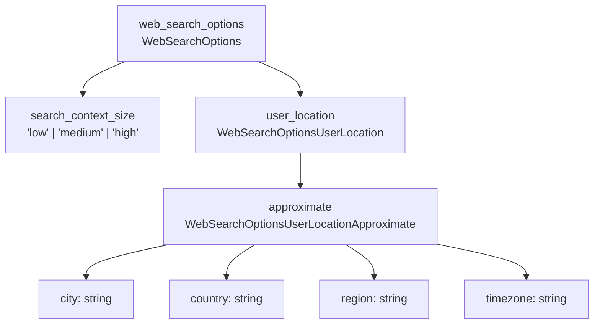
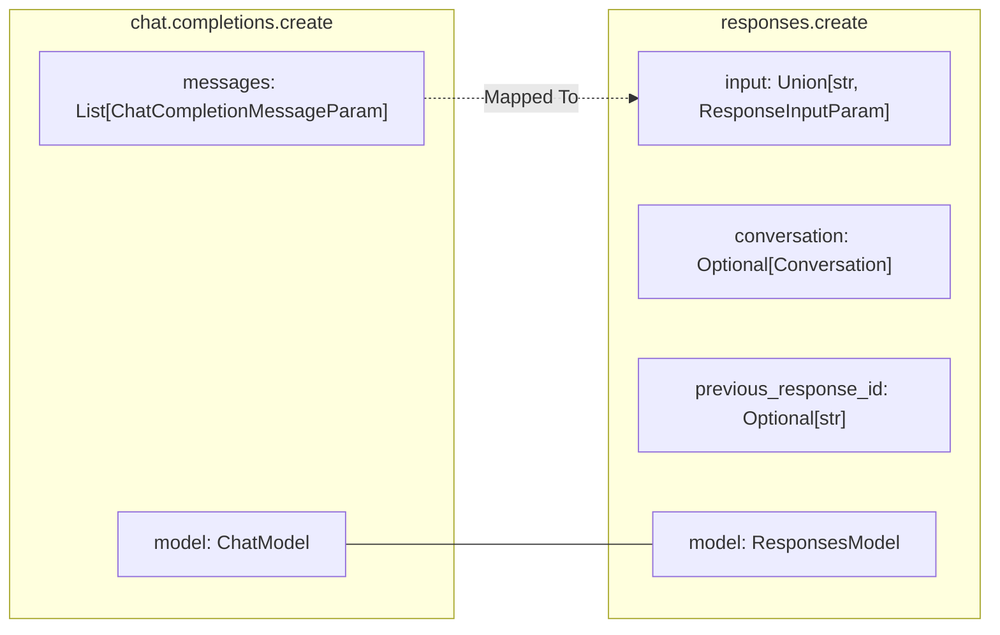
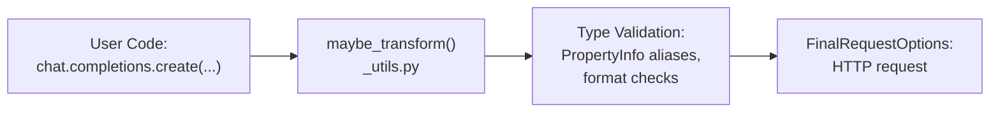

<!-- source: DeepWiki mcp.deepwiki.com · repo openai/openai-python · extra page Parameters and Configuration · fetched 2026-10-26 -->

# Parameters and Configuration

<details>
<summary>Relevant source files</summary>

The following files were used as context for generating this wiki page:

- [src/openai/resources/chat/completions/completions.py](src/openai/resources/chat/completions/completions.py)
- [src/openai/resources/responses/responses.py](src/openai/resources/responses/responses.py)
- [src/openai/types/chat/chat_completion_audio_param.py](src/openai/types/chat/chat_completion_audio_param.py)
- [src/openai/types/chat/completion_create_params.py](src/openai/types/chat/completion_create_params.py)
- [src/openai/types/realtime/realtime_audio_config_output.py](src/openai/types/realtime/realtime_audio_config_output.py)
- [src/openai/types/realtime/realtime_audio_config_output_param.py](src/openai/types/realtime/realtime_audio_config_output_param.py)
- [src/openai/types/realtime/realtime_response_create_audio_output.py](src/openai/types/realtime/realtime_response_create_audio_output.py)
- [src/openai/types/realtime/realtime_response_create_audio_output_param.py](src/openai/types/realtime/realtime_response_create_audio_output_param.py)
- [src/openai/types/responses/response.py](src/openai/types/responses/response.py)
- [src/openai/types/responses/response_compact_params.py](src/openai/types/responses/response_compact_params.py)
- [src/openai/types/responses/response_create_params.py](src/openai/types/responses/response_create_params.py)
- [src/openai/types/responses/responses_client_event.py](src/openai/types/responses/responses_client_event.py)
- [src/openai/types/responses/responses_client_event_param.py](src/openai/types/responses/responses_client_event_param.py)
- [src/openai/types/shared/chat_model.py](src/openai/types/shared/chat_model.py)
- [src/openai/types/shared_params/chat_model.py](src/openai/types/shared_params/chat_model.py)
- [tests/api_resources/chat/test_completions.py](tests/api_resources/chat/test_completions.py)
- [tests/api_resources/realtime/test_calls.py](tests/api_resources/realtime/test_calls.py)
- [tests/api_resources/realtime/test_client_secrets.py](tests/api_resources/realtime/test_client_secrets.py)
- [tests/api_resources/test_responses.py](tests/api_resources/test_responses.py)

</details>


This page documents all parameters available for the Chat Completions API's `create()` method, covering both standard and streaming modes. These parameters control model behavior, output format, tool usage, reasoning effort, caching, and more.

For information about streaming responses and processing SSE events, see [Streaming Chat Completions](#4.1.2). For structured output parsing and the `parse()` method, see [Parsed Responses and Structured Outputs](#4.1.3). For general client configuration like API keys and timeouts, see [Client Configuration](#2.1).

---

## Parameter Type Definitions

The Chat Completions API uses `TypedDict`-based parameter types that provide type safety while remaining flexible for both streaming and non-streaming modes. All parameters are defined in `src/openai/types/chat/completion_create_params.py`.

### Chat Completion Parameter Hierarchy
Title: Chat Completion Parameter Hierarchy


**Sources:** [src/openai/types/chat/completion_create_params.py:24-461]()

The union type `CompletionCreateParams` distinguishes between streaming and non-streaming requests at the type level, enabling proper overload resolution in the client's `create()` method.

---

## Required Parameters

Only two parameters are required for all Chat Completions requests:

| Parameter | Type | Description |
|-----------|------|-------------|
| `messages` | `Iterable[ChatCompletionMessageParam]` | Conversation history with role-based messages supporting text, images, and audio |
| `model` | `Union[str, ChatModel]` | Model identifier like `gpt-4o`, `o3`, or `gpt-4o-mini` |

**Sources:** [src/openai/types/chat/completion_create_params.py:37-55](), [tests/api_resources/chat/test_completions.py:27-35]()

### Messages Structure

Messages use a role-content structure where each message includes:
- **role**: `developer`, `system`, `user`, `assistant`, or `tool`
- **content**: Text string, array of content parts (text/image/audio), or tool call results
- **name** (optional): Message author identifier

The `messages` parameter is typed as `Required[Iterable[ChatCompletionMessageParam]]` at [src/openai/types/chat/completion_create_params.py:43-51]().

### Model Selection

The `model` parameter accepts either a string or the `ChatModel` enum. Models have different capabilities:
- **GPT-4o series**: Multi-modal, tool calling, structured outputs
- **O-series** (`o3`, `o1`): Reasoning models with `reasoning_effort` control
- **GPT-5 series**: Enhanced reasoning with configurable effort levels (e.g., `gpt-5-mini`, `gpt-5.1`)

**Sources:** [src/openai/types/chat/completion_create_params.py:53-60](), [src/openai/types/shared/chat_model.py:7-89](), [src/openai/types/responses/response_compact_params.py:13-112]()

---

## Output Configuration Parameters

These parameters control the format, structure, and type of model outputs.

### Output Configuration Options
Title: Output Configuration Options


**Sources:** [src/openai/types/chat/completion_create_params.py:57-152](), [src/openai/types/chat/completion_create_params.py:213-224](), [src/openai/types/chat/completion_create_params.py:381]()

### Response Format

| Value | Type | Description |
|-------|------|-------------|
| `{"type": "text"}` | `ResponseFormatText` | Plain text output (default) |
| `{"type": "json_object"}` | `ResponseFormatJSONObject` | Valid JSON object (legacy mode) |
| `{"type": "json_schema", "json_schema": {...}}` | `ResponseFormatJSONSchema` | Structured outputs with JSON Schema validation |

The `response_format` parameter is defined as a `TypeAlias` union at [src/openai/types/chat/completion_create_params.py:381]() and used at [src/openai/types/chat/completion_create_params.py:213-224]().

**Usage in tests:**
```python
# Text format (default)
response_format={"type": "text"}

# JSON Schema for structured outputs
response_format={"type": "json_schema", "json_schema": {...}}
```

**Sources:** [tests/api_resources/chat/test_completions.py:89](), [tests/api_resources/chat/test_completions.py:212]()

### Modalities and Audio

The `modalities` parameter specifies output types:
- `["text"]` - Text-only output (default)
- `["text", "audio"]` - Both text and audio for models like `gpt-4o-audio-preview`

When audio output is requested, the `audio` parameter is required:

```python
audio={
    "format": "wav",  # or "mp3", "opus", "flac", "pcm16"
    "voice": "alloy"  # or "ash", "ballad", "coral", "sage", "shimmer", "verse"
}
```

**Sources:** [src/openai/types/chat/completion_create_params.py:62-67](), [src/openai/types/chat/completion_create_params.py:145-157](), [tests/api_resources/chat/test_completions.py:49-52]()

### Token Limits

| Parameter | Range | Description |
|-----------|-------|-------------|
| `max_completion_tokens` | integer | Total tokens including visible output and reasoning (preferred for o-series) |
| `max_tokens` | integer | Legacy parameter, not compatible with o-series models |

**Sources:** [src/openai/types/chat/completion_create_params.py:117-133]()

---

## Sampling and Generation Control

These parameters influence the randomness, creativity, and style of model responses.

| Parameter | Type | Range | Description |
|-----------|------|-------|-------------|
| `temperature` | float | 0-2 | Sampling temperature; higher = more random |
| `top_p` | float | 0-1 | Nucleus sampling; consider tokens with top_p probability mass |
| `frequency_penalty` | float | -2.0 to 2.0 | Penalize tokens by existing frequency |
| `presence_penalty` | float | -2.0 to 2.0 | Penalize tokens by presence in text |
| `logit_bias` | dict | -100 to 100 | Modify likelihood of specific tokens by token ID |
| `seed` | int | any | Enable deterministic sampling (best effort) |
| `stop` | str or list | up to 4 sequences | Stop generation at these sequences |

**Sources:** [src/openai/types/chat/completion_create_params.py:69-108](), [src/openai/types/chat/completion_create_params.py:182-187](), [src/openai/types/chat/completion_create_params.py:235-242](), [src/openai/types/chat/completion_create_params.py:263-268](), [src/openai/types/chat/completion_create_params.py:282-325]()

---

## Tool and Function Calling

Parameters for enabling the model to call external tools and functions.

### Tool Calling Configuration
Title: Tool Calling Configuration


**Sources:** [src/openai/types/chat/completion_create_params.py:76-97](), [src/openai/types/chat/completion_create_params.py:169-175](), [src/openai/types/chat/completion_create_params.py:290-309]()

### Tools Parameter

The `tools` parameter accepts an iterable of tool definitions. Each function tool includes:

```python
tools=[
    {
        "type": "function",
        "function": {
            "name": "get_weather",
            "description": "Get current weather for a location",
            "parameters": {
                "type": "object",
                "properties": {
                    "location": {"type": "string"}
                },
                "required": ["location"]
            },
            "strict": True  # Enable strict schema adherence
        }
    }
]
```

**Sources:** [src/openai/types/chat/completion_create_params.py:303-309](), [tests/api_resources/chat/test_completions.py:102-112]()

---

## Reasoning Model Parameters

These parameters are specific to reasoning models (o-series and gpt-5 series) that perform extended thinking before generating responses.

### Reasoning Effort

The `reasoning_effort` parameter constrains computational effort for reasoning models. This is configured via the `ReasoningEffort` literal in `src/openai/types/shared/reasoning_effort.py`.

| Model | Default | Supported Values | Notes |
|-------|---------|------------------|-------|
| `gpt-5.1` | `none` | `none`, `low`, `medium`, `high` | Tools supported at all levels |
| `o1` / `o3` | `medium` | `low`, `medium`, `high` | Standard reasoning range |

**Sources:** [src/openai/types/chat/completion_create_params.py:196-211](), [tests/api_resources/chat/test_completions.py:88]()

### Verbosity

The `verbosity` parameter controls response length and detail:

```python
verbosity="low"     # Concise responses
verbosity="medium"  # Balanced
verbosity="high"    # Detailed, comprehensive responses
```

**Sources:** [src/openai/types/chat/completion_create_params.py:336-342](), [tests/api_resources/chat/test_completions.py:116]()

---

## Caching and Optimization

Parameters that optimize performance and cost through caching and service tier selection.

### Prompt Caching Configuration
Title: Prompt Caching Configuration


**Sources:** [src/openai/types/chat/completion_create_params.py:181-194]()

---

## Web Search Tool (Beta)

The `web_search_options` parameter enables web search capabilities and location-aware searching.

### Web Search Configuration
Title: Web Search Configuration


**Sources:** [src/openai/types/chat/completion_create_params.py:344-349](), [src/openai/types/chat/completion_create_params.py:384-430]()

---

## Responses API Comparison

The modern `Responses` API (`src/openai/resources/responses/responses.py`) uses a similar set of parameters but introduces conversation-aware fields like `conversation` and `previous_response_id`.

### Chat Completions vs Responses API Entities
Title: Chat Completions vs Responses API Entities


**Sources:** [src/openai/types/chat/completion_create_params.py:43-55](), [src/openai/types/responses/response_create_params.py:53-149](), [src/openai/types/responses/responses.py:133-166]()

---

## Type Safety and Validation

The library performs runtime validation through the transformation pipeline. It explicitly prevents passing Pydantic model classes directly to `response_format` in the `create()` method unless using the specialized `parse()` wrapper.

### Request Transformation Flow
Title: Request Transformation Flow


**Sources:** [src/openai/resources/chat/completions/completions.py:137-147](), [src/openai/_utils.py:23-33]()

For structured output parsing where you wish to pass a Pydantic model, use the `parse()` method instead which handles the schema generation and response deserialization [src/openai/resources/chat/completions/completions.py:91-136]().

---

