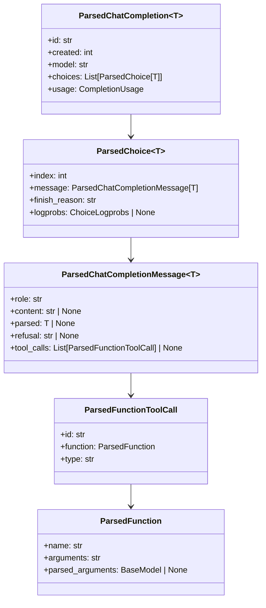
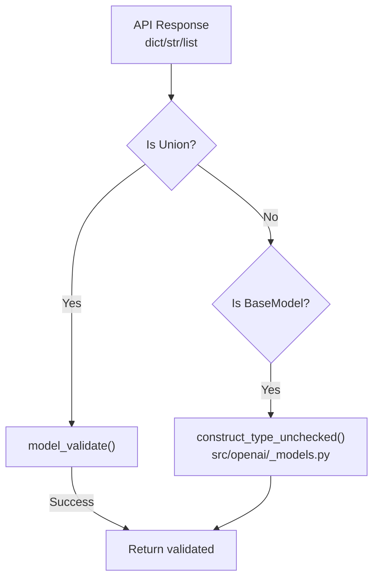

<!-- source: DeepWiki mcp.deepwiki.com · repo openai/openai-python · extra page Parsed Responses and Structured Outputs · fetched 2026-10-26 -->

# Parsed Responses and Structured Outputs

<details>
<summary>Relevant source files</summary>

The following files were used as context for generating this wiki page:

- [src/openai/_exceptions.py](src/openai/_exceptions.py)
- [src/openai/lib/_parsing/__init__.py](src/openai/lib/_parsing/__init__.py)
- [src/openai/lib/_parsing/_completions.py](src/openai/lib/_parsing/_completions.py)
- [src/openai/lib/_pydantic.py](src/openai/lib/_pydantic.py)
- [src/openai/lib/streaming/chat/__init__.py](src/openai/lib/streaming/chat/__init__.py)
- [src/openai/lib/streaming/chat/_completions.py](src/openai/lib/streaming/chat/_completions.py)
- [tests/lib/chat/test_completions.py](tests/lib/chat/test_completions.py)
- [tests/lib/chat/test_completions_streaming.py](tests/lib/chat/test_completions_streaming.py)
- [tests/lib/responses/__init__.py](tests/lib/responses/__init__.py)
- [tests/lib/responses/test_responses.py](tests/lib/responses/test_responses.py)
- [tests/lib/schema_types/query.py](tests/lib/schema_types/query.py)
- [tests/lib/snapshots.py](tests/lib/snapshots.py)
- [tests/lib/test_pydantic.py](tests/lib/test_pydantic.py)
- [tests/lib/utils.py](tests/lib/utils.py)

</details>


## Purpose and Scope

This document covers the `.parse()` method and structured output capabilities of the Chat Completions API, which automatically deserialize API responses into Pydantic models. This feature enables type-safe, validated responses without manual JSON parsing.

For information about the newer Responses API (the recommended interface for model interactions), see [Responses API](#4.2). For general Chat Completions configuration, see [Parameters and Configuration](#4.1.1). For streaming without structured outputs, see [Streaming Chat Completions](#4.1.2).

---

## Overview

The SDK provides two mechanisms for structured outputs:

1.  **Non-streaming parsing**: `client.chat.completions.parse()` returns a `ParsedChatCompletion[T]` with fully deserialized data.
2.  **Streaming parsing**: `client.chat.completions.stream()` with `response_format` returns incremental parsed data as JSON completes.

Both methods use Pydantic models to define the expected output schema, which the API enforces using JSON Schema with `strict: true` mode.

### Data Flow: Natural Language to Code Entity Space

The following diagram illustrates how a natural language request is transformed into a structured Pydantic model instance through the SDK's parsing layer.

```mermaid
graph LR
    subgraph "User Code Space"
        UserModel["pydantic.BaseModel<br/>(Location)"]
        ParseCall["ChatCompletions.parse()"]
        ParsedResult["ParsedChatCompletion[Location]"]
    end
    
    subgraph "SDK Internal (Code Entity Space)"
        Transform["to_strict_json_schema()"]
        Schema["JSON Schema Generation<br/>src/openai/lib/_pydantic.py"]
        Request["HTTP Request<br/>response_format param"]
    end
    
    subgraph "API Response"
        JSONContent["JSON String<br/>'{\"city\":\"SF\",...}'"]
        RawResponse["ChatCompletion"]
    end
    
    subgraph "Parsing Layer"
        ConstructType["construct_type_unchecked()<br/>src/openai/_models.py"]
        ValidatedModel["Location Instance"]
    end
    
    UserModel --> Transform
    Transform --> Schema
    Schema --> Request
    ParseCall --> Request
    Request --> JSONContent
    JSONContent --> RawResponse
    RawResponse --> ConstructType
    ConstructType --> ValidatedModel
    ValidatedModel --> ParsedResult
    ParsedResult --> UserModel
```

The `client.chat.completions.parse()` method is a wrapper around the standard creation logic that provides richer integrations with Python-specific types and returns a `ParsedChatCompletion` object.

**Sources:** [src/openai/lib/_parsing/_completions.py:86-162](), [src/openai/lib/_pydantic.py:16-25](), [tests/lib/chat/test_completions.py:97-163]()

---

## Basic Usage with Pydantic Models

### Defining Response Schemas

Define the expected response structure using a Pydantic `BaseModel`.

```python
from pydantic import BaseModel
from typing_extensions import Literal

class Location(BaseModel):
    city: str
    temperature: float
    units: Literal["c", "f"]
```

### Calling the Parse Method

Pass the model class to the `response_format` parameter. The SDK uses `to_strict_json_schema` to ensure the model conforms to the API's `strict` requirements [src/openai/lib/_pydantic.py:16-35]().

```python
completion = client.chat.completions.parse(
    model="gpt-4o-2024-08-06",
    messages=[
        {"role": "user", "content": "What's the weather like in SF?"}
    ],
    response_format=Location,
)

# Access the parsed model
location = completion.choices[0].message.parsed
assert isinstance(location, Location)
```

The returned `completion.choices[0].message.parsed` contains a fully instantiated `Location` model with validated fields [src/openai/lib/_parsing/_completions.py:146-150]().

**Sources:** [tests/lib/chat/test_completions.py:97-163](), [src/openai/lib/_pydantic.py:16-35]()

---

## Response Types and Structure

### ParsedChatCompletion[T]

The `.parse()` method returns a generic `ParsedChatCompletion[ResponseFormatT]` object [src/openai/lib/_parsing/_completions.py:86-91]().



### Key Attributes

| Attribute | Type | Description |
|-----------|------|-------------|
| `message.parsed` | `T \| None` | The deserialized Pydantic model instance [src/openai/lib/_parsing/_completions.py:146-150]() |
| `message.content` | `str \| None` | Raw JSON string from the API |
| `message.refusal` | `str \| None` | Set if the model refuses to respond [src/openai/lib/_parsing/_completions.py:190-195]() |
| `message.tool_calls` | `List[ParsedFunctionToolCall] \| None` | Parsed tool calls with `parsed_arguments` [src/openai/lib/_parsing/_completions.py:107-137]() |

**Sources:** [src/openai/lib/_parsing/_completions.py:86-162](), [tests/lib/chat/test_completions.py:124-162]()

---

## Streaming with Parsing

### Basic Streaming

Use `.stream()` with `response_format` to receive incremental parsing events. The `ChatCompletionStream` manages state and accumulates the partial JSON [src/openai/lib/streaming/chat/_completions.py:46-65]().

```python
with client.chat.completions.stream(
    model="gpt-4o-2024-08-06",
    messages=[{"role": "user", "content": "What's the weather in SF?"}],
    response_format=Location,
) as stream:
    for event in stream:
        if event.type == "content.delta":
            # Partial JSON data as dict
            print(event.parsed)  
        elif event.type == "content.done":
            # Complete parsed model
            print(event.parsed)  
```

### Streaming Event Types

The `ChatCompletionStreamState` class handles the logic for converting raw chunks into high-level events like `content.delta` and `content.done` [src/openai/lib/streaming/chat/_completions.py:65]().

| Event Type | Description | `event.parsed` Type |
|------------|-------------|---------------------|
| `content.delta` | Incremental JSON parsing | `dict[str, Any]` (partial) |
| `content.done` | Complete JSON parsed | `T` (full model instance) |
| `chunk` | Raw `ChatCompletionChunk` | N/A |

**Sources:** [src/openai/lib/streaming/chat/_completions.py:46-119](), [tests/lib/chat/test_completions_streaming.py:98-191]()

---

## Tool Calling with Parsing

### Defining Tools with Pydantic

The SDK validates that tools used with auto-parsing are `strict` and of type `function` [src/openai/lib/_parsing/_completions.py:65-83]().

### Accessing Parsed Tool Arguments

The `parse_function_tool_arguments` utility handles the deserialization of tool call arguments into the specified Pydantic model [src/openai/lib/_parsing/_completions.py:171-188]().

```python
tool_call = completion.choices[0].message.tool_calls[0]
# Parsed model instance
args = tool_call.function.parsed_arguments
```

**Sources:** [src/openai/lib/_parsing/_completions.py:107-137](), [src/openai/lib/_parsing/_completions.py:171-188]()

---

## Error Handling and Edge Cases

### Finish Reasons

The SDK raises specific exceptions if the model stops for reasons other than a complete response [src/openai/_exceptions.py:166-188]():

1.  **LengthFinishReasonError**: Raised when `finish_reason == "length"`, indicating the response was truncated [src/openai/lib/_parsing/_completions.py:99-100]().
2.  **ContentFilterFinishReasonError**: Raised when `finish_reason == "content_filter"` [src/openai/lib/_parsing/_completions.py:102-103]().

### Refusals

If the model refuses to respond, `maybe_parse_content` will return `None`, and the `refusal` property on the message will be populated [src/openai/lib/_parsing/_completions.py:190-195]().

**Sources:** [src/openai/lib/_parsing/_completions.py:97-105](), [src/openai/_exceptions.py:166-188]()

---

## Type Construction Internals

### The construct_type() Logic

Parsing relies on internal construction logic to perform type coercion. This allows the SDK to instantiate models from API responses [src/openai/lib/_parsing/_completions.py:113-125]().



### JSON Schema Transformation

The `to_strict_json_schema` function in `src/openai/lib/_pydantic.py` mutates standard Pydantic JSON schemas to meet OpenAI's `strict` requirements [src/openai/lib/_pydantic.py:16-35]():
*   Sets `additionalProperties: false` for all objects [src/openai/lib/_pydantic.py:50-51]().
*   Ensures all properties are listed in the `required` array [src/openai/lib/_pydantic.py:57]().
*   Resolves `$ref` pointers to inline definitions where necessary [src/openai/lib/_pydantic.py:100-113]().

**Sources:** [src/openai/lib/_pydantic.py:16-115]()

---

## Comparison: parse() vs create()

| Aspect | `.parse()` | `.create()` |
|--------|-----------|-------------|
| **Return Type** | `ParsedChatCompletion[T]` | `ChatCompletion` |
| **Parsed Access** | `message.parsed` (typed instance) | Manual `json.loads(message.content)` |
| **Tool Arguments** | `parsed_arguments` (typed instance) | Manual `json.loads(tool.arguments)` |
| **Error Handling** | Raises `LengthFinishReasonError` | User must check `finish_reason` |
| **Validation** | Auto-generated via `response_format` | Manual schema in `response_format` |

**Sources:** [src/openai/lib/_parsing/_completions.py:86-162](), [tests/lib/chat/test_completions.py:32-93]()

---

