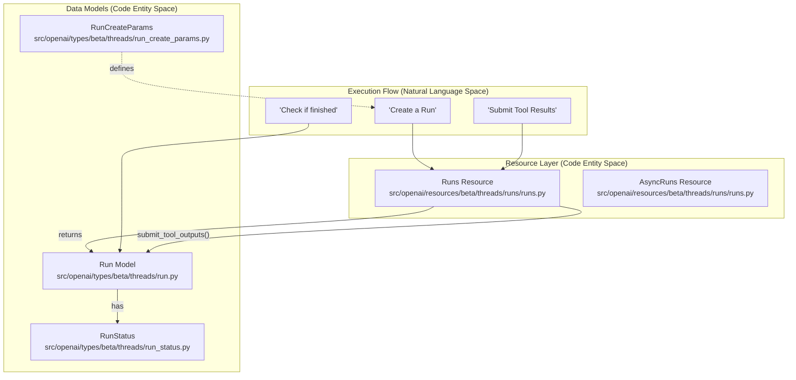
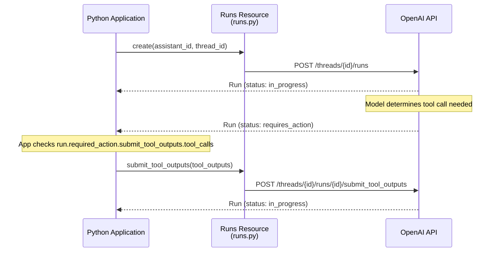

<!-- source: DeepWiki mcp.deepwiki.com · repo openai/openai-python · extra page Runs and Execution · fetched 2026-10-26 -->

# Runs and Execution

<details>
<summary>Relevant source files</summary>

The following files were used as context for generating this wiki page:

- [src/openai/resources/beta/assistants.py](src/openai/resources/beta/assistants.py)
- [src/openai/resources/beta/threads/messages.py](src/openai/resources/beta/threads/messages.py)
- [src/openai/resources/beta/threads/runs/runs.py](src/openai/resources/beta/threads/runs/runs.py)
- [src/openai/resources/beta/threads/runs/steps.py](src/openai/resources/beta/threads/runs/steps.py)
- [src/openai/resources/beta/threads/threads.py](src/openai/resources/beta/threads/threads.py)
- [src/openai/resources/fine_tuning/jobs/jobs.py](src/openai/resources/fine_tuning/jobs/jobs.py)
- [src/openai/resources/models.py](src/openai/resources/models.py)
- [src/openai/types/beta/assistant.py](src/openai/types/beta/assistant.py)
- [src/openai/types/beta/assistant_create_params.py](src/openai/types/beta/assistant_create_params.py)
- [src/openai/types/beta/assistant_update_params.py](src/openai/types/beta/assistant_update_params.py)
- [src/openai/types/beta/thread_create_and_run_params.py](src/openai/types/beta/thread_create_and_run_params.py)
- [src/openai/types/beta/threads/run.py](src/openai/types/beta/threads/run.py)
- [src/openai/types/beta/threads/run_create_params.py](src/openai/types/beta/threads/run_create_params.py)
- [src/openai/types/chat_model.py](src/openai/types/chat_model.py)
- [src/openai/types/fine_tuning/fine_tuning_job.py](src/openai/types/fine_tuning/fine_tuning_job.py)
- [src/openai/types/fine_tuning/job_create_params.py](src/openai/types/fine_tuning/job_create_params.py)
- [src/openai/types/fine_tuning/job_list_params.py](src/openai/types/fine_tuning/job_list_params.py)

</details>


This document describes the run lifecycle and execution system in the Assistants API. A run represents the execution of an assistant on a thread, processing messages and generating responses while potentially calling tools. For information about creating and configuring assistants, see [4.3.1](). For information about threads and messages, see [4.3.2](). For information about streaming run events, see [4.3.4]().

**Deprecation Notice**: The Assistants API is deprecated in favor of the Responses API. All methods in the runs resource are marked with deprecation warnings [src/openai/resources/beta/threads/runs/runs.py:90-91]().

## Run Lifecycle and State Machine

A run progresses through a series of statuses from creation to completion. Understanding this state machine is critical for properly handling run execution.

Title: Assistant Run State Machine
```mermaid
stateDiagram-v2
    [*] --> "queued": "create()"
    "queued" --> "in_progress": "Processing begins"
    "in_progress" --> "requires_action": "Tool calls needed"
    "in_progress" --> "completed": "Success"
    "in_progress" --> "failed": "Error occurred"
    "in_progress" --> "incomplete": "Token limit reached"
    "in_progress" --> "cancelling": "cancel() called"
    
    "requires_action" --> "in_progress": "submit_tool_outputs()"
    "requires_action" --> "expired": "Timeout (10 min)"
    
    "cancelling" --> "cancelled": "Cancellation complete"
    
    "completed" --> [*]
    "failed" --> [*]
    "cancelled" --> [*]
    "incomplete" --> [*]
    "expired" --> [*]
```

**Terminal States**: `completed`, `failed`, `cancelled`, `incomplete`, `expired` [src/openai/types/beta/threads/run.py:225-230]().  
**Action Required State**: `requires_action` - run pauses waiting for tool output submission [src/openai/types/beta/threads/run.py:192-196]().  
**Processing States**: `queued`, `in_progress`, `cancelling` [src/openai/types/beta/threads/run.py:225-230]().

Sources: [src/openai/types/beta/threads/run.py:107-274](), [src/openai/types/beta/threads/run_status.py]()

## Core Run Classes

The runs system is implemented through resource classes and type models that work together to manage run execution.

Title: Natural Language to Code Entity Space - Runs


**Key Classes**:
- `Runs` / `AsyncRuns` at [src/openai/resources/beta/threads/runs/runs.py:62-59]() - Resource classes providing methods for run operations.
- `Run` at [src/openai/types/beta/threads/run.py:107-108]() - Pydantic model representing a run execution.
- `RunCreateParamsBase` at [src/openai/types/beta/threads/run_create_params.py:30-31]() - TypedDict for create parameters.

Sources: [src/openai/resources/beta/threads/runs/runs.py:1-59](), [src/openai/types/beta/threads/run.py:1-274]()

## Creating Runs

### Basic Run Creation

The simplest way to create a run is to specify the assistant ID and thread ID:

```python
run = client.beta.threads.runs.create(
    thread_id="thread_abc123",
    assistant_id="asst_xyz789"
)
```

This creates a run with the assistant's default configuration. The synchronous method implementation is at [src/openai/resources/beta/threads/runs/runs.py:91-119]().

Sources: [src/openai/resources/beta/threads/runs/runs.py:91-119]()

### Run Configuration Options

Runs support extensive configuration options that override assistant defaults:

| Parameter | Type | Description |
|-----------|------|-------------|
| `assistant_id` | `str` | Required. Assistant to execute [src/openai/types/beta/threads/run_create_params.py:31]() |
| `instructions` | `str` | Override assistant instructions [src/openai/types/beta/threads/run_create_params.py:60]() |
| `additional_instructions` | `str` | Append to assistant instructions [src/openai/types/beta/threads/run_create_params.py:50]() |
| `additional_messages` | `Iterable[AdditionalMessage]` | Add messages before running [src/openai/types/beta/threads/run_create_params.py:57]() |
| `model` | `Union[str, ChatModel]` | Override assistant model [src/openai/types/beta/threads/run_create_params.py:95]() |
| `tools` | `Iterable[AssistantToolParam]` | Override assistant tools [src/openai/types/beta/threads/run_create_params.py:163]() |
| `tool_choice` | `AssistantToolChoiceOptionParam` | Control tool behavior [src/openai/types/beta/threads/run_create_params.py:152]() |
| `parallel_tool_calls` | `bool` | Enable parallel function calling [src/openai/types/beta/threads/run_create_params.py:103]() |
| `reasoning_effort` | `ReasoningEffort` | Constrain reasoning for reasoning models [src/openai/types/beta/threads/run_create_params.py:110]() |
| `response_format` | `AssistantResponseFormatOptionParam` | Specify output format [src/openai/types/beta/threads/run_create_params.py:121]() |
| `temperature` | `float` | Sampling temperature (0-2) [src/openai/types/beta/threads/run_create_params.py:145]() |
| `top_p` | `float` | Nucleus sampling parameter [src/openai/types/beta/threads/run_create_params.py:169]() |
| `max_prompt_tokens` | `int` | Maximum prompt tokens across turns [src/openai/types/beta/threads/run_create_params.py:76]() |
| `max_completion_tokens` | `int` | Maximum completion tokens across turns [src/openai/types/beta/threads/run_create_params.py:67]() |
| `truncation_strategy` | `TruncationStrategy` | Control context window truncation [src/openai/types/beta/threads/run_create_params.py:170]() |

Sources: [src/openai/types/beta/threads/run_create_params.py:30-189](), [src/openai/resources/beta/threads/runs/runs.py:91-119]()

## Handling Required Actions

When a run enters `requires_action` status, the assistant has made tool calls that require external execution.

Title: Tool Call Execution Flow


### Submitting Tool Outputs

The `submit_tool_outputs()` method provides the results of tool execution back to the run [src/openai/resources/beta/threads/runs/runs.py:1146-1215]().

```python
run = client.beta.threads.runs.submit_tool_outputs(
    thread_id="thread_abc123",
    run_id="run_xyz789",
    tool_outputs=[
        {
            "tool_call_id": "call_123",
            "output": "28 degrees"
        }
    ]
)
```

The `RequiredAction` structure contains the specific tool calls generated by the model [src/openai/types/beta/threads/run.py:49-67]().

Sources: [src/openai/types/beta/threads/run.py:49-67](), [src/openai/resources/beta/threads/runs/runs.py:1146-1215]()

## Run Management Operations

### Retrieving and Listing Runs

- **Retrieve**: Fetch the current state of a specific run [src/openai/resources/beta/threads/runs/runs.py:961-997]().
- **List**: Retrieve all runs for a thread, supporting cursor-based pagination [src/openai/resources/beta/threads/runs/runs.py:1046-1114]().

```python
# List runs with pagination
runs = client.beta.threads.runs.list(thread_id="thread_123", limit=10)
for run in runs:
    print(run.id, run.status)
```

Sources: [src/openai/resources/beta/threads/runs/runs.py:961-1114]()

### Canceling Runs

An in-progress run can be canceled using the `cancel` method [src/openai/resources/beta/threads/runs/runs.py:1116-1144](). This transitions the run to the `cancelling` state.

Sources: [src/openai/resources/beta/threads/runs/runs.py:1116-1144]()

## Thread Creation with Run

The `create_and_run` method on the `Threads` resource combines thread creation and run execution into a single API call [src/openai/resources/beta/threads/threads.py:274-361]().

```python
run = client.beta.threads.create_and_run(
    assistant_id="asst_123",
    thread={
        "messages": [{"role": "user", "content": "Explain quantum physics"}]
    }
)
```

This uses the `ThreadCreateAndRunParams` structure [src/openai/types/beta/thread_create_and_run_params.py:41-175]().

Sources: [src/openai/resources/beta/threads/threads.py:274-361](), [src/openai/types/beta/thread_create_and_run_params.py:41-175]()

## Token Management and Usage

The `Run` object tracks token consumption in the `usage` field [src/openai/types/beta/threads/run.py:91-105]().

```python
class Usage(BaseModel):
    completion_tokens: int
    prompt_tokens: int
    total_tokens: int
```

If a run exceeds `max_prompt_tokens` or `max_completion_tokens`, it enters the `incomplete` state [src/openai/types/beta/threads/run.py:137-141](). Details on which limit was hit are stored in `incomplete_details` [src/openai/types/beta/threads/run.py:25-37]().

Sources: [src/openai/types/beta/threads/run.py:25-141]()

---

