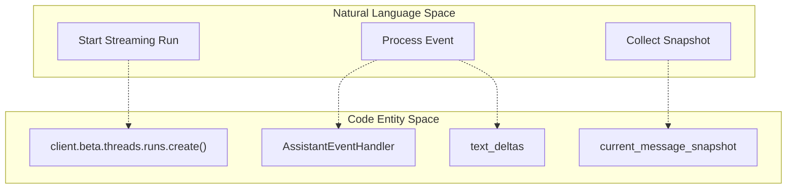
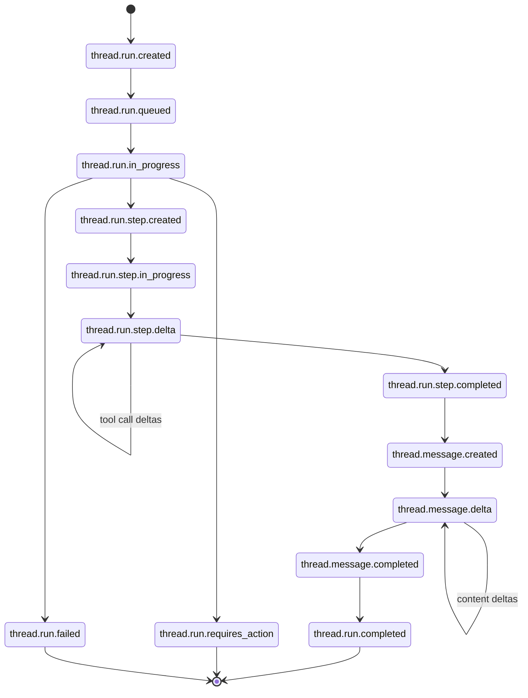
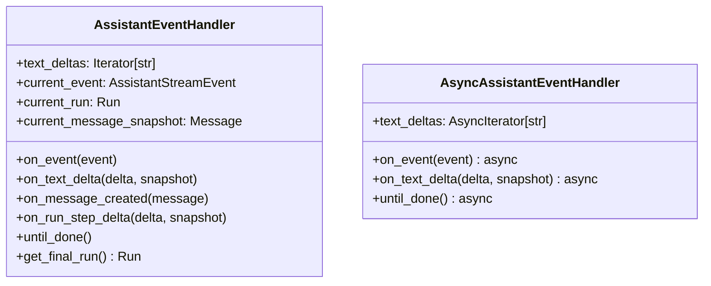
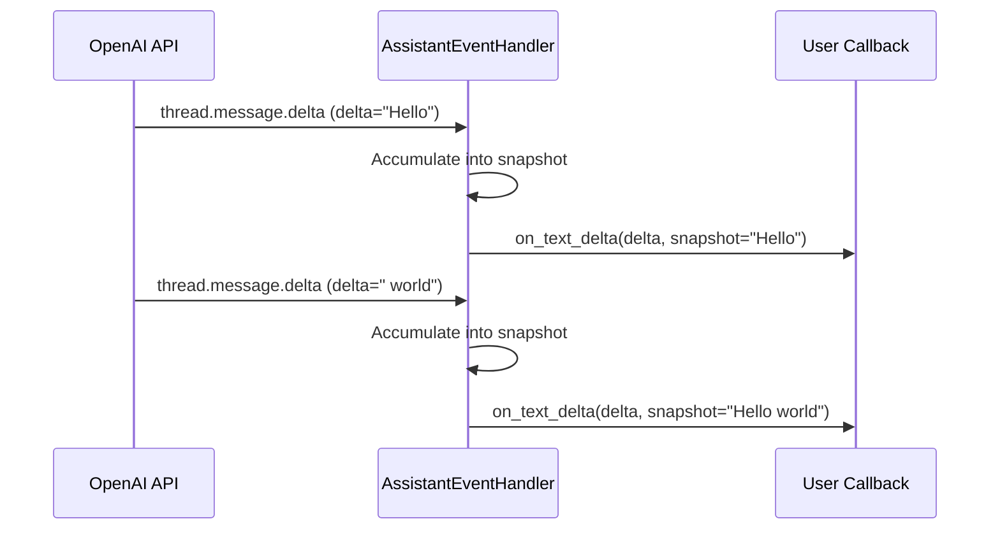
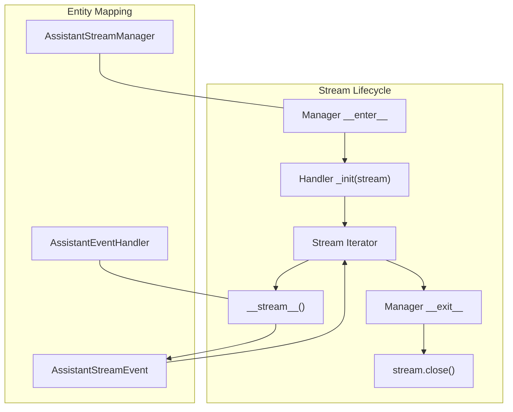

<!-- source: DeepWiki mcp.deepwiki.com · repo openai/openai-python · extra page Streaming Assistant Events · fetched 2026-10-26 -->

# Streaming Assistant Events

<details>
<summary>Relevant source files</summary>

The following files were used as context for generating this wiki page:

- [src/openai/lib/streaming/_assistants.py](src/openai/lib/streaming/_assistants.py)
- [tests/lib/test_assistants.py](tests/lib/test_assistants.py)

</details>


This page documents the streaming event system for the Assistants API, which allows processing incremental responses from assistant runs. When creating a run with `stream=True`, the API returns a stream of `AssistantStreamEvent` objects that can be processed using the `AssistantEventHandler` pattern.

For information about creating and managing assistants, see [Assistants and Configuration](#4.3.1). For details on the run lifecycle without streaming, see [Runs and Execution](#4.3.3).

## Overview

The Assistants API supports streaming responses during run execution. Instead of waiting for the entire run to complete, the stream provides real-time events as the assistant processes messages, uses tools, and generates responses. The SDK provides handler classes that process these events and maintain accumulated state.

**Key Components:**
- `Stream[AssistantStreamEvent]` / `AsyncStream[AssistantStreamEvent]` - The core interface to iterate over SSE responses [src/openai/_streaming.py:12-12]().
- `AssistantEventHandler` / `AsyncAssistantEventHandler` - Handler classes with callback methods and snapshot management [src/openai/lib/streaming/_assistants.py:31-56](), [src/openai/lib/streaming/_assistants.py:475-504]().
- `AssistantStreamManager` / `AsyncAssistantStreamManager` - Context managers for stream lifecycle [src/openai/lib/streaming/_assistants.py:439-440](), [src/openai/lib/streaming/_assistants.py:857-858]().

Sources: [src/openai/_streaming.py:12-12](), [src/openai/lib/streaming/_assistants.py:31-858](), [src/openai/types/beta/assistant_stream_event.py:1-100]()

## Creating Streaming Runs

Streaming is enabled by setting `stream=True` when creating a run. The SDK provides method overloads that return `Stream[AssistantStreamEvent]` when streaming is enabled.

| Method | Streaming Return Type |
|--------|---------------------|
| `client.beta.threads.runs.create(..., stream=True)` | `Stream[AssistantStreamEvent]` |
| `client.beta.threads.create_and_run(..., stream=True)` | `Stream[AssistantStreamEvent]` |

**Natural Language to Code Entity Mapping**



Sources: [tests/lib/test_assistants.py:21-39](), [src/openai/lib/streaming/_assistants.py:31-133]()

## AssistantStreamEvent Types

The `AssistantStreamEvent` discriminated union contains multiple event types that represent different stages of run execution. Each event has an `event` field (discriminator) and a `data` field with the event payload [src/openai/types/beta/assistant_stream_event.py:1-100]().

### Event Categories

| Event Pattern | Description | Data Type |
|--------------|-------------|-----------|
| `thread.run.*` | Run lifecycle events | `Run` |
| `thread.message.*` | Message creation and updates | `Message` or `MessageDelta` |
| `thread.run.step.*` | Run step execution | `RunStep` or `RunStepDelta` |
| `thread.created` | Thread creation | `Thread` |
| `error` | Error events | `Error` |

### Run Lifecycle Events



Sources: [src/openai/lib/streaming/_assistants.py:270-411](), [src/openai/types/beta/assistant_stream_event.py:1-100]()

## AssistantEventHandler Pattern

The `AssistantEventHandler` class provides a structured way to process streaming events through callback methods. Users subclass the handler and override methods for events they want to process.

### Handler Structure



Sources: [src/openai/lib/streaming/_assistants.py:31-434](), [src/openai/lib/streaming/_assistants.py:475-853]()

### Callback Methods

The handler provides callback methods for different event types. Each callback receives structured data specific to that event.

| Callback | Triggered By | Arguments |
|----------|-------------|-----------|
| `on_event(event)` | Every event | Full `AssistantStreamEvent` [src/openai/lib/streaming/_assistants.py:153-154]() |
| `on_text_created(text)` | New text content block | `Text` object [src/openai/lib/streaming/_assistants.py:220-221]() |
| `on_text_delta(delta, snapshot)` | Text content update | `TextDelta`, accumulated `Text` [src/openai/lib/streaming/_assistants.py:223-224]() |
| `on_message_created(message)` | New message | `Message` object [src/openai/lib/streaming/_assistants.py:216-217]() |
| `on_message_delta(delta, snapshot)` | Message update | `MessageDelta`, accumulated `Message` [src/openai/lib/streaming/_assistants.py:218-219]() |
| `on_run_step_delta(delta, snapshot)` | Run step update | `RunStepDelta`, accumulated `RunStep` [src/openai/lib/streaming/_assistants.py:159-160]() |
| `on_tool_call_delta(delta, snapshot)` | Tool call update | `ToolCallDelta`, accumulated `ToolCall` [src/openai/lib/streaming/_assistants.py:192-193]() |
| `on_exception(exception)` | Any exception | `Exception` object [src/openai/lib/streaming/_assistants.py:198-199]() |
| `on_end()` | Stream complete | None [src/openai/lib/streaming/_assistants.py:146-151]() |

Sources: [src/openai/lib/streaming/_assistants.py:146-268]()

## Event Accumulation and Snapshots

The handler automatically accumulates delta events into complete snapshots. This is crucial for understanding the current state without manually tracking deltas.

### Delta vs Snapshot Pattern



The accumulation logic is implemented in the internal `__stream__` method [src/openai/lib/streaming/_assistants.py:270](), which routes events to `accumulate_event()` [src/openai/lib/streaming/_assistants.py:888]() to merge delta payloads into progressively complete objects.

**Accumulated State:**
- `current_message_snapshot`: Latest complete `Message` object [src/openai/lib/streaming/_assistants.py:92-93]().
- `current_run_step_snapshot`: Latest complete `RunStep` object [src/openai/lib/streaming/_assistants.py:85-89]().
- `get_final_messages()`: Returns the full list of accumulated `Message` snapshots [src/openai/lib/streaming/_assistants.py:126-133]().

Sources: [src/openai/lib/streaming/_assistants.py:76-93](), [src/openai/lib/streaming/_assistants.py:270-413]()

## Using the Stream Manager

The `AssistantStreamManager` provides a context manager pattern for handling stream lifecycle. It ensures proper initialization and cleanup of the underlying HTTP connection.

### Implementation Logic



Sources: [src/openai/lib/streaming/_assistants.py:439-473](), [src/openai/lib/streaming/_assistants.py:857-885]()

## Text Delta Iterator

The `text_deltas` property provides a convenient iterator over just the text content, skipping other event types like run step updates or tool calls.

```python
# Usage Example
for text in handler.text_deltas:
    print(text, end="", flush=True)
```

This iterator filters for `thread.message.delta` events and yields `content_delta.text.value` for every text fragment [src/openai/lib/streaming/_assistants.py:135-142]().

Sources: [src/openai/lib/streaming/_assistants.py:32-43](), [src/openai/lib/streaming/_assistants.py:135-143]()

## Helper Methods

The handler provides methods to wait for completion and retrieve final results:

| Method | Description | Return Type |
|--------|-------------|-------------|
| `until_done()` | Consume stream until complete. | `None` [src/openai/lib/streaming/_assistants.py:104-106]() |
| `get_final_run()` | Wait and return final `Run` object. | `Run` [src/openai/lib/streaming/_assistants.py:108-115]() |
| `get_final_messages()` | Wait and return all `Message` snapshots. | `list[Message]` [src/openai/lib/streaming/_assistants.py:126-133]() |
| `get_final_run_steps()` | Wait and return all `RunStep` snapshots. | `list[RunStep]` [src/openai/lib/streaming/_assistants.py:117-124]() |

These methods call `consume_sync_iterator` (or `consume_async_iterator` for async) internally to ensure the stream is fully processed before returning [src/openai/lib/streaming/_assistants.py:8-8]().

Sources: [src/openai/lib/streaming/_assistants.py:104-133](), [src/openai/_utils.py:8-8]()

## Error Handling

The handler provides callbacks for error scenarios. If an exception occurs during iteration, the `on_exception` method is triggered [src/openai/lib/streaming/_assistants.py:421-422]().

### Timeout Handling

If an `httpx.TimeoutException` or `asyncio.TimeoutError` occurs:
1. `on_timeout()` callback is called [src/openai/lib/streaming/_assistants.py:419-420]().
2. `on_exception(exception)` is called [src/openai/lib/streaming/_assistants.py:421-422]().
3. The exception is re-raised to the caller [src/openai/lib/streaming/_assistants.py:423-423]().

Sources: [src/openai/lib/streaming/_assistants.py:415-434](), [src/openai/lib/streaming/_assistants.py:833-853]()

---

