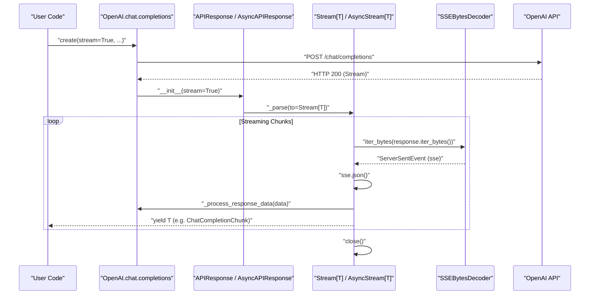
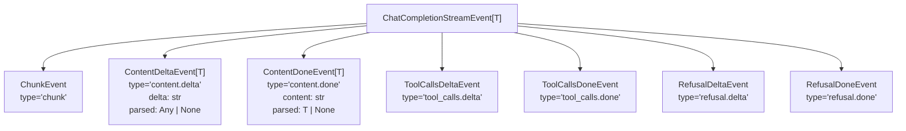
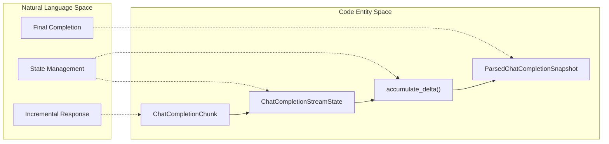

<!-- source: DeepWiki mcp.deepwiki.com · repo openai/openai-python · extra page Streaming Chat Completions · fetched 2026-10-26 -->

# Streaming Chat Completions

<details>
<summary>Relevant source files</summary>

The following files were used as context for generating this wiki page:

- [src/openai/_legacy_response.py](src/openai/_legacy_response.py)
- [src/openai/_response.py](src/openai/_response.py)
- [src/openai/_streaming.py](src/openai/_streaming.py)
- [src/openai/lib/_parsing/__init__.py](src/openai/lib/_parsing/__init__.py)
- [tests/lib/chat/test_completions.py](tests/lib/chat/test_completions.py)
- [tests/lib/chat/test_completions_streaming.py](tests/lib/chat/test_completions_streaming.py)
- [tests/lib/responses/__init__.py](tests/lib/responses/__init__.py)
- [tests/lib/responses/test_responses.py](tests/lib/responses/test_responses.py)
- [tests/lib/snapshots.py](tests/lib/snapshots.py)
- [tests/lib/utils.py](tests/lib/utils.py)
- [tests/test_legacy_response.py](tests/test_legacy_response.py)
- [tests/test_response.py](tests/test_response.py)
- [tests/test_streaming.py](tests/test_streaming.py)

</details>


## Purpose and Scope

This page documents streaming functionality for the **Chat Completions API**, which enables incremental delivery of model responses through Server-Sent Events (SSE). Streaming allows applications to display partial results as they arrive rather than waiting for the complete response.

This page covers the Chat Completions API streaming. For streaming with the newer Responses API, see [Responses API](#4.2). For non-streaming Chat Completions usage, see [Chat Completions API](#4.1) and [Parameters and Configuration](#4.1.1). For parsed responses and structured outputs in non-streaming mode, see [Parsed Responses and Structured Outputs](#4.1.3).

---

## Basic Streaming Usage

### Enabling Stream Mode

Set `stream=True` when calling `client.chat.completions.create()` to receive a stream object instead of a complete response. The stream object implements Python's iterator protocol for synchronous clients and async iterator protocol for asynchronous clients.

#### Synchronous Streaming

```python
from openai import OpenAI

client = OpenAI()

stream = client.chat.completions.create(
    model="gpt-4o",
    messages=[
        {"role": "user", "content": "Write a haiku about recursion"}
    ],
    stream=True,
)

for chunk in stream:
    if chunk.choices[0].delta.content is not None:
        print(chunk.choices[0].delta.content, end="")
```

The returned object is a `Stream[ChatCompletionChunk]` which yields `ChatCompletionChunk` objects as they arrive from the API.

**Sources:** [src/openai/_streaming.py:23-50](), [tests/lib/chat/test_completions_streaming.py:47-61]()

#### Asynchronous Streaming

```python
import asyncio
from openai import AsyncOpenAI

client = AsyncOpenAI()

async def main():
    stream = await client.chat.completions.create(
        model="gpt-4o",
        messages=[
            {"role": "user", "content": "Write a haiku about recursion"}
        ],
        stream=True,
    )
    
    async for chunk in stream:
        if chunk.choices[0].delta.content is not None:
            print(chunk.choices[0].delta.content, end="")

asyncio.run(main())
```

The async variant returns an `AsyncStream[ChatCompletionChunk]` which implements the async iterator protocol.

**Sources:** [src/openai/_streaming.py:132-160](), [tests/lib/chat/test_completions_streaming.py:204-214]()

---

## Stream Request Flow

The following diagram illustrates how streaming requests flow through the SDK, from user code to incremental event processing:

### Request and Data Flow



**Sources:** [src/openai/_response.py:141-182](), [src/openai/_streaming.py:55-110](), [src/openai/_streaming.py:165-218]()

---

## Stream Event Types

### Core Event Hierarchy

When using the high-level `.stream()` method (rather than `.create(stream=True)`), the SDK emits typed events. All events inherit from `ChatCompletionStreamEvent[ResponseFormatT]`.



| Event Type | Description | Key Properties |
|------------|-------------|----------------|
| `chunk` | Raw `ChatCompletionChunk` from API | `chunk` |
| `content.delta` | Incremental content text | `delta`, `snapshot`, `parsed` |
| `content.done` | Complete content available | `content`, `parsed` |
| `tool_calls.delta` | Incremental tool call data | `delta`, `snapshot` |
| `tool_calls.done` | Complete tool call parsed | `tool_calls` |
| `refusal.delta` | Incremental refusal text | `delta`, `snapshot` |
| `refusal.done` | Complete refusal message | `refusal` |

**Sources:** [tests/lib/chat/test_completions_streaming.py:24-31](), [tests/lib/chat/test_completions_streaming.py:85-94](), [tests/lib/chat/test_completions_streaming.py:183-191]()

---

## Using Stream Managers

### High-Level Stream API

The `.stream()` method returns a `ChatCompletionStreamManager` (or `AsyncChatCompletionStreamManager`) which provides a higher-level interface. It automatically accumulates state and emits semantic events.

```python
from openai import OpenAI
from pydantic import BaseModel

client = OpenAI()

class WeatherResponse(BaseModel):
    city: str
    temperature: float

with client.chat.completions.stream(
    model="gpt-4o",
    messages=[{"role": "user", "content": "What's the weather in SF?"}],
    response_format=WeatherResponse,
) as stream:
    for event in stream:
        if event.type == "content.delta":
            print(event.delta, end="")
        elif event.type == "content.done":
            weather = event.parsed
            print(f"\nParsed: {weather}")
    
    completion = stream.get_final_completion()
```

### Manager vs Direct Stream

| Approach | Return Type | Implementation Class |
|----------|-------------|----------------------|
| `.create(stream=True)` | `Stream[ChatCompletionChunk]` | `openai._streaming.Stream` |
| `.stream()` | `ChatCompletionStreamManager[T]` | `openai.lib.streaming.chat.ChatCompletionStreamManager` |

The manager approach is recommended as it handles incremental parsing of structured outputs and tool calls automatically.

**Sources:** [src/openai/_response.py:141-182](), [tests/lib/chat/test_completions_streaming.py:24-31]()

---

## Stream State Management

### Snapshot Accumulation

`ChatCompletionStream` maintains a `current_completion_snapshot` which accumulates deltas into a complete snapshot object.

### Natural Language to Code Entity Mapping



The accumulation logic merges chunk data:
- Concatenates string deltas (content, refusal, arguments).
- Appends list items (tool_calls).
- Updates finish reasons and usage stats.

**Sources:** [tests/lib/chat/test_completions_streaming.py:28-30](), [src/openai/_streaming.py:55-107]()

---

## Parsed Streaming (Structured Outputs)

### Incremental JSON Parsing

When using `response_format` with a Pydantic model, the stream manager incrementally parses JSON as it arrives.

```python
for event in stream:
    if event.type == "content.delta":
        # event.parsed contains partial dict/model as JSON accumulates
        print(event.parsed)
```

**Sources:** [tests/lib/chat/test_completions_streaming.py:98-125](), [tests/lib/chat/test_completions_streaming.py:183-191]()

---

## Error Handling in Streams

### API Errors during Streaming

If the API returns an error mid-stream (e.g., a `thread.error` in Assistants or a standard error object in Chat), the `Stream` class raises an `APIError`.

```python
# Internal Stream logic [src/openai/_streaming.py:87-99]
if is_mapping(data) and data.get("error"):
    raise APIError(
        message=data.get("error").get("message"),
        request=self.response.request,
        body=data["error"],
    )
```

**Sources:** [src/openai/_streaming.py:87-99](), [src/openai/_streaming.py:180-192]()

---

## Synchronous vs Asynchronous Streaming

### API Parity

The `Stream` and `AsyncStream` classes provide a unified interface for handling SSE.

| Feature | `Stream[T]` (Sync) | `AsyncStream[T]` (Async) |
|---------|-----------|-------------|
| Iteration | `for item in stream:` | `async for item in stream:` |
| Underlying | `httpx.Response.iter_bytes()` | `httpx.Response.aiter_bytes()` |
| Cleanup | `stream.close()` | `await stream.close()` |

**Sources:** [src/openai/_streaming.py:48-53](), [src/openai/_streaming.py:157-163](), [src/openai/_streaming.py:123-129]()

---

