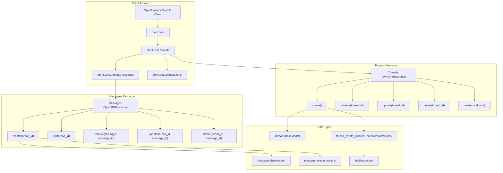
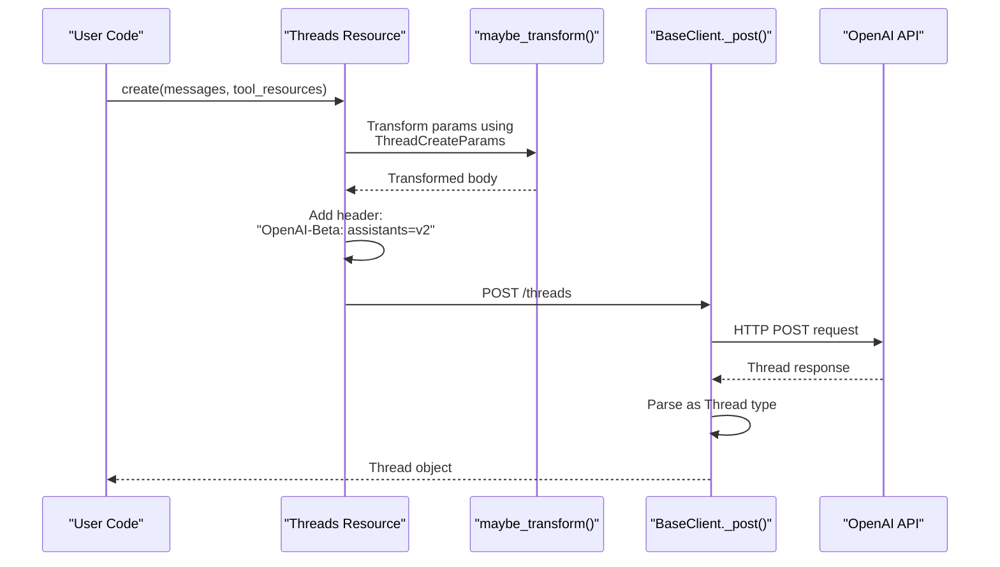
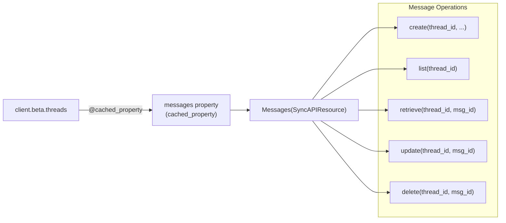
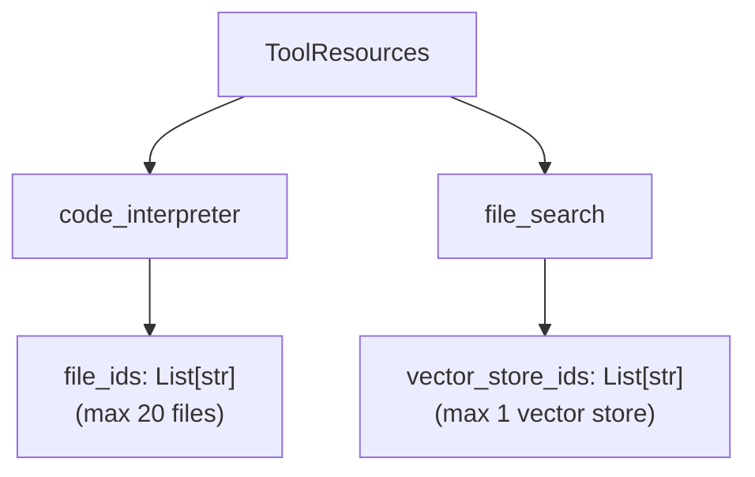
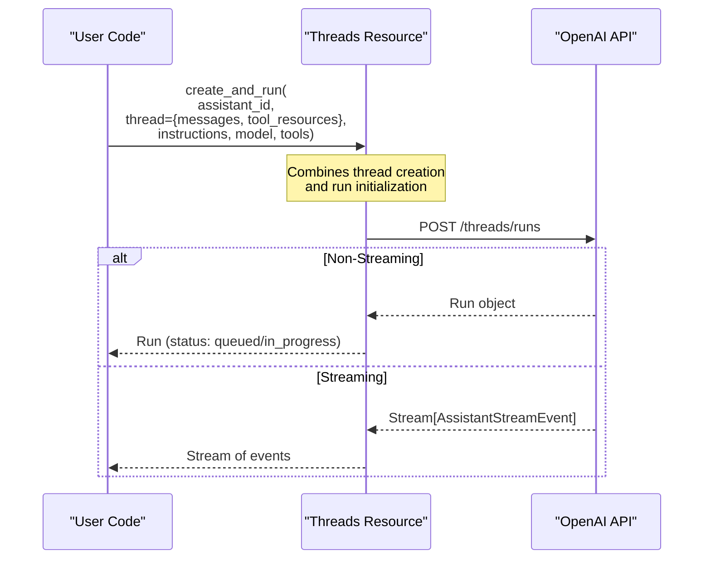

<!-- source: DeepWiki mcp.deepwiki.com · repo openai/openai-python · extra page Threads and Messages · fetched 2026-10-26 -->

# Threads and Messages

<details>
<summary>Relevant source files</summary>

The following files were used as context for generating this wiki page:

- [src/openai/resources/beta/assistants.py](src/openai/resources/beta/assistants.py)
- [src/openai/resources/beta/threads/runs/runs.py](src/openai/resources/beta/threads/runs/runs.py)
- [src/openai/resources/beta/threads/threads.py](src/openai/resources/beta/threads/threads.py)
- [src/openai/types/beta/assistant.py](src/openai/types/beta/assistant.py)
- [src/openai/types/beta/assistant_create_params.py](src/openai/types/beta/assistant_create_params.py)
- [src/openai/types/beta/assistant_update_params.py](src/openai/types/beta/assistant_update_params.py)
- [src/openai/types/beta/thread_create_and_run_params.py](src/openai/types/beta/thread_create_and_run_params.py)
- [src/openai/types/beta/thread_create_params.py](src/openai/types/beta/thread_create_params.py)
- [src/openai/types/beta/threads/message.py](src/openai/types/beta/threads/message.py)
- [src/openai/types/beta/threads/message_create_params.py](src/openai/types/beta/threads/message_create_params.py)
- [src/openai/types/beta/threads/run.py](src/openai/types/beta/threads/run.py)
- [src/openai/types/beta/threads/run_create_params.py](src/openai/types/beta/threads/run_create_params.py)
- [src/openai/types/chat_model.py](src/openai/types/chat_model.py)

</details>


This page documents the Thread and Message management components of the Assistants API (Beta). Threads represent persistent conversation contexts that can be created, populated with messages, and executed by assistants through runs. Messages within threads capture the conversation history between users and assistants.

**Note:** The Assistants API is deprecated in favor of the Responses API [src/openai/resources/beta/threads/threads.py:94](). For information about assistant configuration and tools, see [Assistants and Configuration](#4.3.1). For information about executing assistants on threads, see [Runs and Execution](#4.3.3). For streaming assistant responses, see [Streaming Assistant Events](#4.3.4).

## Overview

A **thread** is a stateful conversation session that maintains:
- An ordered list of messages (user and assistant messages) [src/openai/types/beta/thread_create_params.py:31-35]()
- Tool resources (files for `code_interpreter`, vector stores for `file_search`) [src/openai/types/beta/thread_create_params.py:48-53]()
- Metadata for application-specific data storage [src/openai/types/beta/thread_create_params.py:37-45]()
- Association with runs that execute assistant logic on the thread's content [src/openai/resources/beta/threads/threads.py:66-68]()

Messages are the atomic units of conversation within threads, representing either user inputs or assistant responses [src/openai/types/beta/threads/message_create_params.py:19-26]().

### Thread and Message Architecture



Sources: [src/openai/resources/beta/threads/threads.py:62-73](), [src/openai/resources/beta/threads/threads.py:13-30](), [src/openai/types/beta/thread.py](), [src/openai/types/beta/threads/message.py]()

## Thread Lifecycle Management

The `Threads` resource class provides full CRUD operations for thread management. All thread operations require the `OpenAI-Beta: assistants=v2` header [src/openai/resources/beta/threads/threads.py:135]().

### Creating Threads

Threads can be created empty or pre-populated with initial messages and tool resources.

**Method Signature:**
```python
client.beta.threads.create(
    messages: Iterable[thread_create_params.Message] | Omit = omit,
    metadata: Optional[Metadata] | Omit = omit,
    tool_resources: Optional[thread_create_params.ToolResources] | Omit = omit,
) -> Thread
```

**Parameters:**

| Parameter | Type | Description |
|-----------|------|-------------|
| `messages` | `Iterable[Message]` | Initial messages to populate the thread with [src/openai/types/beta/thread_create_params.py:31-35]() |
| `metadata` | `Optional[Metadata]` | Set of 16 key-value pairs (max 64 char keys, 512 char values) [src/openai/types/beta/thread_create_params.py:37-45]() |
| `tool_resources` | `Optional[ToolResources]` | Resources for assistant tools (code_interpreter files, file_search vector stores) [src/openai/types/beta/thread_create_params.py:48-53]() |

Sources: [src/openai/resources/beta/threads/threads.py:95-154](), [src/openai/types/beta/thread_create_params.py:30-54]()

### Thread Creation Flow



Sources: [src/openai/resources/beta/threads/threads.py:135-154]()

### Retrieving Threads

Fetch an existing thread by its ID using the `retrieve` method [src/openai/resources/beta/threads/threads.py:157-181]().

```python
thread = client.beta.threads.retrieve(thread_id="thread_abc123")
```

Sources: [src/openai/resources/beta/threads/threads.py:157-181]()

### Updating Threads

Modify thread metadata and tool resources using the `update` method [src/openai/resources/beta/threads/threads.py:183-237]().

**Updatable Fields:**

| Field | Type | Purpose |
|-------|------|---------|
| `metadata` | `Optional[Metadata]` | Application-specific key-value pairs [src/openai/types/beta/thread_update_params.py]() |
| `tool_resources` | `Optional[ToolResources]` | Update files/vector stores for tools [src/openai/types/beta/thread_update_params.py]() |

Sources: [src/openai/resources/beta/threads/threads.py:183-237]()

### Deleting Threads

Permanently remove a thread and all associated messages:

```python
deletion_status = client.beta.threads.delete(thread_id="thread_abc123")
# Returns ThreadDeleted with id, object="thread.deleted", deleted=True
```

Sources: [src/openai/resources/beta/threads/threads.py:239-272](), [src/openai/types/beta/thread_deleted.py]()

## Messages Sub-Resource

Messages are managed through the `client.beta.threads.messages` resource [src/openai/resources/beta/threads/threads.py:71-73](). Each message belongs to a specific thread and represents either user input or assistant output [src/openai/types/beta/threads/message_create_params.py:19-26]().

### Message Resource Access



Sources: [src/openai/resources/beta/threads/threads.py:71-73](), [src/openai/resources/beta/threads/messages.py]()

### Message Structure

Messages support various content types, including text and multi-modal parts [src/openai/types/beta/threads/message_create_params.py:16-17]().

| Role | Description |
|--------------|-------------|
| `user` | Sent by an actual user [src/openai/types/beta/threads/message_create_params.py:21-23]() |
| `assistant` | Generated by the assistant [src/openai/types/beta/threads/message_create_params.py:24-25]() |

Messages also support **attachments** linking files to specific tools (`code_interpreter` or `file_search`) [src/openai/types/beta/threads/message_create_params.py:28-29]().

Sources: [src/openai/types/beta/threads/message_create_params.py:15-56]()

### Adding Messages to Threads

Messages are added via the `additional_messages` parameter in run creation [src/openai/types/beta/threads/run_create_params.py:57-58](), or directly through the Messages resource `create` method.

**Message Attachments:**

```python
class Attachment(TypedDict):
    file_id: str  # File ID to attach
    tools: Iterable[AttachmentTool]  # Tools to use this file with
```

Sources: [src/openai/types/beta/threads/message_create_params.py:50-55](), [src/openai/types/beta/threads/run_create_params.py:57-58]()

## Tool Resources Configuration

Threads and Assistants can be configured with tool-specific resources.

### Tool Resources Structure



Sources: [src/openai/types/beta/thread_create_params.py:189-200](), [src/openai/types/beta/assistant.py:33-43]()

### Code Interpreter Resources

Files attached to `code_interpreter` are available for Python code execution within the assistant's sandbox environment. There can be a maximum of 20 files associated with the tool [src/openai/types/beta/thread_create_params.py:100-105]().

Sources: [src/openai/types/beta/thread_create_params.py:99-105]()

### File Search Resources

The `file_search` tool can be attached to vector stores [src/openai/types/beta/thread_create_params.py:171-178]().

**Chunking Strategies:**

| Strategy | Configuration |
|----------|---------------|
| `auto` | Default: 800 token chunks, 400 token overlap [src/openai/types/beta/thread_create_params.py:108-116]() |
| `static` | Custom: specify `max_chunk_size_tokens` and `chunk_overlap_tokens` [src/openai/types/beta/thread_create_params.py:118-131]() |

Sources: [src/openai/types/beta/thread_create_params.py:108-142]()

## Thread and Run Integration

### Create and Run Combined Operation

The `create_and_run` method creates a new thread and immediately starts a run on it in a single API call [src/openai/resources/beta/threads/threads.py:274-406]().



Sources: [src/openai/resources/beta/threads/threads.py:274-406](), [src/openai/types/beta/thread_create_and_run_params.py:41-176]()

### Run Status and Execution

Runs represent the execution of an assistant on a thread. They transition through various statuses such as `queued`, `in_progress`, and `completed` [src/openai/types/beta/threads/run.py:107-113]().

| Field | Type | Description |
|-------|------|-------------|
| `usage` | `Usage` | Token statistics for the run [src/openai/types/beta/threads/run.py:91-105]() |
| `incomplete_details` | `IncompleteDetails` | Reason why a run might have stopped early [src/openai/types/beta/threads/run.py:25-37]() |
| `last_error` | `LastError` | Error information if the run failed [src/openai/types/beta/threads/run.py:39-47]() |

Sources: [src/openai/types/beta/threads/run.py:25-113]()

## Metadata Management

Both threads, messages, and runs support metadata for application-specific data storage [src/openai/types/beta/thread_create_params.py:37-45](), [src/openai/types/beta/threads/run_create_params.py:85-93]().

### Metadata Constraints

- **Limit**: Maximum 16 key-value pairs [src/openai/types/beta/thread_create_params.py:38]().
- **Key Length**: Maximum 64 characters [src/openai/types/beta/thread_create_params.py:43]().
- **Value Length**: Maximum 512 characters [src/openai/types/beta/thread_create_params.py:44]().

Sources: [src/openai/types/beta/thread_create_params.py:37-45](), [src/openai/types/beta/threads/run_create_params.py:85-93]()

## Truncation Strategies

When creating runs, threads can be truncated to fit within model context windows [src/openai/types/beta/threads/run.py:69-89]().

| Type | Behavior |
|------|----------|
| `auto` | Messages in the middle are dropped to fit `max_prompt_tokens` [src/openai/types/beta/threads/run.py:79-81]() |
| `last_messages` | The thread is truncated to the `n` most recent messages [src/openai/types/beta/threads/run.py:78-79]() |

Sources: [src/openai/types/beta/threads/run.py:69-89](), [src/openai/types/beta/threads/run_create_params.py:234-254]()

## Asynchronous Operations

All thread and message operations have async variants accessible through `AsyncThreads` [src/openai/resources/beta/threads/threads.py:705-1056]().

```python
async with AsyncOpenAI() as client:
    thread = await client.beta.threads.create(
        messages=[{"role": "user", "content": "Hello"}]
    )
```

Sources: [src/openai/resources/beta/threads/threads.py:705-1056]()

---

