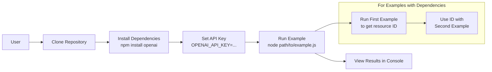
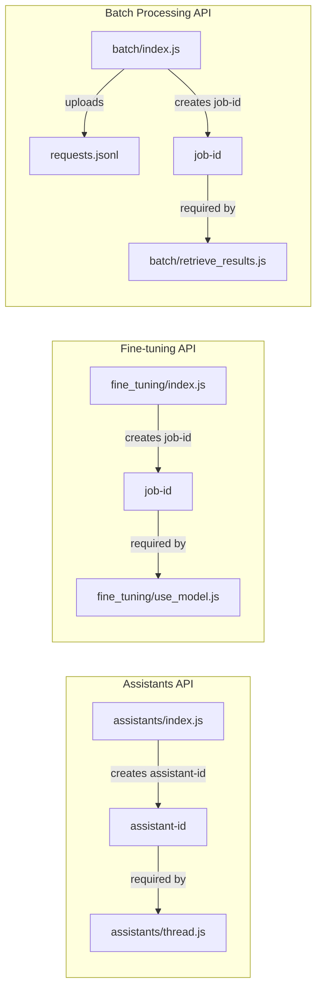
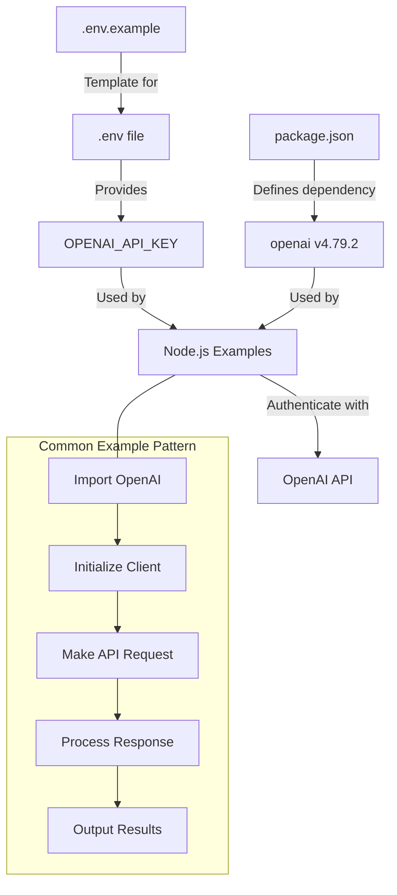

<!-- source: DeepWiki mcp.deepwiki.com · repo openai/openai-quickstart-node · page 1 Overview · fetched 2026-10-26 -->

# Overview

Relevant source files

The following files were used as context for generating this wiki page:

- [README.md](README.md)
- [package.json](package.json)

This document provides an introduction to the OpenAI Quickstart Node.js repository, which demonstrates how to use various OpenAI APIs with the Node.js SDK. The repository contains executable examples for each OpenAI API, organized into distinct categories. For detailed setup instructions, see [Getting Started](#2).

Sources: [README.md:1-15]()

## Repository Purpose

The OpenAI Quickstart Node.js repository serves as a practical reference implementation for developers who want to integrate OpenAI's APIs into Node.js applications. It provides working code examples that demonstrate API functionality across different OpenAI services, from basic implementation to more advanced use cases.

The repository is structured as a collection of standalone examples rather than a comprehensive application, allowing developers to focus on specific API integrations independently.

Sources: [README.md:1-15](), [package.json:1-14]()

## Repository Structure

The codebase is organized by API type, with each OpenAI service having its own dedicated directory. Each directory contains one or more JavaScript files demonstrating different capabilities of that API.

```mermaid
graph TD
    Root["openai-quickstart-node"] --> README["README.md"]
    Root --> Package["package.json<br>(OpenAI SDK v4.79.2)"]
    Root --> EnvConfig[".env.example<br>(OPENAI_API_KEY configuration)"]
    
    Root --> ChatDir["chat_completions/"]
    Root --> AssistDir["assistants/"]
    Root --> FinetuneDir["fine_tuning/"]
    Root --> EmbedDir["embeddings/"]
    Root --> ModDir["moderation/"]
    Root --> BatchDir["batch/"]
    Root --> ImgDir["images/"]
    
    ChatDir --> ChatBasic["index.js<br>(Basic chat example)"]
    ChatDir --> ChatMulti["multi_turn.js<br>(Conversation example)"] 
    ChatDir --> ChatFunc["function_calling.js<br>(Tool use example)"]
    ChatDir --> ChatVision["vision.js<br>(Image input example)"]
    
    AssistDir --> AssistBasic["index.js<br>(Create assistant)"]
    AssistDir --> AssistThread["thread.js<br>(Use assistant)"]
    
    FinetuneDir --> FinetuneBasic["index.js<br>(Create job)"]
    FinetuneDir --> FinetuneUse["use_model.js<br>(Use fine-tuned model)"]
    
    EmbedDir --> EmbedBasic["index.js<br>(Generate embeddings)"]
    
    ModDir --> ModBasic["index.js<br>(Moderate text)"]
    ModDir --> ModImg["images.js<br>(Moderate images & text)"]
    
    BatchDir --> BatchBasic["index.js<br>(Create batch job)"]
    BatchDir --> BatchResults["retrieve_results.js<br>(Get job results)"]
    BatchDir --> BatchRequests["requests.jsonl<br>(Input data)"]
    
    ImgDir --> ImgBasic["index.js<br>(Generate image)"]
```

Sources: [README.md:5-15](), [README.md:83-156]()

## Example Execution Flow

The following diagram illustrates the typical workflow for executing examples in this repository:

Sources: [README.md:17-81]()

## API Integration Examples

The repository provides examples for the following OpenAI APIs:

| API | Example Types | File Paths |
|-----|---------------|------------|
| Chat Completions | Basic, Multi-turn, Function Calling, Vision | [chat_completions/index.js](), [chat_completions/multi_turn.js](), [chat_completions/function_calling.js](), [chat_completions/vision.js]() |
| Assistants | Create Assistant, Thread Management | [assistants/index.js](), [assistants/thread.js]() |
| Fine-tuning | Create Job, Use Fine-tuned Model | [fine_tuning/index.js](), [fine_tuning/use_model.js]() |
| Embeddings | Generate Embeddings | [embeddings/index.js]() |
| Moderation | Text Moderation, Image & Text Moderation | [moderation/index.js](), [moderation/images.js]() |
| Batch Processing | Create Batch Job, Retrieve Results | [batch/index.js](), [batch/retrieve_results.js]() |
| Images | Generate Image | [images/index.js]() |

Sources: [README.md:83-156]()

## API Dependency Relationships

Some examples have dependencies on other examples, particularly those that require resource IDs created by another script:

Sources: [README.md:116-118](), [README.md:125-127](), [README.md:148-150]()

## Technical Requirements

The repository has the following technical prerequisites:

- Node.js version 16.0.0 or higher
- npm or another node package manager
- OpenAI API key (from OpenAI platform dashboard)
- OpenAI Node.js SDK version 4.79.2

Sources: [README.md:17-23](), [package.json:10-12]()

## Authentication Flow

All examples in the repository follow this authentication pattern:

Sources: [README.md:45-69](), [package.json:10-12]()

## Additional Resources

The repository is part of a broader ecosystem of OpenAI quickstart projects:

- Assistants API Quickstart (for more in-depth examples with frontend applications)
- Sample apps with Structured Outputs

This overview page provides a general introduction to the repository. For detailed information about setting up and using specific examples, refer to the respective API documentation pages.

Sources: [README.md:158-164]()

---

