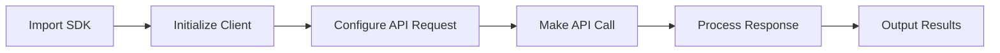
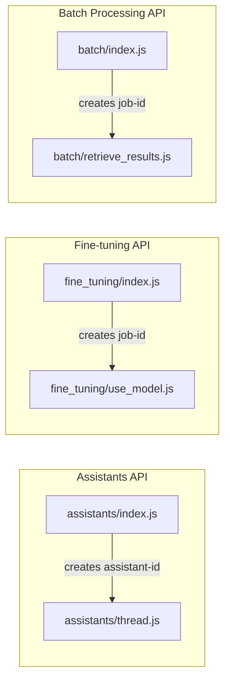
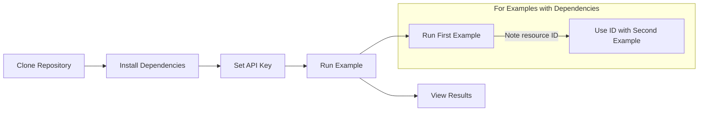

<!-- source: DeepWiki mcp.deepwiki.com · repo openai/openai-quickstart-node · page 3 OpenAI API Examples · fetched 2026-10-26 -->

# OpenAI API Examples

<details>
<summary>Relevant source files</summary>

The following files were used as context for generating this wiki page:

- [README.md](README.md)

</details>


## Purpose and Scope

This page provides a comprehensive overview of the Node.js code examples included in the OpenAI Quickstart repository. These examples demonstrate how to use various OpenAI APIs, ranging from Chat Completions to Image Generation, using the OpenAI Node.js SDK. For information on setting up the repository and configuring your environment, see [Getting Started](#2).

## Examples Organization

The repository organizes examples by API type, with each folder dedicated to a specific OpenAI API. Each folder contains at least one basic example, with some APIs featuring additional examples for more advanced use cases.

```mermaid
graph TD
    Root["openai-quickstart-node"] --> ChatDir["chat_completions/"]
    Root --> AssistDir["assistants/"]
    Root --> FinetuneDir["fine_tuning/"]
    Root --> EmbedDir["embeddings/"]
    Root --> ModDir["moderation/"]
    Root --> BatchDir["batch/"]
    Root --> ImgDir["images/"]
    
    ChatDir --> ChatBasic["index.js - Basic example"]
    ChatDir --> ChatMulti["multi_turn.js - Conversation"]
    ChatDir --> ChatFunc["function_calling.js - Tool use"]
    ChatDir --> ChatVision["vision.js - Image input"]
    
    AssistDir --> AssistBasic["index.js - Create assistant"]
    AssistDir --> AssistThread["thread.js - Use assistant"]
    
    FinetuneDir --> FinetuneBasic["index.js - Create job"]
    FinetuneDir --> FinetuneUse["use_model.js - Use model"]
    
    EmbedDir --> EmbedBasic["index.js - Generate embeddings"]
    
    ModDir --> ModBasic["index.js - Moderate text"]
    ModDir --> ModImg["images.js - Moderate images & text"]
    
    BatchDir --> BatchBasic["index.js - Create batch job"]
    BatchDir --> BatchResults["retrieve_results.js - Get results"]
    
    ImgDir --> ImgBasic["index.js - Generate image"]
```



**Sources**: [README.md:5-15]()

## API Example Categories

The repository covers all major OpenAI APIs, each with specific examples as shown in the table below:

| API Category | Example | File Path | Description |
|--------------|---------|-----------|-------------|
| **Chat Completions** | Basic | [chat_completions/index.js]() | Simple text completion |
| | Multi-turn | [chat_completions/multi_turn.js]() | Conversation with history |
| | Function Calling | [chat_completions/function_calling.js]() | Tool use integration |
| | Vision | [chat_completions/vision.js]() | Processing image inputs |
| **Assistants** | Create | [assistants/index.js]() | Create an assistant |
| | Thread | [assistants/thread.js]() | Run an assistant thread |
| **Fine-tuning** | Create | [fine_tuning/index.js]() | Create fine-tuning job |
| | Use | [fine_tuning/use_model.js]() | Use fine-tuned model |
| **Embeddings** | Generate | [embeddings/index.js]() | Generate text embeddings |
| **Moderation** | Text | [moderation/index.js]() | Content moderation |
| | Images & Text | [moderation/images.js]() | Multi-modal moderation |
| **Batch** | Create | [batch/index.js]() | Create batch processing job |
| | Results | [batch/retrieve_results.js]() | Retrieve batch results |
| **Images** | Generate | [images/index.js]() | Generate images |

**Sources**: [README.md:85-156]()

## Common Example Structure

Each example in the repository follows a consistent pattern, making it easy to understand how to use the OpenAI APIs.



The examples typically include:
1. SDK import and API key configuration
2. Client initialization
3. Request parameters setup
4. API call execution
5. Response handling
6. Result display

**Sources**: [README.md:17-81]()

## Resource Dependencies Between Examples

Some examples create resources that are required by other examples. Understanding these dependencies is crucial for running the examples in the correct order.



The following examples require IDs from previously run examples:
- `assistants/thread.js`: Requires assistant-id from `assistants/index.js`
- `fine_tuning/use_model.js`: Requires job-id from `fine_tuning/index.js`
- `batch/retrieve_results.js`: Requires job-id from `batch/index.js`

**Sources**: [README.md:116-117](), [README.md:126-127](), [README.md:149-150]()

## API Integration Flow

The diagram below illustrates how the examples connect to the OpenAI API ecosystem, showing the relationship between different API examples and their capabilities.

```mermaid
graph TD
    OpenAISDK["OpenAI Node.js SDK"] --> ChatAPI["Chat Completions API"]
    OpenAISDK --> AssistAPI["Assistants API"]
    OpenAISDK --> FinetuneAPI["Fine-tuning API"]
    OpenAISDK --> EmbedAPI["Embeddings API"]
    OpenAISDK --> ModAPI["Moderation API"]
    OpenAISDK --> BatchAPI["Batch API"]
    OpenAISDK --> ImgAPI["Images API"]
    
    ChatAPI --> ChatFeat1["Text generation"]
    ChatAPI --> ChatFeat2["Multi-turn dialogue"]
    ChatAPI --> ChatFeat3["Function calling"]
    ChatAPI --> ChatFeat4["Vision capabilities"]
    
    AssistAPI --> AssistFeat1["Assistant creation"]
    AssistAPI --> AssistFeat2["Thread management"]
    
    FinetuneAPI --> FinetuneFeat1["Model customization"]
    FinetuneAPI --> FinetuneFeat2["Specialized models"]
    
    EmbedAPI --> EmbedFeat["Semantic vectors"]
    
    ModAPI --> ModFeat1["Text content safety"]
    ModAPI --> ModFeat2["Image content safety"]
    
    BatchAPI --> BatchFeat1["Bulk processing"]
    BatchAPI --> BatchFeat2["Async operations"]
    
    ImgAPI --> ImgFeat["Image generation"]
```



**Sources**: [README.md:5-15]()

## Example Execution Pattern

To run any example from the repository, follow these steps:



For example, to run the basic Chat Completions example:
```bash
node chat_completions/index.js
```

For examples that depend on other examples:
```bash
# First run the assistant creation example
node assistants/index.js
# Note the assistant-id output
# Then run the thread example with the assistant-id
node assistants/thread.js {assistant-id}
```

**Sources**: [README.md:17-81]()

## Additional Examples and Resources

The repository serves as a starting point for learning to use the OpenAI API. For more complex, application-focused examples, the repository references additional resources:

- Assistants API Quickstart
- Sample apps with Structured Outputs

These resources demonstrate how to integrate OpenAI APIs into full applications, including with streaming responses and specialized output formats.

**Sources**: [README.md:158-164]()

---

