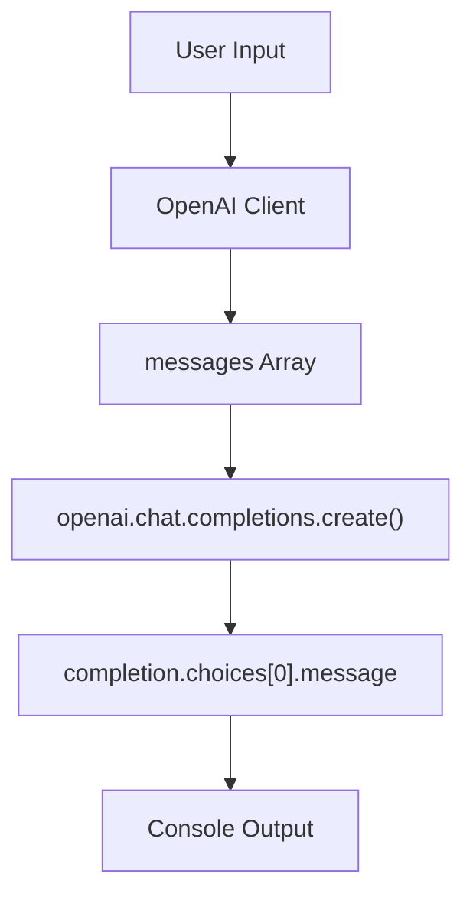
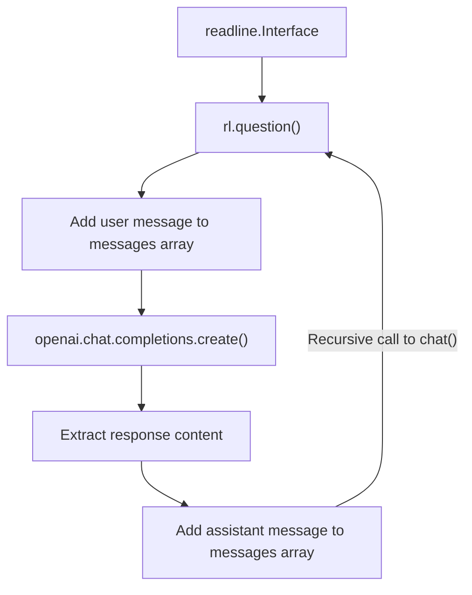
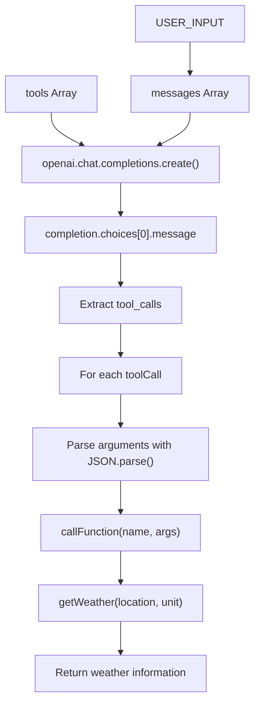
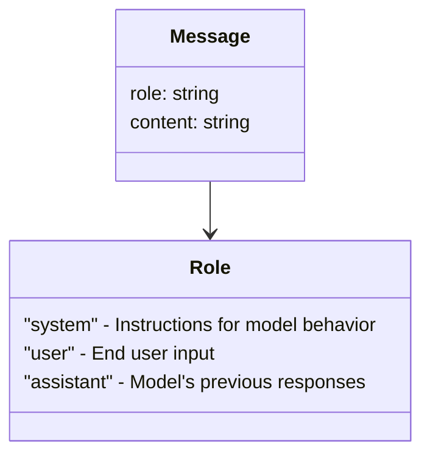
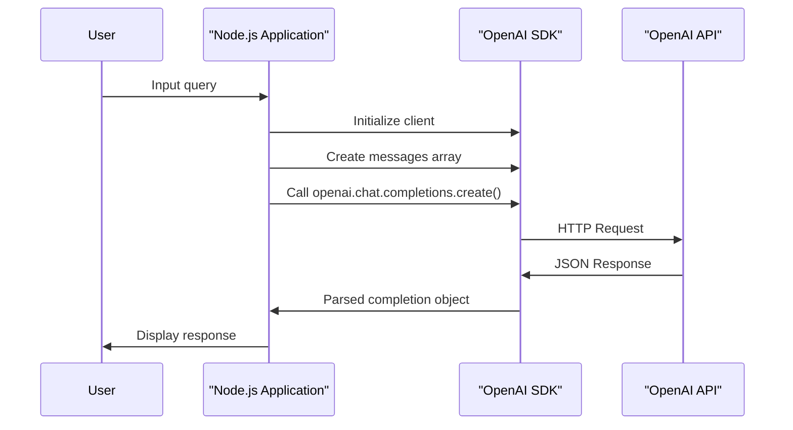

<!-- source: DeepWiki mcp.deepwiki.com · repo openai/openai-quickstart-node · page 3.1 Chat Completions · fetched 2026-10-26 -->

# Chat Completions

<details>
<summary>Relevant source files</summary>

The following files were used as context for generating this wiki page:

- [README.md](README.md)
- [chat_completions/function_calling.js](chat_completions/function_calling.js)
- [chat_completions/index.js](chat_completions/index.js)
- [chat_completions/multi_turn.js](chat_completions/multi_turn.js)

</details>


This page documents the Chat Completions API examples included in the OpenAI Quickstart Node.js repository. The Chat Completions API allows developers to interact with OpenAI's language models in a conversational format, supporting basic completions, multi-turn conversations, function calling, and vision capabilities.

For information about Assistants API examples, see [Assistants](#3.2).

## Overview

The repository includes four Chat Completions examples that demonstrate different usage patterns:

| Example | File | Description |
|---------|------|-------------|
| Basic | chat_completions/index.js | Simple one-turn completion |
| Multi-turn | chat_completions/multi_turn.js | Interactive conversation with history |
| Function calling | chat_completions/function_calling.js | Enabling models to call functions |
| Vision | chat_completions/vision.js | Processing image inputs |

All examples utilize the OpenAI Node.js SDK v4.79.2 to interact with the Chat Completions API.

Sources: [README.md:7-7](), [README.md:94-109]()

## Basic Chat Completion

The most straightforward way to use the Chat Completions API is demonstrated in the basic example.



Implementation details:
- Imports the OpenAI SDK and initializes a client
- Creates a messages array with system and user messages
- Makes a request to the Chat Completions API with the `gpt-4o-mini` model
- Logs the model's response to the console

```javascript
// Example usage
const completion = await openai.chat.completions.create({
  model: "gpt-4o-mini",
  messages: [
    { role: "system", content: "You are a helpful assistant." },
    { role: "user", content: "Write a haiku about recursion in programming." },
  ],
});

console.log(completion.choices[0].message);
```

Sources: [chat_completions/index.js:1-15]()

## Multi-turn Conversations

The multi-turn example demonstrates how to maintain conversation history for a back-and-forth interaction with the model.



This example creates an interactive CLI that:
1. Collects user input through Node.js `readline` interface
2. Maintains a conversation history in the `messages` array
3. Sends the entire conversation history with each request
4. Adds both user inputs and model responses to the history
5. Uses recursion to create a continuous conversation loop

Key code components:
- An initial system message provides context to the model
- Each user input and model response is stored in the `messages` array
- The entire conversation history is sent with each request

Sources: [chat_completions/multi_turn.js:1-34]()

## Function Calling

The function calling example demonstrates how to define tools (functions) that the model can invoke when appropriate.



Implementation highlights:
1. Defines a `tools` array that specifies available functions
2. Each tool includes name, description, and JSON Schema for parameters
3. Makes a completion request with tools parameter
4. Processes any tool calls returned in the response
5. Executes the corresponding functions with the provided arguments

The example defines a `get_weather` function that:
- Takes a location and unit as parameters
- Returns weather information for the specified location
- Is triggered when the user asks about weather conditions

Sources: [chat_completions/function_calling.js:1-80]()

## Message Structure

Messages in the Chat Completions API follow a consistent structure:



The different roles serve specific purposes:
- `system`: Sets the behavior and context for the assistant
- `user`: Contains the end user's input
- `assistant`: Contains the model's previous responses

Maintaining these roles properly is essential for multi-turn conversations and ensuring appropriate model behavior.

Sources: [chat_completions/index.js:6-12](), [chat_completions/multi_turn.js:12](), [chat_completions/function_calling.js:7-13]()

## API Request Parameters

The Chat Completions API accepts several parameters to control the response:

| Parameter | Type | Description | Examples |
|-----------|------|-------------|----------|
| model | string | Model to use | "gpt-4o", "gpt-4o-mini" |
| messages | array | Conversation history | `[{role: "system", content: "..."}]` |
| tools | array | Functions the model may call | Tool definitions with parameters |
| temperature | number | Randomness of responses | 0.7 (default) |
| max_tokens | number | Maximum tokens in response | 150 |

These parameters can be adjusted based on your application's needs:
- Lower temperature (0.0-0.5) for more consistent, deterministic outputs
- Higher temperature (0.7-1.0) for more creative, varied outputs
- Different models balance between performance and cost

Sources: [chat_completions/index.js:4-13](), [chat_completions/multi_turn.js:19-22](), [chat_completions/function_calling.js:42-46]()

## Implementation Steps

To implement Chat Completions in your own Node.js application:

1. Install the OpenAI SDK:
   ```bash
   npm install openai
   ```

2. Initialize the client with your API key (stored in environment variables):
   ```javascript
   import OpenAI from "openai";
   const openai = new OpenAI();
   ```

3. Create a messages array with at least one message:
   ```javascript
   const messages = [
     { role: "system", content: "You are a helpful assistant." },
     { role: "user", content: "Hello, how can you help me?" }
   ];
   ```

4. Make a request to the Chat Completions API:
   ```javascript
   const completion = await openai.chat.completions.create({
     model: "gpt-4o-mini",
     messages: messages,
   });
   ```

5. Process the response:
   ```javascript
   console.log(completion.choices[0].message.content);
   ```

Sources: [chat_completions/index.js:1-15](), [README.md:39-43](), [README.md:45-69]()

## Usage Flow



This diagram illustrates the typical flow of a Chat Completions request, from user input to displayed response.

Sources: [chat_completions/index.js:1-15](), [chat_completions/multi_turn.js:1-34](), [chat_completions/function_calling.js:1-80]()

---

