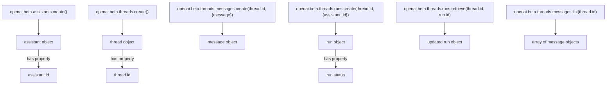
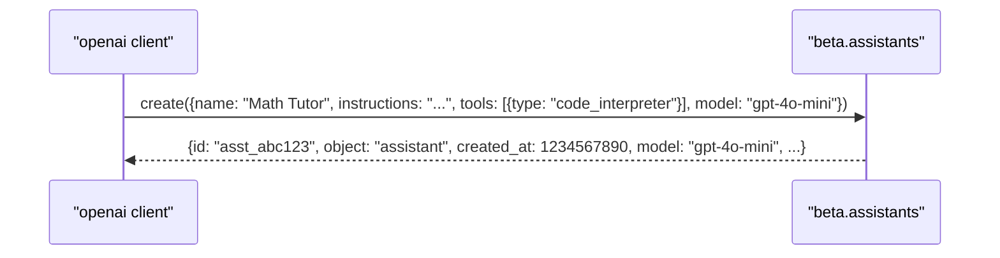
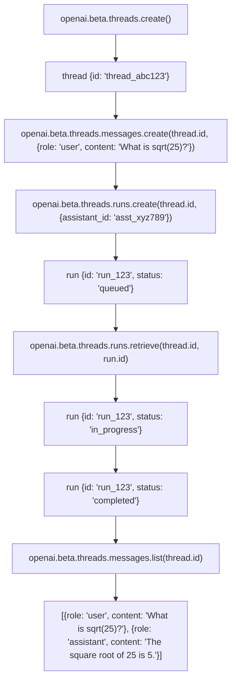
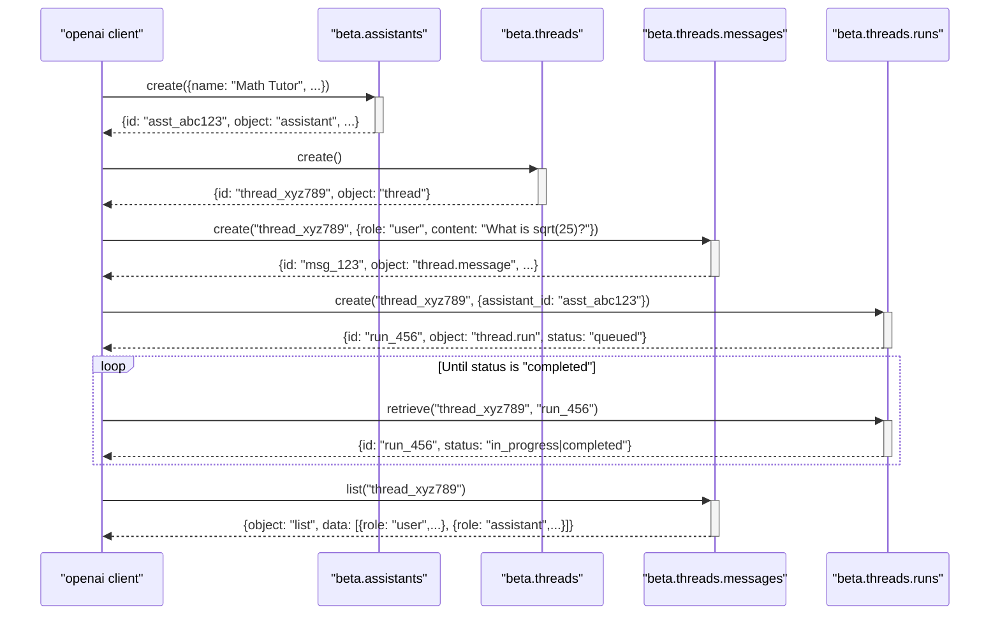

<!-- source: DeepWiki mcp.deepwiki.com · repo openai/openai-quickstart-node · page 3.2 Assistants · fetched 2026-10-26 -->

# Assistants

<details>
<summary>Relevant source files</summary>

The following files were used as context for generating this wiki page:

- [README.md](README.md)
- [assistants/index.js](assistants/index.js)
- [assistants/thread.js](assistants/thread.js)

</details>


This document explains the Assistants API examples in the OpenAI Node.js Quickstart repository. It covers how to create assistants and interact with them through threads, messages, and runs. For information about other OpenAI APIs, see [OpenAI API Examples](#3).

## Overview

The `assistants` directory contains two example scripts demonstrating the core Assistants API workflow:
- `index.js`: Creates an assistant with specific capabilities
- `thread.js`: Uses an assistant in a conversation by creating a thread

These examples illustrate the fundamental operations of the Assistants API using the OpenAI Node.js SDK.

Sources: [assistants/index.js:1-16](), [assistants/thread.js:1-54]()

## Assistants API Components

### Component Relationship Diagram



The Assistants API consists of these primary components:
- **Assistant**: A configured AI assistant with specific capabilities and instructions
- **Thread**: A conversation session that maintains context
- **Message**: User or assistant communications within a thread
- **Run**: Process of executing an assistant on a thread
- **Tool**: Capability enabled for an assistant (e.g., code_interpreter)

Sources: [assistants/index.js:1-16](), [assistants/thread.js:1-54]()

## Assistant Creation (index.js)

The first example demonstrates creating an assistant with code interpretation capability.

### Assistant Creation Workflow



### Implementation Details

The assistant creation process involves:

```javascript
const assistant = await openai.beta.assistants.create({
  name: "Math Tutor",
  instructions: "You are a personal math tutor. Write and run code to answer math questions.",
  tools: [{ type: "code_interpreter" }],
  model: "gpt-4o-mini",
});
```

Key parameters:

| Parameter | Description | Example Value |
|-----------|-------------|---------------|
| `name` | Human-readable identifier | "Math Tutor" |
| `instructions` | Behavior guidance | "You are a personal math tutor..." |
| `tools` | Array of tool objects | `[{ type: "code_interpreter" }]` |
| `model` | AI model to use | "gpt-4o-mini" |

Sources: [assistants/index.js:5-12]()

## Thread Interaction (thread.js)

The second example demonstrates using an assistant in a conversation.

### Thread Workflow



### Implementation Details

The thread interaction consists of several steps:

1. **Creating a Thread**
   ```javascript
   const thread = await openai.beta.threads.create();
   ```

2. **Adding a Message**
   ```javascript
   await openai.beta.threads.messages.create(thread.id, {
     role: "user",
     content: "What is the square root of 25?",
   });
   ```

3. **Running the Assistant**
   ```javascript
   let run = await openai.beta.threads.runs.create(thread.id, {
     assistant_id: assistantId,
   });
   ```

4. **Polling the Run Status**
   ```javascript
   while (
     run.status !== "completed" &&
     run.status !== "failed" &&
     Date.now() - startTime < TIMEOUT
   ) {
     run = await openai.beta.threads.runs.retrieve(thread.id, run.id);
     await new Promise((resolve) => setTimeout(resolve, 10000));
   }
   ```

5. **Retrieving Messages**
   ```javascript
   const threadMessages = await openai.beta.threads.messages.list(thread.id);
   ```

Sources: [assistants/thread.js:10-44]()

## Complete Assistants API Workflow

### API Method Call Sequence



This diagram illustrates the complete workflow from creating an assistant to retrieving responses in a thread.

Sources: [assistants/index.js:1-16](), [assistants/thread.js:1-54]()

## Example Usage

To use these examples:

1. Create an assistant:
   ```bash
   node assistants/index.js
   ```

2. Note the assistant ID output and use it with the thread example:
   ```bash
   node assistants/thread.js <assistant-id>
   ```

This command sequence demonstrates the full workflow of creating and using an assistant.

Sources: [assistants/index.js:15-16](), [assistants/thread.js:7-8]()

## Assistants API Reference Table

| Component | Method | Purpose | Example |
|-----------|--------|---------|---------|
| `openai.beta.assistants` | `create()` | Creates a new assistant | [assistants/index.js:5-12]() |
| `openai.beta.threads` | `create()` | Creates a new conversation thread | [assistants/thread.js:10]() |
| `openai.beta.threads.messages` | `create()` | Adds a message to a thread | [assistants/thread.js:16-19]() |
| `openai.beta.threads.runs` | `create()` | Starts an assistant on a thread | [assistants/thread.js:24-26]() |
| `openai.beta.threads.runs` | `retrieve()` | Checks the status of a run | [assistants/thread.js:38]() |
| `openai.beta.threads.messages` | `list()` | Retrieves messages from a thread | [assistants/thread.js:44]() |

Sources: [assistants/index.js:1-16](), [assistants/thread.js:1-54]()

---

