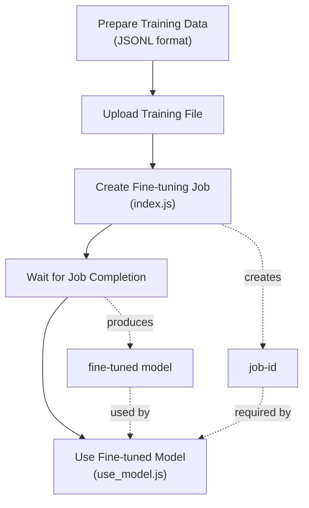
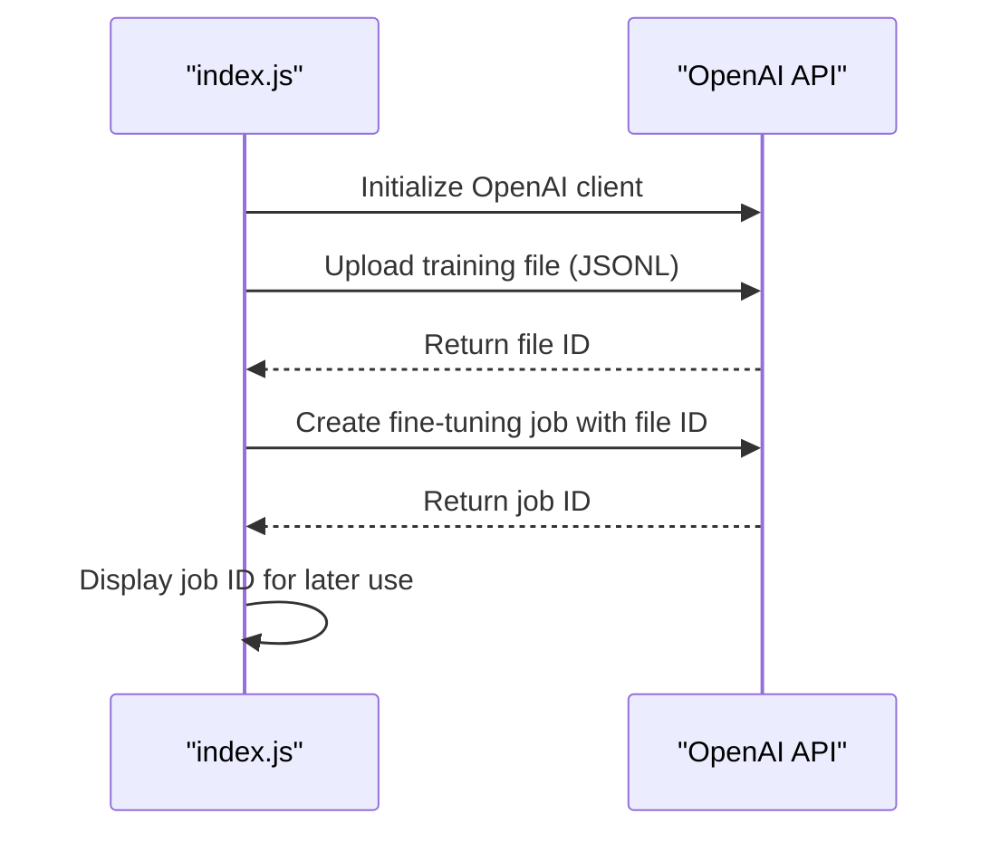
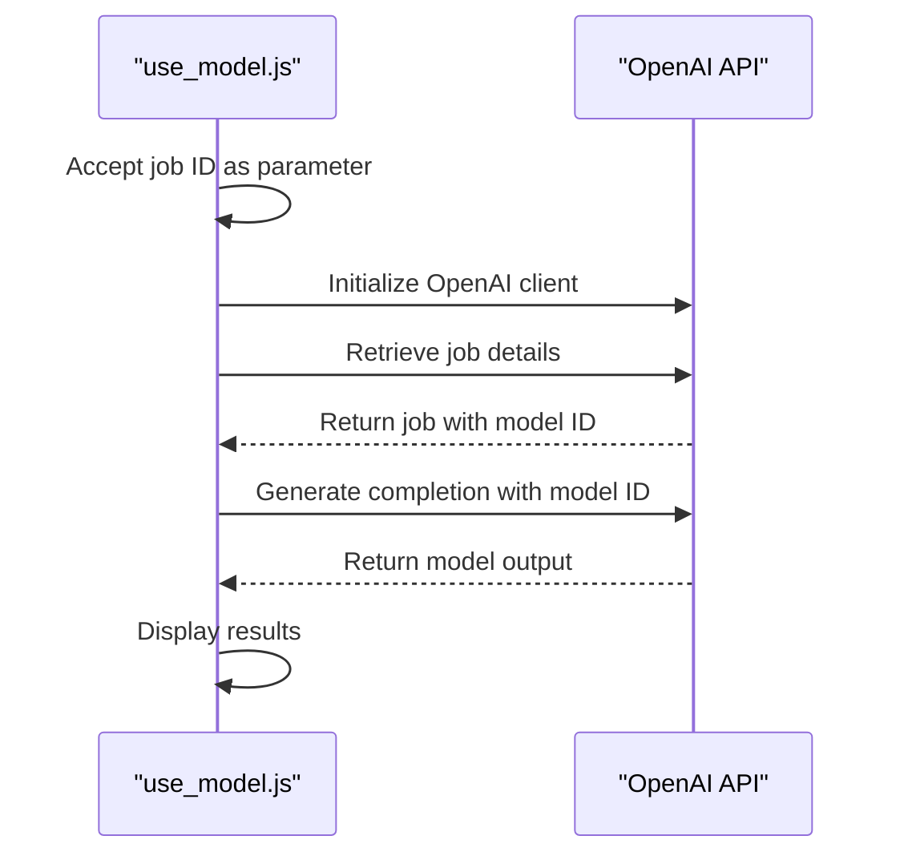
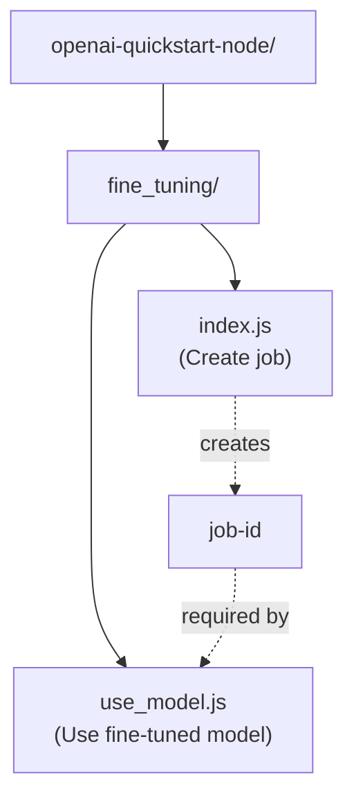

<!-- source: DeepWiki mcp.deepwiki.com · repo openai/openai-quickstart-node · page 3.3 Fine-tuning · fetched 2026-10-26 -->

# Fine-tuning

<details>
<summary>Relevant source files</summary>

The following files were used as context for generating this wiki page:

- [README.md](README.md)

</details>


This document explains the Fine-tuning examples provided in the OpenAI Quickstart Node.js repository. These examples demonstrate how to create and use custom fine-tuned models with OpenAI's API.

For information about other API examples in this repository, see [OpenAI API Examples](#3).

## Purpose and Scope

The Fine-tuning API allows you to customize OpenAI's base models (like GPT-3.5 Turbo) with your own training data, resulting in models that better understand your specific domain or task requirements. This document covers two examples in the repository that demonstrate the complete fine-tuning workflow:

1. Creating a fine-tuning job (`fine_tuning/index.js`)
2. Using a fine-tuned model (`fine_tuning/use_model.js`)

These examples show the end-to-end process from submitting training data to generating completions with your custom model.

## Fine-tuning Workflow

The fine-tuning process consists of several distinct steps:



Sources: README.md

## Creating a Fine-tuning Job

The `fine_tuning/index.js` example demonstrates how to create a fine-tuning job using the OpenAI API.

### Training Data Format

Fine-tuning requires training data in JSONL (JSON Lines) format, where each line contains a conversation example for the model to learn from:

```json
{"messages": [{"role": "system", "content": "You are a helpful assistant."}, {"role": "user", "content": "Hello!"}, {"role": "assistant", "content": "Hi there! How can I assist you today?"}]}
{"messages": [{"role": "system", "content": "You are a helpful assistant."}, {"role": "user", "content": "What's the weather today?"}, {"role": "assistant", "content": "I don't have access to real-time weather information. You might want to check a weather app or website for the most accurate forecast."}]}
```

### Process Flow



Sources: README.md

### Expected Implementation

The example likely implements these key steps:

1. Initialize the OpenAI client with your API key
2. Upload a JSONL file containing your training examples
3. Create a fine-tuning job using the uploaded file
4. Retrieve and output the job ID for later use

The job ID is critical as it's required to access your fine-tuned model once training is complete.

## Using a Fine-tuned Model

The `fine_tuning/use_model.js` example demonstrates how to use your custom model after the fine-tuning job has completed.

### Process Flow



Sources: README.md

### Expected Implementation

This example likely implements these steps:

1. Accept a job ID as a command-line argument
2. Initialize the OpenAI client
3. Retrieve the fine-tuning job details to get the model ID
4. Use the Chat Completions API with the fine-tuned model
5. Display the results

## Running the Examples

To execute these examples in sequence:

```bash
# Step 1: Create a fine-tuning job
node fine_tuning/index.js

# The script will output a job ID

# Step 2: Use the fine-tuned model (replace {job-id} with your actual job ID)
node fine_tuning/use_model.js {job-id}
```

Sources: README.md

## Code Organization

The fine-tuning examples are organized as follows within the repository structure:



Sources: README.md

## Key Concepts

| Concept | Description |
|---------|-------------|
| Training Data | JSONL file containing conversation examples for training |
| Fine-tuning Job | Process that customizes a base model with your data |
| Job ID | Unique identifier for your fine-tuning job |
| Fine-tuned Model | Custom model created from your training data |
| Model ID | Identifier used to access your fine-tuned model |

Sources: README.md

## Dependencies

The fine-tuning examples rely on the following dependencies:

| Dependency | Purpose |
|------------|---------|
| OpenAI Node.js SDK (v4.79.2) | Interact with OpenAI APIs |
| OPENAI_API_KEY | Environment variable for API authentication |

Sources: README.md

---

