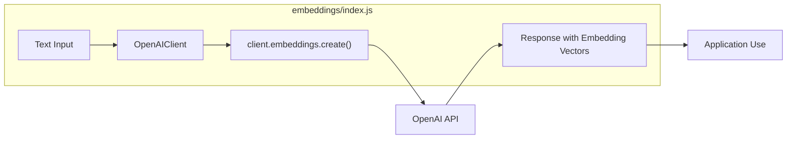
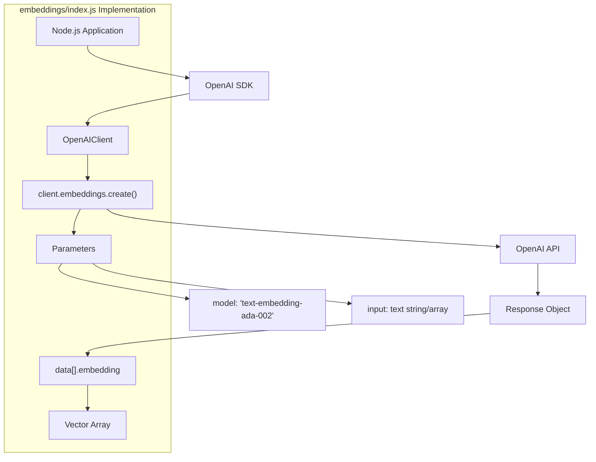
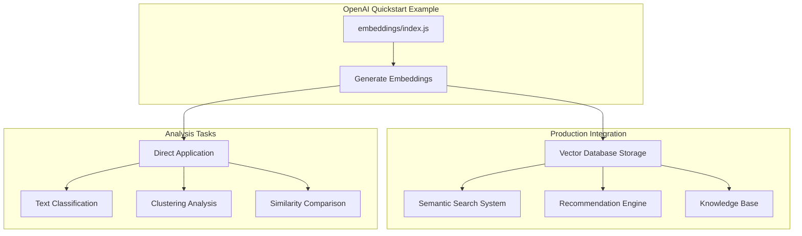

<!-- source: DeepWiki mcp.deepwiki.com · repo openai/openai-quickstart-node · page 3.4 Embeddings · fetched 2026-10-26 -->

# Embeddings

<details>
<summary>Relevant source files</summary>

The following files were used as context for generating this wiki page:

- [README.md](README.md)

</details>


## Purpose and Scope

This document covers the Embeddings API example included in the OpenAI Quickstart Node.js repository. The example demonstrates how to generate vector representations (embeddings) from text using the OpenAI API. Embeddings are numerical representations that capture semantic meaning, enabling applications like semantic search, content clustering, and text similarity analysis. For information about other OpenAI APIs demonstrated in this repository, see [Chat Completions](#3.1), [Assistants](#3.2), [Fine-tuning](#3.3), [Moderation](#3.5), [Batch Processing](#3.6), or [Images API](#3.7).

Sources: [README.md:9-10](), [README.md:129-132]()

## Repository Implementation

The repository includes a basic example of generating embeddings in the file `embeddings/index.js`. As noted in the repository's README, this example demonstrates how to generate embeddings using the OpenAI API with Node.js.

### Embeddings Generation Workflow

The following diagram illustrates the general workflow for generating embeddings using the OpenAI API through the example file:



Sources: [README.md:129-132]()

## Using the Embeddings Example

To run the embeddings example in the repository:

1. Ensure you have completed the repository setup as described in the README:
   - Clone the repository: `git clone https://github.com/openai/openai-quickstart-node.git`
   - Navigate to the project directory: `cd openai-quickstart-node`
   - Install dependencies: `npm install openai`
   - Set your OpenAI API key as an environment variable (e.g., `export OPENAI_API_KEY=<your-api-key>` for Linux/Mac)

2. Run the example:
   ```bash
   node embeddings/index.js
   ```

The script will generate embeddings for the provided text input and display the resulting vector representation.

Sources: [README.md:17-75](), [README.md:129-132]()

## Technical Implementation Details

The embeddings example integrates with the OpenAI API using the Node.js SDK. The following diagram shows the technical components and their relationships:



Sources: [README.md:129-132]()

## Response Structure

The OpenAI Embeddings API typically returns a response with the following structure:

| Field | Description |
|-------|-------------|
| `data` | Array of embedding objects |
| `data[].embedding` | Array of floating-point numbers representing the embedding vector |
| `data[].index` | The index of the embedding in the request |
| `data[].object` | Type identifier (typically "embedding") |
| `model` | The model used to generate the embedding |
| `usage` | Object containing token usage information |

Sources: [README.md:129-132]()

## Applications of Embeddings

Embeddings generated using this example can be utilized in various natural language processing applications:



Sources: [README.md:129-132]()

## Common Use Cases

| Use Case | Description | Implementation Approach |
|----------|-------------|-------------------------|
| Semantic Search | Find documents with similar meaning to a query | Compare query embedding to corpus embeddings |
| Content Clustering | Group similar documents based on meaning | Apply clustering algorithms to embedding vectors |
| Recommendations | Suggest related content | Find items with high vector similarity |
| Classification | Categorize text | Compare to embeddings of known categories |
| Information Retrieval | Enhance search beyond keywords | Index and query by semantic meaning |
| Anomaly Detection | Identify unusual content | Find outliers in the embedding space |

Sources: [README.md:129-132]()

## Integration with Other Repository Examples

Embeddings can complement other examples in the repository:

- Can enhance [Chat Completions](#3.1) by providing relevant context
- Can improve [Assistants](#3.2) with semantic retrieval capabilities
- Can analyze training data for [Fine-tuning](#3.3)
- Can support content organization alongside [Moderation](#3.5)

Sources: [README.md:5-13]()

## Additional Resources

For more detailed information about working with embeddings:
- The official OpenAI documentation on embeddings
- Vector database integrations (e.g., Pinecone, Weaviate, FAISS)
- Examples of RAG (Retrieval-Augmented Generation) applications

Sources: [README.md:158-163]()

---

