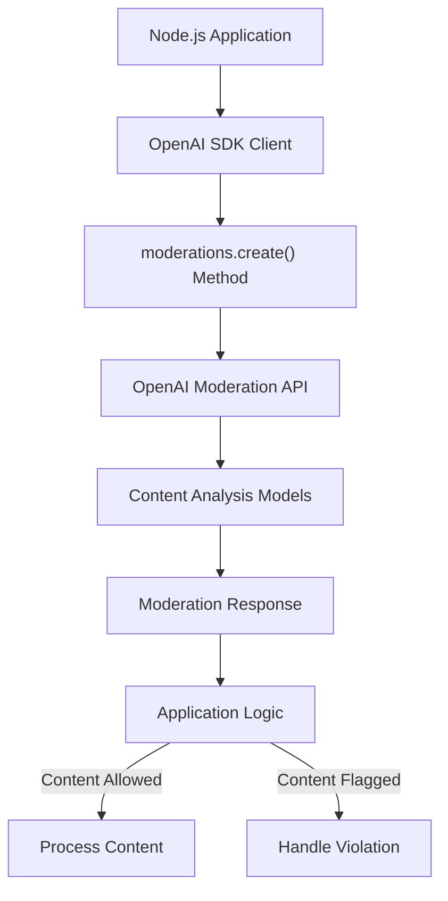
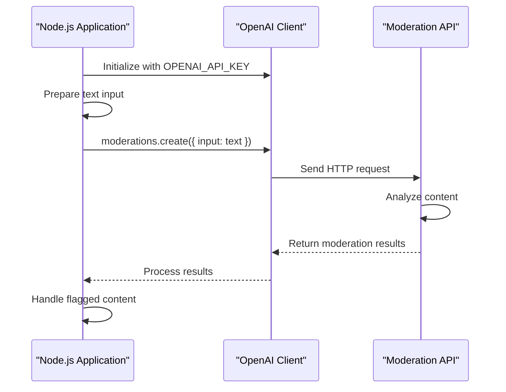
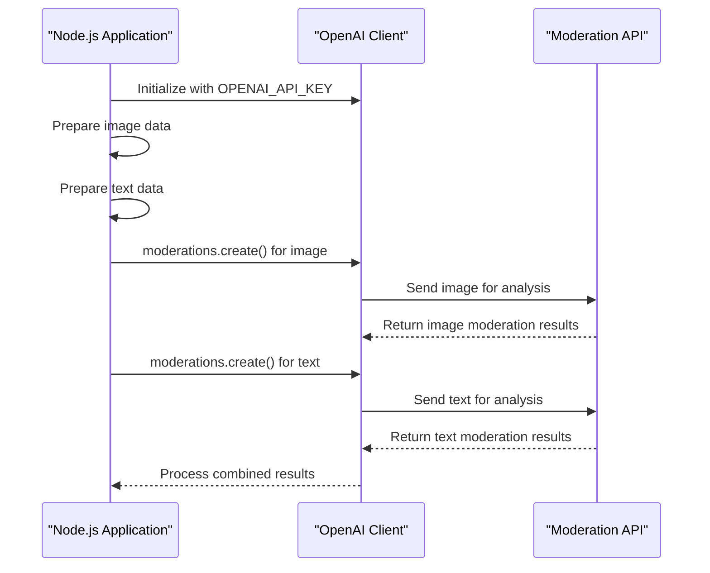
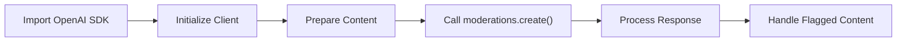

<!-- source: DeepWiki mcp.deepwiki.com · repo openai/openai-quickstart-node · page 3.5 Moderation · fetched 2026-10-26 -->

# Moderation

<details>
<summary>Relevant source files</summary>

The following files were used as context for generating this wiki page:

- [README.md](README.md)

</details>


## Purpose and Scope

This document explains the Moderation API examples included in the OpenAI Node.js Quickstart repository. These examples demonstrate how to use the OpenAI Node.js SDK to detect content that may violate OpenAI's usage policies, such as harmful, deceptive, or sensitive content. The repository provides two examples for content moderation:

1. Text moderation (`moderation/index.js`)
2. Images & text moderation (`moderation/images.js`)

For information about other API examples in this repository, see the [OpenAI API Examples](#3) overview.

## Moderation System Architecture

The following diagram illustrates how the Moderation examples interact with the OpenAI API:



Sources: README.md

The Moderation API processes content and returns detailed information about potential policy violations, including:
- An overall flag indicating whether content violates policies
- Specific categories of violations detected
- Confidence scores for each category

## Text Moderation Example

The basic text moderation example demonstrates how to analyze text content for policy violations.



Sources: README.md lines 135-136

## Images & Text Moderation Example

The more advanced example demonstrates how to moderate both images and text content.



Sources: README.md lines 139-140

## Implementation Components



Sources: README.md

## Moderation Categories

The Moderation API checks for several categories of potentially harmful content:

| Category | Description |
|----------|-------------|
| `hate` | Content expressing hatred based on identity |
| `hate/threatening` | Hateful content that also includes violence or serious harm |
| `harassment` | Content that harasses, intimidates, or bullies individuals |
| `self-harm` | Content promoting, encouraging, or depicting self-harm |
| `sexual` | Content meant to arouse sexual excitement |
| `sexual/minors` | Sexual content involving minors |
| `violence` | Content that promotes or glorifies violence |
| `violence/graphic` | Graphic violence or gore |

## Typical Response Structure

The Moderation API returns a structured response that typically looks like this:

```json
{
  "id": "modr-XXXX",
  "model": "text-moderation-latest",
  "results": [
    {
      "flagged": true,
      "categories": {
        "hate": false,
        "hate/threatening": false,
        "harassment": false,
        "self-harm": false,
        "sexual": true,
        "sexual/minors": false,
        "violence": false,
        "violence/graphic": false
      },
      "category_scores": {
        "hate": 0.0001,
        "hate/threatening": 0.0001,
        "harassment": 0.0002,
        "self-harm": 0.0001,
        "sexual": 0.9958,
        "sexual/minors": 0.0003,
        "violence": 0.0002,
        "violence/graphic": 0.0001
      }
    }
  ]
}
```

## Implementation Best Practices

When implementing content moderation using these examples:

1. Always store your API key securely in environment variables
2. Set appropriate confidence thresholds based on your application's requirements
3. Implement proper error handling for API failures or rate limiting
4. Consider combining automatic moderation with human review for edge cases
5. Cache moderation results for frequently analyzed content to reduce API calls
6. Implement fallback mechanisms in case the API is unavailable

## Usage Considerations

- The Moderation API is designed to help identify potentially problematic content but should not be the sole decision-maker
- False positives and false negatives can occur
- Different geographic regions and cultural contexts may have varying standards for acceptable content
- Consider implementing user feedback mechanisms to improve moderation accuracy over time

Sources: README.md

---

