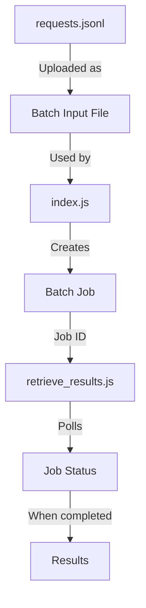
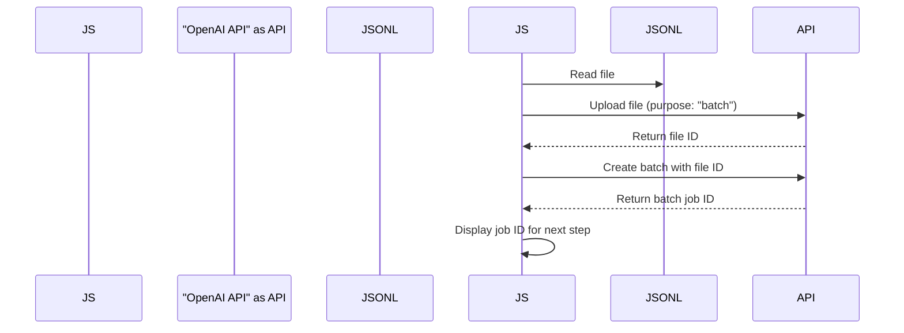
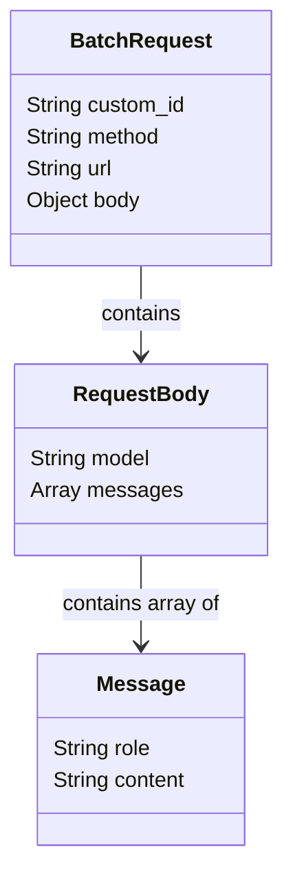
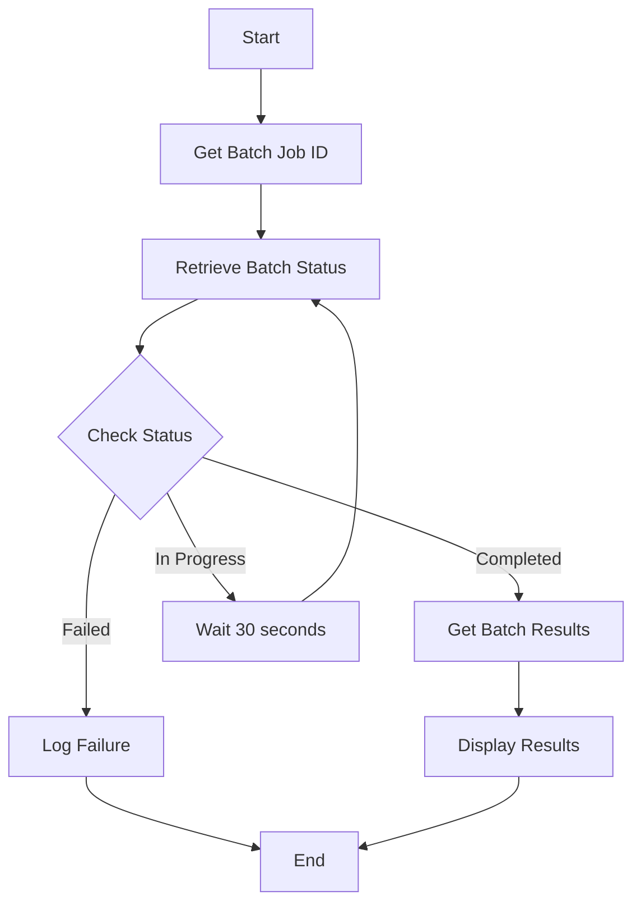

<!-- source: DeepWiki mcp.deepwiki.com · repo openai/openai-quickstart-node · page 3.6 Batch Processing · fetched 2026-10-26 -->

# Batch Processing

<details>
<summary>Relevant source files</summary>

The following files were used as context for generating this wiki page:

- [README.md](README.md)
- [batch/index.js](batch/index.js)
- [batch/requests.jsonl](batch/requests.jsonl)
- [batch/retrieve_results.js](batch/retrieve_results.js)

</details>


## Purpose and Scope

This document explains the Batch Processing examples in the OpenAI Quickstart Node.js repository. The Batch Processing API allows you to process multiple requests in a single job, which is particularly useful for high-volume tasks that don't require immediate responses. The examples demonstrate how to create batch jobs and retrieve their results.

Sources: [README.md:143-150](), [batch/index.js:1-24]()

## Overview

The batch processing examples demonstrate two primary operations:

1. Creating a batch job with multiple requests
2. Retrieving the results from a completed batch job

The repository includes two JavaScript files that handle these operations separately, along with a sample request file.



Sources: [batch/index.js:1-24](), [batch/retrieve_results.js:1-38](), [batch/requests.jsonl:1-5]()

## Files and Components

The Batch Processing examples consist of three main files:

| File | Purpose |
|------|---------|
| `batch/index.js` | Creates a batch job by uploading requests and initiating the batch |
| `batch/retrieve_results.js` | Retrieves and displays results from a completed batch job |
| `batch/requests.jsonl` | Contains the individual requests to be processed in JSONL format |

Sources: [README.md:143-150]()

## Creating a Batch Job

The `index.js` file demonstrates how to create a batch processing job:

1. Upload a JSONL file containing the requests
2. Create a batch job using the uploaded file
3. Output the batch job ID for later retrieval



Sources: [batch/index.js:1-24]()

### Key Code Components

The batch job creation process involves:

1. **File Upload**: The JSONL file is uploaded with the purpose set to "batch"
2. **Batch Creation**: A batch job is created with the uploaded file ID
3. **Endpoint Specification**: The API endpoint to use for processing requests
4. **Completion Window**: The time window for job completion (24 hours in the example)

Sources: [batch/index.js:5-17]()

## Request Format

The batch requests are stored in JSONL format (JSON Lines), with each line representing a single request.



Each request in the JSONL file contains:

- `custom_id`: A unique identifier for the individual request
- `method`: The HTTP method (POST)
- `url`: The API endpoint (/v1/chat/completions)
- `body`: The actual request payload with model and messages

Sources: [batch/requests.jsonl:1-5]()

## Retrieving Batch Results

The `retrieve_results.js` file demonstrates how to check a batch job's status and retrieve results when it's complete:

1. Retrieve the batch job using its ID
2. Poll the job status until it's completed or fails
3. Retrieve and display the results if completed



Sources: [batch/retrieve_results.js:1-38]()

### Key Code Components

The result retrieval process includes:

1. **Batch ID Input**: Accept the batch job ID as a command-line argument or use a hardcoded value
2. **Status Polling**: Check the job status periodically with a timeout
3. **Result Retrieval**: When the job completes, retrieve the output file
4. **Result Display**: Parse and display the results

Sources: [batch/retrieve_results.js:7-37]()

## Complete Workflow

The complete workflow for using batch processing with the OpenAI API involves:

```mermaid
sequenceDiagram
    participant User
    participant "index.js" as Create
    participant "OpenAI API" as API
    participant "retrieve_results.js" as Retrieve
    
    User ->> Create: Run index.js
    Create ->> API: Upload requests.jsonl
    Create ->> API: Create batch job
    API -->> Create: Return batch job ID
    Create -->> User: Display batch job ID
    
    Note over User, API: Wait for processing (up to 24h)
    
    User ->> Retrieve: Run retrieve_results.js with job ID
    Retrieve ->> API: Poll batch status
    loop Until completed or failed
        Retrieve ->> API: Check status
        API -->> Retrieve: Return status
        Retrieve ->> Retrieve: Wait 30 seconds
    end
    Retrieve ->> API: Get results file
    API -->> Retrieve: Return results
    Retrieve -->> User: Display results
```

Sources: [batch/index.js:1-24](), [batch/retrieve_results.js:1-38]()

## Usage Instructions

To use the batch processing examples:

1. Run the batch job creation script:
   ```bash
   node batch/index.js
   ```

2. Note the batch job ID from the output

3. Run the result retrieval script with the job ID:
   ```bash
   node batch/retrieve_results.js <job-id>
   ```

4. Wait for the job to complete (can take up to 24 hours)

Sources: [README.md:143-150](), [batch/index.js:22-23]()

## Use Cases

Batch processing is ideal for:

- Processing large volumes of similar requests
- Tasks that don't require immediate responses
- Bulk data operations
- Offline/asynchronous processing
- Cost-effective handling of high-volume requests

Sources: [batch/index.js:1-24](), [batch/requests.jsonl:1-5]()

## Related Resources

For other API examples in this repository, see:
- [Chat Completions](#3.1)
- [Assistants](#3.2)
- [Fine-tuning](#3.3)
- [Embeddings](#3.4)
- [Moderation](#3.5)
- [Images API](#3.7)

Sources: [README.md:4-14]()

---

