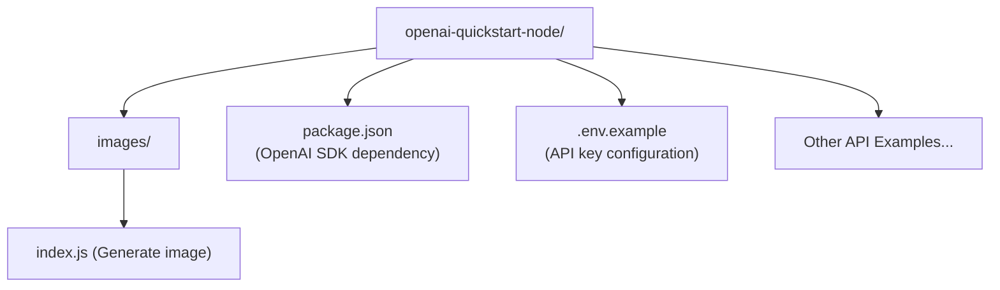
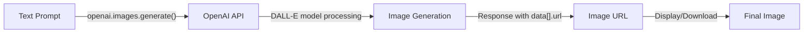
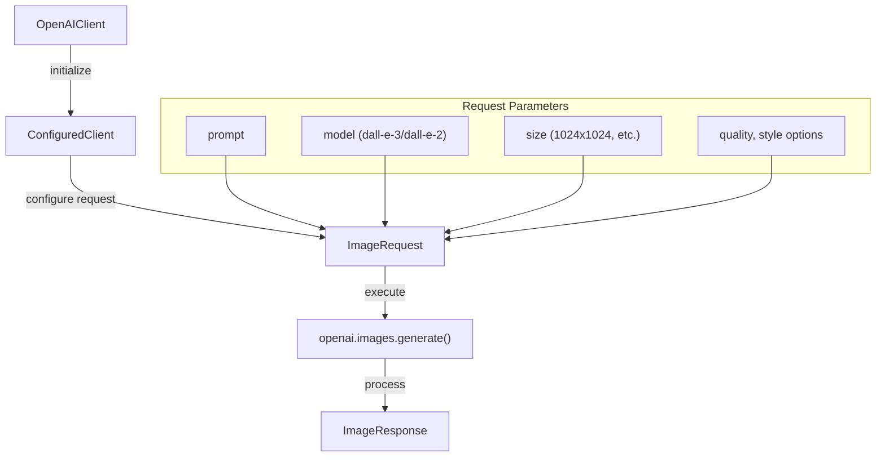
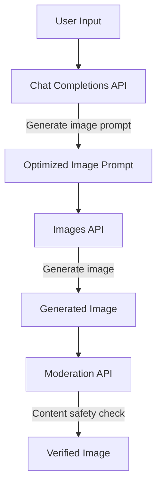

<!-- source: DeepWiki mcp.deepwiki.com · repo openai/openai-quickstart-node · page 3.7 Images API · fetched 2026-10-26 -->

# Images API

<details>
<summary>Relevant source files</summary>

The following files were used as context for generating this wiki page:

- [README.md](README.md)

</details>


This document explains the Images API example in the OpenAI Quickstart Node.js repository. The example demonstrates how to generate AI images from text prompts using OpenAI's DALL-E models through the Node.js SDK.

For information about other API examples in this repository, see [OpenAI API Examples](#3). If you're interested in image moderation instead of generation, see [Moderation](#3.5).

## Purpose and Scope

The Images API example provides a straightforward implementation of text-to-image generation using OpenAI's API. It shows how to:

1. Set up the OpenAI client with proper authentication
2. Create a text prompt that describes the desired image
3. Configure generation parameters like model, size, and quality
4. Make an API request to generate an image
5. Process the response containing the image URL

The implementation is contained in a single file that demonstrates basic image generation capabilities.

Sources: [README.md:152-155]()

## Repository Structure

The Images API example is implemented in the `images` directory of the repository:



Sources: [README.md:12-13](), [README.md:152-155]()

## Image Generation Flow

The Images API translates text descriptions into visual content through the following process:



Sources: [README.md:152-155]()

## Implementation Components

The implementation involves several key components working together to generate images:



Sources: [README.md:152-155]()

## Key Parameters

When generating images, several parameters control the output characteristics:

| Parameter | Description | Possible Values |
|-----------|-------------|----------------|
| `prompt` | Text description of the desired image | Text string (max 1000 characters) |
| `model` | DALL-E model version to use | "dall-e-3", "dall-e-2" |
| `n` | Number of images to generate | 1-10 (model dependent) |
| `size` | Image dimensions | "1024x1024", "512x512", "256x256" |
| `quality` | Image quality level | "standard", "hd" |
| `style` | Visual style preference | "vivid", "natural" |
| `response_format` | Format of returned image data | "url", "b64_json" |

## Running the Example

To execute the Images API example:

1. Make sure you've completed the setup in [Getting Started](#2)
2. Set your OpenAI API key as an environment variable
3. Run the example with:
   ```bash
   node images/index.js
   ```

Sources: [README.md:71-75](), [README.md:152-155]()

## Response Structure

The Images API response contains several key components:

| Field | Description |
|-------|-------------|
| `created` | Timestamp when the image was generated |
| `data` | Array of generated image objects |
| `data[].url` | URL to access the generated image (when response_format is "url") |
| `data[].b64_json` | Base64-encoded image data (when response_format is "b64_json") |
| `data[].revised_prompt` | For DALL-E 3, the refined prompt used to generate the image |

## Error Handling

Common errors when working with the Images API include:

| Error Type | Common Causes | Recommended Handling |
|------------|---------------|---------------------|
| Authentication Error | Invalid API key | Verify the `OPENAI_API_KEY` environment variable |
| Validation Error | Invalid parameters | Check prompt length, image dimensions, etc. |
| Content Policy | Prohibited content | Revise prompt to comply with content policies |
| Rate Limiting | Too many requests | Implement backoff strategy and request throttling |
| Server Error | OpenAI service issues | Add retry logic with exponential backoff |

## Practical Applications

The Images API enables various practical applications:

- Content illustration generation
- Product visualization for e-commerce
- Creative asset development for marketing
- Visual design prototyping
- Educational content creation
- Custom art generation

## Integration with Other APIs

The Images API can be used alongside other OpenAI APIs in the repository:



Sources: [README.md:5-13]()

This diagram shows how multiple APIs can work together in a pipeline, with Chat Completions generating optimized image prompts, the Images API creating the images, and the Moderation API verifying content safety.

---

