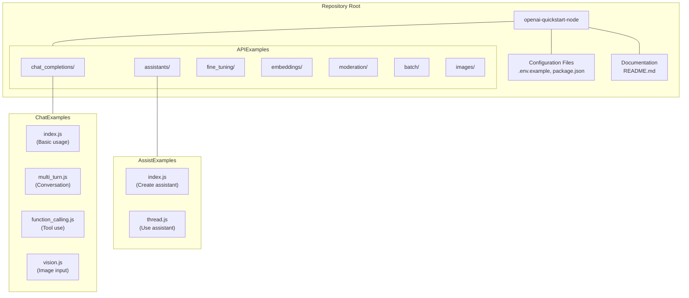
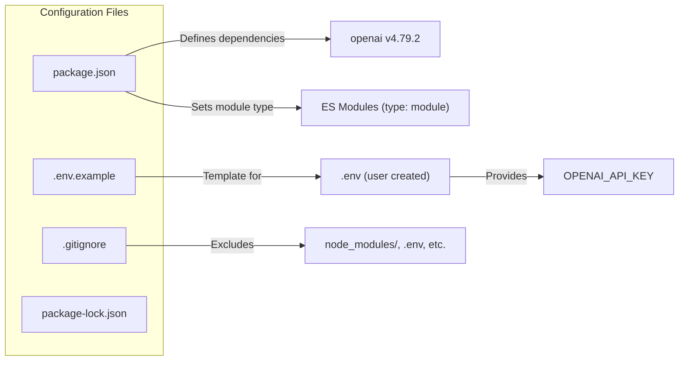
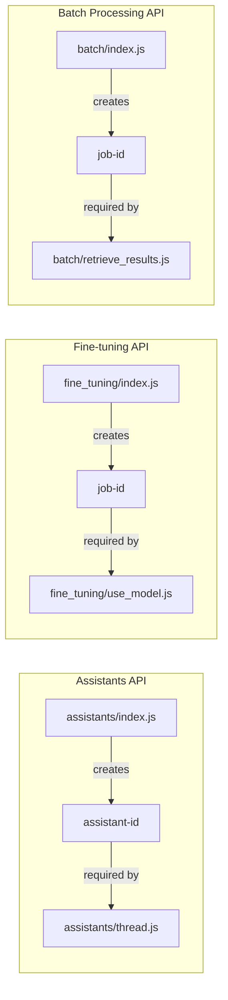
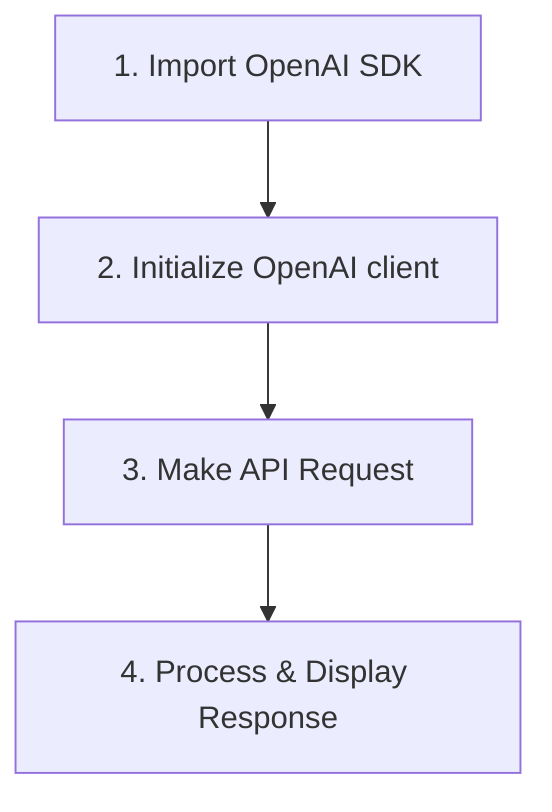
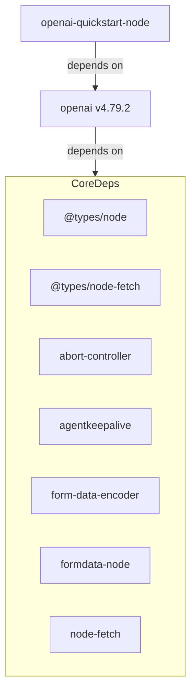

<!-- source: DeepWiki mcp.deepwiki.com · repo openai/openai-quickstart-node · page 4 Project Structure · fetched 2026-10-26 -->

# Project Structure

Relevant source files

The following files were used as context for generating this wiki page:

- [.gitignore](.gitignore)
- [README.md](README.md)
- [package-lock.json](package-lock.json)
- [package.json](package.json)

This document provides an in-depth explanation of the OpenAI Quickstart Node.js repository structure, including its organization, configuration, and the relationships between different examples. For information about getting started with the repository, see [Getting Started](#2).

## Repository Overview

The OpenAI Quickstart Node.js repository is organized as a collection of example scripts demonstrating various OpenAI APIs using the Node.js SDK. The repository structure is designed to be modular, with examples grouped by API type.

Sources: [README.md:1-16]()

## Directory Structure

The repository is organized into directories by API type, with each directory containing at least a basic example and potentially more specialized examples:

| Directory | Purpose | Examples |
|-----------|---------|----------|
| `chat_completions/` | Chat Completions API examples | `index.js` (basic), `multi_turn.js`, `function_calling.js`, `vision.js` |
| `assistants/` | Assistants API examples | `index.js` (create assistant), `thread.js` (use assistant) |
| `fine_tuning/` | Fine-tuning API examples | `index.js` (create job), `use_model.js` (use fine-tuned model) |
| `embeddings/` | Embeddings API examples | `index.js` (generate embeddings) |
| `moderation/` | Moderation API examples | `index.js` (moderate text), `images.js` (moderate images & text) |
| `batch/` | Batch Processing API examples | `index.js` (create batch job), `retrieve_results.js` (get results) |
| `images/` | Images API examples | `index.js` (generate image) |

Sources: [README.md:5-15](), [README.md:85-156]()

## Configuration Files

The repository contains several configuration files that define its environment and dependencies:

### package.json

The `package.json` file defines the project metadata and dependencies:

- **Name**: `openai-quickstart-node`
- **Version**: `1.0.0`
- **Main Dependency**: OpenAI SDK v4.79.2
- **Module Type**: ES Modules (`"type": "module"`)

Sources: [package.json:1-14]()

### Environment Configuration

The project requires configuration of environment variables:

1. The OpenAI API key must be set in an `.env` file (which users create based on `.env.example`)
2. This file is git-ignored for security reasons

Sources: [README.md:45-69](), [.gitignore:27-32]()

## Execution Flow and Dependencies

Some examples depend on the outputs from other examples. These dependencies are structured so that one example creates a resource (like an assistant or a fine-tuning job) and another example uses that resource.

### Example Dependency Patterns

The repository follows a consistent pattern for examples with dependencies:

1. A basic example creates a resource and outputs an ID
2. A follow-up example takes that ID as a parameter to demonstrate usage

For example:
- Run `assistants/index.js` to create an assistant and get an assistant ID
- Use that ID when running `assistants/thread.js {assistant-id}` to create a thread with that assistant

Sources: [README.md:93-150]()

## Code Organization Patterns

All examples follow a consistent structure:

### Common Code Pattern

Most examples follow this basic pattern:

1. Import the OpenAI SDK
2. Initialize the OpenAI client with the API key
3. Define the request parameters
4. Make the API request
5. Process and display the response

This consistency makes it easy to understand and compare different API usages.

Sources: [README.md:71-81]()

## Example Types and Complexity

The examples range from basic to more complex:

| Complexity | Examples | Features |
|------------|----------|----------|
| Basic | Most `index.js` files | Simple API calls with minimal parameters |
| Intermediate | `multi_turn.js`, `thread.js` | Multi-step processes, conversation context |
| Advanced | `function_calling.js`, `vision.js` | Complex parameters, specialized capabilities |

Sources: [README.md:85-156]()

## Project Dependencies

The project has minimal external dependencies, focusing primarily on the OpenAI SDK:

Sources: [package.json:10-12](), [package-lock.json:202-231]()

## Node.js Version Requirements

The repository has specific Node.js version requirements to ensure compatibility:

- Node.js >= 16.0.0
- npm (or another node package manager)

These requirements are driven by both the repository's code and the OpenAI SDK's requirements.

Sources: [README.md:21-23](), [package-lock.json:202-231]()

---

