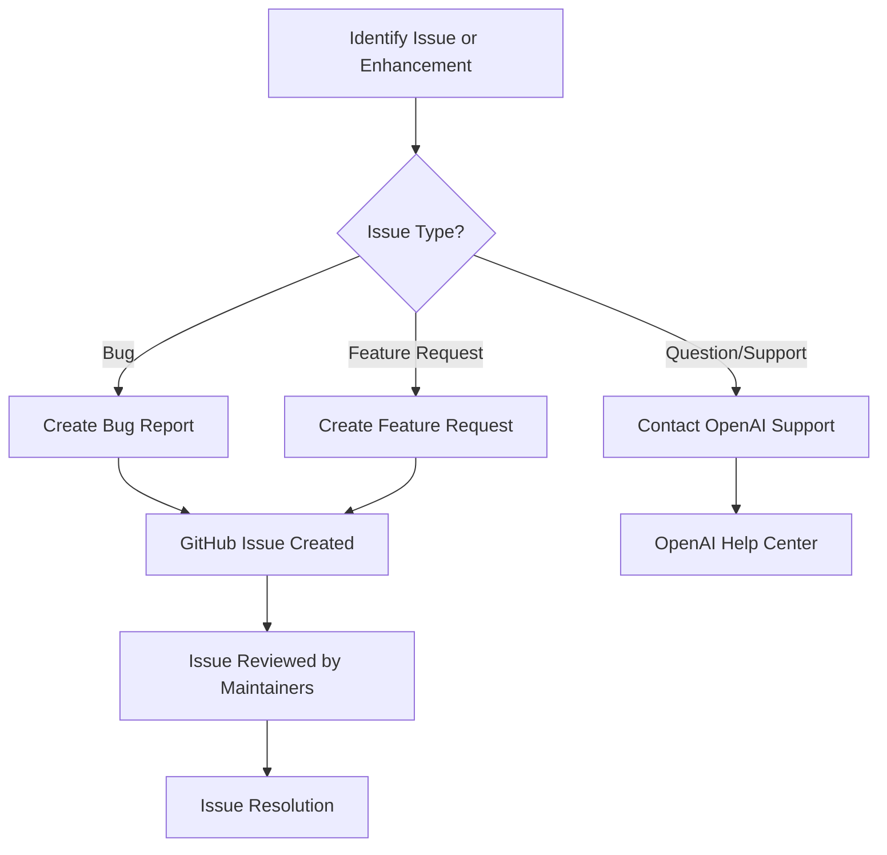
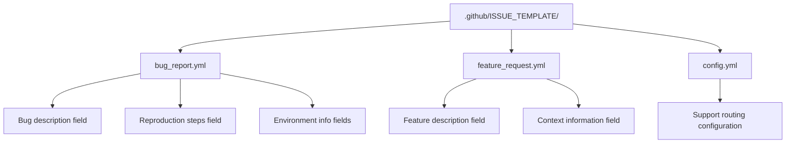
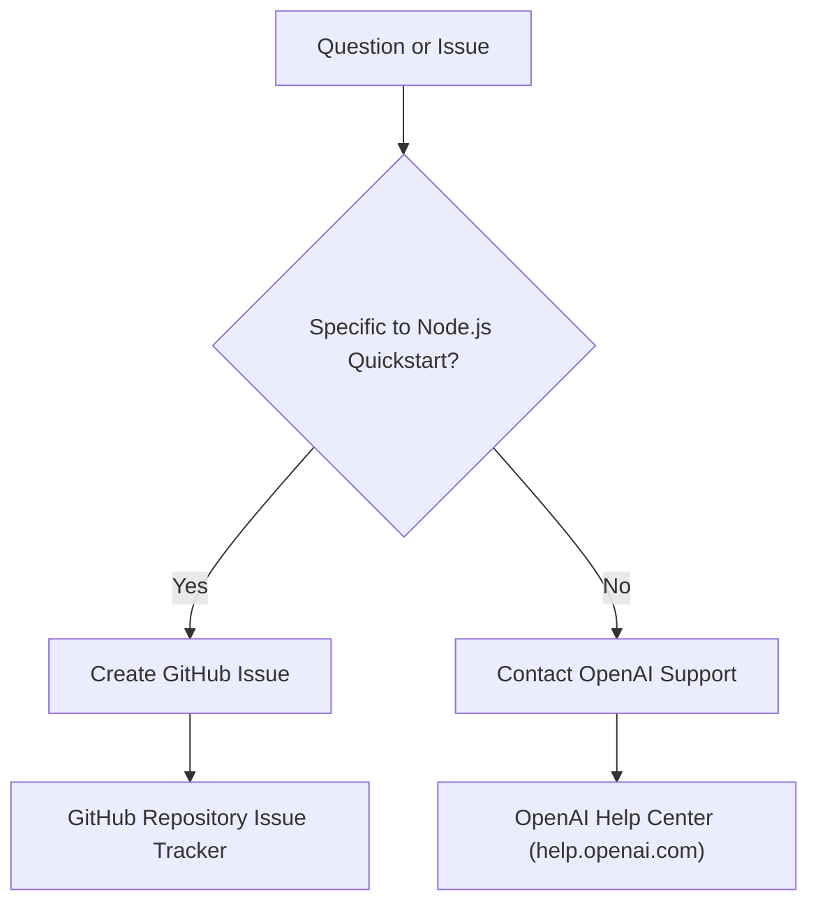
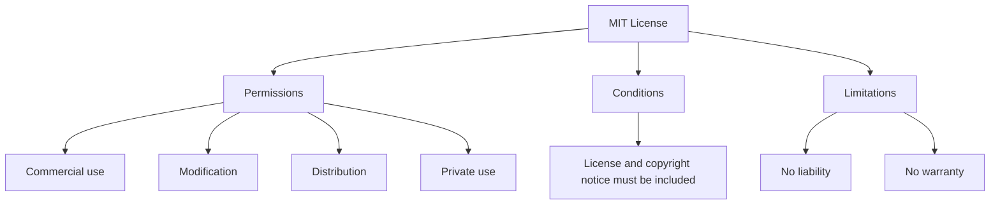
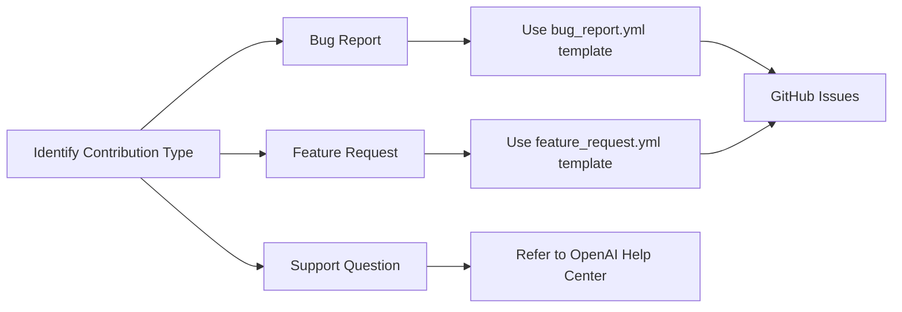

<!-- source: DeepWiki mcp.deepwiki.com · repo openai/openai-quickstart-node · page 5 Contributing · fetched 2026-10-26 -->

# Contributing

Relevant source files

The following files were used as context for generating this wiki page:

- [.github/ISSUE_TEMPLATE/bug_report.yml](.github/ISSUE_TEMPLATE/bug_report.yml)
- [.github/ISSUE_TEMPLATE/config.yml](.github/ISSUE_TEMPLATE/config.yml)
- [.github/ISSUE_TEMPLATE/feature_request.yml](.github/ISSUE_TEMPLATE/feature_request.yml)
- [LICENSE](LICENSE)

This document provides guidelines for contributing to the OpenAI Node.js Quickstart repository. It outlines the process for reporting bugs, requesting features, and understanding project licensing. For information about using the examples in the repository, see [Getting Started](#2) and [OpenAI API Examples](#3).

## Contribution Process Overview

The diagram below illustrates the general process for contributing to this repository:

Sources: [.github/ISSUE_TEMPLATE/bug_report.yml](), [.github/ISSUE_TEMPLATE/feature_request.yml](), [.github/ISSUE_TEMPLATE/config.yml]()

## Issue Templates and Structure

The repository uses standardized GitHub issue templates to ensure contributors provide all necessary information when reporting issues or requesting features:

Sources: [.github/ISSUE_TEMPLATE/bug_report.yml](), [.github/ISSUE_TEMPLATE/feature_request.yml](), [.github/ISSUE_TEMPLATE/config.yml]()

## Reporting Bugs

When encountering bugs in the OpenAI Node.js Quickstart repository, please use the bug report template which captures essential information for troubleshooting:

| Field | Description | Required |
|-------|-------------|----------|
| Describe the bug | Clear description of what the bug is | Yes |
| To Reproduce | Step-by-step reproduction instructions | Yes |
| OS | Your operating system | No |
| Node version | Your Node.js version | No |

The template ensures maintainers have enough context to understand and address the issue efficiently.

Sources: [.github/ISSUE_TEMPLATE/bug_report.yml]()

## Requesting Features

For suggesting improvements or new features, use the feature request template:

| Field | Description | Required |
|-------|-------------|----------|
| Feature description | Clear explanation of the requested feature | Yes |
| Additional context | Any relevant context about the feature request | No |

Feature requests should be specific to the Node.js Quickstart repository functionality.

Sources: [.github/ISSUE_TEMPLATE/feature_request.yml]()

## Support Questions Routing

The repository is configured to direct general OpenAI API questions to the official support channels. GitHub issues should only be used for matters specific to this Node.js Quickstart repository.

Sources: [.github/ISSUE_TEMPLATE/config.yml]()

## License Information

The OpenAI Node.js Quickstart repository is released under the MIT License:

When contributing to this repository, you agree that your contributions will be licensed under the same MIT License terms.

Sources: [LICENSE]()

## Contribution Guidelines Summary

Remember these key points when contributing:

1. Use the appropriate issue template for your contribution type
2. Provide clear, concise information
3. For bug reports, include reproduction steps
4. Ensure your contribution is specific to the Node.js Quickstart repository
5. General OpenAI API questions should be directed to the Help Center

By following these guidelines, you help maintainers address issues more efficiently and improve the repository for all users.

Sources: [.github/ISSUE_TEMPLATE/bug_report.yml](), [.github/ISSUE_TEMPLATE/feature_request.yml](), [.github/ISSUE_TEMPLATE/config.yml]()