# Page: Overview

# Overview

<details>
<summary>Relevant source files</summary>

The following files were used as context for generating this wiki page:

- [README.md](README.md)
- [package.json](package.json)

</details>


This document provides an introduction to the OpenAI Quickstart Node.js repository, which demonstrates how to use various OpenAI APIs with the Node.js SDK. The repository contains executable examples for each OpenAI API, organized into distinct categories. For detailed setup instructions, see [Getting Started](#2).

Sources: [README.md:1-15]()

## Repository Purpose

The OpenAI Quickstart Node.js repository serves as a practical reference implementation for developers who want to integrate OpenAI's APIs into Node.js applications. It provides working code examples that demonstrate API functionality across different OpenAI services, from basic implementation to more advanced use cases.

The repository is structured as a collection of standalone examples rather than a comprehensive application, allowing developers to focus on specific API integrations independently.

Sources: [README.md:1-15](), [package.json:1-14]()

## Repository Structure

The codebase is organized by API type, with each OpenAI service having its own dedicated directory. Each directory contains one or more JavaScript files demonstrating different capabilities of that API.

```mermaid
graph TD
    Root["openai-quickstart-node"] --> README["README.md"]
    Root --> Package["package.json<br>(OpenAI SDK v4.79.2)"]
    Root --> EnvConfig[".env.example<br>(OPENAI_API_KEY configuration)"]
    
    Root --> ChatDir["chat_completions/"]
    Root --> AssistDir["assistants/"]
    Root --> FinetuneDir["fine_tuning/"]
    Root --> EmbedDir["embeddings/"]
    Root --> ModDir["moderation/"]
    Root --> BatchDir["batch/"]
    Root --> ImgDir["images/"]
    
    ChatDir --> ChatBasic["index.js<br>(Basic chat example)"]
    ChatDir --> ChatMulti["multi_turn.js<br>(Conversation example)"] 
    ChatDir --> ChatFunc["function_calling.js<br>(Tool use example)"]
    ChatDir --> ChatVision["vision.js<br>(Image input example)"]
    
    AssistDir --> AssistBasic["index.js<br>(Create assistant)"]
    AssistDir --> AssistThread["thread.js<br>(Use assistant)"]
    
    FinetuneDir --> FinetuneBasic["index.js<br>(Create job)"]
    FinetuneDir --> FinetuneUse["use_model.js<br>(Use fine-tuned model)"]
    
    EmbedDir --> EmbedBasic["index.js<br>(Generate embeddings)"]
    
    ModDir --> ModBasic["index.js<br>(Moderate text)"]
    ModDir --> ModImg["images.js<br>(Moderate images & text)"]
    
    BatchDir --> BatchBasic["index.js<br>(Create batch job)"]
    BatchDir --> BatchResults["retrieve_results.js<br>(Get job results)"]
    BatchDir --> BatchRequests["requests.jsonl<br>(Input data)"]
    
    ImgDir --> ImgBasic["index.js<br>(Generate image)"]
```

Sources: [README.md:5-15](), [README.md:83-156]()

## Example Execution Flow

The following diagram illustrates the typical workflow for executing examples in this repository:

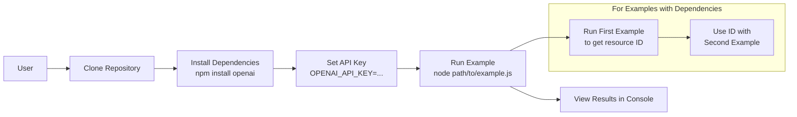

Sources: [README.md:17-81]()

## API Integration Examples

The repository provides examples for the following OpenAI APIs:

| API | Example Types | File Paths |
|-----|---------------|------------|
| Chat Completions | Basic, Multi-turn, Function Calling, Vision | [chat_completions/index.js](), [chat_completions/multi_turn.js](), [chat_completions/function_calling.js](), [chat_completions/vision.js]() |
| Assistants | Create Assistant, Thread Management | [assistants/index.js](), [assistants/thread.js]() |
| Fine-tuning | Create Job, Use Fine-tuned Model | [fine_tuning/index.js](), [fine_tuning/use_model.js]() |
| Embeddings | Generate Embeddings | [embeddings/index.js]() |
| Moderation | Text Moderation, Image & Text Moderation | [moderation/index.js](), [moderation/images.js]() |
| Batch Processing | Create Batch Job, Retrieve Results | [batch/index.js](), [batch/retrieve_results.js]() |
| Images | Generate Image | [images/index.js]() |

Sources: [README.md:83-156]()

## API Dependency Relationships

Some examples have dependencies on other examples, particularly those that require resource IDs created by another script:

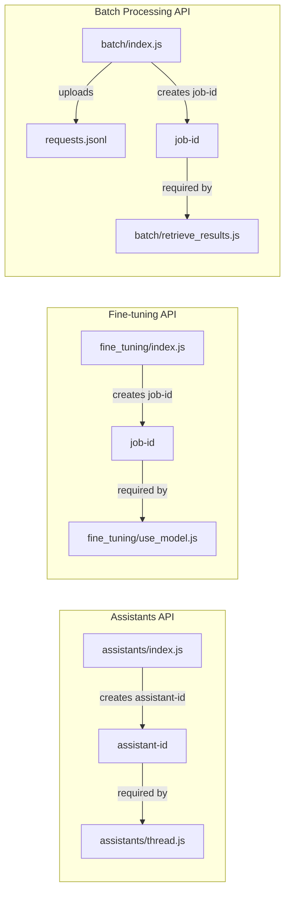

Sources: [README.md:116-118](), [README.md:125-127](), [README.md:148-150]()

## Technical Requirements

The repository has the following technical prerequisites:

- Node.js version 16.0.0 or higher
- npm or another node package manager
- OpenAI API key (from OpenAI platform dashboard)
- OpenAI Node.js SDK version 4.79.2

Sources: [README.md:17-23](), [package.json:10-12]()

## Authentication Flow

All examples in the repository follow this authentication pattern:

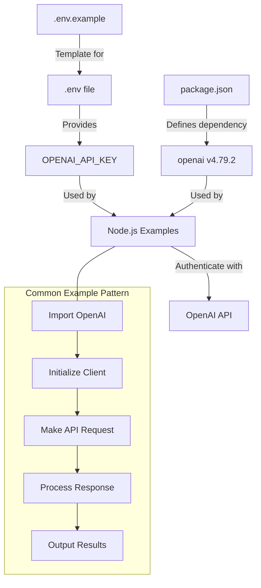

Sources: [README.md:45-69](), [package.json:10-12]()

## Additional Resources

The repository is part of a broader ecosystem of OpenAI quickstart projects:

- Assistants API Quickstart (for more in-depth examples with frontend applications)
- Sample apps with Structured Outputs

This overview page provides a general introduction to the repository. For detailed information about setting up and using specific examples, refer to the respective API documentation pages.

Sources: [README.md:158-164]()

---

# Page: Getting Started

# Getting Started

<details>
<summary>Relevant source files</summary>

The following files were used as context for generating this wiki page:

- [.env.example](.env.example)
- [README.md](README.md)
- [package-lock.json](package-lock.json)
- [package.json](package.json)

</details>


This document provides detailed instructions for setting up the OpenAI Node.js Quickstart repository on your local machine. You will learn how to clone the repository, install dependencies, configure your environment with the necessary API keys, and run the example scripts. For information about the specific examples included in the repository, see [OpenAI API Examples](#3).

## Prerequisites

Before getting started with the OpenAI Node.js Quickstart examples, ensure your system meets the following requirements:

| Requirement | Minimum Version | Notes |
|-------------|-----------------|-------|
| Node.js     | 16.0.0 or higher | [Download from nodejs.org](https://nodejs.org/) |
| npm or other package manager | Latest stable version | Included with Node.js installation |
| OpenAI API Key | N/A | Obtain from [OpenAI platform dashboard](https://platform.openai.com/settings/organization/api-keys) |
| Git | Latest stable version | For cloning the repository |

Sources: [README.md:19-23]()

## Installation Process

Follow these steps to set up the OpenAI Node.js Quickstart repository on your local machine:

### Setup Workflow

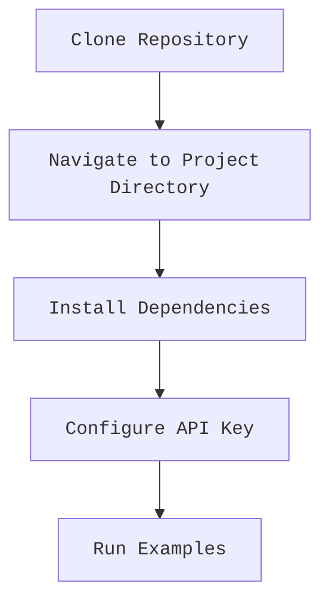

Sources: [README.md:25-81]()

### Step 1: Clone the Repository

Open your terminal and run the following command to clone the repository:

```bash
git clone https://github.com/openai/openai-quickstart-node.git
```

Sources: [README.md:29-31]()

### Step 2: Navigate to the Project Directory

Change to the project directory:

```bash
cd openai-quickstart-node
```

Sources: [README.md:33-37]()

### Step 3: Install Dependencies

Install the required dependencies using npm:

```bash
npm install
```

This will install the OpenAI Node.js SDK version 4.79.2 and its dependencies as specified in the package.json file.

Sources: [README.md:39-43](), [package.json:10-12]()

## Environment Configuration

### Setting Up Your API Key

The OpenAI API requires authentication using your API key. The repository uses environment variables to securely store this key.

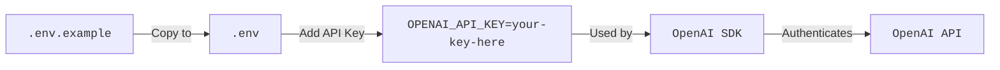

Sources: [README.md:45-69](), [.env.example:1-2]()

There are multiple ways to set up your API key:

#### Option 1: Create a .env file (Recommended)

1. Copy the provided `.env.example` file to create a `.env` file:
   ```bash
   cp .env.example .env
   ```

2. Edit the `.env` file and add your OpenAI API key:
   ```
   OPENAI_API_KEY=sk-your-api-key
   ```

#### Option 2: Set as Environment Variable in Terminal Session

For a temporary setup in your current terminal session:

**Bash (Mac/Linux):**
```bash
export OPENAI_API_KEY=sk-your-api-key
```

**PowerShell (Windows):**
```powershell
setx OPENAI_API_KEY "sk-your-api-key"
```

#### Option 3: Set Persistent Environment Variable

For a more permanent solution:

**Mac/Linux:**
Add this line to your `.bashrc` or `.zshrc` file:
```bash
export OPENAI_API_KEY=sk-your-api-key
```

**Windows:**
Set through System Properties > Environment Variables.

Sources: [README.md:45-69]()

## Running the Examples

The repository contains examples for various OpenAI APIs organized into separate directories. Each example can be run individually using the Node.js runtime.

### Example Execution Flow

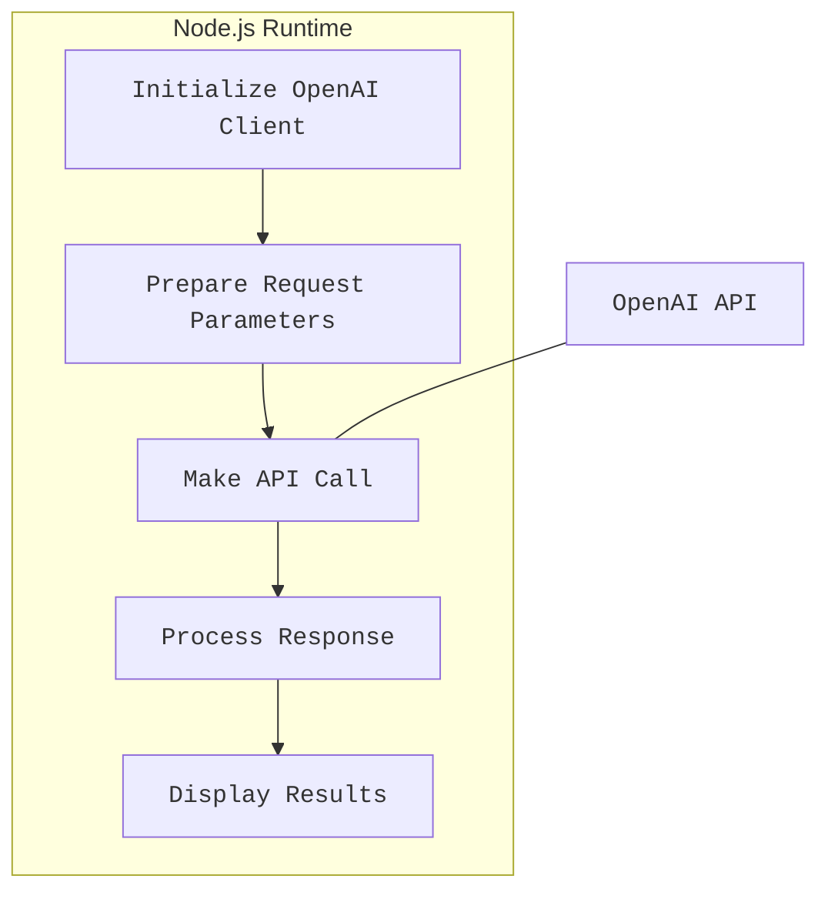

Sources: [README.md:71-81]()

To run an example:

```bash
node path/to/script.js
```

For instance, to run the basic chat completions example:

```bash
node chat_completions/index.js
```

Some examples require outputs from previous examples as inputs. For these, you'll need to run the prerequisite example first and note the ID it generates.

### Examples With Dependencies

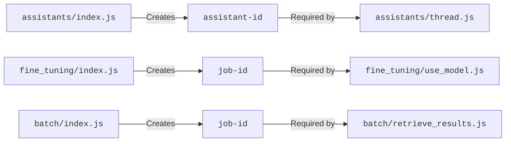

Sources: [README.md:85-156]()

For examples with dependencies, run them in the correct order:

1. First, run the initial script to create a resource:
   ```bash
   node assistants/index.js
   ```

2. Note the ID output (e.g., assistant-id)

3. Then run the dependent script with that ID:
   ```bash
   node assistants/thread.js assistant-id
   ```

## Available Examples Summary

The repository includes examples for the following OpenAI APIs:

| API Category | Basic Example | Additional Examples |
|--------------|---------------|---------------------|
| Chat Completions | chat_completions/index.js | multi_turn.js, function_calling.js, vision.js |
| Assistants | assistants/index.js | thread.js |
| Fine-tuning | fine_tuning/index.js | use_model.js |
| Embeddings | embeddings/index.js | - |
| Moderation | moderation/index.js | images.js |
| Batch | batch/index.js | retrieve_results.js |
| Images | images/index.js | - |

For details about each example, refer to [OpenAI API Examples](#3).

Sources: [README.md:85-156]()

## Project Structure

The OpenAI Quickstart Node.js project uses ES modules as specified in the package.json file. This means you'll see `import` statements rather than `require()` in the examples.

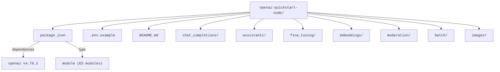

Sources: [package.json:1-14]()

## Troubleshooting

### Common Issues

1. **Authentication Errors**:
   - Verify your API key is correctly set in the environment variables or .env file
   - Check that your API key is active in the OpenAI dashboard

2. **Node.js Version Issues**:
   - Ensure you're running Node.js v16.0.0 or higher
   - Check your version with `node --version`

3. **Module Import Errors**:
   - The project uses ES modules. If you see import errors, make sure you're not mixing CommonJS and ES module syntax
   - Check that package.json has `"type": "module"`

4. **Missing Dependencies**:
   - Run `npm install` again to ensure all dependencies are installed

For more specific information about each API example, see [OpenAI API Examples](#3).

Sources: [package.json:13]()

---

# Page: OpenAI API Examples

# OpenAI API Examples

<details>
<summary>Relevant source files</summary>

The following files were used as context for generating this wiki page:

- [README.md](README.md)

</details>


## Purpose and Scope

This page provides a comprehensive overview of the Node.js code examples included in the OpenAI Quickstart repository. These examples demonstrate how to use various OpenAI APIs, ranging from Chat Completions to Image Generation, using the OpenAI Node.js SDK. For information on setting up the repository and configuring your environment, see [Getting Started](#2).

## Examples Organization

The repository organizes examples by API type, with each folder dedicated to a specific OpenAI API. Each folder contains at least one basic example, with some APIs featuring additional examples for more advanced use cases.

```mermaid
graph TD
    Root["openai-quickstart-node"] --> ChatDir["chat_completions/"]
    Root --> AssistDir["assistants/"]
    Root --> FinetuneDir["fine_tuning/"]
    Root --> EmbedDir["embeddings/"]
    Root --> ModDir["moderation/"]
    Root --> BatchDir["batch/"]
    Root --> ImgDir["images/"]
    
    ChatDir --> ChatBasic["index.js - Basic example"]
    ChatDir --> ChatMulti["multi_turn.js - Conversation"]
    ChatDir --> ChatFunc["function_calling.js - Tool use"]
    ChatDir --> ChatVision["vision.js - Image input"]
    
    AssistDir --> AssistBasic["index.js - Create assistant"]
    AssistDir --> AssistThread["thread.js - Use assistant"]
    
    FinetuneDir --> FinetuneBasic["index.js - Create job"]
    FinetuneDir --> FinetuneUse["use_model.js - Use model"]
    
    EmbedDir --> EmbedBasic["index.js - Generate embeddings"]
    
    ModDir --> ModBasic["index.js - Moderate text"]
    ModDir --> ModImg["images.js - Moderate images & text"]
    
    BatchDir --> BatchBasic["index.js - Create batch job"]
    BatchDir --> BatchResults["retrieve_results.js - Get results"]
    
    ImgDir --> ImgBasic["index.js - Generate image"]
```

**Sources**: [README.md:5-15]()

## API Example Categories

The repository covers all major OpenAI APIs, each with specific examples as shown in the table below:

| API Category | Example | File Path | Description |
|--------------|---------|-----------|-------------|
| **Chat Completions** | Basic | [chat_completions/index.js]() | Simple text completion |
| | Multi-turn | [chat_completions/multi_turn.js]() | Conversation with history |
| | Function Calling | [chat_completions/function_calling.js]() | Tool use integration |
| | Vision | [chat_completions/vision.js]() | Processing image inputs |
| **Assistants** | Create | [assistants/index.js]() | Create an assistant |
| | Thread | [assistants/thread.js]() | Run an assistant thread |
| **Fine-tuning** | Create | [fine_tuning/index.js]() | Create fine-tuning job |
| | Use | [fine_tuning/use_model.js]() | Use fine-tuned model |
| **Embeddings** | Generate | [embeddings/index.js]() | Generate text embeddings |
| **Moderation** | Text | [moderation/index.js]() | Content moderation |
| | Images & Text | [moderation/images.js]() | Multi-modal moderation |
| **Batch** | Create | [batch/index.js]() | Create batch processing job |
| | Results | [batch/retrieve_results.js]() | Retrieve batch results |
| **Images** | Generate | [images/index.js]() | Generate images |

**Sources**: [README.md:85-156]()

## Common Example Structure

Each example in the repository follows a consistent pattern, making it easy to understand how to use the OpenAI APIs.

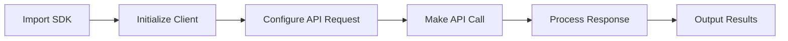

The examples typically include:
1. SDK import and API key configuration
2. Client initialization
3. Request parameters setup
4. API call execution
5. Response handling
6. Result display

**Sources**: [README.md:17-81]()

## Resource Dependencies Between Examples

Some examples create resources that are required by other examples. Understanding these dependencies is crucial for running the examples in the correct order.

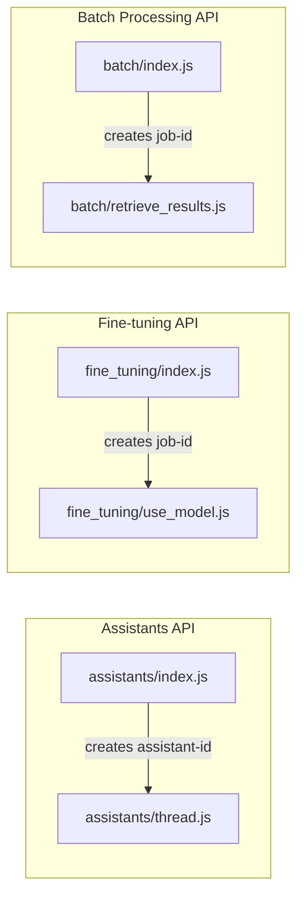

The following examples require IDs from previously run examples:
- `assistants/thread.js`: Requires assistant-id from `assistants/index.js`
- `fine_tuning/use_model.js`: Requires job-id from `fine_tuning/index.js`
- `batch/retrieve_results.js`: Requires job-id from `batch/index.js`

**Sources**: [README.md:116-117](), [README.md:126-127](), [README.md:149-150]()

## API Integration Flow

The diagram below illustrates how the examples connect to the OpenAI API ecosystem, showing the relationship between different API examples and their capabilities.

```mermaid
graph TD
    OpenAISDK["OpenAI Node.js SDK"] --> ChatAPI["Chat Completions API"]
    OpenAISDK --> AssistAPI["Assistants API"]
    OpenAISDK --> FinetuneAPI["Fine-tuning API"]
    OpenAISDK --> EmbedAPI["Embeddings API"]
    OpenAISDK --> ModAPI["Moderation API"]
    OpenAISDK --> BatchAPI["Batch API"]
    OpenAISDK --> ImgAPI["Images API"]
    
    ChatAPI --> ChatFeat1["Text generation"]
    ChatAPI --> ChatFeat2["Multi-turn dialogue"]
    ChatAPI --> ChatFeat3["Function calling"]
    ChatAPI --> ChatFeat4["Vision capabilities"]
    
    AssistAPI --> AssistFeat1["Assistant creation"]
    AssistAPI --> AssistFeat2["Thread management"]
    
    FinetuneAPI --> FinetuneFeat1["Model customization"]
    FinetuneAPI --> FinetuneFeat2["Specialized models"]
    
    EmbedAPI --> EmbedFeat["Semantic vectors"]
    
    ModAPI --> ModFeat1["Text content safety"]
    ModAPI --> ModFeat2["Image content safety"]
    
    BatchAPI --> BatchFeat1["Bulk processing"]
    BatchAPI --> BatchFeat2["Async operations"]
    
    ImgAPI --> ImgFeat["Image generation"]
```

**Sources**: [README.md:5-15]()

## Example Execution Pattern

To run any example from the repository, follow these steps:

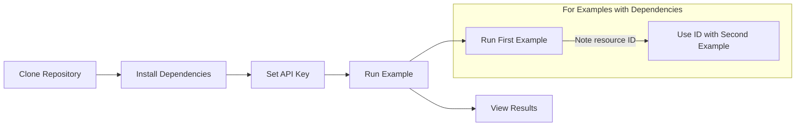

For example, to run the basic Chat Completions example:
```bash
node chat_completions/index.js
```

For examples that depend on other examples:
```bash
# First run the assistant creation example
node assistants/index.js
# Note the assistant-id output
# Then run the thread example with the assistant-id
node assistants/thread.js {assistant-id}
```

**Sources**: [README.md:17-81]()

## Additional Examples and Resources

The repository serves as a starting point for learning to use the OpenAI API. For more complex, application-focused examples, the repository references additional resources:

- Assistants API Quickstart
- Sample apps with Structured Outputs

These resources demonstrate how to integrate OpenAI APIs into full applications, including with streaming responses and specialized output formats.

**Sources**: [README.md:158-164]()

---

# Page: Chat Completions

# Chat Completions

<details>
<summary>Relevant source files</summary>

The following files were used as context for generating this wiki page:

- [README.md](README.md)
- [chat_completions/function_calling.js](chat_completions/function_calling.js)
- [chat_completions/index.js](chat_completions/index.js)
- [chat_completions/multi_turn.js](chat_completions/multi_turn.js)

</details>


This page documents the Chat Completions API examples included in the OpenAI Quickstart Node.js repository. The Chat Completions API allows developers to interact with OpenAI's language models in a conversational format, supporting basic completions, multi-turn conversations, function calling, and vision capabilities.

For information about Assistants API examples, see [Assistants](#3.2).

## Overview

The repository includes four Chat Completions examples that demonstrate different usage patterns:

| Example | File | Description |
|---------|------|-------------|
| Basic | chat_completions/index.js | Simple one-turn completion |
| Multi-turn | chat_completions/multi_turn.js | Interactive conversation with history |
| Function calling | chat_completions/function_calling.js | Enabling models to call functions |
| Vision | chat_completions/vision.js | Processing image inputs |

All examples utilize the OpenAI Node.js SDK v4.79.2 to interact with the Chat Completions API.

Sources: [README.md:7-7](), [README.md:94-109]()

## Basic Chat Completion

The most straightforward way to use the Chat Completions API is demonstrated in the basic example.

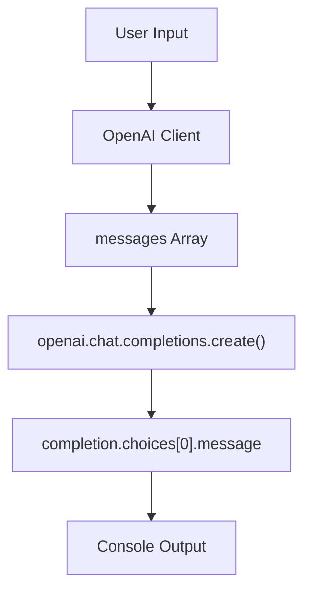

Implementation details:
- Imports the OpenAI SDK and initializes a client
- Creates a messages array with system and user messages
- Makes a request to the Chat Completions API with the `gpt-4o-mini` model
- Logs the model's response to the console

```javascript
// Example usage
const completion = await openai.chat.completions.create({
  model: "gpt-4o-mini",
  messages: [
    { role: "system", content: "You are a helpful assistant." },
    { role: "user", content: "Write a haiku about recursion in programming." },
  ],
});

console.log(completion.choices[0].message);
```

Sources: [chat_completions/index.js:1-15]()

## Multi-turn Conversations

The multi-turn example demonstrates how to maintain conversation history for a back-and-forth interaction with the model.

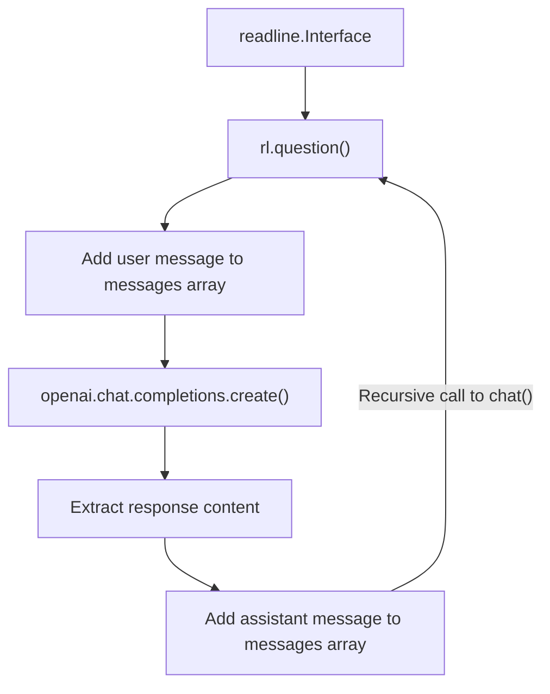

This example creates an interactive CLI that:
1. Collects user input through Node.js `readline` interface
2. Maintains a conversation history in the `messages` array
3. Sends the entire conversation history with each request
4. Adds both user inputs and model responses to the history
5. Uses recursion to create a continuous conversation loop

Key code components:
- An initial system message provides context to the model
- Each user input and model response is stored in the `messages` array
- The entire conversation history is sent with each request

Sources: [chat_completions/multi_turn.js:1-34]()

## Function Calling

The function calling example demonstrates how to define tools (functions) that the model can invoke when appropriate.

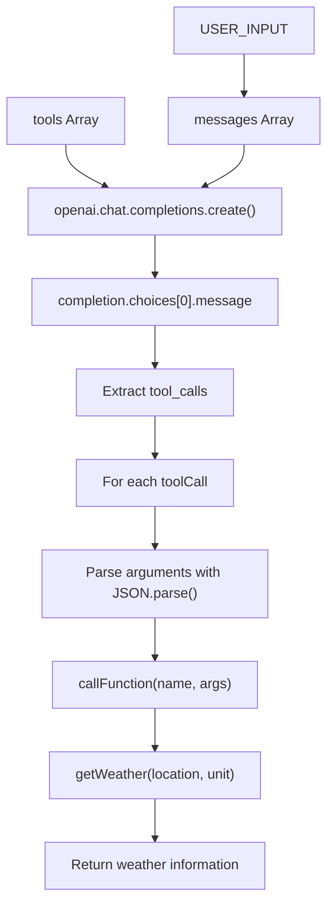

Implementation highlights:
1. Defines a `tools` array that specifies available functions
2. Each tool includes name, description, and JSON Schema for parameters
3. Makes a completion request with tools parameter
4. Processes any tool calls returned in the response
5. Executes the corresponding functions with the provided arguments

The example defines a `get_weather` function that:
- Takes a location and unit as parameters
- Returns weather information for the specified location
- Is triggered when the user asks about weather conditions

Sources: [chat_completions/function_calling.js:1-80]()

## Message Structure

Messages in the Chat Completions API follow a consistent structure:

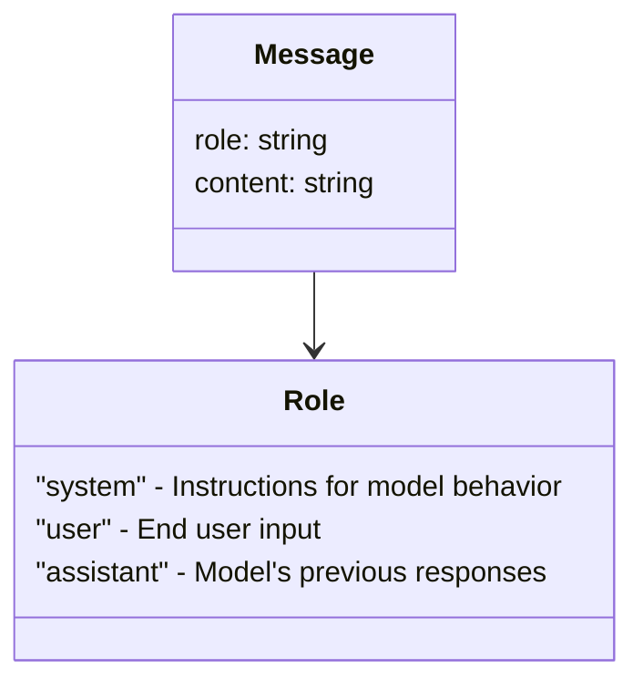

The different roles serve specific purposes:
- `system`: Sets the behavior and context for the assistant
- `user`: Contains the end user's input
- `assistant`: Contains the model's previous responses

Maintaining these roles properly is essential for multi-turn conversations and ensuring appropriate model behavior.

Sources: [chat_completions/index.js:6-12](), [chat_completions/multi_turn.js:12](), [chat_completions/function_calling.js:7-13]()

## API Request Parameters

The Chat Completions API accepts several parameters to control the response:

| Parameter | Type | Description | Examples |
|-----------|------|-------------|----------|
| model | string | Model to use | "gpt-4o", "gpt-4o-mini" |
| messages | array | Conversation history | `[{role: "system", content: "..."}]` |
| tools | array | Functions the model may call | Tool definitions with parameters |
| temperature | number | Randomness of responses | 0.7 (default) |
| max_tokens | number | Maximum tokens in response | 150 |

These parameters can be adjusted based on your application's needs:
- Lower temperature (0.0-0.5) for more consistent, deterministic outputs
- Higher temperature (0.7-1.0) for more creative, varied outputs
- Different models balance between performance and cost

Sources: [chat_completions/index.js:4-13](), [chat_completions/multi_turn.js:19-22](), [chat_completions/function_calling.js:42-46]()

## Implementation Steps

To implement Chat Completions in your own Node.js application:

1. Install the OpenAI SDK:
   ```bash
   npm install openai
   ```

2. Initialize the client with your API key (stored in environment variables):
   ```javascript
   import OpenAI from "openai";
   const openai = new OpenAI();
   ```

3. Create a messages array with at least one message:
   ```javascript
   const messages = [
     { role: "system", content: "You are a helpful assistant." },
     { role: "user", content: "Hello, how can you help me?" }
   ];
   ```

4. Make a request to the Chat Completions API:
   ```javascript
   const completion = await openai.chat.completions.create({
     model: "gpt-4o-mini",
     messages: messages,
   });
   ```

5. Process the response:
   ```javascript
   console.log(completion.choices[0].message.content);
   ```

Sources: [chat_completions/index.js:1-15](), [README.md:39-43](), [README.md:45-69]()

## Usage Flow

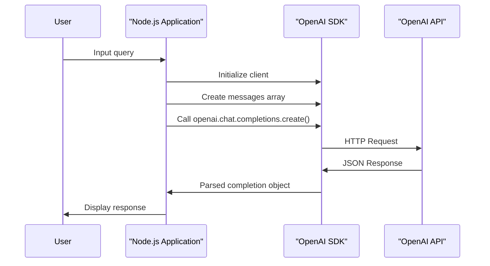

This diagram illustrates the typical flow of a Chat Completions request, from user input to displayed response.

Sources: [chat_completions/index.js:1-15](), [chat_completions/multi_turn.js:1-34](), [chat_completions/function_calling.js:1-80]()

---

# Page: Assistants

# Assistants

<details>
<summary>Relevant source files</summary>

The following files were used as context for generating this wiki page:

- [README.md](README.md)
- [assistants/index.js](assistants/index.js)
- [assistants/thread.js](assistants/thread.js)

</details>


This document explains the Assistants API examples in the OpenAI Node.js Quickstart repository. It covers how to create assistants and interact with them through threads, messages, and runs. For information about other OpenAI APIs, see [OpenAI API Examples](#3).

## Overview

The `assistants` directory contains two example scripts demonstrating the core Assistants API workflow:
- `index.js`: Creates an assistant with specific capabilities
- `thread.js`: Uses an assistant in a conversation by creating a thread

These examples illustrate the fundamental operations of the Assistants API using the OpenAI Node.js SDK.

Sources: [assistants/index.js:1-16](), [assistants/thread.js:1-54]()

## Assistants API Components

### Component Relationship Diagram

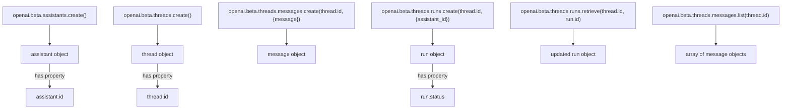

The Assistants API consists of these primary components:
- **Assistant**: A configured AI assistant with specific capabilities and instructions
- **Thread**: A conversation session that maintains context
- **Message**: User or assistant communications within a thread
- **Run**: Process of executing an assistant on a thread
- **Tool**: Capability enabled for an assistant (e.g., code_interpreter)

Sources: [assistants/index.js:1-16](), [assistants/thread.js:1-54]()

## Assistant Creation (index.js)

The first example demonstrates creating an assistant with code interpretation capability.

### Assistant Creation Workflow

```mermaid
sequenceDiagram
    participant Client as "openai client"
    participant AssistantsAPI as "beta.assistants"
    
    Client->>AssistantsAPI: create({name: "Math Tutor", instructions: "...", tools: [{type: "code_interpreter"}], model: "gpt-4o-mini"})
    AssistantsAPI-->>Client: {id: "asst_abc123", object: "assistant", created_at: 1234567890, model: "gpt-4o-mini", ...}
```

### Implementation Details

The assistant creation process involves:

```javascript
const assistant = await openai.beta.assistants.create({
  name: "Math Tutor",
  instructions: "You are a personal math tutor. Write and run code to answer math questions.",
  tools: [{ type: "code_interpreter" }],
  model: "gpt-4o-mini",
});
```

Key parameters:

| Parameter | Description | Example Value |
|-----------|-------------|---------------|
| `name` | Human-readable identifier | "Math Tutor" |
| `instructions` | Behavior guidance | "You are a personal math tutor..." |
| `tools` | Array of tool objects | `[{ type: "code_interpreter" }]` |
| `model` | AI model to use | "gpt-4o-mini" |

Sources: [assistants/index.js:5-12]()

## Thread Interaction (thread.js)

The second example demonstrates using an assistant in a conversation.

### Thread Workflow

```mermaid
flowchart TD
    A["openai.beta.threads.create()"] --> B["thread {id: 'thread_abc123'}"]
    B --> C["openai.beta.threads.messages.create(thread.id, {role: 'user', content: 'What is sqrt(25)?'})"]
    C --> D["openai.beta.threads.runs.create(thread.id, {assistant_id: 'asst_xyz789'})"]
    D --> E["run {id: 'run_123', status: 'queued'}"]
    E --> F["openai.beta.threads.runs.retrieve(thread.id, run.id)"]
    F --> G["run {id: 'run_123', status: 'in_progress'}"]
    G --> H["run {id: 'run_123', status: 'completed'}"]
    H --> I["openai.beta.threads.messages.list(thread.id)"]
    I --> J["[{role: 'user', content: 'What is sqrt(25)?'}, {role: 'assistant', content: 'The square root of 25 is 5.'}]"]
```

### Implementation Details

The thread interaction consists of several steps:

1. **Creating a Thread**
   ```javascript
   const thread = await openai.beta.threads.create();
   ```

2. **Adding a Message**
   ```javascript
   await openai.beta.threads.messages.create(thread.id, {
     role: "user",
     content: "What is the square root of 25?",
   });
   ```

3. **Running the Assistant**
   ```javascript
   let run = await openai.beta.threads.runs.create(thread.id, {
     assistant_id: assistantId,
   });
   ```

4. **Polling the Run Status**
   ```javascript
   while (
     run.status !== "completed" &&
     run.status !== "failed" &&
     Date.now() - startTime < TIMEOUT
   ) {
     run = await openai.beta.threads.runs.retrieve(thread.id, run.id);
     await new Promise((resolve) => setTimeout(resolve, 10000));
   }
   ```

5. **Retrieving Messages**
   ```javascript
   const threadMessages = await openai.beta.threads.messages.list(thread.id);
   ```

Sources: [assistants/thread.js:10-44]()

## Complete Assistants API Workflow

### API Method Call Sequence

```mermaid
sequenceDiagram
    participant Client as "openai client"
    participant Assistants as "beta.assistants"
    participant Threads as "beta.threads"
    participant Messages as "beta.threads.messages"
    participant Runs as "beta.threads.runs"
    
    Client->>+Assistants: create({name: "Math Tutor", ...})
    Assistants-->>-Client: {id: "asst_abc123", object: "assistant", ...}
    
    Client->>+Threads: create()
    Threads-->>-Client: {id: "thread_xyz789", object: "thread"}
    
    Client->>+Messages: create("thread_xyz789", {role: "user", content: "What is sqrt(25)?"})
    Messages-->>-Client: {id: "msg_123", object: "thread.message", ...}
    
    Client->>+Runs: create("thread_xyz789", {assistant_id: "asst_abc123"})
    Runs-->>-Client: {id: "run_456", object: "thread.run", status: "queued"}
    
    loop Until status is "completed"
        Client->>+Runs: retrieve("thread_xyz789", "run_456")
        Runs-->>-Client: {id: "run_456", status: "in_progress|completed"}
    end
    
    Client->>+Messages: list("thread_xyz789")
    Messages-->>-Client: {object: "list", data: [{role: "user",...}, {role: "assistant",...}]}
```

This diagram illustrates the complete workflow from creating an assistant to retrieving responses in a thread.

Sources: [assistants/index.js:1-16](), [assistants/thread.js:1-54]()

## Example Usage

To use these examples:

1. Create an assistant:
   ```bash
   node assistants/index.js
   ```

2. Note the assistant ID output and use it with the thread example:
   ```bash
   node assistants/thread.js <assistant-id>
   ```

This command sequence demonstrates the full workflow of creating and using an assistant.

Sources: [assistants/index.js:15-16](), [assistants/thread.js:7-8]()

## Assistants API Reference Table

| Component | Method | Purpose | Example |
|-----------|--------|---------|---------|
| `openai.beta.assistants` | `create()` | Creates a new assistant | [assistants/index.js:5-12]() |
| `openai.beta.threads` | `create()` | Creates a new conversation thread | [assistants/thread.js:10]() |
| `openai.beta.threads.messages` | `create()` | Adds a message to a thread | [assistants/thread.js:16-19]() |
| `openai.beta.threads.runs` | `create()` | Starts an assistant on a thread | [assistants/thread.js:24-26]() |
| `openai.beta.threads.runs` | `retrieve()` | Checks the status of a run | [assistants/thread.js:38]() |
| `openai.beta.threads.messages` | `list()` | Retrieves messages from a thread | [assistants/thread.js:44]() |

Sources: [assistants/index.js:1-16](), [assistants/thread.js:1-54]()

---

# Page: Fine-tuning

# Fine-tuning

<details>
<summary>Relevant source files</summary>

The following files were used as context for generating this wiki page:

- [README.md](README.md)

</details>


This document explains the Fine-tuning examples provided in the OpenAI Quickstart Node.js repository. These examples demonstrate how to create and use custom fine-tuned models with OpenAI's API.

For information about other API examples in this repository, see [OpenAI API Examples](#3).

## Purpose and Scope

The Fine-tuning API allows you to customize OpenAI's base models (like GPT-3.5 Turbo) with your own training data, resulting in models that better understand your specific domain or task requirements. This document covers two examples in the repository that demonstrate the complete fine-tuning workflow:

1. Creating a fine-tuning job (`fine_tuning/index.js`)
2. Using a fine-tuned model (`fine_tuning/use_model.js`)

These examples show the end-to-end process from submitting training data to generating completions with your custom model.

## Fine-tuning Workflow

The fine-tuning process consists of several distinct steps:

```mermaid
flowchart TD
    A["Prepare Training Data<br>(JSONL format)"] --> B["Upload Training File"]
    B --> C["Create Fine-tuning Job<br>(index.js)"]
    C --> D["Wait for Job Completion"]
    D --> E["Use Fine-tuned Model<br>(use_model.js)"]
    
    C -.->|"creates"| F["job-id"]
    F -.->|"required by"| E
    D -.->|"produces"| G["fine-tuned model"]
    G -.->|"used by"| E
```

Sources: README.md

## Creating a Fine-tuning Job

The `fine_tuning/index.js` example demonstrates how to create a fine-tuning job using the OpenAI API.

### Training Data Format

Fine-tuning requires training data in JSONL (JSON Lines) format, where each line contains a conversation example for the model to learn from:

```json
{"messages": [{"role": "system", "content": "You are a helpful assistant."}, {"role": "user", "content": "Hello!"}, {"role": "assistant", "content": "Hi there! How can I assist you today?"}]}
{"messages": [{"role": "system", "content": "You are a helpful assistant."}, {"role": "user", "content": "What's the weather today?"}, {"role": "assistant", "content": "I don't have access to real-time weather information. You might want to check a weather app or website for the most accurate forecast."}]}
```

### Process Flow

```mermaid
sequenceDiagram
    participant Client as "index.js"
    participant OpenAIAPI as "OpenAI API"
    
    Client->>OpenAIAPI: Initialize OpenAI client
    Client->>OpenAIAPI: Upload training file (JSONL)
    OpenAIAPI-->>Client: Return file ID
    Client->>OpenAIAPI: Create fine-tuning job with file ID
    OpenAIAPI-->>Client: Return job ID
    Client->>Client: Display job ID for later use
```

Sources: README.md

### Expected Implementation

The example likely implements these key steps:

1. Initialize the OpenAI client with your API key
2. Upload a JSONL file containing your training examples
3. Create a fine-tuning job using the uploaded file
4. Retrieve and output the job ID for later use

The job ID is critical as it's required to access your fine-tuned model once training is complete.

## Using a Fine-tuned Model

The `fine_tuning/use_model.js` example demonstrates how to use your custom model after the fine-tuning job has completed.

### Process Flow

```mermaid
sequenceDiagram
    participant Client as "use_model.js"
    participant OpenAIAPI as "OpenAI API"
    
    Client->>Client: Accept job ID as parameter
    Client->>OpenAIAPI: Initialize OpenAI client
    Client->>OpenAIAPI: Retrieve job details
    OpenAIAPI-->>Client: Return job with model ID
    Client->>OpenAIAPI: Generate completion with model ID
    OpenAIAPI-->>Client: Return model output
    Client->>Client: Display results
```

Sources: README.md

### Expected Implementation

This example likely implements these steps:

1. Accept a job ID as a command-line argument
2. Initialize the OpenAI client
3. Retrieve the fine-tuning job details to get the model ID
4. Use the Chat Completions API with the fine-tuned model
5. Display the results

## Running the Examples

To execute these examples in sequence:

```bash
# Step 1: Create a fine-tuning job
node fine_tuning/index.js

# The script will output a job ID

# Step 2: Use the fine-tuned model (replace {job-id} with your actual job ID)
node fine_tuning/use_model.js {job-id}
```

Sources: README.md

## Code Organization

The fine-tuning examples are organized as follows within the repository structure:

```mermaid
graph TD
    Root["openai-quickstart-node/"] --> FinetuneDir["fine_tuning/"]
    FinetuneDir --> FinetuneBasic["index.js<br>(Create job)"]
    FinetuneDir --> FinetuneUse["use_model.js<br>(Use fine-tuned model)"]
    
    FinetuneBasic -.->|"creates"| JobID["job-id"]
    JobID -.->|"required by"| FinetuneUse
```

Sources: README.md

## Key Concepts

| Concept | Description |
|---------|-------------|
| Training Data | JSONL file containing conversation examples for training |
| Fine-tuning Job | Process that customizes a base model with your data |
| Job ID | Unique identifier for your fine-tuning job |
| Fine-tuned Model | Custom model created from your training data |
| Model ID | Identifier used to access your fine-tuned model |

Sources: README.md

## Dependencies

The fine-tuning examples rely on the following dependencies:

| Dependency | Purpose |
|------------|---------|
| OpenAI Node.js SDK (v4.79.2) | Interact with OpenAI APIs |
| OPENAI_API_KEY | Environment variable for API authentication |

Sources: README.md

---

# Page: Embeddings

# Embeddings

<details>
<summary>Relevant source files</summary>

The following files were used as context for generating this wiki page:

- [README.md](README.md)

</details>


## Purpose and Scope

This document covers the Embeddings API example included in the OpenAI Quickstart Node.js repository. The example demonstrates how to generate vector representations (embeddings) from text using the OpenAI API. Embeddings are numerical representations that capture semantic meaning, enabling applications like semantic search, content clustering, and text similarity analysis. For information about other OpenAI APIs demonstrated in this repository, see [Chat Completions](#3.1), [Assistants](#3.2), [Fine-tuning](#3.3), [Moderation](#3.5), [Batch Processing](#3.6), or [Images API](#3.7).

Sources: [README.md:9-10](), [README.md:129-132]()

## Repository Implementation

The repository includes a basic example of generating embeddings in the file `embeddings/index.js`. As noted in the repository's README, this example demonstrates how to generate embeddings using the OpenAI API with Node.js.

### Embeddings Generation Workflow

The following diagram illustrates the general workflow for generating embeddings using the OpenAI API through the example file:

```mermaid
flowchart LR
    A["Text Input"] --> B["OpenAIClient"]
    B --> C["client.embeddings.create()"]
    C --> D["OpenAI API"]
    D --> E["Response with Embedding Vectors"]
    E --> F["Application Use"]
    
    subgraph "embeddings/index.js"
        A
        B
        C
        E
    end
```

Sources: [README.md:129-132]()

## Using the Embeddings Example

To run the embeddings example in the repository:

1. Ensure you have completed the repository setup as described in the README:
   - Clone the repository: `git clone https://github.com/openai/openai-quickstart-node.git`
   - Navigate to the project directory: `cd openai-quickstart-node`
   - Install dependencies: `npm install openai`
   - Set your OpenAI API key as an environment variable (e.g., `export OPENAI_API_KEY=<your-api-key>` for Linux/Mac)

2. Run the example:
   ```bash
   node embeddings/index.js
   ```

The script will generate embeddings for the provided text input and display the resulting vector representation.

Sources: [README.md:17-75](), [README.md:129-132]()

## Technical Implementation Details

The embeddings example integrates with the OpenAI API using the Node.js SDK. The following diagram shows the technical components and their relationships:

```mermaid
graph TD
    A["Node.js Application"] --> B["OpenAI SDK"]
    B --> C["OpenAIClient"]
    C --> D["client.embeddings.create()"]
    D --> E["Parameters"]
    E --> F["model: 'text-embedding-ada-002'"]
    E --> G["input: text string/array"]
    D --> H["OpenAI API"]
    H --> I["Response Object"]
    I --> J["data[].embedding"]
    J --> K["Vector Array"]
    
    subgraph "embeddings/index.js Implementation"
        A
        C
        D
        E
        J
        K
    end
```

Sources: [README.md:129-132]()

## Response Structure

The OpenAI Embeddings API typically returns a response with the following structure:

| Field | Description |
|-------|-------------|
| `data` | Array of embedding objects |
| `data[].embedding` | Array of floating-point numbers representing the embedding vector |
| `data[].index` | The index of the embedding in the request |
| `data[].object` | Type identifier (typically "embedding") |
| `model` | The model used to generate the embedding |
| `usage` | Object containing token usage information |

Sources: [README.md:129-132]()

## Applications of Embeddings

Embeddings generated using this example can be utilized in various natural language processing applications:

```mermaid
graph TD
    A["embeddings/index.js"] --> B["Generate Embeddings"]
    B --> C["Vector Database Storage"]
    B --> D["Direct Application"]
    
    C --> E["Semantic Search System"]
    C --> F["Recommendation Engine"]
    C --> G["Knowledge Base"]
    
    D --> H["Text Classification"]
    D --> I["Clustering Analysis"]
    D --> J["Similarity Comparison"]
    
    subgraph "OpenAI Quickstart Example"
        A
        B
    end
    
    subgraph "Production Integration"
        C
        E
        F
        G
    end
    
    subgraph "Analysis Tasks"
        D
        H
        I
        J
    end
```

Sources: [README.md:129-132]()

## Common Use Cases

| Use Case | Description | Implementation Approach |
|----------|-------------|-------------------------|
| Semantic Search | Find documents with similar meaning to a query | Compare query embedding to corpus embeddings |
| Content Clustering | Group similar documents based on meaning | Apply clustering algorithms to embedding vectors |
| Recommendations | Suggest related content | Find items with high vector similarity |
| Classification | Categorize text | Compare to embeddings of known categories |
| Information Retrieval | Enhance search beyond keywords | Index and query by semantic meaning |
| Anomaly Detection | Identify unusual content | Find outliers in the embedding space |

Sources: [README.md:129-132]()

## Integration with Other Repository Examples

Embeddings can complement other examples in the repository:

- Can enhance [Chat Completions](#3.1) by providing relevant context
- Can improve [Assistants](#3.2) with semantic retrieval capabilities
- Can analyze training data for [Fine-tuning](#3.3)
- Can support content organization alongside [Moderation](#3.5)

Sources: [README.md:5-13]()

## Additional Resources

For more detailed information about working with embeddings:
- The official OpenAI documentation on embeddings
- Vector database integrations (e.g., Pinecone, Weaviate, FAISS)
- Examples of RAG (Retrieval-Augmented Generation) applications

Sources: [README.md:158-163]()

---

# Page: Moderation

# Moderation

<details>
<summary>Relevant source files</summary>

The following files were used as context for generating this wiki page:

- [README.md](README.md)

</details>


## Purpose and Scope

This document explains the Moderation API examples included in the OpenAI Node.js Quickstart repository. These examples demonstrate how to use the OpenAI Node.js SDK to detect content that may violate OpenAI's usage policies, such as harmful, deceptive, or sensitive content. The repository provides two examples for content moderation:

1. Text moderation (`moderation/index.js`)
2. Images & text moderation (`moderation/images.js`)

For information about other API examples in this repository, see the [OpenAI API Examples](#3) overview.

## Moderation System Architecture

The following diagram illustrates how the Moderation examples interact with the OpenAI API:

```mermaid
flowchart TD
    A["Node.js Application"] --> B["OpenAI SDK Client"]
    B --> C["moderations.create() Method"]
    C --> D["OpenAI Moderation API"]
    D --> E["Content Analysis Models"]
    E --> F["Moderation Response"]
    F --> G["Application Logic"]
    G -- "Content Allowed" --> H["Process Content"]
    G -- "Content Flagged" --> I["Handle Violation"]
```

Sources: README.md

The Moderation API processes content and returns detailed information about potential policy violations, including:
- An overall flag indicating whether content violates policies
- Specific categories of violations detected
- Confidence scores for each category

## Text Moderation Example

The basic text moderation example demonstrates how to analyze text content for policy violations.

```mermaid
sequenceDiagram
    participant App as "Node.js Application"
    participant Client as "OpenAI Client"
    participant API as "Moderation API"
    
    App->>Client: Initialize with OPENAI_API_KEY
    App->>App: Prepare text input
    App->>Client: moderations.create({ input: text })
    Client->>API: Send HTTP request
    API->>API: Analyze content
    API-->>Client: Return moderation results
    Client-->>App: Process results
    App->>App: Handle flagged content
```

Sources: README.md lines 135-136

## Images & Text Moderation Example

The more advanced example demonstrates how to moderate both images and text content.

```mermaid
sequenceDiagram
    participant App as "Node.js Application"
    participant Client as "OpenAI Client"
    participant API as "Moderation API"
    
    App->>Client: Initialize with OPENAI_API_KEY
    App->>App: Prepare image data
    App->>App: Prepare text data
    App->>Client: moderations.create() for image
    Client->>API: Send image for analysis
    API-->>Client: Return image moderation results
    App->>Client: moderations.create() for text
    Client->>API: Send text for analysis
    API-->>Client: Return text moderation results
    Client-->>App: Process combined results
```

Sources: README.md lines 139-140

## Implementation Components

```mermaid
flowchart LR
    A["Import OpenAI SDK"] --> B["Initialize Client"]
    B --> C["Prepare Content"]
    C --> D["Call moderations.create()"]
    D --> E["Process Response"]
    E --> F["Handle Flagged Content"]
```

Sources: README.md

## Moderation Categories

The Moderation API checks for several categories of potentially harmful content:

| Category | Description |
|----------|-------------|
| `hate` | Content expressing hatred based on identity |
| `hate/threatening` | Hateful content that also includes violence or serious harm |
| `harassment` | Content that harasses, intimidates, or bullies individuals |
| `self-harm` | Content promoting, encouraging, or depicting self-harm |
| `sexual` | Content meant to arouse sexual excitement |
| `sexual/minors` | Sexual content involving minors |
| `violence` | Content that promotes or glorifies violence |
| `violence/graphic` | Graphic violence or gore |

## Typical Response Structure

The Moderation API returns a structured response that typically looks like this:

```json
{
  "id": "modr-XXXX",
  "model": "text-moderation-latest",
  "results": [
    {
      "flagged": true,
      "categories": {
        "hate": false,
        "hate/threatening": false,
        "harassment": false,
        "self-harm": false,
        "sexual": true,
        "sexual/minors": false,
        "violence": false,
        "violence/graphic": false
      },
      "category_scores": {
        "hate": 0.0001,
        "hate/threatening": 0.0001,
        "harassment": 0.0002,
        "self-harm": 0.0001,
        "sexual": 0.9958,
        "sexual/minors": 0.0003,
        "violence": 0.0002,
        "violence/graphic": 0.0001
      }
    }
  ]
}
```

## Implementation Best Practices

When implementing content moderation using these examples:

1. Always store your API key securely in environment variables
2. Set appropriate confidence thresholds based on your application's requirements
3. Implement proper error handling for API failures or rate limiting
4. Consider combining automatic moderation with human review for edge cases
5. Cache moderation results for frequently analyzed content to reduce API calls
6. Implement fallback mechanisms in case the API is unavailable

## Usage Considerations

- The Moderation API is designed to help identify potentially problematic content but should not be the sole decision-maker
- False positives and false negatives can occur
- Different geographic regions and cultural contexts may have varying standards for acceptable content
- Consider implementing user feedback mechanisms to improve moderation accuracy over time

Sources: README.md

---

# Page: Batch Processing

# Batch Processing

<details>
<summary>Relevant source files</summary>

The following files were used as context for generating this wiki page:

- [README.md](README.md)
- [batch/index.js](batch/index.js)
- [batch/requests.jsonl](batch/requests.jsonl)
- [batch/retrieve_results.js](batch/retrieve_results.js)

</details>


## Purpose and Scope

This document explains the Batch Processing examples in the OpenAI Quickstart Node.js repository. The Batch Processing API allows you to process multiple requests in a single job, which is particularly useful for high-volume tasks that don't require immediate responses. The examples demonstrate how to create batch jobs and retrieve their results.

Sources: [README.md:143-150](), [batch/index.js:1-24]()

## Overview

The batch processing examples demonstrate two primary operations:

1. Creating a batch job with multiple requests
2. Retrieving the results from a completed batch job

The repository includes two JavaScript files that handle these operations separately, along with a sample request file.

```mermaid
flowchart TD
    A["requests.jsonl"] -->|Uploaded as| B["Batch Input File"]
    B -->|Used by| C["index.js"]
    C -->|Creates| D["Batch Job"]
    D -->|Job ID| E["retrieve_results.js"]
    E -->|Polls| F["Job Status"]
    F -->|When completed| G["Results"]
```

Sources: [batch/index.js:1-24](), [batch/retrieve_results.js:1-38](), [batch/requests.jsonl:1-5]()

## Files and Components

The Batch Processing examples consist of three main files:

| File | Purpose |
|------|---------|
| `batch/index.js` | Creates a batch job by uploading requests and initiating the batch |
| `batch/retrieve_results.js` | Retrieves and displays results from a completed batch job |
| `batch/requests.jsonl` | Contains the individual requests to be processed in JSONL format |

Sources: [README.md:143-150]()

## Creating a Batch Job

The `index.js` file demonstrates how to create a batch processing job:

1. Upload a JSONL file containing the requests
2. Create a batch job using the uploaded file
3. Output the batch job ID for later retrieval

```mermaid
sequenceDiagram
    participant "index.js" as JS
    participant "OpenAI API" as API
    participant "requests.jsonl" as JSONL
    
    JS ->> JSONL: Read file
    JS ->> API: Upload file (purpose: "batch")
    API -->> JS: Return file ID
    JS ->> API: Create batch with file ID
    API -->> JS: Return batch job ID
    JS ->> JS: Display job ID for next step
```

Sources: [batch/index.js:1-24]()

### Key Code Components

The batch job creation process involves:

1. **File Upload**: The JSONL file is uploaded with the purpose set to "batch"
2. **Batch Creation**: A batch job is created with the uploaded file ID
3. **Endpoint Specification**: The API endpoint to use for processing requests
4. **Completion Window**: The time window for job completion (24 hours in the example)

Sources: [batch/index.js:5-17]()

## Request Format

The batch requests are stored in JSONL format (JSON Lines), with each line representing a single request.

```mermaid
classDiagram
    class BatchRequest {
        String custom_id
        String method
        String url
        Object body
    }
    
    class RequestBody {
        String model
        Array messages
    }
    
    class Message {
        String role
        String content
    }
    
    BatchRequest --> RequestBody : contains
    RequestBody --> Message : contains array of
```

Each request in the JSONL file contains:

- `custom_id`: A unique identifier for the individual request
- `method`: The HTTP method (POST)
- `url`: The API endpoint (/v1/chat/completions)
- `body`: The actual request payload with model and messages

Sources: [batch/requests.jsonl:1-5]()

## Retrieving Batch Results

The `retrieve_results.js` file demonstrates how to check a batch job's status and retrieve results when it's complete:

1. Retrieve the batch job using its ID
2. Poll the job status until it's completed or fails
3. Retrieve and display the results if completed

```mermaid
flowchart TD
    A["Start"] --> B["Get Batch Job ID"]
    B --> C["Retrieve Batch Status"]
    C --> D{"Check Status"}
    D -->|"Completed"| E["Get Batch Results"]
    D -->|"In Progress"| F["Wait 30 seconds"]
    F --> C
    D -->|"Failed"| G["Log Failure"]
    E --> H["Display Results"]
    G --> I["End"]
    H --> I
```

Sources: [batch/retrieve_results.js:1-38]()

### Key Code Components

The result retrieval process includes:

1. **Batch ID Input**: Accept the batch job ID as a command-line argument or use a hardcoded value
2. **Status Polling**: Check the job status periodically with a timeout
3. **Result Retrieval**: When the job completes, retrieve the output file
4. **Result Display**: Parse and display the results

Sources: [batch/retrieve_results.js:7-37]()

## Complete Workflow

The complete workflow for using batch processing with the OpenAI API involves:

```mermaid
sequenceDiagram
    participant User
    participant "index.js" as Create
    participant "OpenAI API" as API
    participant "retrieve_results.js" as Retrieve
    
    User ->> Create: Run index.js
    Create ->> API: Upload requests.jsonl
    Create ->> API: Create batch job
    API -->> Create: Return batch job ID
    Create -->> User: Display batch job ID
    
    Note over User, API: Wait for processing (up to 24h)
    
    User ->> Retrieve: Run retrieve_results.js with job ID
    Retrieve ->> API: Poll batch status
    loop Until completed or failed
        Retrieve ->> API: Check status
        API -->> Retrieve: Return status
        Retrieve ->> Retrieve: Wait 30 seconds
    end
    Retrieve ->> API: Get results file
    API -->> Retrieve: Return results
    Retrieve -->> User: Display results
```

Sources: [batch/index.js:1-24](), [batch/retrieve_results.js:1-38]()

## Usage Instructions

To use the batch processing examples:

1. Run the batch job creation script:
   ```bash
   node batch/index.js
   ```

2. Note the batch job ID from the output

3. Run the result retrieval script with the job ID:
   ```bash
   node batch/retrieve_results.js <job-id>
   ```

4. Wait for the job to complete (can take up to 24 hours)

Sources: [README.md:143-150](), [batch/index.js:22-23]()

## Use Cases

Batch processing is ideal for:

- Processing large volumes of similar requests
- Tasks that don't require immediate responses
- Bulk data operations
- Offline/asynchronous processing
- Cost-effective handling of high-volume requests

Sources: [batch/index.js:1-24](), [batch/requests.jsonl:1-5]()

## Related Resources

For other API examples in this repository, see:
- [Chat Completions](#3.1)
- [Assistants](#3.2)
- [Fine-tuning](#3.3)
- [Embeddings](#3.4)
- [Moderation](#3.5)
- [Images API](#3.7)

Sources: [README.md:4-14]()

---

# Page: Images API

# Images API

<details>
<summary>Relevant source files</summary>

The following files were used as context for generating this wiki page:

- [README.md](README.md)

</details>


This document explains the Images API example in the OpenAI Quickstart Node.js repository. The example demonstrates how to generate AI images from text prompts using OpenAI's DALL-E models through the Node.js SDK.

For information about other API examples in this repository, see [OpenAI API Examples](#3). If you're interested in image moderation instead of generation, see [Moderation](#3.5).

## Purpose and Scope

The Images API example provides a straightforward implementation of text-to-image generation using OpenAI's API. It shows how to:

1. Set up the OpenAI client with proper authentication
2. Create a text prompt that describes the desired image
3. Configure generation parameters like model, size, and quality
4. Make an API request to generate an image
5. Process the response containing the image URL

The implementation is contained in a single file that demonstrates basic image generation capabilities.

Sources: [README.md:152-155]()

## Repository Structure

The Images API example is implemented in the `images` directory of the repository:

```mermaid
graph TD
    Root["openai-quickstart-node/"] --> ImgDir["images/"]
    ImgDir --> ImgIndex["index.js (Generate image)"]
    
    Root --> PackageJSON["package.json<br>(OpenAI SDK dependency)"]
    Root --> EnvExample[".env.example<br>(API key configuration)"]
    Root --> OtherAPIs["Other API Examples..."]
```

Sources: [README.md:12-13](), [README.md:152-155]()

## Image Generation Flow

The Images API translates text descriptions into visual content through the following process:

```mermaid
flowchart LR
    A["Text Prompt"] --> |"openai.images.generate()"| B["OpenAI API"]
    B --> |"DALL-E model processing"| C["Image Generation"]
    C --> |"Response with data[].url"| D["Image URL"]
    D --> |"Display/Download"| E["Final Image"]
```

Sources: [README.md:152-155]()

## Implementation Components

The implementation involves several key components working together to generate images:

```mermaid
flowchart TD
    A["OpenAIClient"] --> |"initialize"| B["ConfiguredClient"]
    B --> |"configure request"| C["ImageRequest"]
    C --> |"execute"| D["openai.images.generate()"]
    D --> |"process"| E["ImageResponse"]
    
    subgraph "Request Parameters"
        F["prompt"] 
        G["model (dall-e-3/dall-e-2)"]
        H["size (1024x1024, etc.)"]
        I["quality, style options"]
    end
    
    F & G & H & I --> C
```

Sources: [README.md:152-155]()

## Key Parameters

When generating images, several parameters control the output characteristics:

| Parameter | Description | Possible Values |
|-----------|-------------|----------------|
| `prompt` | Text description of the desired image | Text string (max 1000 characters) |
| `model` | DALL-E model version to use | "dall-e-3", "dall-e-2" |
| `n` | Number of images to generate | 1-10 (model dependent) |
| `size` | Image dimensions | "1024x1024", "512x512", "256x256" |
| `quality` | Image quality level | "standard", "hd" |
| `style` | Visual style preference | "vivid", "natural" |
| `response_format` | Format of returned image data | "url", "b64_json" |

## Running the Example

To execute the Images API example:

1. Make sure you've completed the setup in [Getting Started](#2)
2. Set your OpenAI API key as an environment variable
3. Run the example with:
   ```bash
   node images/index.js
   ```

Sources: [README.md:71-75](), [README.md:152-155]()

## Response Structure

The Images API response contains several key components:

| Field | Description |
|-------|-------------|
| `created` | Timestamp when the image was generated |
| `data` | Array of generated image objects |
| `data[].url` | URL to access the generated image (when response_format is "url") |
| `data[].b64_json` | Base64-encoded image data (when response_format is "b64_json") |
| `data[].revised_prompt` | For DALL-E 3, the refined prompt used to generate the image |

## Error Handling

Common errors when working with the Images API include:

| Error Type | Common Causes | Recommended Handling |
|------------|---------------|---------------------|
| Authentication Error | Invalid API key | Verify the `OPENAI_API_KEY` environment variable |
| Validation Error | Invalid parameters | Check prompt length, image dimensions, etc. |
| Content Policy | Prohibited content | Revise prompt to comply with content policies |
| Rate Limiting | Too many requests | Implement backoff strategy and request throttling |
| Server Error | OpenAI service issues | Add retry logic with exponential backoff |

## Practical Applications

The Images API enables various practical applications:

- Content illustration generation
- Product visualization for e-commerce
- Creative asset development for marketing
- Visual design prototyping
- Educational content creation
- Custom art generation

## Integration with Other APIs

The Images API can be used alongside other OpenAI APIs in the repository:

```mermaid
graph TD
    A["User Input"] --> B["Chat Completions API"]
    B --> |"Generate image prompt"| C["Optimized Image Prompt"]
    C --> D["Images API"]
    D --> |"Generate image"| E["Generated Image"]
    E --> F["Moderation API"]
    F --> |"Content safety check"| G["Verified Image"]
```

Sources: [README.md:5-13]()

This diagram shows how multiple APIs can work together in a pipeline, with Chat Completions generating optimized image prompts, the Images API creating the images, and the Moderation API verifying content safety.

---

# Page: Project Structure

# Project Structure

<details>
<summary>Relevant source files</summary>

The following files were used as context for generating this wiki page:

- [.gitignore](.gitignore)
- [README.md](README.md)
- [package-lock.json](package-lock.json)
- [package.json](package.json)

</details>


This document provides an in-depth explanation of the OpenAI Quickstart Node.js repository structure, including its organization, configuration, and the relationships between different examples. For information about getting started with the repository, see [Getting Started](#2).

## Repository Overview

The OpenAI Quickstart Node.js repository is organized as a collection of example scripts demonstrating various OpenAI APIs using the Node.js SDK. The repository structure is designed to be modular, with examples grouped by API type.

```mermaid
graph TD
    subgraph "Repository Root"
        Root["openai-quickstart-node"]
        ConfigFiles["Configuration Files<br>.env.example, package.json"]
        Documentation["Documentation<br>README.md"]
        
        Root --- ConfigFiles
        Root --- Documentation
        Root --- APIExamples
    end
    
    subgraph "APIExamples"
        Chat["chat_completions/"]
        Assistants["assistants/"]
        FineTuning["fine_tuning/"]
        Embeddings["embeddings/"]
        Moderation["moderation/"]
        Batch["batch/"]
        Images["images/"]
    end
    
    Chat --- ChatExamples
    
    subgraph "ChatExamples"
        ChatBasic["index.js<br>(Basic usage)"]
        ChatMulti["multi_turn.js<br>(Conversation)"]
        ChatFunction["function_calling.js<br>(Tool use)"]
        ChatVision["vision.js<br>(Image input)"]
    end
    
    Assistants --- AssistExamples
    
    subgraph "AssistExamples"
        AssistBasic["index.js<br>(Create assistant)"]
        AssistThread["thread.js<br>(Use assistant)"]
    end
```

Sources: [README.md:1-16]()

## Directory Structure

The repository is organized into directories by API type, with each directory containing at least a basic example and potentially more specialized examples:

| Directory | Purpose | Examples |
|-----------|---------|----------|
| `chat_completions/` | Chat Completions API examples | `index.js` (basic), `multi_turn.js`, `function_calling.js`, `vision.js` |
| `assistants/` | Assistants API examples | `index.js` (create assistant), `thread.js` (use assistant) |
| `fine_tuning/` | Fine-tuning API examples | `index.js` (create job), `use_model.js` (use fine-tuned model) |
| `embeddings/` | Embeddings API examples | `index.js` (generate embeddings) |
| `moderation/` | Moderation API examples | `index.js` (moderate text), `images.js` (moderate images & text) |
| `batch/` | Batch Processing API examples | `index.js` (create batch job), `retrieve_results.js` (get results) |
| `images/` | Images API examples | `index.js` (generate image) |

Sources: [README.md:5-15](), [README.md:85-156]()

## Configuration Files

The repository contains several configuration files that define its environment and dependencies:

```mermaid
graph LR
    subgraph "Configuration Files"
        Package["package.json"]
        EnvExample[".env.example"]
        GitIgnore[".gitignore"]
        PackageLock["package-lock.json"]
    end
    
    Package --"Defines dependencies"--> OpenAISDK["openai v4.79.2"]
    Package --"Sets module type"--> ESModules["ES Modules (type: module)"]
    EnvExample --"Template for"--> EnvFile[".env (user created)"]
    EnvFile --"Provides"--> APIKEY["OPENAI_API_KEY"]
    GitIgnore --"Excludes"--> IgnoredFiles["node_modules/, .env, etc."]
```

### package.json

The `package.json` file defines the project metadata and dependencies:

- **Name**: `openai-quickstart-node`
- **Version**: `1.0.0`
- **Main Dependency**: OpenAI SDK v4.79.2
- **Module Type**: ES Modules (`"type": "module"`)

Sources: [package.json:1-14]()

### Environment Configuration

The project requires configuration of environment variables:

1. The OpenAI API key must be set in an `.env` file (which users create based on `.env.example`)
2. This file is git-ignored for security reasons

Sources: [README.md:45-69](), [.gitignore:27-32]()

## Execution Flow and Dependencies

Some examples depend on the outputs from other examples. These dependencies are structured so that one example creates a resource (like an assistant or a fine-tuning job) and another example uses that resource.

```mermaid
flowchart LR
    subgraph "Assistants API"
        A1["assistants/index.js"] -->|"creates"| A2["assistant-id"]
        A2 -->|"required by"| A3["assistants/thread.js"]
    end
    
    subgraph "Fine-tuning API"
        F1["fine_tuning/index.js"] -->|"creates"| F2["job-id"]
        F2 -->|"required by"| F3["fine_tuning/use_model.js"]
    end
    
    subgraph "Batch Processing API"
        B1["batch/index.js"] -->|"creates"| B2["job-id"]
        B2 -->|"required by"| B3["batch/retrieve_results.js"]
    end
```

### Example Dependency Patterns

The repository follows a consistent pattern for examples with dependencies:

1. A basic example creates a resource and outputs an ID
2. A follow-up example takes that ID as a parameter to demonstrate usage

For example:
- Run `assistants/index.js` to create an assistant and get an assistant ID
- Use that ID when running `assistants/thread.js {assistant-id}` to create a thread with that assistant

Sources: [README.md:93-150]()

## Code Organization Patterns

All examples follow a consistent structure:

```mermaid
flowchart TD
    Import["1. Import OpenAI SDK"] --> 
    Initialize["2. Initialize OpenAI client"] -->
    MakeRequest["3. Make API Request"] -->
    ProcessResponse["4. Process & Display Response"]
```

### Common Code Pattern

Most examples follow this basic pattern:

1. Import the OpenAI SDK
2. Initialize the OpenAI client with the API key
3. Define the request parameters
4. Make the API request
5. Process and display the response

This consistency makes it easy to understand and compare different API usages.

Sources: [README.md:71-81]()

## Example Types and Complexity

The examples range from basic to more complex:

| Complexity | Examples | Features |
|------------|----------|----------|
| Basic | Most `index.js` files | Simple API calls with minimal parameters |
| Intermediate | `multi_turn.js`, `thread.js` | Multi-step processes, conversation context |
| Advanced | `function_calling.js`, `vision.js` | Complex parameters, specialized capabilities |

Sources: [README.md:85-156]()

## Project Dependencies

The project has minimal external dependencies, focusing primarily on the OpenAI SDK:

```mermaid
graph TD
    Project["openai-quickstart-node"] -->|"depends on"| OpenAISDK["openai v4.79.2"]
    OpenAISDK -->|"depends on"| CoreDeps["Core Dependencies"]
    
    subgraph "CoreDeps"
        NodeTypes["@types/node"]
        NodeFetchTypes["@types/node-fetch"]
        AbortController["abort-controller"]
        AgentKeepalive["agentkeepalive"]
        FormDataEncoder["form-data-encoder"]
        FormdataNode["formdata-node"]
        NodeFetch["node-fetch"]
    end
```

Sources: [package.json:10-12](), [package-lock.json:202-231]()

## Node.js Version Requirements

The repository has specific Node.js version requirements to ensure compatibility:

- Node.js >= 16.0.0
- npm (or another node package manager)

These requirements are driven by both the repository's code and the OpenAI SDK's requirements.

Sources: [README.md:21-23](), [package-lock.json:202-231]()

---

# Page: Contributing

# Contributing

<details>
<summary>Relevant source files</summary>

The following files were used as context for generating this wiki page:

- [.github/ISSUE_TEMPLATE/bug_report.yml](.github/ISSUE_TEMPLATE/bug_report.yml)
- [.github/ISSUE_TEMPLATE/config.yml](.github/ISSUE_TEMPLATE/config.yml)
- [.github/ISSUE_TEMPLATE/feature_request.yml](.github/ISSUE_TEMPLATE/feature_request.yml)
- [LICENSE](LICENSE)

</details>


This document provides guidelines for contributing to the OpenAI Node.js Quickstart repository. It outlines the process for reporting bugs, requesting features, and understanding project licensing. For information about using the examples in the repository, see [Getting Started](#2) and [OpenAI API Examples](#3).

## Contribution Process Overview

The diagram below illustrates the general process for contributing to this repository:

```mermaid
flowchart TD
    A["Identify Issue or Enhancement"] --> B{"Issue Type?"}
    B -->|"Bug"| C["Create Bug Report"]
    B -->|"Feature Request"| D["Create Feature Request"]
    B -->|"Question/Support"| E["Contact OpenAI Support"]
    
    C --> F["GitHub Issue Created"]
    D --> F
    E --> G["OpenAI Help Center"]
    
    F --> H["Issue Reviewed by Maintainers"]
    H --> I["Issue Resolution"]
```

Sources: [.github/ISSUE_TEMPLATE/bug_report.yml](), [.github/ISSUE_TEMPLATE/feature_request.yml](), [.github/ISSUE_TEMPLATE/config.yml]()

## Issue Templates and Structure

The repository uses standardized GitHub issue templates to ensure contributors provide all necessary information when reporting issues or requesting features:

```mermaid
flowchart TD
    A[".github/ISSUE_TEMPLATE/"] --> B["bug_report.yml"]
    A --> C["feature_request.yml"]
    A --> D["config.yml"]
    
    B --> E["Bug description field"]
    B --> F["Reproduction steps field"]
    B --> G["Environment info fields"]
    
    C --> H["Feature description field"]
    C --> I["Context information field"]
    
    D --> J["Support routing configuration"]
```

Sources: [.github/ISSUE_TEMPLATE/bug_report.yml](), [.github/ISSUE_TEMPLATE/feature_request.yml](), [.github/ISSUE_TEMPLATE/config.yml]()

## Reporting Bugs

When encountering bugs in the OpenAI Node.js Quickstart repository, please use the bug report template which captures essential information for troubleshooting:

| Field | Description | Required |
|-------|-------------|----------|
| Describe the bug | Clear description of what the bug is | Yes |
| To Reproduce | Step-by-step reproduction instructions | Yes |
| OS | Your operating system | No |
| Node version | Your Node.js version | No |

The template ensures maintainers have enough context to understand and address the issue efficiently.

Sources: [.github/ISSUE_TEMPLATE/bug_report.yml]()

## Requesting Features

For suggesting improvements or new features, use the feature request template:

| Field | Description | Required |
|-------|-------------|----------|
| Feature description | Clear explanation of the requested feature | Yes |
| Additional context | Any relevant context about the feature request | No |

Feature requests should be specific to the Node.js Quickstart repository functionality.

Sources: [.github/ISSUE_TEMPLATE/feature_request.yml]()

## Support Questions Routing

```mermaid
flowchart TD
    A["Question or Issue"] --> B{"Specific to Node.js Quickstart?"}
    B -->|"Yes"| C["Create GitHub Issue"]
    B -->|"No"| D["Contact OpenAI Support"]
    C --> E["GitHub Repository Issue Tracker"]
    D --> F["OpenAI Help Center (help.openai.com)"]
```

The repository is configured to direct general OpenAI API questions to the official support channels. GitHub issues should only be used for matters specific to this Node.js Quickstart repository.

Sources: [.github/ISSUE_TEMPLATE/config.yml]()

## License Information

The OpenAI Node.js Quickstart repository is released under the MIT License:

```mermaid
graph TD
    A["MIT License"] --> B["Permissions"]
    B --> C["Commercial use"]
    B --> D["Modification"]
    B --> E["Distribution"]
    B --> F["Private use"]
    
    A --> G["Conditions"]
    G --> H["License and copyright notice must be included"]
    
    A --> I["Limitations"]
    I --> J["No liability"]
    I --> K["No warranty"]
```

When contributing to this repository, you agree that your contributions will be licensed under the same MIT License terms.

Sources: [LICENSE]()

## Contribution Guidelines Summary

```mermaid
flowchart LR
    A["Identify Contribution Type"] --> B["Bug Report"]
    A --> C["Feature Request"]
    A --> D["Support Question"]
    
    B --> E["Use bug_report.yml template"]
    C --> F["Use feature_request.yml template"]
    D --> G["Refer to OpenAI Help Center"]
    
    E --> H["GitHub Issues"]
    F --> H
```

Remember these key points when contributing:

1. Use the appropriate issue template for your contribution type
2. Provide clear, concise information
3. For bug reports, include reproduction steps
4. Ensure your contribution is specific to the Node.js Quickstart repository
5. General OpenAI API questions should be directed to the Help Center

By following these guidelines, you help maintainers address issues more efficiently and improve the repository for all users.

Sources: [.github/ISSUE_TEMPLATE/bug_report.yml](), [.github/ISSUE_TEMPLATE/feature_request.yml](), [.github/ISSUE_TEMPLATE/config.yml]()