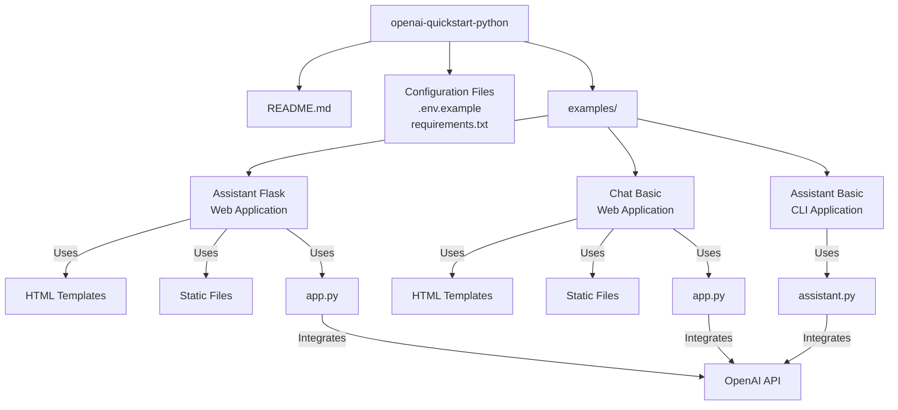
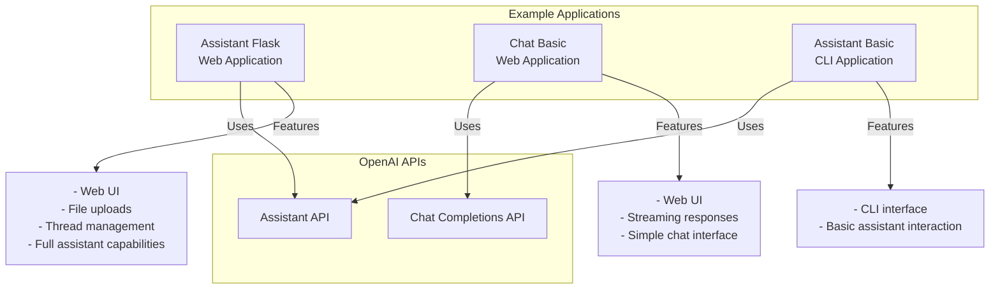
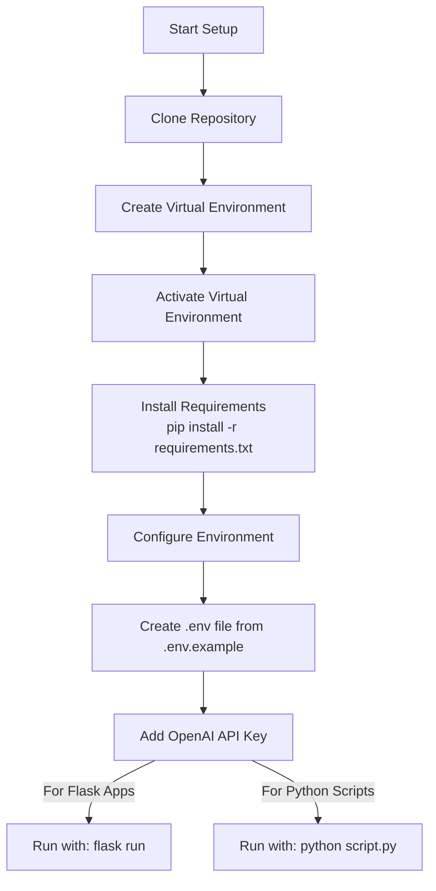
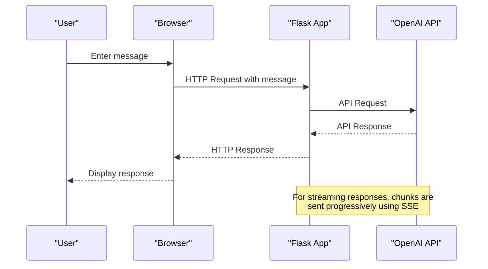

<!-- source: DeepWiki mcp.deepwiki.com · repo openai/openai-quickstart-python · page 1 Overview · fetched 2026-10-26 -->

# Overview

<details>
<summary>Relevant source files</summary>

The following files were used as context for generating this wiki page:

- [README.md](README.md)
- [requirements.txt](requirements.txt)

</details>


## Purpose and Scope

The OpenAI Python Quickstart repository serves as a practical introduction to integrating OpenAI's APIs into Python applications. This repository contains multiple example applications that demonstrate different OpenAI API endpoints (chat, assistants, etc.) with varying complexity levels.

This overview provides a high-level understanding of the repository structure, example applications, and integration patterns. For detailed setup instructions, see [Setup and Configuration](#2). For in-depth explanations of the individual example applications, see [Example Applications](#3).

## Repository Structure

The repository is organized with configuration files at the root level and example applications in separate directories.

**Repository Structure Diagram**


Sources: [README.md:3-3]()

## Example Applications

The repository includes three main example applications, each showcasing different OpenAI API integration approaches:

**Example Applications and API Integration**


Sources: [README.md:3-3]()

### Assistant Flask Application

The most comprehensive example in the repository, demonstrating a full-featured web application integrating with OpenAI's Assistant API. This application includes file uploads, thread management, and a complete chat interface.

### Chat Basic Application

A simpler web implementation focusing on the Chat Completions API, featuring server-sent events for streaming responses and a basic chat interface.

### Assistant Basic Application

A command-line implementation showing Assistant API usage without a web interface, providing a simpler demonstration of the core functionality.

## Basic OpenAI API Integration

All examples in the repository rely on the OpenAI Python SDK to interact with the API. Here's how a basic API request is structured:

```python
from openai import OpenAI
client = OpenAI()

completion = client.chat.completions.create(
  model="gpt-3.5-turbo",
  messages=[
    {"role": "system", "content": "You are a helpful assistant."},
    {"role": "user", "content": "Hello!"}
  ]
)

print(completion.choices[0].message)
```

Sources: [README.md:9-22]()

## Core Dependencies

The repository relies on several key Python packages:

| Dependency | Version | Purpose |
|------------|---------|---------|
| openai | 1.11.1 | Official OpenAI Python SDK |
| Flask | 3.0.2 | Web application framework |
| httpx | 0.26.0 | HTTP client (used by OpenAI SDK) |
| pydantic | 2.6.1 | Data validation |
| Jinja2 | 3.1.3 | Template engine for Flask |

Sources: [requirements.txt:1-21]()

## Setup Process

The repository includes detailed setup instructions in the README:

**Setup Flow Diagram**


Sources: [README.md:24-79]()

## Data Flow in Applications

The applications follow specific data flow patterns when interacting with the OpenAI API. Here's how the Flask-based applications typically handle requests:

**Data Flow Diagram**


Sources: [README.md:67-73]()

## Conclusion

The OpenAI Quickstart Python repository provides practical examples for developers looking to integrate OpenAI's APIs into their applications. From simple CLI applications to more complex web interfaces with file handling capabilities, the examples demonstrate various integration patterns and use cases.

For detailed instructions on setting up the environment and running the examples, refer to [Setup and Configuration](#2). For more information about each example application, see [Example Applications](#3).

---

