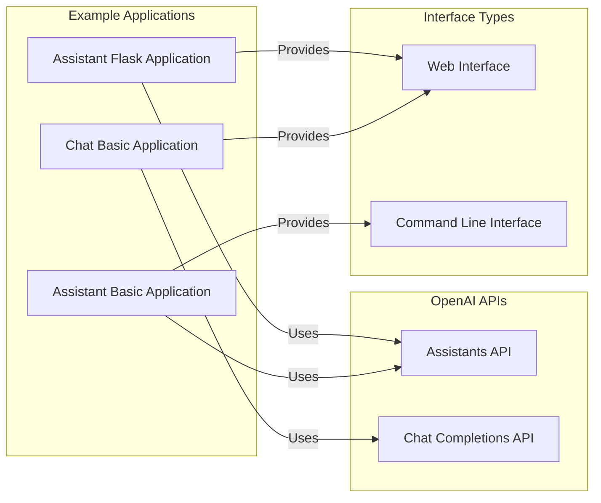
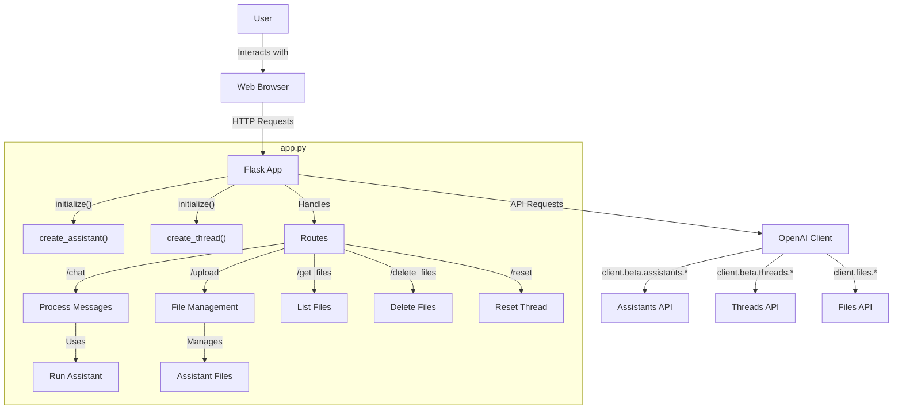
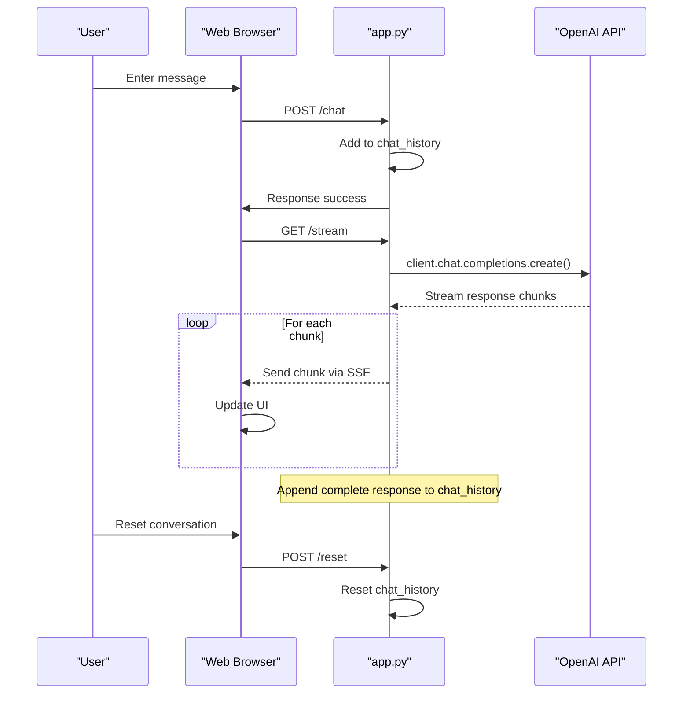
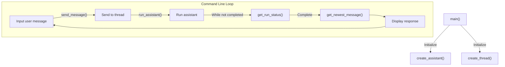
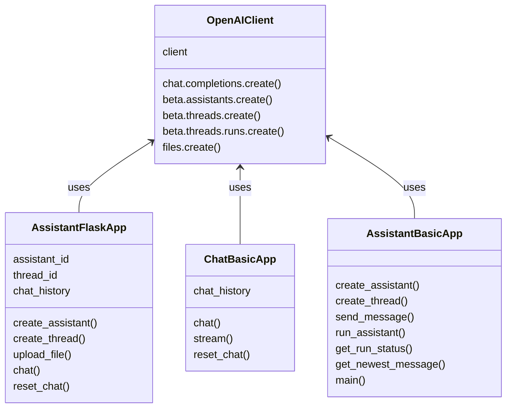

<!-- source: DeepWiki mcp.deepwiki.com · repo openai/openai-quickstart-python · page 3 Example Applications · fetched 2026-10-26 -->

# Example Applications

Relevant source files

The following files were used as context for generating this wiki page:

- [README.md](README.md)
- [examples/assistant-basic/assistant.py](examples/assistant-basic/assistant.py)
- [examples/assistant-flask/app.py](examples/assistant-flask/app.py)
- [examples/chat-basic/app.py](examples/chat-basic/app.py)

## Purpose and Scope

This document provides an overview of the three example applications included in the OpenAI quickstart repository. These applications demonstrate different approaches to integrate with OpenAI's APIs, showcasing various implementation patterns and use cases. For setup instructions and environment configuration, see [Setup and Configuration](#2).

## Overview of Example Applications

The repository includes three distinct example applications that demonstrate different ways to interact with OpenAI's APIs:

Sources: [README.md:3-3](), [examples/assistant-flask/app.py](), [examples/chat-basic/app.py](), [examples/assistant-basic/assistant.py]()

| Application | API Used | Interface | Key Features |
|-------------|----------|-----------|--------------|
| Assistant Flask | Assistants API | Web | File uploads, threaded conversations, code interpreter |
| Chat Basic | Chat Completions API | Web | Streaming responses, simple interface |
| Assistant Basic | Assistants API | Command Line | Basic assistant functionality in terminal |

Sources: [examples/assistant-flask/app.py](), [examples/chat-basic/app.py](), [examples/assistant-basic/assistant.py]()

## Assistant Flask Application

The Assistant Flask Application is the most comprehensive example, demonstrating a full-featured web interface for the OpenAI Assistants API.

Sources: [examples/assistant-flask/app.py:1-206]()

Key features:
- Creates and manages an OpenAI Assistant with code interpreter capabilities
- Supports file uploads and attaches them to the assistant
- Manages threaded conversations for context retention
- Provides a web interface for user interaction
- Implements file management (upload, list, delete)

Implementation highlights:
- Initializes an assistant and thread on startup [examples/assistant-flask/app.py:196-201]()
- Handles file uploads and associates them with the assistant [examples/assistant-flask/app.py:26-58]()
- Processes chat messages and runs the assistant [examples/assistant-flask/app.py:147-182]()
- Retrieves and manages files [examples/assistant-flask/app.py:95-110]()
- Resets conversation threads [examples/assistant-flask/app.py:185-193]()

## Chat Basic Application

The Chat Basic Application demonstrates a simpler implementation using the Chat Completions API with streaming responses.

Sources: [examples/chat-basic/app.py:1-63]()

Key features:
- Uses the Chat Completions API instead of Assistants API
- Implements streaming responses using Server-Sent Events (SSE)
- Maintains a simple chat history
- Provides a clean, minimal web interface

Implementation highlights:
- Initializes chat history with a system message [examples/chat-basic/app.py:15-17]()
- Handles chat messages and adds them to history [examples/chat-basic/app.py:25-29]()
- Streams responses from the Chat Completions API [examples/chat-basic/app.py:32-55]()
- Resets chat history [examples/chat-basic/app.py:58-62]()

## Assistant Basic Application

The Assistant Basic Application provides a command-line interface for interacting with the OpenAI Assistants API.

Sources: [examples/assistant-basic/assistant.py:1-80]()

Key features:
- Demonstrates Assistants API usage in a command-line interface
- Uses a simple loop for continuous conversation
- Shows basic thread and assistant management
- Includes status checking while waiting for assistant responses

Implementation highlights:
- Creates an assistant and thread [examples/assistant-basic/assistant.py:9-28]()
- Sends user messages to the thread [examples/assistant-basic/assistant.py:31-37]()
- Runs the assistant and checks run status [examples/assistant-basic/assistant.py:40-54]()
- Retrieves and displays responses [examples/assistant-basic/assistant.py:47-49]()
- Implements a command loop for conversation [examples/assistant-basic/assistant.py:61-75]()

## Code Structure Comparison

The following diagram shows the key code structure and class relationships across all three examples:

Sources: [examples/assistant-flask/app.py](), [examples/chat-basic/app.py](), [examples/assistant-basic/assistant.py]()

## Implementation Differences

Understanding the differences between these examples helps in choosing the right approach for your application:

| Feature | Assistant Flask | Chat Basic | Assistant Basic |
|---------|----------------|------------|----------------|
| API Used | Assistants API | Chat Completions API | Assistants API |
| Interface | Web (Flask) | Web (Flask) | Command Line |
| Streaming | No | Yes (SSE) | No |
| File Handling | Yes | No | No |
| Thread Management | Yes | No (simple array) | Yes |
| Code Interpreter | Yes | No | No |
| Implementation Complexity | High | Medium | Low |

Sources: [examples/assistant-flask/app.py](), [examples/chat-basic/app.py](), [examples/assistant-basic/assistant.py]()

## Example Use Cases

Each example is suited for different scenarios:

1. **Assistant Flask Application**
   - Full-featured AI assistant web applications
   - Applications requiring file upload and analysis
   - Use cases requiring code interpreter capabilities
   - Projects needing persistent context across conversations

2. **Chat Basic Application**
   - Simple chatbot interfaces
   - Applications where streaming responses improve user experience
   - Projects with minimal setup requirements
   - Use cases where the Chat Completions API is sufficient

3. **Assistant Basic Application**
   - Command-line tools and utilities
   - Scripts and automation requiring AI assistance
   - Testing and prototyping Assistants API integration
   - Simple applications without a web interface

Sources: [README.md](), [examples/assistant-flask/app.py](), [examples/chat-basic/app.py](), [examples/assistant-basic/assistant.py]()

For more detailed information about each application, refer to their respective pages:
- [Assistant Flask Application](#3.1)
- [Chat Basic Application](#3.2)
- [Assistant Basic Application](#3.3)

---

