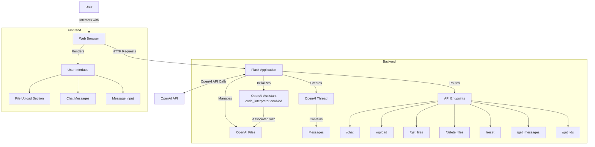
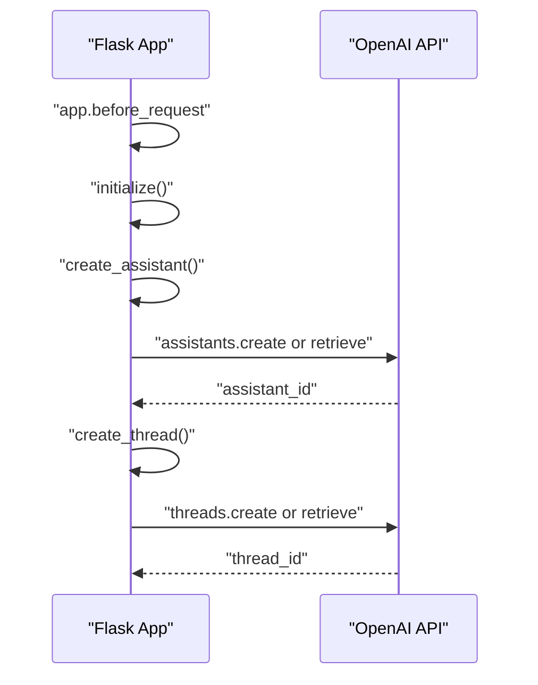
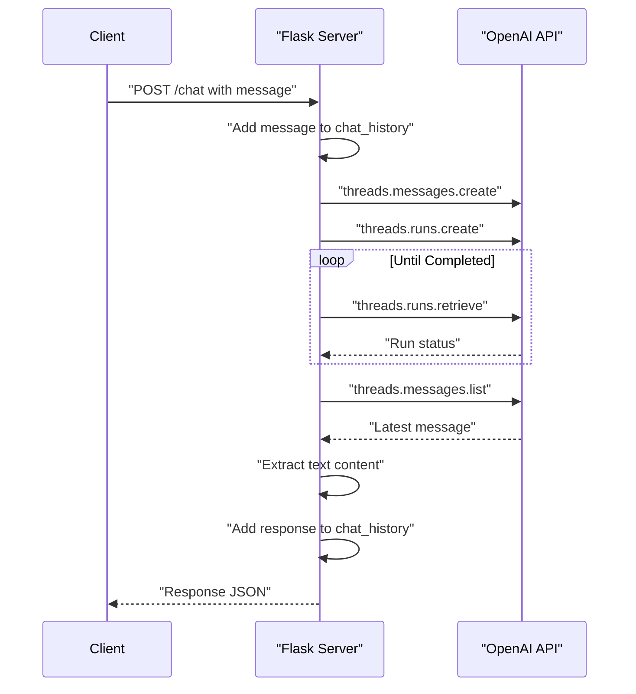
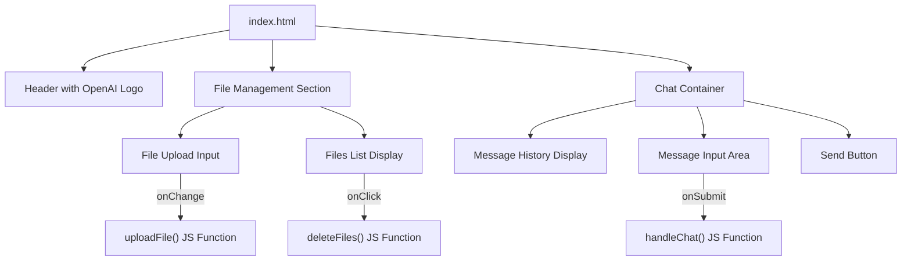
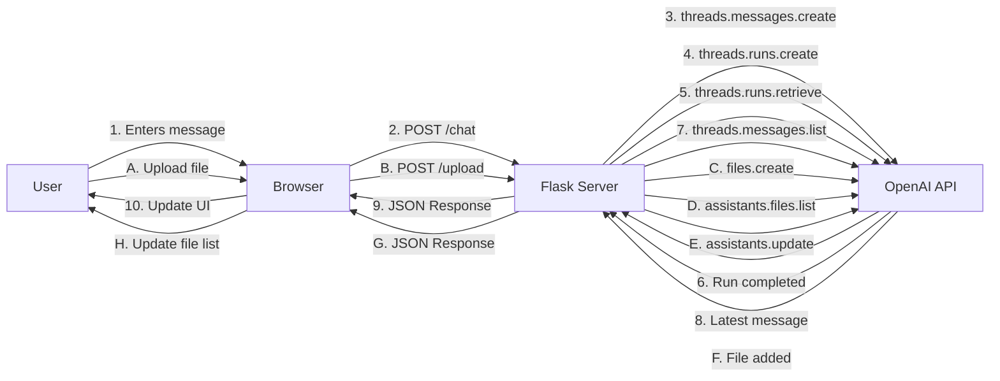

<!-- source: DeepWiki mcp.deepwiki.com · repo openai/openai-quickstart-python · page 3.1 Assistant Flask Application · fetched 2026-10-26 -->

# Assistant Flask Application

<details>
<summary>Relevant source files</summary>

The following files were used as context for generating this wiki page:

- [examples/assistant-flask/app.py](examples/assistant-flask/app.py)
- [examples/assistant-flask/templates/index.html](examples/assistant-flask/templates/index.html)

</details>


This document describes the Assistant Flask Application, which is a comprehensive web application that demonstrates how to integrate with OpenAI's Assistant API. The application features a chat interface with file upload capabilities, allowing users to interact with an OpenAI Assistant that has code interpreter capabilities.

For information about the simpler command-line implementation, see [Assistant Basic Application](#3.3). For details about the chat application using the Chat Completions API, see [Chat Basic Application](#3.2).

## Overview

The Assistant Flask Application showcases a full-featured implementation of OpenAI's Assistant API within a web application context. It demonstrates:

- Creating and managing an OpenAI Assistant with code interpreter capabilities
- Managing conversation threads
- Uploading and attaching files to the Assistant
- Building a responsive chat interface

Sources: [examples/assistant-flask/app.py]()

## System Architecture



Sources: [examples/assistant-flask/app.py:1-204](), [examples/assistant-flask/templates/index.html:1-342]()

## Backend Implementation

The backend is built using Flask and interacts with the OpenAI API to manage the Assistant, Thread, and file operations.

### Initialization Process

When the application starts, it:

1. Creates an OpenAI client
2. Initializes a new Assistant or retrieves an existing one
3. Creates a new conversation Thread or retrieves an existing one



Sources: [examples/assistant-flask/app.py:113-140](), [examples/assistant-flask/app.py:196-201]()

### Key API Endpoints

| Endpoint | Method | Purpose |
|----------|--------|---------|
| `/` | GET | Renders the main application interface |
| `/chat` | POST | Sends user messages to the Assistant and returns the response |
| `/upload` | POST | Handles file uploads and attaches them to the Assistant |
| `/delete_files` | POST | Removes files from the Assistant |
| `/get_files` | GET | Retrieves the list of files attached to the Assistant |
| `/get_messages` | GET | Fetches the conversation history |
| `/get_ids` | GET | Returns the current Assistant and Thread IDs |
| `/reset` | POST | Resets the conversation and creates a new Thread |

Sources: [examples/assistant-flask/app.py:26-193]()

### Chat Processing Flow



Sources: [examples/assistant-flask/app.py:147-182]()

### File Management

The application allows users to:
1. Upload files (limiting to specific file types)
2. Attach files to the Assistant
3. View the list of attached files
4. Delete files from the Assistant

Files are processed through OpenAI's Files API and then attached to the Assistant using the Assistants API.

Sources: [examples/assistant-flask/app.py:22-110]()

## Frontend Implementation

The frontend is a single-page web application built with HTML, CSS, and JavaScript that provides a clean interface for chatting with the Assistant and managing files.

### User Interface Components



Sources: [examples/assistant-flask/templates/index.html:10-81]()

### Client-Side Functionality

The frontend JavaScript handles:

1. Sending and receiving messages
2. Uploading and deleting files
3. Displaying chat history
4. Managing UI updates and state
5. Showing typing indicators while waiting for responses

Key JavaScript functions include:
- `populateFiles()` - Updates the file list display
- `deleteFiles()` - Removes files from the Assistant
- Event listeners for file uploads and message submissions

Sources: [examples/assistant-flask/templates/index.html:81-340]()

## Data Flow



Sources: [examples/assistant-flask/app.py:147-182](), [examples/assistant-flask/app.py:26-58](), [examples/assistant-flask/templates/index.html:213-262]()

## Usage Examples

### Starting a Chat Session

When a user accesses the application:
1. The Flask server initializes an Assistant and Thread
2. The browser loads the UI with any existing chat history
3. The user can start sending messages to the Assistant

### File Upload Process

1. User selects a file through the file upload interface
2. Browser sends the file to the server via the `/upload` endpoint
3. The server uploads the file to OpenAI's Files API
4. The server attaches the file to the Assistant using the Assistants API
5. The browser updates to show the file in the list

### Messaging Flow

1. User enters a message and submits it
2. Message is displayed in the UI
3. Message is sent to the server via `/chat` endpoint
4. Server adds the message to the Assistant's Thread
5. Server creates a Run to process the message
6. Server polls the Run status until completion
7. Server retrieves the Assistant's response
8. Response is returned to the browser and displayed in the UI

## Implementation Details

### Assistant Configuration

The application creates an Assistant with the following configuration:

```python
# Assistant creation with code interpreter
my_assistant = client.beta.assistants.create(
    instructions="You are a helpful assistant. If asked about math or computing problems, write and run code to answer the question.",
    name="MyQuickstartAssistant",
    model="gpt-3.5-turbo",
    tools=[{"type": "code_interpreter"}],
)
```

Sources: [examples/assistant-flask/app.py:116-121]()

### File Type Restrictions

The application limits file uploads to specific file types:

```python
ALLOWED_EXTENSIONS = {"txt", "pdf", "png", "jpg", "jpeg", "gif", "csv"}
```

Sources: [examples/assistant-flask/app.py:11]()

## Summary

The Assistant Flask Application demonstrates a complete implementation of OpenAI's Assistant API in a web application context. It showcases how to create and manage Assistants, Threads, and Files, as well as how to build a responsive user interface for interacting with the Assistant. The application's architecture provides a solid foundation for building more complex AI-powered chat applications with file handling capabilities.

Sources: [examples/assistant-flask/app.py](), [examples/assistant-flask/templates/index.html]()

---

