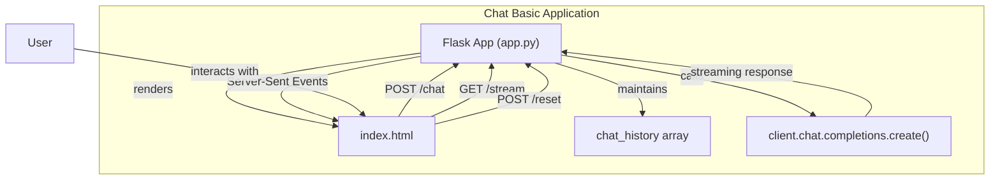
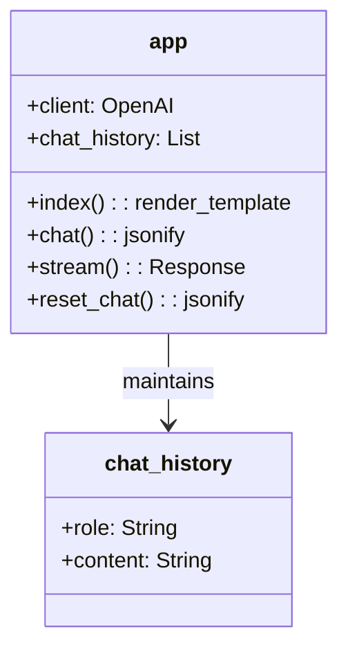
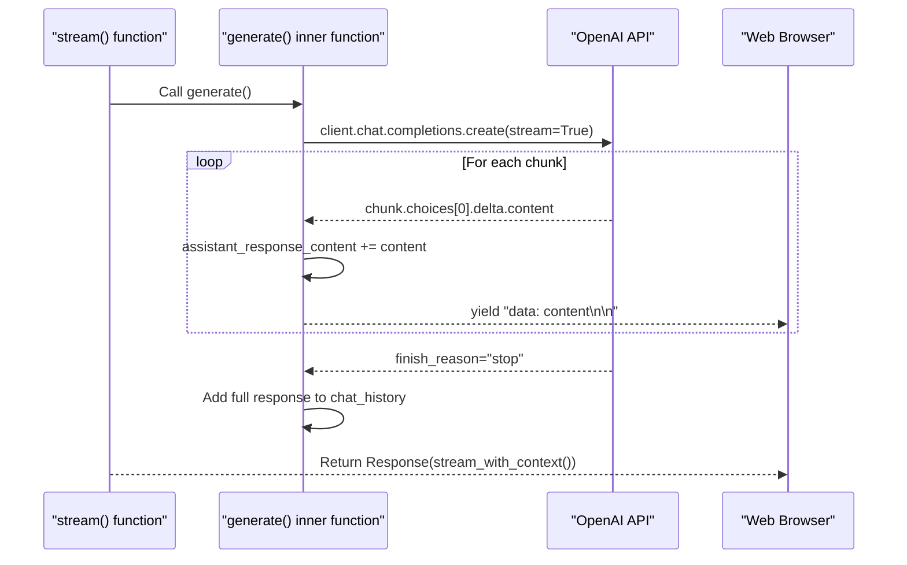
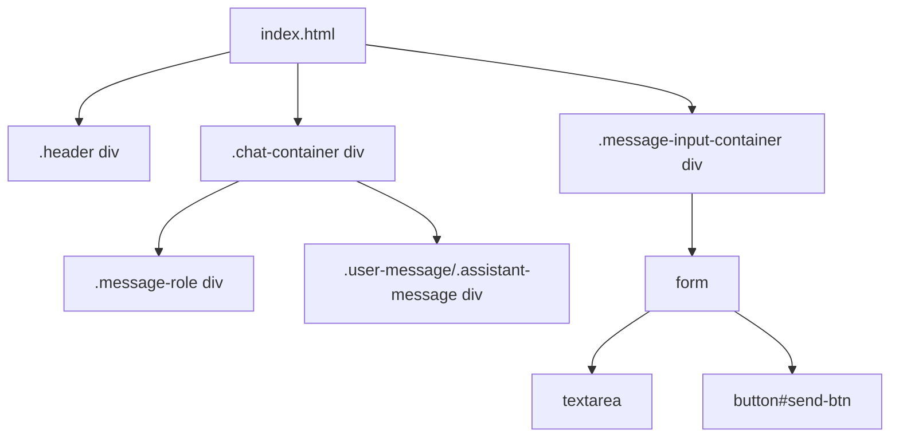
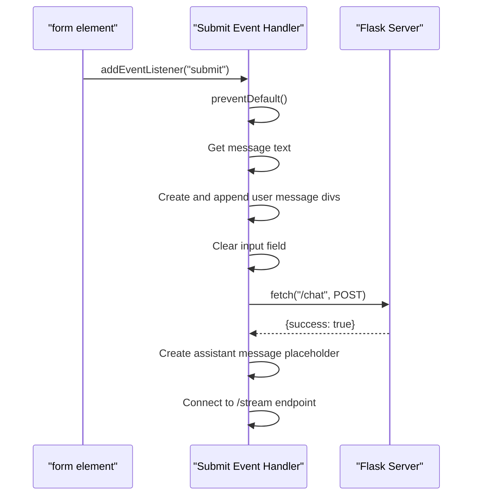
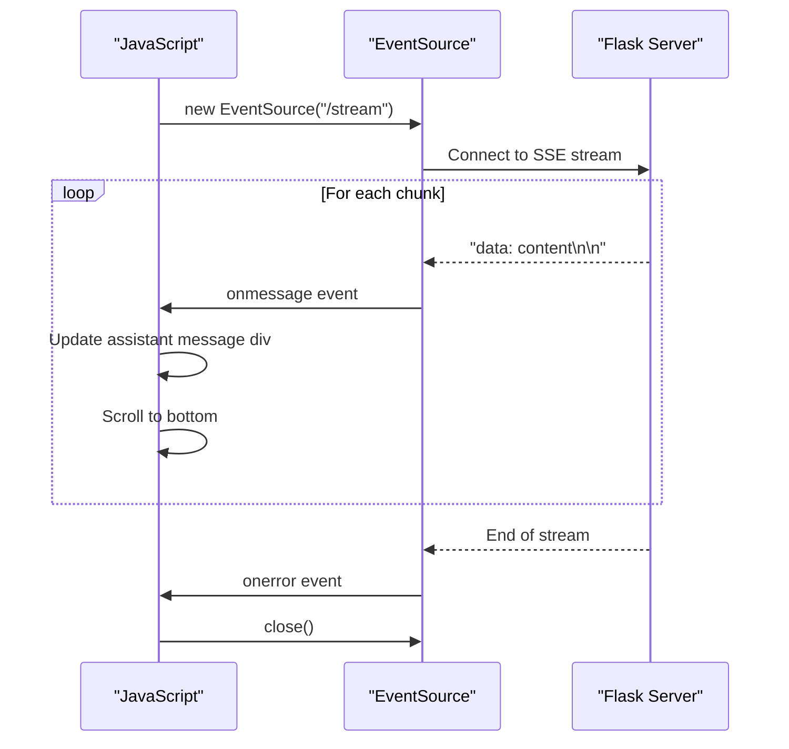
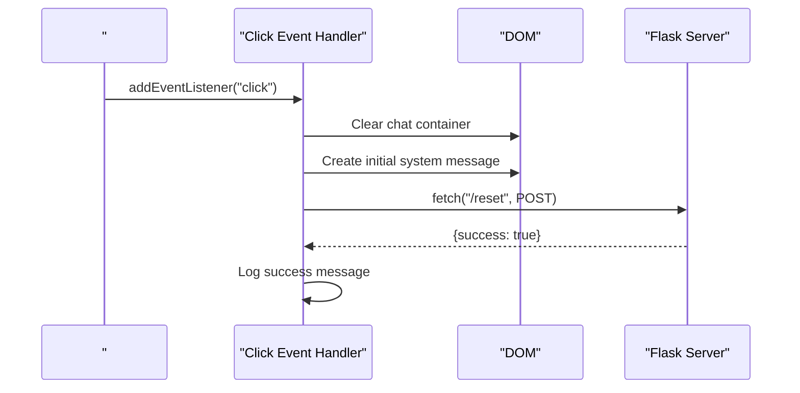
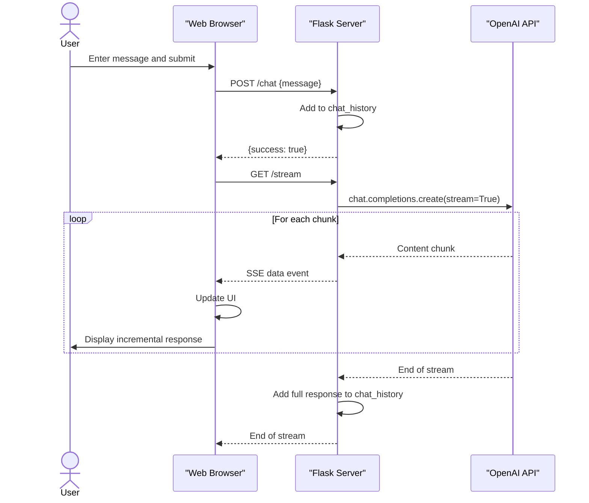
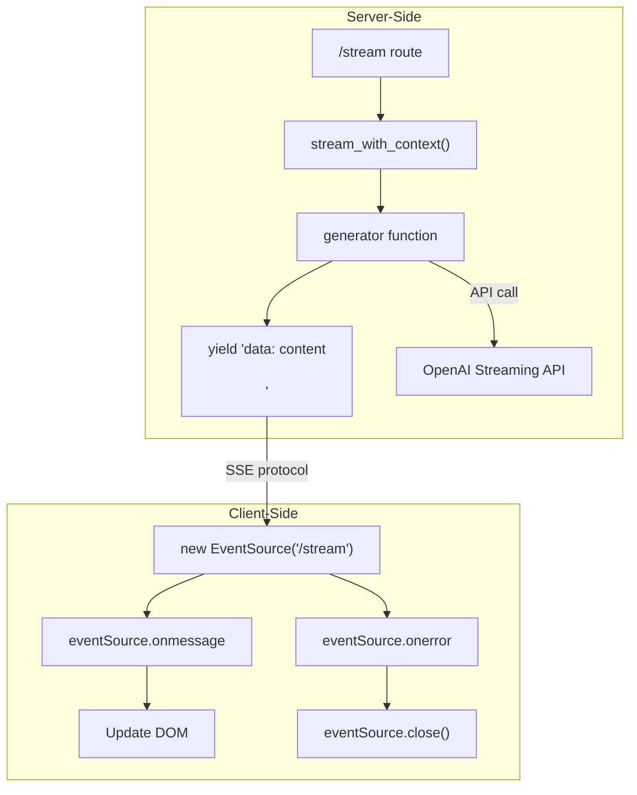
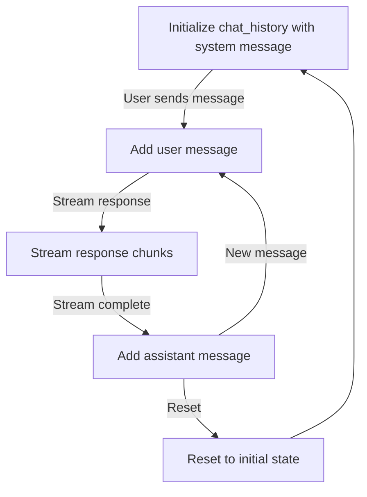

<!-- source: DeepWiki mcp.deepwiki.com · repo openai/openai-quickstart-python · page 3.2 Chat Basic Application · fetched 2026-10-26 -->

# Chat Basic Application

<details>
<summary>Relevant source files</summary>

The following files were used as context for generating this wiki page:

- [examples/assistant-basic/assistant.py](examples/assistant-basic/assistant.py)
- [examples/chat-basic/app.py](examples/chat-basic/app.py)
- [examples/chat-basic/templates/index.html](examples/chat-basic/templates/index.html)

</details>


The Chat Basic Application is a minimalist web interface that demonstrates how to implement real-time streaming with OpenAI's Chat Completions API. This example focuses specifically on creating a simple chat interface where AI responses appear progressively as they're generated.

For a more comprehensive example using the Assistants API with features like file uploads, see [Assistant Flask Application](#3.1).

## System Architecture



The application consists of a Flask server that maintains chat state, interfaces with OpenAI's API, and serves a web interface using Server-Sent Events (SSE) for streaming responses.

Sources:
- [examples/chat-basic/app.py]()
- [examples/chat-basic/templates/index.html]()

## Server-Side Implementation

### Flask Application Setup



The Flask application initializes the OpenAI client and establishes a global `chat_history` array with an initial system message that sets the assistant's behavior.

```python
client = openai.OpenAI()
app = Flask(__name__)
chat_history = [
    {"role": "system", "content": "You are a helpful assistant."},
]
```

Sources: [examples/chat-basic/app.py:1-17]()

### Route Handlers

The application defines four HTTP endpoints:

| Route | Method | Function | Purpose |
|-------|--------|----------|---------|
| `/` | GET | `index()` | Renders HTML template with chat history |
| `/chat` | POST | `chat()` | Adds user messages to chat history |
| `/stream` | GET | `stream()` | Streams AI responses via SSE |
| `/reset` | POST | `reset_chat()` | Resets chat history to initial state |

Sources: [examples/chat-basic/app.py:20-62]()

### Streaming Implementation

The core functionality of the application is implemented in the `stream()` route handler:



The implementation uses Flask's `stream_with_context` to wrap a generator function that:
1. Calls OpenAI's API with `stream=True`
2. Processes and yields each content chunk as it arrives
3. Accumulates the complete response
4. Adds the full response to chat history after completion

Sources: [examples/chat-basic/app.py:32-55]()

## Client-Side Implementation

### HTML Structure



The client interface consists of a header with the OpenAI logo, a container for displaying messages, and an input area for sending new messages.

Sources: [examples/chat-basic/templates/index.html:1-41]()

### JavaScript Functionality

The client-side JavaScript handles three main tasks:

1. **Message Submission**



Sources: [examples/chat-basic/templates/index.html:43-92]()

2. **Response Streaming**



The JavaScript uses the `EventSource` API to establish a connection to the stream endpoint and incrementally update the UI as chunks arrive.

Sources: [examples/chat-basic/templates/index.html:94-113]()

3. **Chat Reset**



Sources: [examples/chat-basic/templates/index.html:119-140]()

## Data Flow

The complete data flow through the application:



This diagram shows how user input flows through the system and how the streaming response is handled from the API to the user interface.

Sources:
- [examples/chat-basic/app.py:25-55]()
- [examples/chat-basic/templates/index.html:43-113]()

## Key Implementation Patterns

### Server-Sent Events (SSE)

The application uses Server-Sent Events to stream content from the server to the client:



This pattern enables real-time, chunk-by-chunk display of AI responses, creating a more interactive user experience.

Sources:
- [examples/chat-basic/app.py:32-55]()
- [examples/chat-basic/templates/index.html:94-113]()

### Chat History Management

The chat history follows this lifecycle:



This pattern ensures that each message has proper context from the conversation history, while allowing for state reset when needed.

Sources:
- [examples/chat-basic/app.py:15-17]()
- [examples/chat-basic/app.py:27-28]()
- [examples/chat-basic/app.py:51-53]()
- [examples/chat-basic/app.py:58-62]()

## Summary

The Chat Basic Application demonstrates a minimalist yet effective implementation of an OpenAI-powered chat interface with real-time streaming responses. Key technical features include:

1. Server-side streaming using Flask's `stream_with_context` and the OpenAI streaming API
2. Client-side handling of streamed responses using the `EventSource` API
3. Conversation state management through a server-side chat history array
4. Dynamic DOM updates to display the conversation

This example provides a foundation for developers looking to implement AI chat interfaces with streaming capabilities in their own applications.

For more advanced implementations like the Assistants API with file handling, see [Assistant Flask Application](#3.1) or [Assistant Basic Application](#3.3).

---

