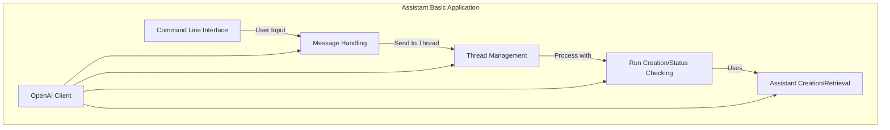
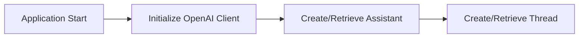
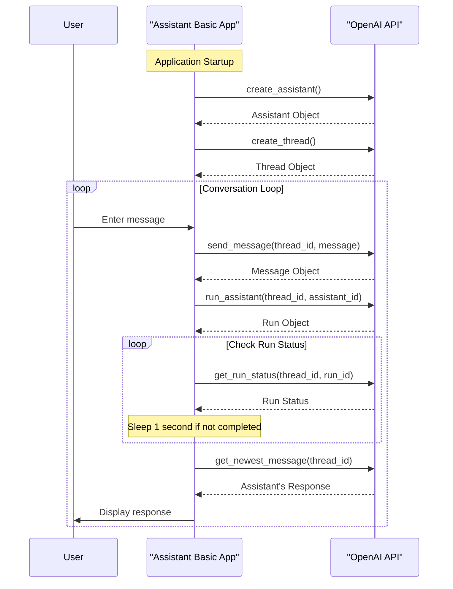
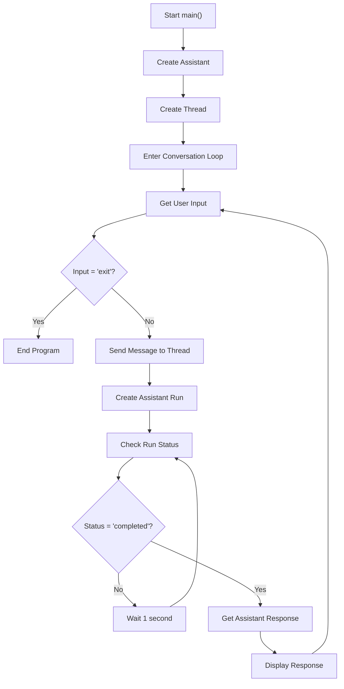

<!-- source: DeepWiki mcp.deepwiki.com · repo openai/openai-quickstart-python · page 3.3 Assistant Basic Application · fetched 2026-10-26 -->

# Assistant Basic Application

<details>
<summary>Relevant source files</summary>

The following files were used as context for generating this wiki page:

- [examples/assistant-basic/assistant.py](examples/assistant-basic/assistant.py)
- [examples/chat-basic/app.py](examples/chat-basic/app.py)

</details>


## Purpose and Scope

This document covers the Assistant Basic Application, a command-line interface (CLI) implementation that demonstrates the fundamental usage of OpenAI's Assistant API. This minimal example shows how to create an assistant, manage a conversation thread, and handle message exchanges without the complexity of a web interface. For web-based implementations, see [Assistant Flask Application](#3.1) or [Chat Basic Application](#3.2).

## Architecture Overview

The Assistant Basic Application is structured as a simple Python script that interacts directly with the OpenAI API. Unlike the web-based examples, this application runs entirely in the terminal and demonstrates the core functionality of the Assistant API in a minimal implementation.



Sources: [examples/assistant-basic/assistant.py:1-79]()

## Core Components

The Assistant Basic Application consists of several key functions that handle different aspects of the interaction with OpenAI's Assistant API:

### Client Initialization

The application starts by initializing the OpenAI client:



Sources: [examples/assistant-basic/assistant.py:1-4]()

### Assistant and Thread Management

The application creates or retrieves an assistant and a thread, which are the two primary resources needed for using the Assistant API:

| Function | Purpose | Source |
|----------|---------|--------|
| `create_assistant()` | Creates a new assistant or retrieves an existing one | [assistant.py:9-19]() |
| `create_thread()` | Creates a new thread or retrieves an existing one | [assistant.py:22-28]() |

Sources: [examples/assistant-basic/assistant.py:9-28]()

### Message and Run Management

These functions handle sending messages, running the assistant, and retrieving responses:

| Function | Purpose | Source |
|----------|---------|--------|
| `send_message()` | Sends a user message to a thread | [assistant.py:31-37]() |
| `run_assistant()` | Creates a run to process messages with an assistant | [assistant.py:40-44]() |
| `get_newest_message()` | Retrieves the most recent message in a thread | [assistant.py:47-49]() |
| `get_run_status()` | Checks the status of a run | [assistant.py:52-54]() |

Sources: [examples/assistant-basic/assistant.py:31-54]()

## Execution Flow

The application follows a sequential execution pattern for handling conversations with the OpenAI Assistant:



Sources: [examples/assistant-basic/assistant.py:57-76]()

## Main Loop Implementation

The `main()` function implements the core conversation loop that:
1. Creates an assistant and a thread
2. Repeatedly prompts the user for input
3. Sends the user message to the thread
4. Initiates a run to process the message
5. Polls for run completion
6. Retrieves and displays the assistant's response

The loop continues until the user enters "exit" to terminate the conversation.



Sources: [examples/assistant-basic/assistant.py:57-79]()

## API Interaction Details

The application demonstrates several key interactions with the OpenAI Assistant API:

### Assistant Creation

The application creates an assistant with basic instructions and a model specification:

```python
my_assistant = client.beta.assistants.create(
    instructions="You are a helpful assistant.",
    name="MyQuickstartAssistant",
    model="gpt-3.5-turbo",
)
```

Sources: [examples/assistant-basic/assistant.py:11-15]()

### Thread and Message Management

The application creates a thread to hold the conversation and adds messages to it:

```python
thread = client.beta.threads.create()  # Create a new thread
thread_message = client.beta.threads.messages.create(  # Add a message
    thread_id,
    role="user",
    content=message,
)
```

Sources: [examples/assistant-basic/assistant.py:24](), [examples/assistant-basic/assistant.py:32-36]()

### Run Creation and Monitoring

The application creates a run to process the conversation and monitors its status:

```python
run = client.beta.threads.runs.create(
    thread_id=thread_id, assistant_id=assistant_id
)
run_status = client.beta.threads.runs.retrieve(thread_id=thread_id, run_id=run_id).status
```

Sources: [examples/assistant-basic/assistant.py:41-43](), [examples/assistant-basic/assistant.py:53-54]()

## Usage Example

To use the Assistant Basic Application:

1. Ensure you have the OpenAI Python SDK installed
2. Set your OpenAI API key as an environment variable
3. Run the script with `python assistant.py`
4. Enter messages at the prompt
5. View the assistant's responses
6. Type "exit" to end the conversation

The application provides a simple polling mechanism with a visual indicator (`⏳`) to show that it's waiting for the assistant to respond.

Sources: [examples/assistant-basic/assistant.py:69-71]()

## Comparison with Other Example Applications

The Assistant Basic Application differs from the other examples in the repository in several ways:

| Feature | Assistant Basic | [Assistant Flask](#3.1) | [Chat Basic](#3.2) |
|---------|----------------|----------------------|--------------|
| Interface | Command-line | Web (Flask) | Web (Flask) |
| API Used | Assistant API | Assistant API | Chat Completions API |
| File Upload | No | Yes | No |
| Response Streaming | No | Yes | Yes |
| Complexity | Low | High | Medium |

While this example is minimal, it clearly demonstrates the core Assistant API workflow without the additional complexity of web frameworks or advanced features.

Sources: [examples/assistant-basic/assistant.py:1-79]()

---

