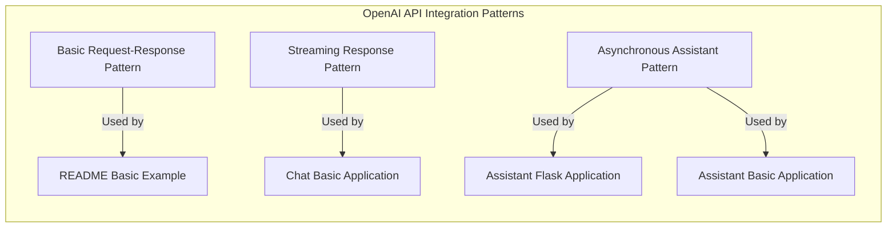
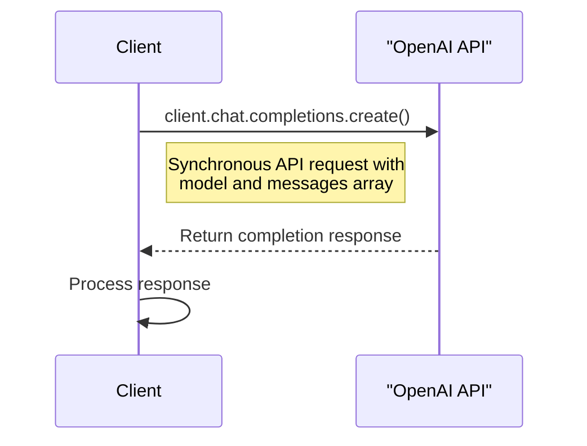
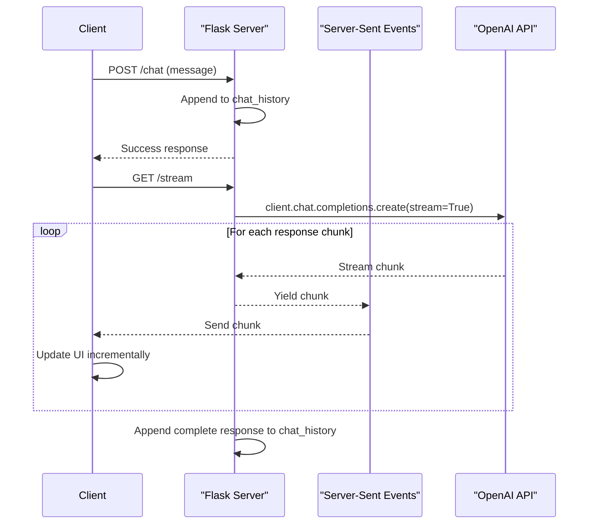
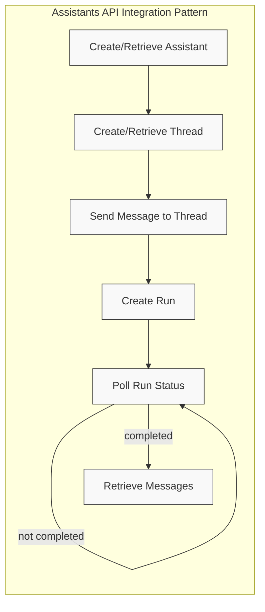
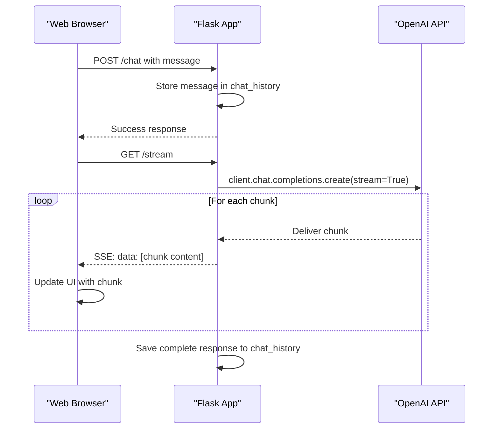
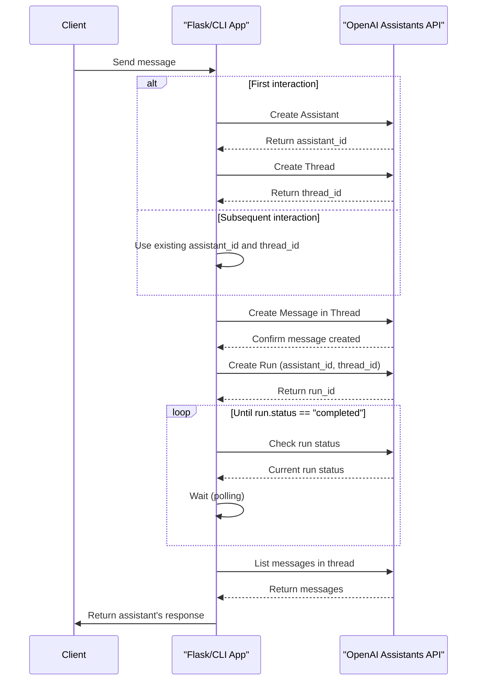

<!-- source: DeepWiki mcp.deepwiki.com · repo openai/openai-quickstart-python · page 4 OpenAI API Integration Patterns · fetched 2026-10-26 -->

# OpenAI API Integration Patterns

<details>
<summary>Relevant source files</summary>

The following files were used as context for generating this wiki page:

- [README.md](README.md)
- [examples/assistant-basic/assistant.py](examples/assistant-basic/assistant.py)
- [examples/assistant-flask/app.py](examples/assistant-flask/app.py)
- [examples/chat-basic/app.py](examples/chat-basic/app.py)

</details>


## Purpose and Scope

This document examines the different patterns and techniques for integrating with the OpenAI API as demonstrated in the OpenAI Quickstart Python repository. It compares implementation approaches across the example applications, highlighting key differences between Chat Completions API and Assistants API integration methods. For detailed information about the specific example applications themselves, see [Example Applications](#3).

## API Integration Overview

The repository demonstrates three distinct patterns for integrating with OpenAI's APIs, each with different architectures and user interaction models.



Sources: [README.md:5-22](), [examples/chat-basic/app.py:32-55](), [examples/assistant-flask/app.py:147-182](), [examples/assistant-basic/assistant.py:31-55]()

## Basic Request-Response Pattern

The simplest integration pattern is a straightforward request-response model, where a single API call is made and a complete response is returned. This pattern is demonstrated in the basic example in the repository's README.



Key implementation aspects:
- Synchronous API call that blocks until completion
- Simple error handling
- Complete response returned at once
- Low implementation complexity

Sources: [README.md:9-22]()

## Streaming Response Pattern

The Chat Basic application demonstrates a streaming response pattern, where the API returns chunks of the response as they're generated, allowing for a more interactive user experience.



Key implementation aspects:
- Sets `stream=True` in the API request
- Uses Flask's `stream_with_context` and Server-Sent Events
- Accumulates the full response while streaming chunks
- Appends the complete message to chat history after streaming finishes

Sources: [examples/chat-basic/app.py:32-55]()

## Asynchronous Assistant Pattern

The Assistant applications use a more complex asynchronous pattern that involves creating persistent resources (assistants and threads) and polling for completion status.



This pattern is implemented with variations in both the Assistant Flask application and the Assistant Basic CLI application.

Sources: [examples/assistant-flask/app.py:113-193](), [examples/assistant-basic/assistant.py:9-76]()

## Integration Pattern Comparison

The following table compares key aspects of the integration patterns demonstrated in the repository:

| Feature | Basic Request | Chat Basic (Streaming) | Assistant Applications |
|---------|---------------|------------------------|------------------------|
| API Used | Chat Completions | Chat Completions | Assistants API |
| Response Style | Synchronous | Streaming | Asynchronous with polling |
| State Management | None | In-memory chat history | Persistent assistants and threads |
| Implementation Complexity | Low | Medium | High |
| User Experience | Basic | Interactive typing effect | Rich features (file uploads, code execution) |
| Resource Management | Stateless | Session-based | Persistent resources with IDs |

Sources: [README.md:9-22](), [examples/chat-basic/app.py:1-62](), [examples/assistant-flask/app.py:1-205](), [examples/assistant-basic/assistant.py:1-79]()

## Code-Level Integration Patterns

### Chat Completions API Integration

The Chat Completions API follows a more direct integration pattern, as shown in the Chat Basic application:

```mermaid
classDiagram
    class "OpenAI Client" {
        +chat.completions.create()
    }
    
    class "ChatHistory" {
        +Array of messages
        +System prompt
        +User messages
        +Assistant responses
    }
    
    class "StreamHandler" {
        +generate()
        +accumulate_content()
    }
    
    "OpenAI Client" -- "ChatHistory" : uses
    "StreamHandler" -- "OpenAI Client" : streams from
    "StreamHandler" -- "ChatHistory" : updates
```

Key implementation elements:
- Client initialization: `client = openai.OpenAI()`
- Message structure: `{"role": "user|assistant|system", "content": "message text"}`
- API call with streaming: `client.chat.completions.create(model="gpt-3.5-turbo", messages=chat_history, stream=True)`
- Response processing: Iterating through chunks with `for chunk in stream:`

Sources: [examples/chat-basic/app.py:9-55]()

### Assistants API Integration

The Assistants API requires a more complex integration pattern with multiple API resources:

```mermaid
classDiagram
    class "OpenAI Client" {
        +beta.assistants.create()
        +beta.assistants.retrieve()
        +beta.threads.create()
        +beta.threads.retrieve()
        +beta.threads.messages.create()
        +beta.threads.runs.create()
        +beta.threads.runs.retrieve()
        +beta.threads.messages.list()
    }
    
    class "Assistant" {
        +id
        +instructions
        +model
        +tools
        +files
    }
    
    class "Thread" {
        +id
        +messages
    }
    
    class "Run" {
        +id
        +status
        +assistant_id
        +thread_id
    }
    
    class "Message" {
        +id
        +role
        +content
        +thread_id
    }
    
    "OpenAI Client" -- "Assistant" : creates/manages
    "OpenAI Client" -- "Thread" : creates/manages
    "OpenAI Client" -- "Run" : creates/manages
    "OpenAI Client" -- "Message" : creates/retrieves
    "Assistant" -- "Run" : referenced by
    "Thread" -- "Run" : referenced by
    "Thread" -- "Message" : contains
```

Key implementation steps:
1. Create or retrieve an Assistant
2. Create or retrieve a Thread
3. Add a Message to the Thread
4. Create a Run to process the Thread with the Assistant
5. Poll the Run status until completed
6. Retrieve the latest Messages

Sources: [examples/assistant-flask/app.py:113-193](), [examples/assistant-basic/assistant.py:9-76]()

## Implementation Examples

### Basic Chat Completions Pattern

```python
# Initialize the OpenAI client
client = OpenAI()

# Make a Chat Completions API request
completion = client.chat.completions.create(
  model="gpt-3.5-turbo",
  messages=[
    {"role": "system", "content": "You are a helpful assistant."},
    {"role": "user", "content": "Hello!"}
  ]
)

# Process the response
print(completion.choices[0].message)
```

Sources: [README.md:9-22]()

### Streaming Response Pattern

In the Chat Basic application, a streaming response pattern is implemented with Server-Sent Events:



Key implementation code in the Flask app:
- The `/stream` route creates a streaming response
- Uses `stream_with_context` and a generator function
- Yields each chunk with the proper SSE format
- Accumulates the full response

Sources: [examples/chat-basic/app.py:32-55]()

### Assistants API Pattern

The Assistant applications demonstrate a more complex integration pattern:



Sources: [examples/assistant-flask/app.py:147-193](), [examples/assistant-basic/assistant.py:57-76]()

## Best Practices

Based on the examples in the repository, here are some best practices for OpenAI API integration:

1. **Choose the appropriate API**:
   - Use Chat Completions API for simple conversational applications
   - Use Assistants API for applications requiring persistent state, file uploads, or specialized tools

2. **Implement proper error handling**:
   - The example applications could be improved with more robust error handling
   - Consider handling API rate limits, timeouts, and other potential failures

3. **Use streaming for better user experience**:
   - For chat applications, streaming responses provides a more responsive experience
   - Ensure you properly accumulate the full response while streaming

4. **Manage resources efficiently**:
   - With the Assistants API, store assistant_id and thread_id for reuse
   - Consider implementing cleanup routines for unused resources

5. **Structure your prompts effectively**:
   - Start with a clear system message
   - Maintain consistent message structure
   - Properly format user inputs and context

Sources: [README.md:9-22](), [examples/chat-basic/app.py:1-62](), [examples/assistant-flask/app.py:1-205](), [examples/assistant-basic/assistant.py:1-79]()

## Associated Code Entities

The following diagram maps the integration patterns to their specific code implementations:

```mermaid
flowchart TD
    subgraph "OpenAI API Integration Code Entities"
        direction TB
        
        Client["client = OpenAI()"] --> ChatAPI["client.chat.completions.create()"]
        Client --> AssistantAPI["client.beta.assistants.*"]
        Client --> ThreadAPI["client.beta.threads.*"]
        Client --> RunAPI["client.beta.threads.runs.*"]
        Client --> MessageAPI["client.beta.threads.messages.*"]
        
        ChatAPI --> BasicApp["README.md Basic Example"]
        ChatAPI --> StreamApp["chat-basic/app.py: /stream route"]
        
        AssistantAPI --> CreateAssistant["assistant-flask/app.py: create_assistant()"]
        AssistantAPI --> AssistantBasic["assistant-basic/assistant.py: create_assistant()"]
        
        ThreadAPI --> CreateThread["assistant-flask/app.py: create_thread()"]
        ThreadAPI --> ThreadBasic["assistant-basic/assistant.py: create_thread()"]
        
        RunAPI --> RunAssistant["assistant-flask/app.py: run and polling loop"]
        RunAPI --> RunBasic["assistant-basic/assistant.py: run_assistant() and polling loop"]
        
        MessageAPI --> SendMessage["assistant-flask/app.py: threads.messages.create()"]
        MessageAPI --> GetMessages["assistant-flask/app.py: threads.messages.list()"]
        
        classDef entity fill:#f9f9f9,stroke:#333,stroke-width:1px;
        class Client,ChatAPI,AssistantAPI,ThreadAPI,RunAPI,MessageAPI,BasicApp,StreamApp,CreateAssistant,AssistantBasic,CreateThread,ThreadBasic,RunAssistant,RunBasic,SendMessage,GetMessages entity;
    end
```



Sources: [README.md:9-22](), [examples/chat-basic/app.py:32-55](), [examples/assistant-flask/app.py:113-193](), [examples/assistant-basic/assistant.py:9-76]()

---

