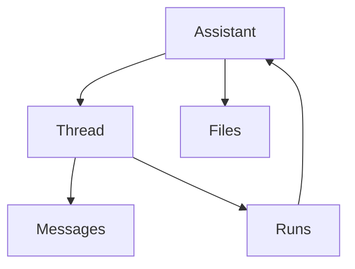
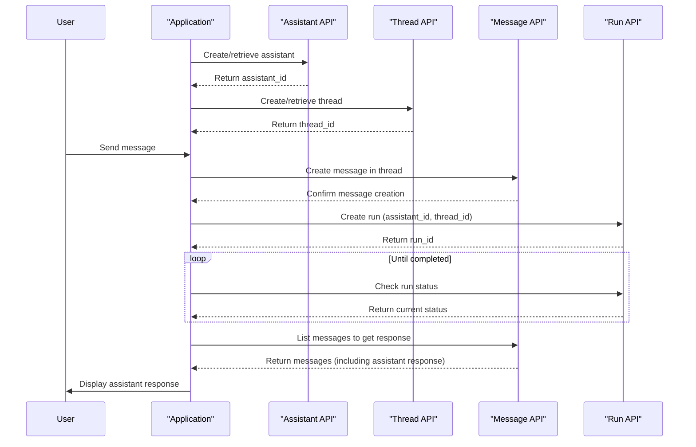
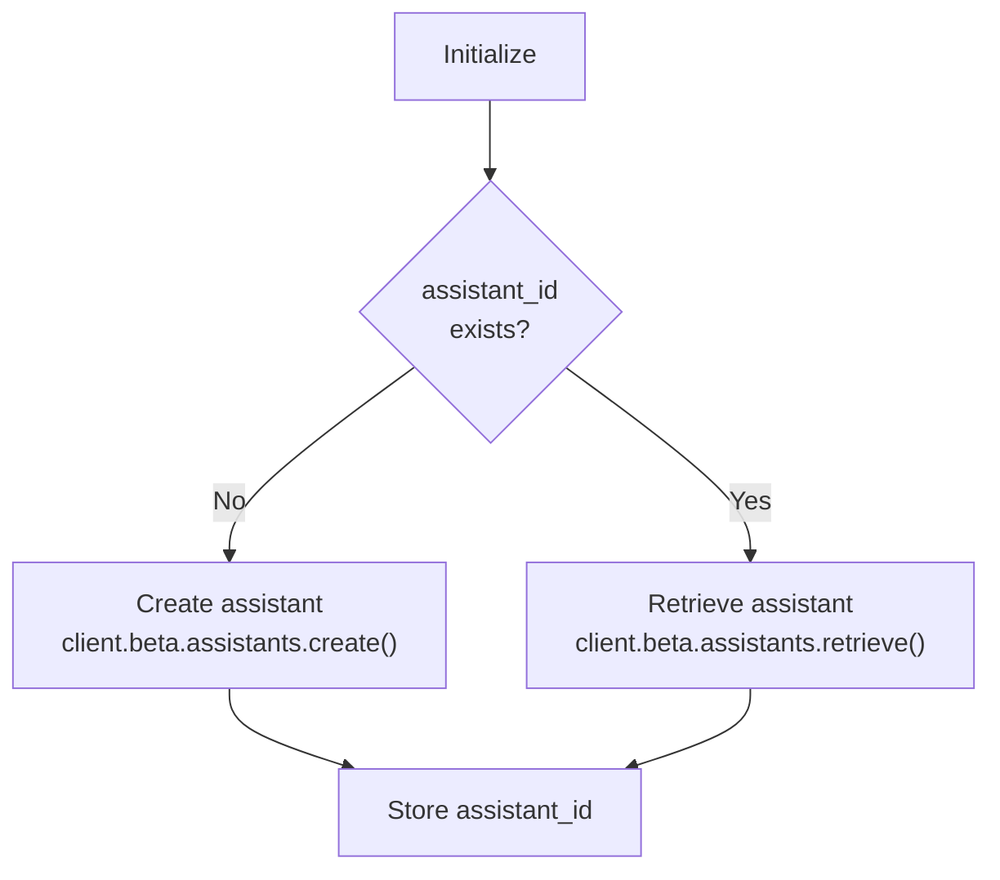
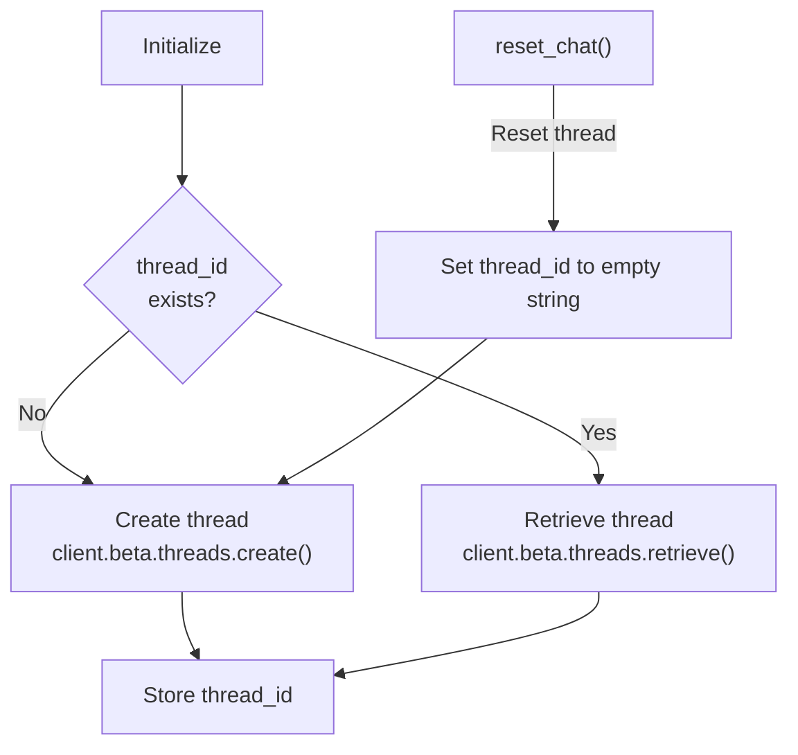
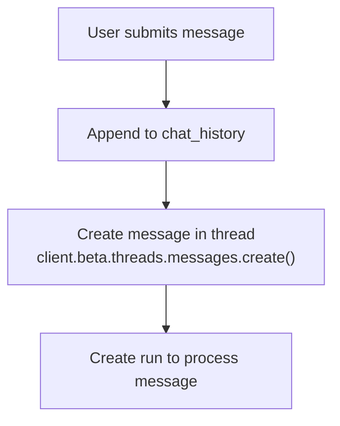
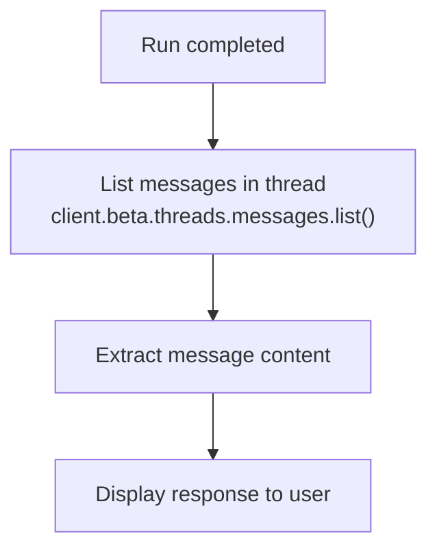
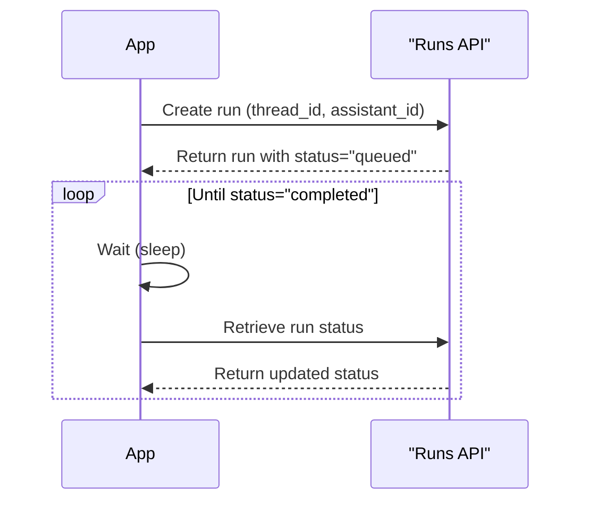
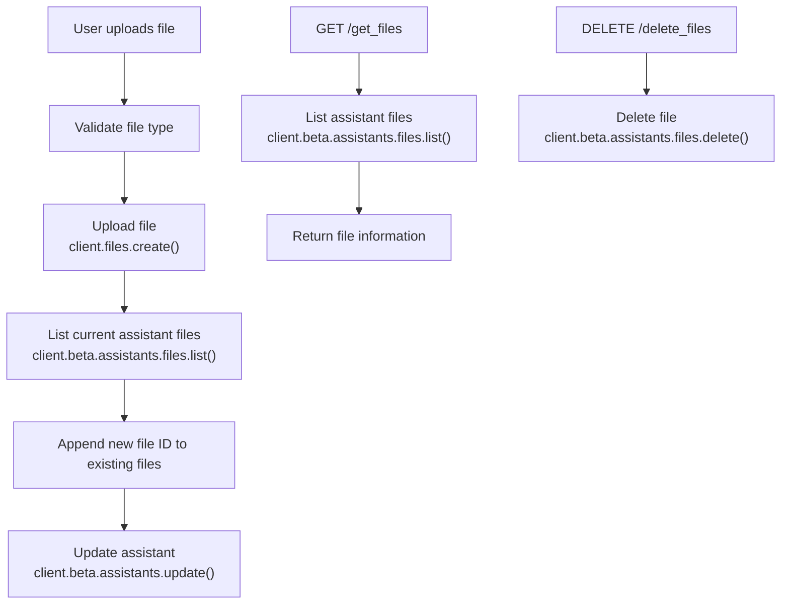
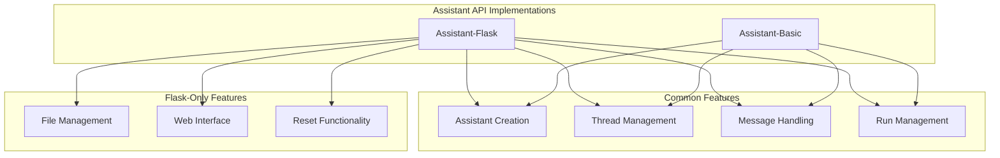

<!-- source: DeepWiki mcp.deepwiki.com · repo openai/openai-quickstart-python · page 4.1 Assistant API Implementation · fetched 2026-10-26 -->

# Assistant API Implementation

Relevant source files

The following files were used as context for generating this wiki page:

- [examples/assistant-basic/assistant.py](examples/assistant-basic/assistant.py)
- [examples/assistant-flask/app.py](examples/assistant-flask/app.py)
- [examples/chat-basic/app.py](examples/chat-basic/app.py)

## Purpose and Scope

This document provides a detailed explanation of how the OpenAI Assistant API is implemented in the quickstart repository. It covers the core components, interaction patterns, and key functions used to create and manage assistants, threads, messages, runs, and files through the API. For information about the Chat Completions API implementation, see [Chat Completions API Implementation](#4.2).

## Core Components of the Assistant API

The Assistant API implementation is built around five key components:

| Component | Purpose | Primary Operations |
|-----------|---------|-------------------|
| Assistant | An AI assistant with defined capabilities | Create, retrieve, update |
| Thread | Container for a conversation | Create, retrieve |
| Message | Individual messages within a thread | Create, list, retrieve |
| Run | Execution of an assistant on a thread | Create, retrieve, poll status |
| File | Documents provided to the assistant | Upload, list, delete |

Sources: [examples/assistant-flask/app.py:113-127](), [examples/assistant-flask/app.py:130-139](), [examples/assistant-basic/assistant.py:9-19]()

## Implementation Flow

The implementation follows a consistent pattern across both the web-based and CLI examples:

Sources: [examples/assistant-flask/app.py:147-182](), [examples/assistant-basic/assistant.py:57-75]()

## Assistant Creation and Management

Both implementations initialize an assistant either by creating a new one or retrieving an existing one by ID:

### Assistant-Flask Implementation

Sources: [examples/assistant-flask/app.py:113-127](), [examples/assistant-flask/app.py:197-201]()

The Flask application creates an assistant with:
- Instructions for behavior
- A name
- Model selection (gpt-3.5-turbo)
- Tools (code_interpreter)

The assistant is initialized during application startup via the `@app.before_request` decorator.

Sources: [examples/assistant-flask/app.py:113-127](), [examples/assistant-flask/app.py:197-201]()

## Thread Management

Threads serve as containers for conversations. Both implementations manage threads similarly:

Sources: [examples/assistant-flask/app.py:130-139](), [examples/assistant-flask/app.py:185-193](), [examples/assistant-basic/assistant.py:22-28]()

The Flask implementation also provides a reset functionality that clears the thread ID, creating a fresh thread for a new conversation.

## Message Handling

Messages represent user inputs and assistant responses within a thread:

### Sending Messages

Sources: [examples/assistant-flask/app.py:147-156](), [examples/assistant-basic/assistant.py:31-37]()

### Retrieving Messages

Sources: [examples/assistant-flask/app.py:166-178](), [examples/assistant-basic/assistant.py:47-49](), [examples/assistant-flask/app.py:66-79]()

## Run Management

Runs trigger the assistant to process the conversation in a thread:

Sources: [examples/assistant-flask/app.py:158-164](), [examples/assistant-basic/assistant.py:40-44](), [examples/assistant-basic/assistant.py:52-54]()

The run creation and monitoring pattern is similar in both implementations, using a polling approach to check run status until completion.

## File Integration

The Assistant-Flask implementation includes full file management capabilities:

Sources: [examples/assistant-flask/app.py:26-58](), [examples/assistant-flask/app.py:82-92](), [examples/assistant-flask/app.py:95-110]()

The file management includes:
- Uploading files and attaching them to the assistant
- Listing files associated with the assistant
- Deleting files from the assistant

## Implementation Comparison

The repository includes two distinct implementations of the Assistant API:

| Feature | Assistant-Flask | Assistant-Basic |
|---------|----------------|----------------|
| Interface | Web UI | Command Line |
| File Management | ✓ (Upload, list, delete) | ✗ |
| Thread Management | ✓ (Create, reset) | ✓ (Create only) |
| Message Handling | ✓ | ✓ |
| Run Management | ✓ | ✓ |
| Reset Functionality | ✓ | ✗ |
| Integration with UI | Interactive web interface | Simple text I/O |

Sources: [examples/assistant-flask/app.py](), [examples/assistant-basic/assistant.py]()

## Key API Endpoints in the Flask Implementation

The Assistant-Flask application exposes several endpoints to interact with the Assistant API:

| Endpoint | Method | Purpose |
|----------|--------|---------|
| `/chat` | POST | Send a message to the assistant |
| `/upload` | POST | Upload a file to associate with the assistant |
| `/get_files` | GET | List files associated with the assistant |
| `/delete_files` | POST | Delete a file from the assistant |
| `/reset` | POST | Reset the conversation thread |
| `/get_messages` | GET | Retrieve messages from the current thread |
| `/get_ids` | GET | Get the current assistant and thread IDs |

Sources: [examples/assistant-flask/app.py:26-58](), [examples/assistant-flask/app.py:61-63](), [examples/assistant-flask/app.py:66-79](), [examples/assistant-flask/app.py:82-92](), [examples/assistant-flask/app.py:95-110](), [examples/assistant-flask/app.py:147-182](), [examples/assistant-flask/app.py:185-193]()

This comprehensive implementation demonstrates the full capabilities of the OpenAI Assistant API, providing both a reference architecture and a working example for developers looking to integrate this technology into their own applications.

---

